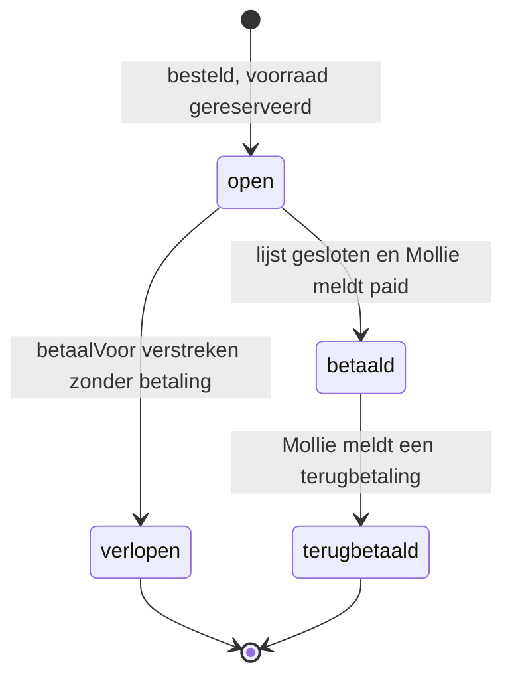

# Bouwspecificatie: Marcs wijnclub

19 november 2026 · hoort bij [pilotplan-marcs-wijnclub.md](../pilotplan-marcs-wijnclub.md)

Dit document werkt het pilotplan uit tot bouwniveau: sleutels in DynamoDB, de levensloop van een bestelling, de bieding, de API-aanroepen en de indeling van het project. Het plan zegt wat er komt; dit document zegt hoe het in elkaar zit.

## 1. Uitgangspunten

| Onderdeel | Keuze |
| --- | --- |
| Taal backend | Python, Lambda-runtime `python3.14` |
| Omgeving als code | AWS CDK in Python (`aws-cdk-lib` 2.255.0) |
| Web-app | React met Vite, in TypeScript. `npm run build` in `app/` schrijft statische bestanden naar `app/dist`; die staan op S3 achter CloudFront. Geen paden: één pagina |
| API | API Gateway HTTP API, bereikbaar via CloudFront onder `/api/*` |
| Inloggen | Cognito, eenmalige code per e-mail, alleen op uitnodiging |
| Betalen | Mollie, iDEAL |
| Omgevingen | `test` en `prod`, elk een eigen set stacks in hetzelfde AWS-account |

De API loopt via CloudFront, zodat web-app en API hetzelfde adres hebben. Daardoor is geen CORS-instelling nodig en hangen de stacks niet in een kring van elkaar af.

Bedragen staan overal als **hele centen** (`950` voor € 9,50), nooit als kommagetal. Tijden staan als UTC-tekst in de vorm `2026-11-19T15:40:00Z`, zodat ze als tekst te sorteren en te vergelijken zijn.

### Nagezocht op 19 november 2026

| Feit | Bron |
| --- | --- |
| Een code per e-mail vraagt het Essentials-plan van Cognito, de inlogstroom `USER_AUTH` en verzending via Amazon SES | [Cognito: authentication flows](https://docs.aws.amazon.com/cognito/latest/developerguide/amazon-cognito-user-pools-authentication-flow-methods.html), [Cognito: e-mail](https://docs.aws.amazon.com/cognito/latest/developerguide/user-pool-email.html) |
| Een beheerder kan gebruikers zonder wachtwoord aanmaken | Zelfde pagina |
| Een refresh-token kan maximaal 10 jaar geldig zijn | [Cognito: refresh tokens](https://docs.aws.amazon.com/cognito/latest/developerguide/amazon-cognito-user-pools-using-the-refresh-token.html) |
| `python3.14` is de nieuwste algemeen beschikbare Lambda-runtime, ondersteund tot 30 juni 2029 | [Lambda runtimes](https://docs.aws.amazon.com/lambda/latest/dg/lambda-runtimes.html) |
| Een open iDEAL-betaling verloopt bij Mollie na 15 minuten | [Mollie: handling payment status](https://docs.mollie.com/docs/handling-payment-status) |
| De melding van Mollie is een POST met alleen `id=tr_…`. De status moet je zelf ophalen. Er is geen handtekening om te controleren | [Mollie: webhooks](https://docs.mollie.com/reference/webhooks) |
| Mollie probeert een melding 10 keer, verspreid over 26 uur, en verwacht `200 OK` binnen 15 seconden | Zelfde pagina |
| Mollie roept de melding ook aan bij een terugbetaling | Zelfde pagina |
| Eindstatussen van een betaling: `paid`, `canceled`, `expired`, `failed` | [Mollie: handling payment status](https://docs.mollie.com/docs/handling-payment-status) |

## 2. Tabellen en sleutels

Zeven tabellen, alle met betalen naar gebruik en herstel naar een tijdstip. Zes komen uit het plan; `betalingen` is erbij gekomen om een melding van Mollie aan een bestelling te koppelen.

| Tabel | Sleutel | Extra index | Waarvoor de index dient |
| --- | --- | --- | --- |
| `leden` | `lidId` | geen | |
| `lijsten` | `lijstId` | `status-index`: `status` + `openTot` | De lijst die nu open staat |
| `wijnen` | `wijnId` | `lijst-index`: `lijstId` + `volgorde` | Wijnen van één lijst, in Marcs volgorde |
| | | `bieding-index`: `biedingStatus` + `eindtijd` | Biedingen die nu open staan. Alleen wijnen met een bieding hebben `biedingStatus` |
| `biedingen` | `wijnId` + `tijdstipLid` | `lid-index`: `lidId` + `tijdstip` | Biedingen van één lid |
| `bestellingen` | `bestellingId` | `lid-index`: `lidId` + `aangemaakt` | Mijn flessen |
| | | `lijst-index`: `lijstId` + `aangemaakt` | Marcs overzicht per lijst |
| `betalingen` | `mollieBetalingId` | geen | Melding van Mollie naar de bestellingen in die betaling |
| `oordelen` | `lidId` + `wijnId` | geen | |

`lidId` is de `sub` uit Cognito. Abonnementen op meldingen staan als lijst op het lid; bij 120 leden is alle leden doorlopen voor een melding geen probleem.

### Velden per tabel

- **`leden`**: `lidId`, `naam`, `email`, `telefoon`, `afhaalpuntVoorkeur`, `volwassenBevestigdOp`, `meldingen` (lijst van abonnementen), `uitgenodigdOp`. Er wordt geen adres bewaard: leden halen af.
- **`lijsten`**: `lijstId`, `titel`, `inleiding`, `status` (`concept`, `open`, `gesloten`), `openVan`, `openTot`, `geslotenOp`, `herinnerdOp`, `afhaalpunten` (lijst van `afhaalpuntId`, `naam`, `wanneer`, `toelichting`).
- **`wijnen`**: `wijnId`, `soort` (`vast` of `bieding`), `naam`, `producent`, `jaargang`, `streek`, `tekst`, `foto`. Optioneel: `druif`, `spijs`, `drinken`.
  - Bij `vast`: `lijstId`, `volgorde`, `letter`, `prijs`, `voorraad`. De letter is die uit Marcs WhatsApp-bericht: A voor de eerste wijn van de lijst.
  - Bij `bieding`: `biedingStatus` (`open`, `gesloten`), `startbod`, `minimaleVerhoging`, `minimaalVolgendBod`, `eindtijd`, `herkomst`, `spraakbericht`, `hoogsteBod`, `hoogsteBieder`, `aantalBiedingen`.
- **`biedingen`**: `wijnId`, `tijdstipLid` (`<tijdstip>#<lidId>`), `tijdstip`, `lidId`, `bedrag`.
- **`bestellingen`**: `bestellingId`, `lidId`, `soort` (`lijst`, `bieding`, `namens`), `lijstId`, `regels` (lijst van `wijnId`, `naam`, `aantal`, `prijs`), `totaal`, `status`, `voorraadGereserveerd`, `betaalVoor`, `levering` (een `afhaalpuntId` van de lijst, of `bewaren` bij een bieding), `afgeleverdOp`, `ingevoerdDoor`, `aangemaakt`, `betaaldOp`, `controleNodig`.
- **`betalingen`**: `mollieBetalingId`, `bestellingIds` (lijst), `lidId`, `lijstId`, `bedrag`, `aangemaakt`.
- **`oordelen`**: `lidId`, `wijnId`, `oordeel` (`lekker`, `niet`), `gewijzigd`.

`minimaalVolgendBod` bestaat omdat DynamoDB in een voorwaarde niet kan rekenen. Na elk bod wordt het `bod + minimaleVerhoging`.

## 3. Levensloop van een bestelling

Eén regel bepaalt alles: **een bestelling blijft open tot `betaalVoor`, en alleen een geslaagde betaling of het verstrijken van die tijd verandert de status.** Een mislukte of afgebroken betaling verandert niets; het lid kan binnen de termijn opnieuw betalen.

Bestellen van de lijst is bindend en kost niets. **Betalen kan pas als de lijst gesloten is**, in één betaling voor alle open bestellingen van het lid op die lijst. Zo blijft bestellen even snel als een WhatsApp-bericht, en kan een lid bijbestellen zonder twee keer te betalen.



| Soort bestelling | Ontstaat als | `betaalVoor` | Voorraad gereserveerd |
| --- | --- | --- | --- |
| `lijst` | Een lid bestelt van de lijst | 48 uur na `openTot` van de lijst | Ja |
| `namens` | Marc een bestelling voor een lid invoert | 48 uur na `openTot` van de lijst | Ja |
| `bieding` | Een bieding sluit met een winnaar | 48 uur na sluiten van de bieding | Nee, de fles is al van de lijst af |

Sluit Marc de lijst eerder dan `openTot`, dan kunnen leden eerder betalen; `betaalVoor` verandert niet.

### Bestellen van de lijst

1. De app controleert de regels: minstens één wijn, elk aantal tussen 1 en 24, elke wijn één keer, hoogstens 25 regels. `levering` moet een afhaalpunt van deze lijst zijn.
2. Eén transactie in DynamoDB doet alles of niets:
   - controleer dat de lijst `open` is en `openTot` niet voorbij;
   - verlaag per wijn de `voorraad`, op voorwaarde dat er genoeg is;
   - schrijf de bestelling met status `open`.
3. Mislukt de transactie op een wijn, dan krijgt het lid `409` terug met de wijnen die op zijn. Er is niets gereserveerd.
4. Het lid krijgt `201` terug. Er wordt nog niet betaald.
5. Bestelt het lid opnieuw van dezelfde lijst, dan ontstaat een tweede bestelling. Bestellingen worden nooit achteraf gewijzigd; ze komen samen in één betaling.
6. Het gekozen afhaalpunt wordt als voorkeur op het lid bewaard.

### De lijst sluiten

1. Een eenmalige taak in EventBridge Scheduler staat op `openTot`. Marc kan de lijst ook eerder sluiten.
2. De taak zet de status van de lijst op `gesloten`, op voorwaarde dat die nog `open` is, en schrijft `geslotenOp`.
3. Elk lid met een open bestelling op de lijst krijgt een melding met het bedrag en een link naar Mijn flessen.
4. Per lijst staat één taak klaar op 24 uur na het sluiten (herinnering aan wie nog niet betaald heeft) en één op `betaalVoor` (verlopen).

### Betalen

1. Het lid tikt op Betaal. De app verzamelt alle open bestellingen van het lid op die lijst, ook wat Marc namens hem invoerde, en telt de bedragen op.
2. De app controleert dat de lijst `gesloten` is. Bij een bestelling uit een bieding geldt die voorwaarde niet.
3. De app maakt één betaling aan bij Mollie, schrijft die met de `bestellingIds` in `betalingen` en stuurt het lid naar de betaalpagina. Een iDEAL-betaling verloopt bij Mollie na 15 minuten; daarna kan het lid een nieuwe starten.

### Melding van Mollie

1. De melding bevat alleen het nummer van de betaling. De app zoekt de bestelling op in `betalingen` en haalt de status op bij Mollie.
2. `paid`: alle bestellingen van die betaling gaan in één transactie van `open` naar `betaald`, op voorwaarde dat ze nog `open` zijn. Komt dezelfde melding nog eens, dan faalt die voorwaarde en gebeurt er niets.
3. `paid` terwijl de bestelling al `verlopen` is: de status blijft `verlopen`, `controleNodig` gaat aan en er gaat een alarm af. Marc levert alsnog of betaalt terug.
4. Een terugbetaling op een betaalde bestelling: de status wordt `terugbetaald`. De voorraad komt niet vanzelf terug; dat beslist Marc.
5. Elke andere status: geen wijziging.
6. De app antwoordt altijd `200`, ook als het nummer onbekend is. Een onbekend nummer wordt gelogd.

### Verlopen

De taak op `betaalVoor` loopt de bestellingen van de lijst na die nog `open` zijn, en vraagt per lid bij Mollie de status van de laatste betaling op.

- Nog bezig (`open`, `pending`): vijf minuten later opnieuw kijken.
- Betaald: verwerken als een melding.
- Anders: één transactie zet de status op `verlopen` en geeft de voorraad terug, op voorwaarde dat de status nog `open` is. Marc krijgt bericht, zodat hij de flessen niet meeneemt naar het afhaalpunt.

Bij een verlopen bestelling uit een bieding komt er geen voorraad terug. Marc krijgt bericht en beslist of de fles naar de volgende bieder gaat.

## 4. De bieding

### Een bod plaatsen

1. De app leest de wijn en controleert: `biedingStatus` is `open`, `eindtijd` is niet voorbij, het bod is minstens `minimaalVolgendBod`.
2. Valt het bod in de laatste twee minuten, dan wordt de nieuwe eindtijd het moment van bieden plus twee minuten.
3. Eén transactie schrijft het bod en werkt de wijn bij, op voorwaarde dat `minimaalVolgendBod` en `eindtijd` nog zijn zoals gelezen. Was iemand net eerder, dan faalt de transactie en krijgt het lid `409` met het nieuwe minimum.
4. De vorige hoogste bieder krijgt een melding dat hij overboden is.

Leden zien `hoogsteBod` en of hun eigen bod het hoogste is. Wie de hoogste bieder is, gaat nooit naar de web-app.

### Een bieding sluiten

1. Bij het starten van een bieding komt er een eenmalige taak op `eindtijd`.
2. De taak leest de wijn. Is de eindtijd verlengd, dan plant hij zichzelf opnieuw op de nieuwe eindtijd en stopt.
3. Anders zet hij `biedingStatus` op `gesloten`, op voorwaarde dat die nog `open` is.
4. Is er een hoogste bieder, dan maakt hij een bestelling van soort `bieding` met `betaalVoor` over 48 uur, en stuurt de winnaar een melding.

## 5. API-aanroepen

Alle paden beginnen met `/api`. Elke aanroep vraagt een geldig token van Cognito, behalve de melding van Mollie. Paden onder `/api/beheer` vragen daarnaast de groep `beheer`.

| Aanroep | Doet | Antwoord |
| --- | --- | --- |
| `GET /api/aanbod` | De open lijst met wijnen, en de open biedingen | `200` |
| `GET /api/wijnen/{wijnId}` | Eén wijn | `200`, `404` |
| `POST /api/bestellingen` | Bestellen van de lijst: `regels`, `levering` (een afhaalpunt). Er wordt nog niet betaald | `201`, of `409` met de wijnen die op zijn |
| `GET /api/bestellingen/{id}` | Status, na terugkomst van de betaalpagina | `200`, `404` |
| `POST /api/mijn/betalingen` | Eén betaling starten: met `lijstId` voor alle open bestellingen op een gesloten lijst, of met `bestellingId` voor een gewonnen bieding | `201` met `betaalUrl`, `409` als er niets te betalen is of de lijst nog open staat |
| `PUT /api/bestellingen/{id}/levering` | Een afhaalpunt, of bewaren bij een fles uit een bieding | `200` |
| `POST /api/wijnen/{wijnId}/biedingen` | Een bod: `bedrag` | `201`, of `409` met `minimaalVolgendBod` |
| `GET /api/mijn/flessen` | De bestellingen van de lopende lijst met bedrag en status, in bewaring, eerder gekocht, met oordelen | `200` |
| `PUT /api/mijn/oordelen/{wijnId}` | `lekker` of `niet` | `200` |
| `GET` en `PUT /api/mijn/profiel` | Naam, telefoon, afhaalpunt van voorkeur, bevestiging 18 jaar | `200` |
| `POST` en `DELETE /api/mijn/meldingen` | Abonnement op meldingen | `200` |
| `POST /api/beheer/herken` | Velden uit Marcs WhatsApp-bericht | `200` |
| `POST /api/beheer/uploads` | Tijdelijke uploadlink voor foto of spraakbericht | `200` |
| `POST` en `PUT /api/beheer/lijsten` | Lijst aanmaken met titel, inleiding, eindtijd en afhaalpunten; openen, sluiten | `200`, `201` |
| `POST /api/beheer/lijsten/{id}/herinnering` | Eén melding "nog beschikbaar" aan alle leden. Kan één keer per lijst | `200`, `409` |
| `GET /api/beheer/lijsten/{id}/paklijst` | Per afhaalpunt: wie, welke wijnen, betaald of niet | `200` |
| `POST` en `PUT /api/beheer/wijnen` | Wijn op de lijst zetten of bieding starten | `200`, `201` |
| `GET /api/beheer/bestellingen` | Overzicht per lijst | `200` |
| `POST /api/beheer/bestellingen` | Bestelling namens een lid: `lidId`, `regels`, `levering`. De web-app zet "C2 D2" om in regels | `201`, `409` |
| `PUT /api/beheer/bestellingen/{id}/afgeleverd` | Afvinken | `200` |
| `POST /api/beheer/leden` | Lid uitnodigen | `201` |
| `POST /api/webhooks/mollie` | Melding van Mollie, zonder token | altijd `200` |

Een lid ziet alleen zijn eigen bestellingen, biedingen en oordelen. De app neemt het `lidId` altijd uit het token en nooit uit de aanvraag.

Een fout heeft altijd dezelfde vorm, zonder interne details:

```json
{ "fout": "uitverkocht", "bericht": "Een van de wijnen is net op." }
```

Details staan in het logboek, zonder namen, adressen of bedragen per persoon.

**Uploads zijn een risico.** De uploadlink is alleen voor de groep `beheer`, geldt enkele minuten, staat alleen afbeeldingen en geluid toe en heeft een maximale grootte. Bestanden komen in een eigen map van de bucket en worden nooit uitgevoerd.

## 6. Inloggen en rechten

- De gebruikerspool staat op het Essentials-plan, met `EMAIL_OTP` als toegestane eerste factor en zelf aanmelden uit.
- Marc nodigt uit via `POST /api/beheer/leden`. Die maakt de gebruiker aan in Cognito zonder wachtwoord en een rij in `leden`.
- De web-app gebruikt de stroom `USER_AUTH`. Het refresh-token is een jaar geldig, zodat een lid op zijn telefoon ingelogd blijft.
- De groep `beheer` bevat alleen Marc en de bouwer. API Gateway controleert het token; de Lambda-functie controleert de groep.
- Inloggen wordt niet zelf gebouwd. Draait dit ooit binnen een organisatie met een eigen standaard voor klantlogin, dan vervangt die Cognito.

**Vooraf regelen:** een geverifieerd domein of adres in Amazon SES, en toegang buiten de proefomgeving van SES. In de proefomgeving kan SES alleen mailen naar adressen die je zelf hebt geverifieerd.

## 7. Projectindeling

```text
wine/
├── README.md
├── pilotplan-marcs-wijnclub.md      het plan
├── wijnclub-prototype.html          klikbaar prototype, de specificatie van de schermen
├── docs/bouwspecificatie.md         dit document
├── app/                             de web-app: React met Vite, gebouwd naar app/dist
├── functions/wijnclub/
│   ├── domein/                      regels zonder AWS: geld, bestelling, bieding
│   ├── handlers/                    één bestand per Lambda-functie
│   ├── opslag.py                    lezen en schrijven in DynamoDB
│   └── antwoord.py                  antwoorden en gegevens uit het token
├── infra/
│   ├── app.py                       de CDK-app
│   ├── cdk.json
│   └── wijnclub_infra/              vier stacks: data, inloggen, api, web
└── tests/
    ├── functions/                   tests voor de regels en de functies
    └── infra/                       tests voor de stacks
```

De regels in `domein/` gebruiken geen AWS en zijn daardoor los te testen. De functies daar bouwen de transacties op; de handlers voeren ze uit.

| Stack | Bevat |
| --- | --- |
| `Wijnclub-<omgeving>-Data` | De zeven tabellen |
| `Wijnclub-<omgeving>-Inloggen` | Gebruikerspool, groep `beheer`, client voor de web-app |
| `Wijnclub-<omgeving>-Api` | HTTP API en de Lambda-functies |
| `Wijnclub-<omgeving>-Web` | Bucket, CloudFront, uitrol van de web-app |

In `test` worden tabellen en bucket weggegooid als je de stack verwijdert. In `prod` blijven ze staan.

### Afhankelijkheden

Alle versies staan vast. De Lambda-functies gebruiken alleen `boto3`, dat in de runtime zit; er is dus geen Docker nodig om uit te rollen.

| Pakket | Versie | Waarvoor |
| --- | --- | --- |
| `aws-cdk-lib` | 2.255.0 | Omgeving als code |
| `constructs` | 10.6.0 | Hoort bij CDK |
| `aws-cdk` (npm, via `npx`) | 2.1149.0 | Het programma `cdk` |
| `react`, `react-dom` | 19.3.1 | Web-app |
| `vite` | 8.3.5 | Bouwen van de web-app |
| `@vitejs/plugin-react` | 6.2.1 | Bouwen van de web-app |
| `typescript` | 7.0.2 | Typecontrole van de web-app |
| `@types/react`, `@types/react-dom` | 19.3.0 | Typecontrole van de web-app |
| `lucide-react` | 1.68.0 | Iconen, dezelfde als in het ontwerp |
| `@fontsource/barlow-condensed` | 5.3.0 | Lettertype, vanaf het eigen domein in plaats van Google Fonts |
| `pytest` | 9.2.0 (8.4.2 op Python 3.9) | Tests |
| `boto3` | 1.44.6 (1.42.97 op Python 3.9) | Alleen lokaal, voor tests |

Van de web-app is steeds de nieuwste versie gekozen die minstens twee weken oud was. `npm audit` meldde bij het vastleggen geen kwetsbaarheden.

Komt er later een pakket bij dat niet in de runtime zit, zoals Powertools, dan gaat dat als Lambda-laag mee.

## 8. Wat de opzet bevat

| Onderdeel | Staat | Hoort bij |
| --- | --- | --- |
| Zeven tabellen met indexen | Gebouwd | Week 3 |
| Gebruikerspool met code per e-mail | Gebouwd | Week 3 |
| HTTP API met `GET /api/aanbod` | Gebouwd | Week 3 en 4 |
| Bucket, CloudFront, uitrol van `app/dist` | Gebouwd | Week 3 |
| Regels voor geld, bestelling en bieding, met tests | Gebouwd | Week 5 en 6 |
| Regels voor afhaalpunt, betalen na het sluiten en één betaling per lid per lijst, met tests | Gebouwd | Week 5 |
| Lijst sluiten met betaalverzoek, herinnering na 24 uur | Nog niet | Week 5 en 7 |
| Afhaalpunten in beheer, paklijst, herinnering "nog beschikbaar" | Nog niet | Week 4 en 7 |
| Overige API-aanroepen | Nog niet | Week 4 tot en met 7 |
| Koppeling met Mollie | Nog niet | Week 5 |
| Taken in EventBridge Scheduler | Nog niet | Week 5 en 6 |
| Meldingen | Nog niet | Week 7 |
| Web-app: opzet, gedeelde onderdelen, de schermen Aanbod en Wijn van de lijst met voorbeeldinhoud | Gebouwd | Week 4 |
| Web-app: inloggen, de overige schermen, koppeling met de API | Nog niet | Week 4 tot en met 7 |

## 9. Open punten

- **Gebruikers zonder wachtwoord.** De documentatie zegt dat een beheerder gebruikers zonder wachtwoord kan aanmaken. Of zo'n gebruiker direct met een code kan inloggen, zonder tussenstap, is niet letterlijk bevestigd. Test dit als eerste in week 3.
- **Eigen gegevens bij een Mollie-betaling.** Het ontwerp gebruikt de tabel `betalingen` en is niet afhankelijk van het veld `metadata` van Mollie, omdat de werking daarvan niet letterlijk is nagelezen.
- **Dubbele betaling voorkomen.** Of Mollie een sleutel ondersteunt om een dubbel aangemaakte betaling te voorkomen, is niet gevonden. Het ontwerp vangt dit op door per betaalpoging een rij in `betalingen` te schrijven.
- **Betalen na het sluiten.** Dit volgt hoe het nu in de WhatsApp-groep gaat, maar hoe leden nu betalen is niet bevestigd. Wil Marc vooraf betaald krijgen, dan komt de betaling terug in `POST /api/bestellingen` en wordt `betaalVoor` weer 20 minuten na het aanmaken.
- **Wie niet betaalt.** Na 48 uur verloopt de bestelling vanzelf. Of Marc dat wil, of liever zelf beslist per lid, moet hij aangeven.
- **Meldingen op de iPhone.** Werken alleen als de app op het beginscherm staat. De precieze eisen moeten in week 7 nagezocht worden.
- **Bedrock.** Welk model en of het in de gekozen regio beschikbaar is, wordt in week 4 gekozen.
- **Web-app.** Gekozen: React met Vite. Het ontwerp in pen.dev is de bron voor de schermen; het prototype blijft de bron voor het gedrag.
- **Lokale Python.** Op de machine waarop deze opzet is gemaakt staat Python 3.9, dat niet meer wordt ondersteund. De code en de tests werken ermee, maar pip installeert er oudere versies van pytest en boto3 op, met bekende kwetsbaarheden (pytest: PYSEC-2026-1845; urllib3 1.26, via boto3: meerdere). Die draaien alleen lokaal en komen niet in Lambda. Installeer Python 3.14: dan lopen de versies gelijk met Lambda en zijn de kwetsbaarheden weg. De tests zijn alleen op 3.9 gedraaid.
