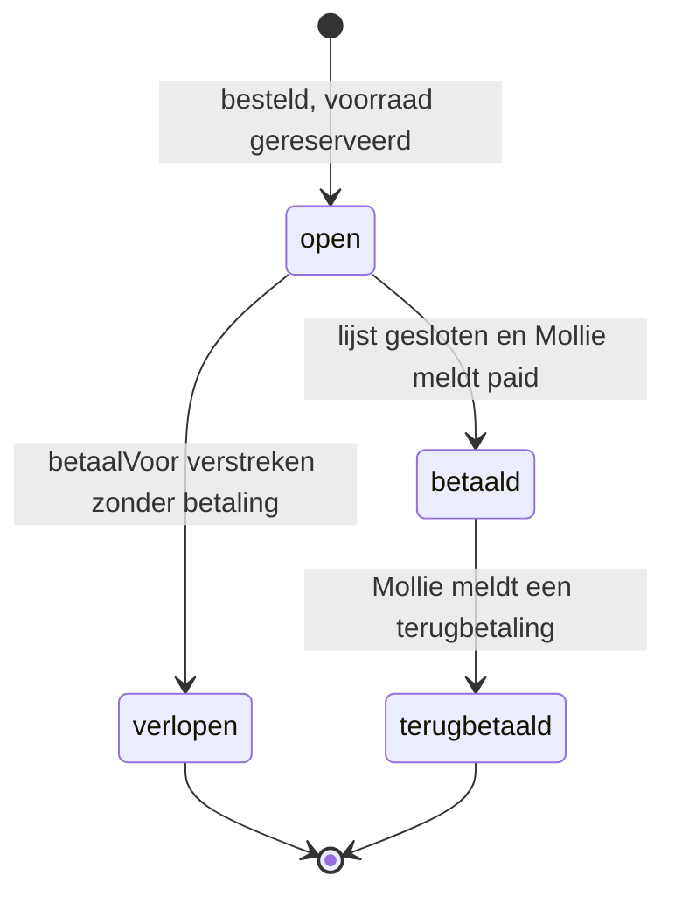

# Bouwspecificatie: Marcs wijnclub

19 november 2026 · hoort bij [pilotplan-marcs-wijnclub.md](../pilotplan-marcs-wijnclub.md)

Dit document werkt het pilotplan uit tot bouwniveau: sleutels in DynamoDB, de levensloop van een bestelling, de bieding, de API-aanroepen en de indeling van het project. Het plan zegt wat er komt; dit document zegt hoe het in elkaar zit.

## 1. Uitgangspunten

| Onderdeel | Keuze |
| --- | --- |
| Taal backend | Python, Lambda-runtime `python3.14` |
| Omgeving als code | AWS CDK in Python (`aws-cdk-lib` 2.255.0) |
| Web-app | React met Vite, in TypeScript. `npm run build` in `app/` schrijft statische bestanden naar `app/dist`; die staan op S3 achter CloudFront. Geen paden: één pagina |
| Apparaat | De telefoon eerst: vrijwel elk lid gebruikt de app op zijn telefoon. De eisen staan in hoofdstuk 10 |
| API | API Gateway HTTP API, bereikbaar via CloudFront onder `/api/*` |
| Inloggen | Cognito, eenmalige code per e-mail, alleen op uitnodiging |
| Betalen | Mollie, iDEAL |
| Omgevingen | `test` en `prod`, elk een eigen set stacks, samen in één privé-AWS-account dat ook andere eigen projecten bevat; alles van de wijnclub begint met `Wijnclub-` |

De API loopt via CloudFront, zodat web-app en API hetzelfde adres hebben. Daardoor is geen CORS-instelling nodig en hangen de stacks niet in een kring van elkaar af.

Bedragen staan overal als **hele centen** (`950` voor € 9,50), nooit als kommagetal. Tijden staan als UTC-tekst in de vorm `2026-11-19T15:40:00Z`, zodat ze als tekst te sorteren en te vergelijken zijn.

### Nagezocht op 19 november 2026

| Feit | Bron |
| --- | --- |
| Een code per e-mail vraagt het Essentials-plan van Cognito, de inlogstroom `USER_AUTH` en verzending via Amazon SES | [Cognito: authentication flows](https://docs.aws.amazon.com/cognito/latest/developerguide/amazon-cognito-user-pools-authentication-flow-methods.html), [Cognito: e-mail](https://docs.aws.amazon.com/cognito/latest/developerguide/user-pool-email.html) |
| Een beheerder kan gebruikers zonder wachtwoord aanmaken | Zelfde pagina |
| Een refresh-token kan maximaal 10 jaar geldig zijn | [Cognito: refresh tokens](https://docs.aws.amazon.com/cognito/latest/developerguide/amazon-cognito-user-pools-using-the-refresh-token.html) |
| `python3.14` is de nieuwste algemeen beschikbare Lambda-runtime, ondersteund tot 30 juni 2029 | [Lambda runtimes](https://docs.aws.amazon.com/lambda/latest/dg/lambda-runtimes.html) |
| Een open iDEAL-betaling verloopt bij Mollie na 15 minuten | [Mollie: handling payment status](https://docs.mollie.com/docs/handling-payment-status) |
| De melding van Mollie is een POST met alleen `id=tr_…`. De status moet je zelf ophalen. Er is geen handtekening om te controleren | [Mollie: webhooks](https://docs.mollie.com/reference/webhooks) |
| Mollie probeert een melding 10 keer, verspreid over 26 uur, en verwacht `200 OK` binnen 15 seconden | Zelfde pagina |
| Mollie roept de melding ook aan bij een terugbetaling | Zelfde pagina |
| Eindstatussen van een betaling: `paid`, `canceled`, `expired`, `failed` | [Mollie: handling payment status](https://docs.mollie.com/docs/handling-payment-status) |

## 2. Tabellen en sleutels

Tien tabellen, alle met betalen naar gebruik en herstel naar een tijdstip. `betalingen` is erbij gekomen om een melding van Mollie aan een bestelling te koppelen, en `weergaven`, `berichten` en `tikken` voor de tellingen in hoofdstuk 5. Zeven zijn gebouwd; `weergaven`, `berichten` en `tikken` nog niet.

| Tabel | Sleutel | Extra index | Waarvoor de index dient |
| --- | --- | --- | --- |
| `leden` | `lidId` | geen | |
| `lijsten` | `lijstId` | `status-index`: `status` + `openTot` | De lijst die nu open staat |
| `wijnen` | `wijnId` | `lijst-index`: `lijstId` + `volgorde` | Wijnen van één lijst, in Marcs volgorde |
| | | `bieding-index`: `biedingStatus` + `eindtijd` | Biedingen die nu open staan. Alleen wijnen met een bieding hebben `biedingStatus` |
| `biedingen` | `wijnId` + `tijdstipLid` | `lid-index`: `lidId` + `tijdstip` | Biedingen van één lid |
| `bestellingen` | `bestellingId` | `lid-index`: `lidId` + `aangemaakt` | Mijn flessen |
| | | `lijst-index`: `lijstId` + `aangemaakt` | Marcs overzicht per lijst |
| `betalingen` | `mollieBetalingId` | geen | Melding van Mollie naar de bestellingen in die betaling |
| `oordelen` | `lidId` + `wijnId` | geen | |
| `weergaven` | `wijnId` + `lidId` | geen | Per bieding tellen hoeveel leden hem openden |
| `berichten` | `berichtId` | geen | Per melding vastleggen wanneer hij verstuurd is. Bij enkele honderden berichten is alles doorlopen geen probleem |
| `tikken` | `berichtId` + `lidId` | geen | Per melding tellen hoeveel leden erop tikten |

`lidId` is de `sub` uit Cognito. Abonnementen op meldingen staan als lijst op het lid; bij 120 leden is alle leden doorlopen voor een melding geen probleem.

### Velden per tabel

- **`leden`**: `lidId`, `naam`, `email`, `telefoon`, `afhaalpuntVoorkeur`, `volwassenBevestigdOp`, `meldingen` (lijst van abonnementen), `uitgenodigdOp`. Er wordt geen adres bewaard: leden halen af.
- **`lijsten`**: `lijstId`, `titel`, `inleiding`, `status` (`concept`, `open`, `gesloten`), `openVan`, `openTot`, `geslotenOp`, `herinnerdOp`, `afhaalpunten` (lijst van `afhaalpuntId`, `naam`, `wanneer`, `toelichting`).
- **`wijnen`**: `wijnId`, `soort` (`vast` of `bieding`), `naam`, `producent`, `jaargang`, `streek`, `tekst`, `foto`. Optioneel: `druif`, `spijs`, `drinken`.
  - Bij `vast`: `lijstId`, `volgorde`, `letter`, `prijs`, `voorraad`. De letter is die uit Marcs WhatsApp-bericht: A voor de eerste wijn van de lijst.
  - Bij `bieding`: `biedingStatus` (`open`, `gesloten`), `startbod`, `minimaleVerhoging`, `minimaalVolgendBod`, `eindtijd`, `herkomst`, `spraakbericht`, `hoogsteBod`, `hoogsteBieder`, `aantalBiedingen`.
- **`biedingen`**: `wijnId`, `tijdstipLid` (`<tijdstip>#<lidId>`), `tijdstip`, `lidId`, `bedrag`, `verlengd` (waar als dit bod de eindtijd verschoof).
- **`bestellingen`**: `bestellingId`, `lidId`, `soort` (`lijst`, `bieding`, `namens`), `lijstId`, `regels` (lijst van `wijnId`, `naam`, `aantal`, `prijs`), `totaal`, `status`, `voorraadGereserveerd`, `betaalVoor`, `levering` (een `afhaalpuntId` van de lijst, of `bewaren` bij een bieding), `afgeleverdOp`, `ingevoerdDoor`, `aangemaakt`, `betaaldOp`, `mollieBetalingId` (de betaling waarmee de bestelling op betaald is gezet), `controleNodig`.
- **`betalingen`**: `mollieBetalingId`, `bestellingIds` (lijst), `lidId`, `lijstId`, `bedrag`, `aangemaakt`.
- **`oordelen`**: `lidId`, `wijnId`, `oordeel` (`lekker`, `niet`), `gewijzigd`.
- **`weergaven`**: `wijnId`, `lidId`, `eerst`, `vervaltOp`. Eén rij per lid per bieding, alleen voor de tellingen.
- **`berichten`**: `berichtId`, `soort` (`nieuwe-lijst`, `nog-beschikbaar`, `betaalverzoek`, `betaalherinnering`, `nieuwe-bieding`, `overboden`, `gewonnen`), `kanaal` (`melding`, `email`, `groep`), `lijstId` of `wijnId`, `verzondenOp`, `ontvangers` (aantal). Er staat geen `lidId` in, ook niet bij een bericht aan één lid.
- **`tikken`**: `berichtId`, `lidId`, `eerst`, `vervaltOp`. Eén rij per lid per bericht, alleen voor de tellingen.

`minimaalVolgendBod` bestaat omdat DynamoDB in een voorwaarde niet kan rekenen. Na elk bod wordt het `bod + minimaleVerhoging`.

**Nieuw door design-v3, nog niet in de tabellen.** Het ontwerp maakt van elke lijst "een avond bij Marc". Het prototype in `app/` gebruikt daarvoor deze velden; ze komen in de tabellen zodra de open beslissingen uit hoofdstuk 9 genomen zijn:

- **`lijsten`**: `fase` (`aangekondigd`, `live`, `gesloten`), `begin` (de begintijd, zoals 19:30), `veilingBegin` (wanneer de veiling opent als Marc niet eerder start), `aankondigingOp`. De `inleiding` is Marcs aankondiging.
- **`wijnen`**: `opTafelSinds` (wanneer Marc de wijn op tafel zette; leeg is "staat klaar" en dan is hij niet te koop) en `opSinds` (wanneer de laatste fles weg was). Bij een bieding: `geopend` (wanneer de zaal openging).
- **Nieuwe tabel `feed`**: sleutel `lijstId` + `tijdstip`, met `soort` (`wijn`, `bericht`, `gebeurtenis`), en `wijnId` of `tekst`. Een gebeurtenis zoals "een lid nam 2 × wijn H" bevat nooit een `lidId`.
- **`biedingen`**: een vast `bieder`-nummer per lid per veiling, voor "Bieder 7" in de biedlog. Het nummer is niet herleidbaar tot het lid; alleen de server kent de koppeling.

## 3. Levensloop van een bestelling

Eén regel bepaalt alles: **een bestelling blijft open tot `betaalVoor`, en alleen een geslaagde betaling of het verstrijken van die tijd verandert de status.** Een mislukte of afgebroken betaling verandert niets; het lid kan binnen de termijn opnieuw betalen.

Bestellen van de lijst is bindend en kost niets. **Betalen kan pas als de lijst gesloten is**, in één betaling voor alle open bestellingen van het lid op die lijst. Zo blijft bestellen even snel als een WhatsApp-bericht, en kan een lid bijbestellen zonder twee keer te betalen.



| Soort bestelling | Ontstaat als | `betaalVoor` | Voorraad gereserveerd |
| --- | --- | --- | --- |
| `lijst` | Een lid bestelt van de lijst | 48 uur na `openTot` van de lijst | Ja |
| `namens` | Marc een bestelling voor een lid invoert | 48 uur na `openTot` van de lijst | Ja |
| `bieding` | Een bieding sluit met een winnaar | 48 uur na sluiten van de bieding | Nee, de fles is al van de lijst af |

Sluit Marc de lijst eerder dan `openTot`, dan kunnen leden eerder betalen; `betaalVoor` verandert niet.

### Bestellen van de lijst

1. De app controleert de regels: minstens één wijn, elk aantal tussen 1 en 24, elke wijn één keer, hoogstens 25 regels. `levering` moet een afhaalpunt van deze lijst zijn.
2. De web-app stuurt per bestelpoging een `sleutel` mee: een willekeurige tekst van 8 tot 64 letters, cijfers en streepjes, zoals een UUID. Ze maakt die aan als het lid op Bestel tikt en stuurt dezelfde sleutel mee als ze de aanroep herhaalt. Het `bestellingId` wordt afgeleid van het lid en de sleutel, zodat dezelfde poging altijd hetzelfde nummer geeft.
3. Eén transactie in DynamoDB doet alles of niets:
   - controleer dat de lijst `open` is en `openTot` niet voorbij;
   - verlaag per wijn de `voorraad`, op voorwaarde dat er genoeg is;
   - schrijf de bestelling met status `open`, op voorwaarde dat het `bestellingId` nog niet bestaat.
4. Mislukt de transactie, dan kijkt de app in deze volgorde naar de reden:
   - **Een botsing in de tijd.** Bestellen twee leden op hetzelfde moment dezelfde wijn, dan breekt DynamoDB één van de twee af zonder dat er iets op is. De app probeert het hoogstens drie keer opnieuw, met een korte willekeurige pauze. Lukt het dan nog niet, dan krijgt het lid `503` en probeert de web-app het opnieuw met dezelfde sleutel.
   - **De bestelling stond er al.** Dezelfde poging kwam twee keer binnen, bijvoorbeeld na een time-out of een dubbele tik. Het lid krijgt de bestaande bestelling terug met `201`; er komt geen tweede.
   - **De lijst is dicht of een wijn is op.** Het lid krijgt `409` terug met de wijnen die op zijn. Er is niets gereserveerd.
5. Het lid krijgt `201` terug. Er wordt nog niet betaald.
6. Bestelt het lid opnieuw van dezelfde lijst, met een nieuwe sleutel, dan ontstaat een tweede bestelling. Bestellingen worden nooit achteraf gewijzigd; ze komen samen in één betaling.
7. Het gekozen afhaalpunt wordt als voorkeur op het lid bewaard.

### De lijst sluiten

1. Een eenmalige taak in EventBridge Scheduler staat op `openTot`. Marc kan de lijst ook eerder sluiten.
2. De taak zet de status van de lijst op `gesloten`, op voorwaarde dat die nog `open` is, en schrijft `geslotenOp`.
3. Elk lid met een open bestelling op de lijst krijgt een melding met het bedrag en een link naar Mijn flessen.
4. Per lijst staat één taak klaar op 24 uur na het sluiten (herinnering aan wie nog niet betaald heeft) en één op `betaalVoor` (verlopen).

### Betalen

1. Het lid tikt op Betaal. De app verzamelt alle open bestellingen van het lid op die lijst, ook wat Marc namens hem invoerde, en telt de bedragen op.
2. De app controleert dat de lijst `gesloten` is. Bij een bestelling uit een bieding geldt die voorwaarde niet.
3. De app maakt één betaling aan bij Mollie, schrijft die met de `bestellingIds` in `betalingen` en stuurt het lid naar de betaalpagina. Een iDEAL-betaling verloopt bij Mollie na 15 minuten; daarna kan het lid een nieuwe starten.

### Melding van Mollie

1. De melding bevat alleen het nummer van de betaling. De app zoekt de bestelling op in `betalingen` en haalt de status op bij Mollie.
2. `paid`: alle bestellingen van die betaling gaan in één transactie van `open` naar `betaald`, op voorwaarde dat ze nog `open` zijn. Het nummer van de betaling komt als `mollieBetalingId` op elke bestelling.
3. Faalt die voorwaarde, dan leest de app de bestellingen opnieuw en beslist per bestelling:
   - `betaald` met hetzelfde `mollieBetalingId`: dezelfde melding kwam nog eens. Er gebeurt niets.
   - `betaald` of `terugbetaald` met een ander `mollieBetalingId`: het lid heeft **dubbel betaald**, bijvoorbeeld door twee betalingen tegelijk te starten. De status blijft staan, `controleNodig` gaat aan en er gaat een alarm af. Marc betaalt de tweede betaling terug.
   - `verlopen`: de status blijft `verlopen`, `controleNodig` gaat aan en er gaat een alarm af. Marc levert alsnog of betaalt terug.
4. Een terugbetaling van de betaling waarmee de bestelling betaald is: de status wordt `terugbetaald`. De voorraad komt niet vanzelf terug; dat beslist Marc. Een terugbetaling van een andere betaling, de dubbele, verandert de status niet.
5. Elke andere status van de betaling: geen wijziging.
6. De app antwoordt altijd `200`, ook als het nummer onbekend is. Een onbekend nummer wordt gelogd.

### Verlopen

De taak op `betaalVoor` loopt de bestellingen van de lijst na die nog `open` zijn, en vraagt per lid bij Mollie de status op van alle betalingen die het lid voor die bestellingen startte. Alleen de laatste is niet genoeg: een eerdere betaling kan nog slagen nadat een latere is afgebroken.

- Eén ervan betaald: verwerken als een melding.
- Geen betaald, maar één nog bezig (`open`, `pending`, `authorized`): vijf minuten later opnieuw kijken.
- Anders: één transactie zet de status op `verlopen` en geeft de voorraad terug, op voorwaarde dat de status nog `open` is. Marc krijgt bericht, zodat hij de flessen niet meeneemt naar het afhaalpunt.

Bij een verlopen bestelling uit een bieding komt er geen voorraad terug. Marc krijgt bericht en beslist of de fles naar de volgende bieder gaat.

## 4. De bieding

### Een bod plaatsen

1. De app leest de wijn en controleert: `biedingStatus` is `open`, `eindtijd` is niet voorbij, het lid is niet zelf de hoogste bieder, en het bod is minstens `minimaalVolgendBod` en hoogstens drie keer dat bedrag. De bovengrens vangt een tikfout op: een bod is bindend en zet het minimum voor iedereen vast.
2. Valt het bod in de laatste twee minuten, dan wordt de nieuwe eindtijd het moment van bieden plus twee minuten.
3. Eén transactie schrijft het bod, met `verlengd` als stap 2 de eindtijd verschoof, en werkt de wijn bij, op voorwaarde dat `minimaalVolgendBod` en `eindtijd` nog zijn zoals gelezen. Faalt de transactie, dan leest de app de wijn opnieuw en beoordeelt het bod nog eens, hoogstens drie keer. Was iemand net eerder, dan krijgt het lid `409` met het nieuwe minimum. Botsten twee biedingen alleen in de tijd, dan gaat het bod bij de volgende poging gewoon door.
4. De vorige hoogste bieder krijgt een melding dat hij overboden is.

Leden zien `hoogsteBod` en of hun eigen bod het hoogste is. Wie de hoogste bieder is, gaat nooit naar de web-app.

### Een bieding sluiten

1. Bij het starten van een bieding komt er een eenmalige taak op `eindtijd`.
2. De taak leest de wijn. Is de eindtijd verlengd, dan plant hij zichzelf opnieuw op de nieuwe eindtijd en stopt.
3. Anders zet hij `biedingStatus` op `gesloten`, op voorwaarde dat die nog `open` is en dat `eindtijd` en `minimaalVolgendBod` nog zijn zoals gelezen. Is er een hoogste bieder, dan schrijft dezelfde transactie een bestelling van soort `bieding` met `betaalVoor` over 48 uur. Zo is er nooit een gesloten bieding met een winnaar zonder bestelling.
4. Daarna krijgt de winnaar een melding.

## 5. API-aanroepen

Alle paden beginnen met `/api`. Elke aanroep vraagt een geldig token van Cognito, behalve de melding van Mollie. Paden onder `/api/beheer` vragen daarnaast de groep `beheer`.

| Aanroep | Doet | Antwoord |
| --- | --- | --- |
| `GET /api/aanbod` | De open lijst met wijnen, en de open biedingen | `200` |
| `GET /api/wijnen/{wijnId}` | Eén wijn. Legt vast dat het lid een bieding opende, zie Tellingen voor de roadmap | `200`, `404` |
| `POST /api/bestellingen` | Bestellen van de lijst: `regels`, `levering` (een afhaalpunt), `sleutel` (per bestelpoging). Er wordt nog niet betaald. Dezelfde sleutel nog eens geeft dezelfde bestelling terug | `201`, `409` met de wijnen die op zijn, of `503` bij aanhoudende drukte |
| `GET /api/bestellingen/{id}` | Status, na terugkomst van de betaalpagina | `200`, `404` |
| `POST /api/mijn/betalingen` | Eén betaling starten: met `lijstId` voor alle open bestellingen op een gesloten lijst, of met `bestellingId` voor een gewonnen bieding | `201` met `betaalUrl`, `409` als er niets te betalen is of de lijst nog open staat |
| `PUT /api/bestellingen/{id}/levering` | Een afhaalpunt, of bewaren bij een fles uit een bieding | `200` |
| `POST /api/wijnen/{wijnId}/biedingen` | Een bod: `bedrag` | `201`, of `409` met `minimaalVolgendBod` en het hoogste toegestane bod. De fout zegt waarom: `bod_te_laag`, `bod_te_hoog`, `al_hoogste` of `bieding_gesloten` |
| `GET /api/mijn/flessen` | De bestellingen van de lopende lijst met bedrag en status, in bewaring, eerder gekocht, met oordelen | `200` |
| `PUT /api/mijn/oordelen/{wijnId}` | `lekker` of `niet` | `200` |
| `GET` en `PUT /api/mijn/profiel` | Naam, telefoon, afhaalpunt van voorkeur, bevestiging 18 jaar | `200` |
| `POST` en `DELETE /api/mijn/meldingen` | Abonnement op meldingen | `200` |
| `POST /api/mijn/tikken` | Een tik op een melding: `berichtId`. Telt één keer per lid, zie Tellingen voor de roadmap | altijd `200` |
| `POST /api/beheer/herken` | Velden uit Marcs WhatsApp-bericht: `naam`, `producent`, `jaargang`, `aantal`, `prijs` in centen, `tekst` en `ontbreekt`. Zie "Een bericht herkennen" | `200`, `400` |
| `POST /api/beheer/uploads` | Tijdelijke uploadlink voor foto of spraakbericht | `200` |
| `POST` en `PUT /api/beheer/lijsten` | Lijst aanmaken met titel, inleiding, eindtijd en afhaalpunten; openen, sluiten | `200`, `201` |
| `POST /api/beheer/lijsten/{id}/herinnering` | Eén melding "nog beschikbaar" aan alle leden. Kan één keer per lijst | `200`, `409` |
| `GET /api/beheer/lijsten/{id}/paklijst` | Per afhaalpunt: wie, welke wijnen, betaald of niet | `200` |
| `POST` en `PUT /api/beheer/wijnen` | Wijn op de lijst zetten of bieding starten | `200`, `201` |
| `GET /api/beheer/bestellingen` | Overzicht per lijst | `200` |
| `POST /api/beheer/bestellingen` | Bestelling namens een lid: `lidId`, `regels`, `levering`. De web-app zet "C2 D2" om in regels | `201`, `409` |
| `PUT /api/beheer/bestellingen/{id}/afgeleverd` | Afvinken | `200` |
| `POST /api/beheer/leden` | Lid uitnodigen | `201` |
| `POST /api/beheer/berichten` | Vastleggen dat Marc iets in de WhatsApp-groep deelt: `soort`, `lijstId` of `wijnId`. Geeft de link met het `berichtId` terug | `201` |
| `GET /api/beheer/tellingen` | De tellingen voor de roadmap, alleen aantallen | `200` |
| `POST /api/webhooks/mollie` | Melding van Mollie, zonder token | altijd `200` |

Een lid ziet alleen zijn eigen bestellingen, biedingen en oordelen. De app neemt het `lidId` altijd uit het token en nooit uit de aanvraag.

Een fout heeft altijd dezelfde vorm, zonder interne details:

```json
{ "fout": "uitverkocht", "bericht": "Een van de wijnen is net op." }
```

Details staan in het logboek, zonder namen, adressen of bedragen per persoon.

**Een bericht herkennen.** Een taalmodel in Bedrock leest het bericht. De regels staan in `domein/herkennen.py`; de handler roept alleen het model aan.

- Het bericht is hoogstens 2000 tekens, anders `400` zonder aanroep van het model. Het gaat tussen `<bericht>` en `</bericht>` naar het model, als tekst om te lezen en nooit als opdracht.
- Het model geeft JSON terug. De prijs komt terug zoals Marc hem schreef, zoals `10,5`. De app rekent hem om naar centen, niet het model.
- Alleen wat in het bericht staat, wordt overgenomen. Naam en producent staan er woord voor woord in. Elk woord van de tekst staat in het bericht, dus geen verzonnen smaken. Jaargang, aantal en prijs staan er als los getal in: 18 telt niet als het alleen in 2018 voorkomt.
- Daarnaast gelden grenzen: jaargang 1900 tot 2100, aantal 1 tot 999, prijs boven nul en hoogstens € 1000.
- Klopt een veld niet, of is het antwoord geen leesbare JSON, dan blijft dat veld leeg en staat het in `ontbreekt`. Marc vult het dan zelf in. Een fout van het model zelf geeft de algemene fout; Marc kan dan alles zelf invullen.
- De letter wordt niet herkend: de app geeft de volgende letter van de lijst.
- Het bericht en het antwoord komen niet in het logboek, alleen of het lukte en welke velden ontbraken.

**Uploads zijn een risico.** De uploadlink is alleen voor de groep `beheer`, geldt enkele minuten, staat alleen afbeeldingen en geluid toe en heeft een maximale grootte. Bestanden komen in een eigen map van de bucket en worden nooit uitgevoerd.

### Tellingen voor de roadmap

De pilot legt drie tellingen vast, zodat na acht weken te kiezen is tussen de onderwerpen op de roadmap van het plan. Er komt geen scherm bij: de bouwer vraagt ze op met `GET /api/beheer/tellingen` voor de evaluatie.

| Telling | Beantwoordt | Komt uit | Nieuw |
| --- | --- | --- | --- |
| Leden die op één, twee, of drie en meer lijsten bestelden | Komen leden terug | `bestellingen`, via `lijst-index` | Niets |
| Per bieding: leden die keken, leden die boden, en biedingen die de eindtijd verlengden | Is er vraag naar volgen en een maximaal bod | `weergaven`, en `biedingen` met `verlengd` | Tabel `weergaven` en veld `verlengd` |
| Per melding: wanneer hij verstuurd is, hoeveel leden erop tikten, en hoeveel er binnen 24 uur bestelden of boden | Welk moment werkt, voor de campagnes op de roadmap | `berichten`, `tikken`, `bestellingen` en `biedingen` | Tabellen `berichten` en `tikken` |

**Een weergave vastleggen.** `GET /api/wijnen/{wijnId}` schrijft één rij in `weergaven` als de wijn een bieding is die open staat.

- De rij wordt alleen geschreven als hij nog niet bestaat. Tien keer openen telt als één lid.
- Het is een eigen tabel en geen veld op de wijn. Een schrijfactie op de wijn tijdens een bod of een bestelling kan die transactie laten mislukken, en een telling mag de bieding nooit raken.
- Mislukt het schrijven, dan staat dat in het logboek en krijgt het lid gewoon de wijn te zien.
- Een aanroep uit de groep `beheer` telt niet mee.
- Het scherm Bijzondere fles roept `GET /api/wijnen/{wijnId}` altijd aan bij het openen, ook als de gegevens al uit `GET /api/aanbod` bekend zijn.

**Terugkomende bestellers.** Een lid telt voor een lijst mee als het daar minstens één bestelling van soort `lijst` of `namens` heeft die niet `verlopen` is. De telling loopt over alle gesloten lijsten. De regel staat in `domein/`, met tests.

**Een tik op een melding vastleggen.** Elke melding die de app verstuurt, krijgt een rij in `berichten` en een link met het `berichtId`, zoals `/?b=<berichtId>`.

- De functie die een melding verstuurt, schrijft eerst de rij in `berichten` met `verzondenOp` en het aantal ontvangers, en zet het `berichtId` in de link.
- Opent een lid de app via die link, dan stuurt de web-app na het inloggen `POST /api/mijn/tikken` en haalt ze het `berichtId` uit het adres.
- De rij in `tikken` wordt alleen geschreven als hij nog niet bestaat. Tien keer tikken telt als één lid.
- Een onbekend `berichtId` geeft ook `200`, zodat de aanroep niet verraadt welke berichten bestaan. Mislukt het schrijven, dan staat dat in het logboek en merkt het lid er niets van.
- Deelt Marc de link of het overzicht "nog beschikbaar" in de WhatsApp-groep, dan vraagt de web-app eerst `POST /api/beheer/berichten` aan en zet ze de link met het `berichtId` in de tekst. Het moment van delen geldt als `verzondenOp`.
- Wie na een bericht bestelde of bood, wordt niet opgeslagen. De telling loopt over de bestellingen en biedingen op die lijst of wijn binnen 24 uur na `verzondenOp`.

**Wat `GET /api/beheer/tellingen` teruggeeft.** Alleen aantallen: per bieding, per lijst en per bericht. Er gaat geen `lidId` en geen naam in het antwoord, en ook niet in het logboek.

**Privacy.** `weergaven` legt vast welk lid welke bieding opende, en `tikken` welk lid op welke melding tikte. Dat is een persoonsgegeven en hoort in de privacyverklaring. `vervaltOp` staat op 180 dagen na `eerst`, waarna DynamoDB de rij verwijdert. Dat veld is een getal in seconden sinds 1970, omdat DynamoDB dat vraagt; het is de enige tijd die niet als UTC-tekst staat.

## 6. Inloggen en rechten

- De gebruikerspool staat op het Essentials-plan, met `EMAIL_OTP` als toegestane eerste factor en zelf aanmelden uit.
- Marc nodigt uit via `POST /api/beheer/leden`. Die maakt de gebruiker aan in Cognito zonder wachtwoord en een rij in `leden`.
- De web-app gebruikt de stroom `USER_AUTH`. Het refresh-token is een jaar geldig, zodat een lid op zijn telefoon ingelogd blijft.
- De groep `beheer` bevat alleen Marc en de bouwer. API Gateway controleert het token; de Lambda-functie controleert de groep.
- Inloggen wordt niet zelf gebouwd. Draait dit ooit binnen een organisatie met een eigen standaard voor klantlogin, dan vervangt die Cognito.

**Vooraf regelen:** een geverifieerd domein of adres in Amazon SES, en toegang buiten de proefomgeving van SES. In de proefomgeving kan SES alleen mailen naar adressen die je zelf hebt geverifieerd. Voorlopig is de afzender één los geverifieerd adres en draait de app op het adres van CloudFront; het eigen domein is onderwerp 13 op de roadmap van het plan.

## 7. Projectindeling

```text
wine/
├── README.md
├── pilotplan-marcs-wijnclub.md      het plan
├── wijnclub-prototype.html          klikbaar prototype, de specificatie van de schermen
├── docs/bouwspecificatie.md         dit document
├── app/                             de web-app: React met Vite, gebouwd naar app/dist
├── functions/wijnclub/
│   ├── domein/                      regels zonder AWS: geld, bestelling, bieding
│   ├── handlers/                    één bestand per Lambda-functie
│   ├── opslag.py                    lezen en schrijven in DynamoDB
│   └── antwoord.py                  antwoorden en gegevens uit het token
├── infra/
│   ├── app.py                       de CDK-app
│   ├── cdk.json
│   └── wijnclub_infra/              vier stacks: data, inloggen, api, web
└── tests/
    ├── functions/                   tests voor de regels en de functies
    └── infra/                       tests voor de stacks
```

De regels in `domein/` gebruiken geen AWS en zijn daardoor los te testen. De functies daar bouwen de transacties op; de handlers voeren ze uit.

| Stack | Bevat |
| --- | --- |
| `Wijnclub-<omgeving>-Data` | De tabellen uit hoofdstuk 2 |
| `Wijnclub-<omgeving>-Inloggen` | Gebruikerspool, groep `beheer`, client voor de web-app |
| `Wijnclub-<omgeving>-Api` | HTTP API en de Lambda-functies |
| `Wijnclub-<omgeving>-Web` | Bucket, CloudFront, uitrol van de web-app |

In `test` worden tabellen en bucket weggegooid als je de stack verwijdert. In `prod` blijven ze staan.

### Afhankelijkheden

Alle versies staan vast. De Lambda-functies gebruiken alleen `boto3`, dat in de runtime zit; er is dus geen Docker nodig om uit te rollen.

| Pakket | Versie | Waarvoor |
| --- | --- | --- |
| `aws-cdk-lib` | 2.255.0 | Omgeving als code |
| `constructs` | 10.6.0 | Hoort bij CDK |
| `aws-cdk` (npm, via `npx`) | 2.1149.0 | Het programma `cdk` |
| `react`, `react-dom` | 19.3.1 | Web-app |
| `vite` | 8.3.5 | Bouwen van de web-app |
| `@vitejs/plugin-react` | 6.2.1 | Bouwen van de web-app |
| `typescript` | 7.0.2 | Typecontrole van de web-app |
| `@types/react`, `@types/react-dom` | 19.3.0 | Typecontrole van de web-app |
| `lucide-react` | 1.68.0 | Iconen, dezelfde als in het ontwerp |
| `@fontsource/barlow-condensed` | 5.3.0 | Lettertype, vanaf het eigen domein in plaats van Google Fonts |
| `pytest` | 9.2.0 (8.4.2 op Python 3.9) | Tests |
| `boto3` | 1.44.6 (1.42.97 op Python 3.9) | Alleen lokaal, voor tests |

Van de web-app is steeds de nieuwste versie gekozen die minstens twee weken oud was. `npm audit` meldde bij het vastleggen geen kwetsbaarheden.

Komt er later een pakket bij dat niet in de runtime zit, zoals Powertools, dan gaat dat als Lambda-laag mee.

## 8. Wat de opzet bevat

| Onderdeel | Staat | Hoort bij |
| --- | --- | --- |
| Zeven tabellen met indexen | Gebouwd | Week 3 |
| Gebruikerspool met code per e-mail | Gebouwd | Week 3 |
| HTTP API met `GET /api/aanbod` | Gebouwd | Week 3 en 4 |
| Bucket, CloudFront, uitrol van `app/dist` | Gebouwd | Week 3 |
| Regels voor geld, bestelling en bieding, met tests | Gebouwd | Week 5 en 6 |
| Regels voor afhaalpunt, betalen na het sluiten en één betaling per lid per lijst, met tests | Gebouwd | Week 5 |
| Regels na de review van 19 november: dubbele betaling herkennen, alle betalingen meewegen op de termijn, een herhaalde bestelpoging herkennen, een botsing in de tijd onderscheiden van uitverkocht, bovengrens op een bod, niet jezelf overbieden, bieding sluiten en bestelling schrijven in één transactie. Met tests; de handlers die ze uitvoeren zijn er nog niet | Gebouwd | Week 5 en 6 |
| Regels voor het herkennen van een bericht (`domein/herkennen.py`): vraag aan het model en controle van het antwoord, met tests op een nagebootst model. De handler, de koppeling met Bedrock en de test met twintig echte berichten zijn er nog niet | Gebouwd | Week 4 |
| Lijst sluiten met betaalverzoek, herinnering na 24 uur | Nog niet | Week 5 en 7 |
| Afhaalpunten in beheer, paklijst, herinnering "nog beschikbaar" | Nog niet | Week 4 en 7 |
| Overige API-aanroepen | Nog niet | Week 4 tot en met 7 |
| Koppeling met Mollie | Nog niet | Week 5 |
| Taken in EventBridge Scheduler | Nog niet | Week 5 en 6 |
| Meldingen | Nog niet | Week 7 |
| Tellingen voor de roadmap: tabel `weergaven`, veld `verlengd`, `GET /api/beheer/tellingen` | Nog niet | Week 6 en 7 |
| Meting per melding: tabellen `berichten` en `tikken`, `POST /api/mijn/tikken`, `POST /api/beheer/berichten` | Nog niet | Week 7 |
| Web-app: klikbaar prototype van alle schermen uit `design-v3` (eerste login, aankondiging, de avond als live feed, wijn, bon, bijzondere fles, de veiling met biedlog, biedpaneel, eenmaal andermaal, hamerslag met terugblik, na de betaling, mijn flessen, Marc, beheer: wijn klaarzetten, de avond presenteren, bestellingen, namens een lid, toestanden) met voorbeeldinhoud en proefacties. Alles staat in de browser (`app/src/staat.tsx`); er gaat niets naar de API en "live" is nagebootst in de browser | Gebouwd | Week 4 |
| Web-app: echt inloggen via Cognito, koppeling met de API, betalen via Mollie, foto's uploaden, spraakbericht | Nog niet | Week 4 tot en met 7 |
| Web-app: eisen voor de telefoon uit hoofdstuk 10. Het prototype voldoet aan M1, M2, M4 en M6 en deels aan acht andere; de stand per eis staat in dat hoofdstuk | Deels | Week 4 tot en met 7 |
| Web-app: manifest en een voorlopig icoon voor het beginscherm (`app/public/manifest.webmanifest`, `app/public/iconen/`). Geen service worker | Gebouwd | Week 4 |
| Browsertests op telefoonformaat tegen het prototype: `tests/web`, Playwright in pytest, op 375 × 667 en 320 × 568 px, en een eigen stap in de pipeline (`controles.yml`, job `telefoon`). Ze meten M1, M2, M4, M5, M6, M9 en M10 | Gebouwd | Week 4 |
| End-to-end-tests tegen de teststack en de handtest op echte telefoons (M14) | Nog niet | Week 4 tot en met 7 |

## 9. Open punten

- **Gebruikers zonder wachtwoord.** De documentatie zegt dat een beheerder gebruikers zonder wachtwoord kan aanmaken. Of zo'n gebruiker direct met een code kan inloggen, zonder tussenstap, is niet letterlijk bevestigd. Test dit als eerste in week 3.
- **Eigen gegevens bij een Mollie-betaling.** Het ontwerp gebruikt de tabel `betalingen` en is niet afhankelijk van het veld `metadata` van Mollie, omdat de werking daarvan niet letterlijk is nagelezen.
- **Dubbele betaling voorkomen.** Of Mollie een sleutel ondersteunt om een dubbel aangemaakte betaling te voorkomen, is niet gevonden. Het ontwerp vangt dit op door per betaalpoging een rij in `betalingen` te schrijven.
- **Betalen na het sluiten.** Dit volgt hoe het nu in de WhatsApp-groep gaat, maar hoe leden nu betalen is niet bevestigd. Wil Marc vooraf betaald krijgen, dan komt de betaling terug in `POST /api/bestellingen` en wordt `betaalVoor` weer 20 minuten na het aanmaken.
- **Bovengrens op een bod.** Een bod mag hoogstens drie keer het minimum zijn. De factor drie is een keuze van de bouwer na de review, geen wens van Marc. Hij staat op één plek in `domein/bieding.py` en in `app/src/staat.tsx`. Vraag Marc of dit past bij hoe er nu geboden wordt.
- **Jezelf overbieden.** De hoogste bieder kan niet opnieuw bieden tot hij overboden is. Komt er later een maximaal bod waarbij de app namens het lid meebiedt (roadmap), dan moet deze regel opnieuw bekeken worden.
- **Een bestelling annuleren.** Bestellen is bindend en een bestelling wordt nooit gewijzigd. Vergist een lid zich, dan blijft de voorraad vast tot 48 uur na het sluiten van de lijst, en ook Marc kan dat niet terugdraaien. Vraag Marc of hij in beheer een open bestelling wil kunnen annuleren, met de voorraad terug. Dat is dan een nieuwe status `geannuleerd` en een aanroep onder `/api/beheer`.
- **Wie niet betaalt.** Na 48 uur verloopt de bestelling vanzelf. Of Marc dat wil, of liever zelf beslist per lid, moet hij aangeven.
- **Meldingen op de iPhone.** Werken alleen als de app op het beginscherm staat. De precieze eisen moeten in week 7 nagezocht worden.
- **Bedrock.** Welk model en of het in de gekozen regio beschikbaar is, wordt in week 4 gekozen.
- **Rijen automatisch verwijderen.** `weergaven` en `tikken` gaan ervan uit dat DynamoDB een rij verwijdert op het tijdstip in `vervaltOp`. Dat is uit het hoofd opgeschreven en niet nagelezen. Zoek bij het bouwen in week 6 op hoe het werkt en hoe snel na het tijdstip de rij echt weg is.
- **Grondslag voor de tellingen.** Of het vastleggen van welk lid welke bieding opende of op welke melding tikte onder het gerechtvaardigd belang van Marc valt, of toestemming vraagt, hoort bij de juridische check.
- **Web-app.** Gekozen: React met Vite. Het ontwerp in pen.dev is de bron voor de schermen; het prototype blijft de bron voor het gedrag.
- **Ontwerp en plan wijken af.** Waar `design-v3` en het plan verschillen in functie en regels, volgt het prototype het plan, zoals `design-v3/DESIGN.md` voorschrijft. Op de bon is de hoofdknop "Bestel" in plaats van "Betaal met iDEAL": betalen volgt als de avond sluit, op de terugblik en onder Flessen. Je kiest een afhaalpunt in plaats van BRENG of HAAL, en na een gewonnen veiling bewaren of een afhaalpunt. "Laat hem brengen" heet "Zet hem klaar". De voortgang onder Flessen heeft drie stappen (besteld, betaald, afgehaald), omdat het datamodel geen "ingepakt" kent. Het ontwerp moet hierop worden aangepast, of het plan als Marc anders kiest.
- **Open beslissingen uit design-v3.** Het ontwerp wijkt op vijf punten bewust af van het plan en vraagt die met een instelling te bouwen. In het prototype: (1) *Rust*: live-stip, NET OP TAFEL en de klok in de laatste twee minuten staan aan en zijn samen uit te zetten in de voorbeeldbalk; (2) *Wie bood*: bijnamen als "Bieder 7" staan aan en zijn uit te zetten, dan toont de biedlog alleen bedragen en tijden. Nog een vraag voor de jurist; (3) *Live*: zie hieronder; (4) *Rol van Marc*: hij zet tijdens de avond wijnen op tafel en stuurt berichten (scherm 15). Een nieuwe wijn komt daarom eerst klaar te staan en is pas te koop als hij op tafel ligt. Zonder Marc op de avond zou een wijn op de begintijd vanzelf op tafel moeten komen; dat is nog niet gebouwd; (5) *Lijst sluiten*: op de eindtijd, of eerder met SLUIT DE AVOND. In het prototype sluit de avond alleen met de knop; op de eindtijd sluiten volgt met de API. De veiling opent wel vanzelf op de begintijd en de hamer valt vanzelf op de eindtijd.
- **Live bijwerken.** Design-v3 vraagt nieuwe wijnen, berichten en voorraad binnen 2 seconden en de stand van de veiling binnen 1 seconde. Het plan heeft dat nog niet. Voorstel van het ontwerp: een WebSocket API in API Gateway met Lambda, gevoed door DynamoDB Streams, of voor de pilot pollen elke 3 seconden zolang het scherm zichtbaar is. Het bod zelf blijft een gewone aanroep met de voorwaardelijke schrijfactie. Naar schatting een week extra bouwtijd. Aidan kiest; tot dan bootst het prototype het na in de browser.
- **Marcs portret en foto's.** Het ontwerp toont Marcs portret als avatar bij elk bericht en een sfeerfoto van zijn site op de aankondiging. Het prototype gebruikt zijn portret van marckookt.com (`app/public/marc/portret.jpg`, 360 × 424 px) als avatar en op zijn pagina; Marc levert nog een groter origineel. Op de aankondiging staat zijn sfeerfoto van dezelfde site (`app/public/marc/sfeer.jpg`); Marc levert nog twee of drie eigen sfeerfoto's voor aankondigingen. De berichten van Marc in de feed, de biedlog, de snelle zinnen en de aantallen leden zijn verzonnen en als voorbeeld gemarkeerd.
- **Foto's uploaden.** In het prototype blijft een gekozen foto in de browser. In de echte app gaat de upload via een vooraf ondertekende S3-URL, alleen voor de groep `beheer`, met een vaste lijst bestandstypen en een maximale grootte, en de app toont de foto pas na controle aan de serverkant. Een bestand van een gebruiker is een risico; neem dit mee in de review van week 4.
- **De flessenrij op de telefoon.** Twaalf flessen van 44 px passen niet naast elkaar op een telefoon. In het prototype kies je daarom met een min- en een plusknop van 44 × 44 px; de rij is een tekening van de voorraad en je keuze en is zelf niet meer aan te tikken. Dat wijkt af van het ontwerp (`design-v2` en `design-v3`), waar je op een fles tikt en de rij een schuifregelaar is, en van het ontwerpidee "je kiest flessen, geen aantallen". Aidan en Marc beslissen of dit zo blijft; daarna moet het ontwerp worden aangepast.
- **Andere aanpassingen voor de telefoon die van het ontwerp afwijken.** Op de bon staat het afhaalpunt boven het papier in plaats van eronder. De foto van een wijn en de poster van een bijzondere fles zijn niet meer vast 430 en 640 px hoog, maar schalen mee met de hoogte van het scherm. In het biedpaneel staat naast Bevestig een knop om te stoppen. Beheer heeft de drie tabs uit het pilotplan, met de hoofdknop onderaan. Het ontwerp moet hierop worden aangepast, of het prototype als Aidan en Marc anders kiezen.
- **Spookwoorden in koppen.** Het eerste woord van een grote kop ("Mijn" in "Mijn flessen", "Nieuwe", "De", "Nog", "Namens", en "Niets open.") staat in `--ghost` met een contrast van 1,4:1. Dat is het beeldmerk van het ontwerp, maar het woord hoort bij de kop en haalt M5 niet. Kies: lichter grijs (minstens 3:1), of de eis voor deze woorden laten vallen.
- **Voorlopig icoon.** Het icoon voor het beginscherm is een gouden W op zwart, getekend zonder Marcs logo. Vervang het zodra Marc het logo aanlevert.
- **De link uit WhatsApp en de app op het beginscherm.** Uit het hoofd opgeschreven en niet nagezocht: op een iPhone opent een link uit WhatsApp in de browser en niet in de app op het beginscherm, en die twee delen mogelijk geen login. Een lid dat de app heeft geïnstalleerd, zou dan na een tik op Marcs link opnieuw moeten inloggen. Zoek dit op en test het op een echte iPhone en een echte Android-telefoon vóór de eerste uitnodiging; het bepaalt of "zet de app op je beginscherm" de juiste tip is.
- **Terug van de bank.** Ook niet nagezocht: na betalen in de app van de bank komt het lid terug in de browser, mogelijk niet in de app op het beginscherm en mogelijk zonder login. Het scherm na betalen moet dan ook zonder login iets zinnigs tonen, zonder persoonsgegevens, en de status moet kloppen zodra het lid de app weer opent. Test dit in week 5 met Mollie in testmodus op echte telefoons.
- **Zichtbare hoogte in de browser.** De maat 375 × 667 px in hoofdstuk 10 is een schatting van wat een gangbare telefoon in de browser overhoudt met de adresbalk in beeld. Meet dit na op echte toestellen en pas de maat aan als hij niet klopt.
- **Lokale Python.** Op de machine waarop deze opzet is gemaakt staat Python 3.9, dat niet meer wordt ondersteund. De code en de tests werken ermee, maar pip installeert er oudere versies van pytest en boto3 op, met bekende kwetsbaarheden (pytest: PYSEC-2026-1845; urllib3 1.26, via boto3: meerdere). Die draaien alleen lokaal en komen niet in Lambda. Installeer Python 3.14: dan lopen de versies gelijk met Lambda en zijn de kwetsbaarheden weg. De tests zijn alleen op 3.9 gedraaid.

## 10. Eisen voor de telefoon

Vrijwel elk lid gebruikt de app op zijn telefoon: de link komt uit de WhatsApp-groep. De telefoon is daarom het uitgangspunt en geen variant. De eisen gelden voor elk scherm, ook voor beheer, en zijn zo geschreven dat je ze kunt meten. Maten zijn CSS-pixels.

Er zijn twee referentiematen, beide staand. **375 × 667 px** is de maat waarop alles moet kloppen: een kleine iPhone, en naar schatting ook wat een grotere telefoon in de browser overhoudt met de adresbalk in beeld. **320 × 568 px** is de ondergrens: daar mag je meer moeten scrollen, maar alles blijft bruikbaar.

| Nr | Eis | Hoe je het toetst |
| --- | --- | --- |
| M1 | **Schermmaat.** Elk scherm werkt van 320 tot 430 px breed, zonder horizontaal scrollen. Boven 430 px blijft de app één gecentreerde kolom | Browsertest op beide referentiematen: de pagina is niet breder dan het scherm |
| M2 | **Tikvlakken.** Alles wat je kunt aantikken is minstens 44 × 44 px. Tussen twee tikvlakken naast elkaar zit minstens 8 px, of ze zijn samen één vlak | Browsertest meet elk bedienbaar onderdeel |
| M3 | **Eén hand.** De hoofdknop en de tabs staan onderaan. Een paneel sluit ook met een knop onderaan of door omlaag te vegen, niet alleen met het kruisje rechtsboven. De vaste onderkant neemt op 375 × 667 px hoogstens een kwart van de hoogte in | Browsertest meet de onderkant; de rest in de handtest |
| M4 | **Zonder scrollen in beeld** op 375 × 667 px, boven de vaste onderkant. Aanbod: de eerste wijn met naam, prijs en flessenrij. Bestelling: het totaal en het gekozen afhaalpunt, of de keuze zelf als er nog niets gekozen is. Bijzondere fles: het hoogste bod en de eindtijd. Biedpaneel: het gekozen bod, de melding dat het bindend is en de knop Bevestig. Mijn flessen: wat je moet betalen. Op 320 × 568 px staat in het biedpaneel de knop Bevestig nog steeds in beeld | Browsertest per scherm |
| M5 | **Leesbaar.** Lopende tekst is minstens 16 px, een label in hoofdletters minstens 13 px. Tekst die je moet kunnen lezen heeft een contrast van minstens 4,5:1, of 3:1 vanaf 24 px. Dat geldt ook voor een keuze die nog niet gekozen is en voor een jaargang of bedrag. Alleen versiering mag lichter, en is dan verborgen voor schermlezers | Browsertest meet grootte en contrast; de handtest buiten in daglicht |
| M6 | **Invoer.** Een veld heeft tekst van minstens 16 px, zodat een iPhone niet inzoomt. Elk veld vraagt het juiste toetsenbord: cijfers voor een code, een aantal of een bedrag. De code uit de e-mail kun je plakken en laten invullen door de telefoon. Een lid hoeft niets te typen om te bestellen of te bieden | Browsertest op de kenmerken van elk veld |
| M7 | **Inzoomen en grote tekst.** Inzoomen is niet geblokkeerd. Met de tekstgrootte van de telefoon op de grootste stand blijft elke stroom bruikbaar: niets valt weg of over elkaar | Handtest |
| M8 | **Veilige randen.** Niets wat je moet lezen of aantikken valt onder de inkeping, de statusbalk of de veegbalk onderaan, ook niet als de app schermvullend vanaf het beginscherm draait. Dat geldt boven en onder, ook in een paneel | Handtest op een iPhone, vanaf het beginscherm |
| M9 | **Terugknop en vegen.** De terugknop of het teruggebaar van de telefoon sluit eerst een open paneel en gaat daarna naar het vorige scherm. Vegen in het biedpaneel scrolt de pagina niet mee en ververst de pagina niet | Browsertest voor terug; handtest voor vegen |
| M10 | **Geen vergissing.** Vóór Bestel en Bevestig bod staan aantal, bedrag en afhaalpunt in beeld. De knop werkt één keer: dubbel tikken of een trage verbinding geeft één bestelling, één bod of één betaling. Een stap in beheer die niet terug te draaien is, zoals de lijst sluiten, vraagt een bevestiging | Browsertest met dubbel tikken; integratietest op de API |
| M11 | **Onderbreking.** Het mandje, het gekozen afhaalpunt en een half ingevulde login blijven staan na herladen en na wisselen naar een andere app en terug. Komt het lid terug in de app, dan zijn voorraad en hoogste bod binnen twee seconden ververst | Browsertest met herladen; handtest met wisselen van app |
| M12 | **Trage verbinding.** Elk scherm heeft een toestand voor laden en voor "het lukte niet, probeer opnieuw". Op een gemiddelde telefoon met 4G staat de kaart er binnen drie seconden. Een foto is niet groter dan nodig voor het scherm en hoogstens 150 kB, heeft vaste afmetingen zodat de pagina niet verspringt, en laadt pas als hij in beeld komt | Lighthouse in de pipeline, met de instelling voor mobiel |
| M13 | **Op het beginscherm.** De app heeft een manifest met naam en iconen en opent schermvullend en staand. De app werkt ook volledig in de browser, zonder installeren. Een link uit WhatsApp, een melding of een e-mail opent het juiste scherm | Handtest op iPhone en Android |
| M14 | **Testen.** De end-to-end-tests draaien op beide referentiematen. Elke release wordt met de hand nagelopen op een echte iPhone, in Safari en vanaf het beginscherm, en op een echte Android-telefoon in Chrome. De bestelstroom wordt één keer per release met de schermlezer doorlopen: VoiceOver en TalkBack | Pipeline en een afvinklijst per release |

### Stand van het prototype op 19 november 2026

Het prototype in `app/` is twee keer nagelopen in de browser: vóór de aanpassingen voor de telefoon op 375 × 812, 390 × 664, 375 × 667 en 320 × 568 px, en erna op 375 × 667 en 320 × 568 px. Bij de eerste meting voldeed het aan M1 en M6. Hieronder staat de stand na de aanpassingen. Het gaat om een nagebootst telefoonscherm, geen echte telefoon: vegen, het toetsenbord, de schermlezer en de app op het beginscherm zijn niet getest.

| Nr | Stand | Bevinding |
| --- | --- | --- |
| M1 | Voldoet | Geen horizontaal scrollen op 320 en 375 px breed. De naam van een afhaalpunt krimpt mee op een smal scherm en breekt niet meer af |
| M2 | Voldoet | Kiezen gaat met een min- en een plusknop van 44 × 44 px op de kaart en 56 × 56 px op de wijnpagina, met 8 px ertussen. De flessenrij is een tekening. De velden onder "Herkend" in beheer zijn 44 px hoog. De gouden voorbeeldbalk is 28 px hoog; die verdwijnt in de echte app |
| M3 | Deels | Hoofdknop en tabs staan onderaan, ook in beheer. De vaste onderkant is 145 px: 22% van 667 px. Het biedpaneel heeft onderaan een knop om te stoppen, naast Bevestig. Een gewoon paneel sluit met het kruisje in de kop van het paneel, een tik ernaast of de terugknop van de telefoon, maar niet met een knop onderaan of door omlaag te vegen |
| M4 | Voldoet | Gemeten op 375 × 667 px. Aanbod: de eerste wijn loopt van 321 tot 571 px, de tabs beginnen op 609 px. Bestelling: de keuze van het afhaalpunt staat op 105 tot 221 px en het totaal op 429 tot 489 px, boven de onderkant op 523 px. Bijzondere fles: het hoogste bod en de eindtijd staan op 340 tot 476 px. Biedpaneel: Bevestig staat op 581 tot 643 px; op 320 × 568 px op 455 tot 544 px. Mijn flessen is niet opnieuw gemeten; de knop Betaal is daar de vaste hoofdknop. Niet geëist, wel goed om te weten: op de wijnpagina staan prijs en flessenrij nog onder de vouw (vanaf 593 px) |
| M5 | Voldoet niet | Na de aanpassingen voor de telefoon haalden alle schermen de eis, op de spookwoorden in grote koppen na (1,4:1, zie de open punten; de browsertests slaan ze voorlopig over). De omzetting naar `design-v3` bracht nieuwe overtredingen, gevonden door de browsertests: het label "Startbod" op de aankondiging is 12 px (`Aanbod.tsx`), de afzender en het tijdstip bij een bericht van Marc in de avond zijn 12 px (`.marc-afzender`), en een uitverkochte wijn in de avond staat op 45% dekking (`.feed-wijn.op`, ook `.beheer-wijn.op`), wat 2,2:1 geeft |
| M6 | Voldoet | Alle velden hebben tekst van 16 px of meer, het juiste toetsenbord, en de code heeft `one-time-code` en plakken. Bestellen en bieden gaan zonder typen |
| M7 | Deels | Inzoomen is niet geblokkeerd. Alle maten zijn vaste pixels; grote tekst is niet getest |
| M8 | Deels | De app, de melding en het biedpaneel houden boven rekening met de inkeping, en de onderkant en de panelen onder met de veegbalk. Niet getest op een echte iPhone |
| M9 | Deels | De terugknop sluit eerst een open paneel; getest in de browser. De ladder heeft `touch-action: none` en een paneel `overscroll-behavior: contain`, zodat vegen de pagina niet meeneemt. Het vegen zelf is niet op een echte telefoon getest |
| M10 | Deels | Het afhaalpunt staat boven de bon en is in beeld als je op Bestel tikt. Een bod vraagt een bevestiging met het bedrag. De lijst sluiten vraagt een bevestiging met het aantal leden dat een betaalverzoek krijgt. Dubbel tikken is nog niet te toetsen: er is geen API |
| M11 | Deels | Mandje en afhaalpunt overleven herladen (opslag in de browser, per tabblad). In de echte app opnieuw toetsen, ook na het sluiten van de app. Verversen bij terugkomst bestaat nog niet |
| M12 | Nog niet te toetsen | Er is geen API, dus geen toestand voor laden of mislukken. Foto's onder de vouw laden pas als ze in beeld komen. De app laadt vijf gewichten van het lettertype. De voorbeeldfoto's zijn 70 tot 90 kB |
| M13 | Deels | Er is een manifest met een voorlopig icoon; de app opent schermvullend en staand. Niet getest vanaf het beginscherm van een echte telefoon. Schermen hebben een eigen adres, ook de tabs van beheer. Wat een link uit WhatsApp doet, staat bij de open punten |
| M14 | Deels | De browsertests in `tests/web` draaien bij elke pull request op beide referentiematen, tegen het prototype in `app/dist`. Ze lopen inloggen, bestellen en een paneel met de terugknop door, en meten op elk scherm tikvlakken, horizontaal scrollen, contrast en tekstgrootte. Het biedpaneel zit er nog niet in: bieden vraagt een lopende veiling, en die stroom verandert nog met `design-v3`. Tegen de teststack en op echte telefoons is nog niets getest |
