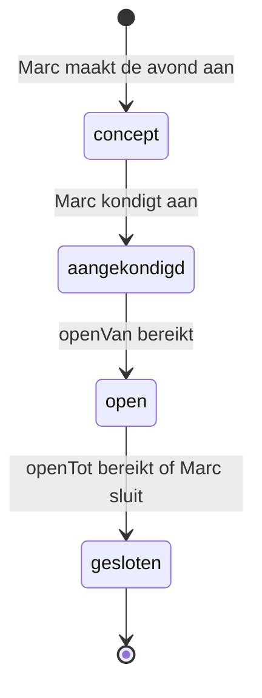
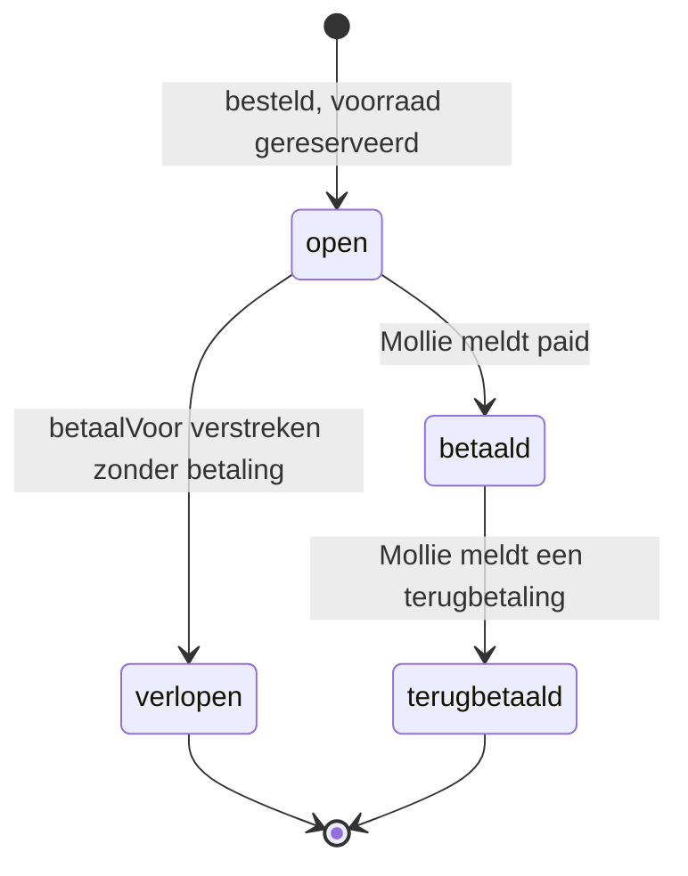

# Bouwspecificatie: Marcs wijnclub

19 november 2026, bijgewerkt op 21 november 2026 voor de avond en de besluiten in het plan · hoort bij [pilotplan-marcs-wijnclub.md](../pilotplan-marcs-wijnclub.md)

Dit document werkt het pilotplan uit tot bouwniveau: sleutels in DynamoDB, de levensloop van een avond en een bestelling, de bieding, de API-aanroepen en de indeling van het project. Het plan zegt wat er komt; dit document zegt hoe het in elkaar zit.

Het document heeft twee lagen. Hoofdstuk 1 tot en met 6 en hoofdstuk 10 zijn de specificatie: wat de app moet doen, los van wat er al staat. Daar toetsen de tests tegen, en dat neem je mee bij een herbouw. Hoofdstuk 7 tot en met 9 en de stand van het prototype onderaan hoofdstuk 10 beschrijven de huidige opzet: wat er gebouwd is, met welke versies, en wat nog open is. Die delen verouderen met de code.

In schermteksten en in het plan heet het de avond, de veiling, de bon en vervallen; in gegevens en in dit document de lijst (`lijsten`), de bieding, de bestelling en `verlopen`. De volledige lijst staat in het plan onder Begrippen.

## 1. Uitgangspunten

| Onderdeel | Keuze |
| --- | --- |
| Taal backend | Python, Lambda-runtime `python3.14` |
| Omgeving als code | AWS CDK in Python (`aws-cdk-lib` 2.255.0) |
| Web-app | React met Vite, in TypeScript. `npm run build` in `app/` schrijft statische bestanden naar `app/dist`; die staan op S3 achter CloudFront. Eén pagina met adressen achter een hekje, zoals `#/wijn/{wijnId}`, zodat CloudFront geen paden hoeft te kennen. Node 24 |
| Apparaat | De telefoon eerst: vrijwel elk lid gebruikt de app op zijn telefoon. De eisen staan in hoofdstuk 10 |
| API | API Gateway HTTP API, bereikbaar via CloudFront onder `/api/*` |
| Live bijwerken | Pollen: de web-app vraagt `GET /api/aanbod` elke 3 seconden zolang het scherm zichtbaar is. Besloten op 21 november 2026; een WebSocket is onderwerp 17 op de [roadmap](roadmap.md) |
| Inloggen | Cognito, eenmalige code per e-mail en daarna eventueel een passkey, alleen op uitnodiging |
| Betalen | Mollie, iDEAL |
| Omgevingen | `test` en `prod`, elk een eigen set stacks, samen in één privé-AWS-account dat ook andere eigen projecten bevat; alles van de wijnclub begint met `Wijnclub-` |

De API loopt via CloudFront, zodat web-app en API hetzelfde adres hebben. Daardoor is geen CORS-instelling nodig en hangen de stacks niet in een kring van elkaar af.

Bedragen staan overal als **hele centen** (`950` voor € 9,50), nooit als kommagetal. Tijden staan als UTC-tekst in de vorm `2026-11-19T15:40:00Z`, zodat ze als tekst te sorteren en te vergelijken zijn.

### Adressen van de web-app

Elk scherm heeft een eigen adres achter een hekje. Een link uit een melding krijgt `?b=<berichtId>` vóór het hekje, zie Tellingen voor de roadmap.

| Adres | Scherm |
| --- | --- |
| `#/welkom` | Inloggen, V4 01 tot en met 05 |
| `#/` | Het aanbod: aankondiging, de avond of de terugblik, naar de status van de avond |
| `#/wijn/{wijnId}` | Wijn van de lijst |
| `#/bestelling` | De bon, vóór het betalen |
| `#/bon/{bestellingId}` | Een bon na het bestellen: open met Betaal, betaald, niet betaald of vervallen. Hierheen wijst de betaallink |
| `#/net-op` | Net op |
| `#/veiling/{wijnId}/fles` | Bijzondere fles |
| `#/veiling/{wijnId}` | De veiling: de zaal, eenmaal andermaal, verkocht of afgelopen |
| `#/veiling/{wijnId}/gewonnen` | Na een gewonnen veiling: betalen, daarna brengen of halen |
| `#/mijn-bestelling` | Je bestellingen |
| `#/marc` | Marc, met voorwaarden en privacy |
| `#/beheer` | Beheer: de avond |
| `#/beheer/nieuw` | Beheer: nieuwe fles |
| `#/beheer/afleveren` | Beheer: afleveren |
| `#/beheer/namens` | Beheer: namens een lid |
| `#/beheer/plannen` | Beheer: een avond plannen. Nog niet gebouwd |
| `#/beheer/leden` | Beheer: leden. Nog niet gebouwd |

### Nagezocht op 19 november 2026

| Feit | Bron |
| --- | --- |
| Een code per e-mail vraagt het Essentials-plan van Cognito, de inlogstroom `USER_AUTH` en verzending via Amazon SES | [Cognito: authentication flows](https://docs.aws.amazon.com/cognito/latest/developerguide/amazon-cognito-user-pools-authentication-flow-methods.html), [Cognito: e-mail](https://docs.aws.amazon.com/cognito/latest/developerguide/user-pool-email.html) |
| Een beheerder kan gebruikers zonder wachtwoord aanmaken | Zelfde pagina |
| Een refresh-token kan maximaal 10 jaar geldig zijn | [Cognito: refresh tokens](https://docs.aws.amazon.com/cognito/latest/developerguide/amazon-cognito-user-pools-using-the-refresh-token.html) |
| `python3.14` is de nieuwste algemeen beschikbare Lambda-runtime, ondersteund tot 30 juni 2029 | [Lambda runtimes](https://docs.aws.amazon.com/lambda/latest/dg/lambda-runtimes.html) |
| Een open iDEAL-betaling verloopt bij Mollie na 15 minuten | [Mollie: handling payment status](https://docs.mollie.com/docs/handling-payment-status) |
| De melding van Mollie is een POST met alleen `id=tr_…`. De status moet je zelf ophalen. Er is geen handtekening om te controleren | [Mollie: webhooks](https://docs.mollie.com/reference/webhooks) |
| Mollie probeert een melding 10 keer, verspreid over 26 uur, en verwacht `200 OK` binnen 15 seconden | Zelfde pagina |
| Mollie roept de melding ook aan bij een terugbetaling | Zelfde pagina |
| Eindstatussen van een betaling: `paid`, `canceled`, `expired`, `failed` | [Mollie: handling payment status](https://docs.mollie.com/docs/handling-payment-status) |

## 2. Tabellen en sleutels

Elf tabellen, alle met betalen naar gebruik en herstel naar een tijdstip. `betalingen` is erbij gekomen om een melding van Mollie aan een bestelling te koppelen, `weergaven`, `berichten` en `tikken` voor de tellingen in hoofdstuk 5, `feed` voor de avond, en `tijdlijn` voor het volgen van een bestelling (sinds 21 november 2026, zie Tijdlijn en signalen in hoofdstuk 3). Zes zijn gebouwd; `feed`, `weergaven`, `berichten`, `tikken` en `tijdlijn` nog niet. De tabel `oordelen` is op 19 november 2026 vervallen: de eigen collectie van een lid is uit de pilot gehaald en staat als onderwerp 14 op de [roadmap](roadmap.md).

| Tabel | Sleutel | Extra index | Waarvoor de index dient |
| --- | --- | --- | --- |
| `leden` | `lidId` | geen | |
| `lijsten` | `lijstId` | `status-index`: `status` + `openTot` | De avond die nu aangekondigd of open is, en de laatst gesloten avond voor de terugblik |
| `wijnen` | `wijnId` | `lijst-index`: `lijstId` + `volgorde` | Wijnen van één avond, in Marcs volgorde, ook de veiling |
| | | `bieding-index`: `biedingStatus` + `eindtijd` | Biedingen die nu open staan. Alleen wijnen met een bieding hebben `biedingStatus` |
| `biedingen` | `wijnId` + `tijdstipLid` | `lid-index`: `lidId` + `tijdstip` | Biedingen van één lid |
| `bestellingen` | `bestellingId` | `lid-index`: `lidId` + `aangemaakt` | Je bestellingen |
| | | `lijst-index`: `lijstId` + `aangemaakt` | Marcs overzicht per lijst |
| | | `betaal-index`: `status` + `betaalVoor` | Open bestellingen waarvan de termijn voorbij is, voor de taak die ze laat verlopen |
| `betalingen` | `mollieBetalingId` | geen | Melding van Mollie naar de bestelling van die betaling |
| `weergaven` | `wijnId` + `lidId` | geen | Per bieding tellen hoeveel leden hem openden |
| `berichten` | `berichtId` | geen | Per melding vastleggen wanneer hij verstuurd is. Bij enkele honderden berichten is alles doorlopen geen probleem |
| `tikken` | `berichtId` + `lidId` | geen | Per melding tellen hoeveel leden erop tikten |
| `feed` | `lijstId` + `tijdstipId` | geen | De feed van één avond, op volgorde. Met `sinds` alleen wat nieuw is |
| `tijdlijn` | `bestellingId` + `tijdstipId` | geen | De stappen van één bestelling, op volgorde |

`lidId` is de `sub` uit Cognito. Abonnementen op meldingen staan als lijst op het lid; bij 120 leden is alle leden doorlopen voor een melding geen probleem.

### Velden per tabel

- **`leden`**: `lidId`, `naam`, `email`, `telefoon`, `adres` (het afleveradres: `straat` met huisnummer, `postcode`, `plaats`; ontbreekt als het lid geen adres heeft), `leveringVoorkeur` (`brengen` of `halen`), `volwassenBevestigdOp`, `meldingen` (lijst van abonnementen), `herinneren` (de `lijstId`'s waarvoor het lid "herinner mij" koos), `uitgenodigdOp`, `volwassenVolgensMarc` (Marc bevestigde bij de uitnodiging dat het lid 18 jaar of ouder is), `voorwaardenVersie` en `voorwaardenGeaccepteerdOp` (bij de eerste login), `eersteLoginOp`. Het adres is er alleen voor brengen. Alleen het lid zelf en de groep `beheer` zien het (design-v4 toont het op scherm 10); een ander lid nooit. Het komt niet op de bestelling en nooit in het logboek.
- **`lijsten`**: één rij per avond. `lijstId`, `titel`, `inleiding` (Marcs aankondiging), `status` (`concept`, `aangekondigd`, `open`, `gesloten`), `openVan` (de begintijd), `openTot` (de eindtijd), `aangekondigdOp`, `geslotenOp`, `herinnerdOp` (wanneer "nog beschikbaar" verstuurd is), `onderwegOp`, `levering`. In `levering` staat wat Marc voor deze lijst aanbiedt: `brengen` met `van` en `tot` (het tijdvak waarin hij aan huis brengt), en `halen` met `van`, `tot` en `waar` (waar en wanneer het lid ophaalt). Wat hij niet aanbiedt, ontbreekt; minstens één van de twee staat er. Bijvoorbeeld:

  ```json
  {
    "brengen": { "van": "2026-11-26T17:00:00Z", "tot": "2026-11-26T19:00:00Z" },
    "halen": { "van": "2026-11-28T09:00:00Z", "tot": "2026-11-28T12:00:00Z", "waar": "Bij Marc" }
  }
  ```

- **`wijnen`**: `wijnId`, `lijstId`, `volgorde`, `soort` (`vast` of `bieding`), `naam`, `korteNaam` (voor de bon en de feed), `producent`, `jaargang`, `streek`, `kleur` (`rood`, `wit`, `rosé`, `bubbels` of `zoet`), `land`, `tekst`, `tekstBron` (`bericht`, `voorstel`, `voorstel-aangepast` of `zelf`), `foto`, `opTafelSinds` (wanneer Marc de wijn op tafel zette; leeg is "staat klaar" en dan is hij niet te koop). Optioneel: `druif`, `spijs`, `drinken`.
  - Bij `vast`: `letter`, `prijs`, `voorraad`, `partij` (het aantal flessen waarmee de wijn op tafel kwam; de flessenrij tekent daarmee wat al weg is), `opSinds` (wanneer de laatste fles weg was). De letter is die uit Marcs WhatsApp-bericht: A voor de eerste wijn van de avond.
  - Bij `bieding`: `biedingStatus` (`klaar`, `open`, `gesloten`), `startbod`, `minimaleVerhoging`, `minimaalVolgendBod`, `veilingBegin` (wanneer de zaal vanzelf opengaat), `geopend` (wanneer hij echt openging), `eindtijd`, `herkomst`, `bewaring`, `spraakbericht`, `hoogsteBod`, `hoogsteBieder`, `aantalBiedingen`. Een veiling hoort bij één avond, hoogstens één per avond.
- **`biedingen`**: `wijnId`, `tijdstipLid` (`<tijdstip>#<lidId>`), `tijdstip`, `lidId`, `bedrag`, `bieder` (het vaste nummer van dit lid in deze veiling, voor "Bieder 7"), `verlengd` (waar als dit bod de eindtijd verschoof).
- **`bestellingen`**: `bestellingId`, `lidId`, `soort` (`lijst`, `bieding`, `namens`), `lijstId`, `regels` (lijst van `wijnId`, `naam`, `aantal`, `prijs`), `totaal`, `status`, `voorraadGereserveerd`, `betaalVoor`, `levering` (`brengen` of `halen`; bij een gewonnen bieding leeg tot het lid na het betalen kiest), `afgeleverdOp`, `ingevoerdDoor`, `aangemaakt`, `betaalpogingen` (lijst van `mollieBetalingId`: elke betaling die voor deze bestelling is gestart), `betaaldOp`, `mollieBetalingId` (de betaling waarmee de bestelling op betaald is gezet), `verlopenOp`, `herinnerdOp`, `controleNodig`, `bestelduur` (seconden van het openen van het aanbod tot de tik op Betaal, door de web-app meegestuurd; alleen voor de succescriteria).
- **`betalingen`**: `mollieBetalingId`, `bestellingId`, `lidId`, `bedrag`, `aangemaakt`. Een betaling hoort bij precies één bestelling.
- **`weergaven`**: `wijnId`, `lidId`, `eerst`, `vervaltOp`. Eén rij per lid per bieding, alleen voor de tellingen.
- **`berichten`**: `berichtId`, `soort` (`aankondiging`, `begin` (aan wie "herinner mij" koos), `nog-beschikbaar`, `veiling-begint`, `overboden`, `gewonnen`, `betaallink` (bij een bestelling namens een lid), `betaalherinnering`, `onderweg`), `kanaal` (`melding`, `email`, `groep`), `lijstId` of `wijnId`, `verzondenOp`, `ontvangers` (aantal). Er staat geen `lidId` in, ook niet bij een bericht aan één lid.
- **`tikken`**: `berichtId`, `lidId`, `eerst`, `vervaltOp`. Eén rij per lid per bericht, alleen voor de tellingen.
- **`feed`**: `lijstId`, `tijdstipId` (`<tijdstip>#<korte willekeurige tekst>`, zodat twee rijen in dezelfde seconde niet botsen), `tijdstip`, `soort` (`wijn`: Marc zette een wijn op tafel; `bericht`: Marc zei iets; `gebeurtenis`: iets wat gebeurde), en `wijnId` of `tekst`. Gebeurtenissen zijn "een lid nam 2 × Janasse", "de Verdejo is op", "de veiling begint", "de Barolo ging voor € 380" en "Marc sloot de avond". Een rij bevat nooit een `lidId` of een naam. Wie schrijft wat: `wijn` bij het op tafel zetten; `bericht` bij `POST /api/beheer/lijsten/{lijstId}/feed`; "een lid nam" bij de melding van Mollie die de bestelling op `betaald` zet, zodat een bon die vervalt niet in de feed komt; "is op" in de bestel-transactie als de voorraad 0 wordt, samen met `opSinds`. Komt er door een vervallen bon weer voorraad, dan wist de taak voor verlopen `opSinds` en schrijft hij "de … is weer te bestellen". De veiling schrijft bij openen en sluiten, en "Marc sloot de avond" komt bij eerder sluiten.
- **`tijdlijn`**: `bestellingId`, `tijdstipId` (zoals bij `feed`), `tijdstip`, `stap`, bij `betaling-gestart` de `poging` (1, 2, 3), bij `melding-mollie` de `mollieStatus`, en `vervaltOp` (180 dagen na `tijdstip`, in seconden sinds 1970, zoals bij `weergaven`). Een rij bevat nooit een `lidId`, een naam, een adres of een bedrag. De stappen staan onder Tijdlijn en signalen in hoofdstuk 3.

`minimaalVolgendBod` bestaat omdat DynamoDB in een voorwaarde niet kan rekenen. Bij het klaarzetten is het `startbod`; na elk bod wordt het `bod + minimaleVerhoging`.

**Herkomst van de velden voor de avond.** `aangekondigd` als status, `opTafelSinds`, `opSinds`, `partij`, `kleur`, `land`, `korteNaam`, `veilingBegin`, `geopend`, `bieder` en de tabel `feed` komen uit design-v3 en V4 en staan sinds 21 november 2026 in dit hoofdstuk, als voorlopige bouwkeuze uit de besluiten in het plan. Het prototype in `app/` noemt de status van de avond nog `fase` (`aangekondigd`, `live`, `gesloten`); `live` is hier `open`.

## 3. Levensloop van een avond en een bestelling

### Een avond



- **`concept`.** Marc plant de avond en zet wijnen klaar. Leden zien niets. `POST /api/beheer/lijsten` controleert de levering, zoals onder Levering.
- **`aangekondigd`.** Met `PUT /api/beheer/lijsten/{lijstId}` en `status` `aangekondigd` gaat er een melding `aankondiging` naar alle leden met meldingen aan, en komen er eenmalige taken in EventBridge Scheduler op `openVan` en `openTot`, en op `veilingBegin` en `eindtijd` als er een veiling is. Worden na het aankondigen de tijden gewijzigd of komt de veiling er later bij, dan zet `PUT /api/beheer/lijsten/{lijstId}` of `POST /api/beheer/wijnen` de taken opnieuw. Dit is de enige plek die taken voor een avond en zijn veiling aanmaakt. Er kan hoogstens één avond tegelijk aangekondigd of open zijn. De tijden moeten kloppen: `openVan` vóór `openTot`, en bij een veiling `openVan` ≤ `veilingBegin` < `eindtijd` ≤ `openTot`; anders `400` met `ongeldig_moment`. Het aanbod toont de aankondiging met alle wijnen die klaarstaan; geen ervan is te bestellen.
- **`open`.** De taak op `openVan` zet de status op `open`, op voorwaarde dat die nog `aangekondigd` is, en stuurt de melding `begin` aan de leden met de `lijstId` in `herinneren`. Marc zet wijnen op tafel met `POST /api/beheer/wijnen/{wijnId}/op-tafel`: dat zet `opTafelSinds` en `partij` (de voorraad op dat moment) en schrijft een rij in `feed`. Alleen een wijn op tafel is te bestellen. Wat Marc zegt, komt met `POST /api/beheer/lijsten/{lijstId}/feed` in de feed.
- **`gesloten`.** Zie De lijst sluiten. Het aanbod toont dan de terugblik, uit de wijnen en de feed van deze avond, tot er een nieuwe avond aangekondigd is. Wat nooit op tafel kwam, staat niet in de terugblik; de veiling wel, met de uitkomst.
- **De veiling en het sluiten.** De taak op `openTot` sluit de avond niet zolang de veiling open is: hij plant zichzelf opnieuw op de `eindtijd` en sluit de avond na de hamer. Eerder sluiten kan niet zolang de veiling open is (`409` met `veiling_loopt`). Staat de veiling nog op `klaar` als de avond sluit, dan gaat hij naar `gesloten` zonder winnaar en vervallen zijn taken.

**Pollen.** De web-app roept `GET /api/aanbod?sinds=<tijdstip>` elke 3 seconden aan zolang het scherm zichtbaar is (`document.visibilityState`), met het `tijdstip` van de laatste rij uit de feed die ze al heeft. `sinds` is inclusief; de web-app laat rijen vallen waarvan ze de `tijdstipId` al kent. Het antwoord bevat de status van de avond, de voorraad van elke wijn op tafel, de stand van de veiling en alleen de nieuwe rijen uit de feed. Bij terugkomst in de app vraagt ze meteen. Bij 30 leden is dat ongeveer 10 aanroepen per seconde; de begrenzing van de API moet daar ruim boven liggen, met een eigen grens per lid voor bieden en bestellen.

### Een bestelling

Eén regel bepaalt alles: **een bestelling blijft open tot `betaalVoor`, en alleen een geslaagde betaling of het verstrijken van die tijd verandert de status.** Een mislukte of afgebroken betaling verandert niets; het lid kan binnen de termijn opnieuw betalen.

**Elke bestelling wordt apart betaald**, met iDEAL via Mollie. Van de lijst betaalt het lid meteen bij het bestellen: Marc houdt de flessen 15 minuten vast. De voorraad gaat bij het bestellen omlaag; is er na 15 minuten niet betaald, dan verloopt de bestelling en komt de voorraad terug. Bijbestellen is een nieuwe bestelling, met een eigen betaling. Er is geen gezamenlijke betaling bij het sluiten van de lijst.



| Soort bestelling | Ontstaat als | `betaalVoor` | Voorraad gereserveerd |
| --- | --- | --- | --- |
| `lijst` | Een lid bestelt van de lijst | 15 minuten na het bestellen | Ja |
| `namens` | Marc een bestelling voor een lid invoert | 48 uur na het invoeren | Ja |
| `bieding` | Een bieding sluit met een winnaar | 48 uur na sluiten van de bieding | Nee, de fles is al van de lijst af |

Het sluiten van de lijst verandert geen enkele `betaalVoor`. De regels staan in `domein/bestelling.py`.

### Levering

Een bestelling wordt gebracht of gehaald:

- **`brengen`**: Marc brengt de flessen aan huis, in het tijdvak dat hij voor de lijst instelt, zoals donderdagavond van 18:00 tot 20:00.
- **`halen`**: het lid haalt de flessen bij Marc op, op het moment en de plek die hij voor de lijst instelt.

Per lijst kiest Marc of hij brengen, halen of beide aanbiedt, met `van` en `tot` en bij halen `waar` (zie `lijsten` in hoofdstuk 2). De app controleert dat er minstens één is, dat `van` vóór `tot` ligt en dat halen een plek heeft, van hoogstens 200 tekens.

Bij bestellen controleert de app de levering met wat in de opslag staat, nooit met wat de aanvraag zegt:

- Geen levering gekozen: `geen_levering`. Iets anders dan `brengen` of `halen`: `onbekende_levering`.
- Een levering die de lijst niet aanbiedt: `levering_niet_aangeboden`.
- Brengen terwijl het lid geen afleveradres heeft: `geen_adres`.

Het adres komt niet op de bestelling. De afleverlijst leest het uit `leden`, zodat er geen kopieën van ontstaan. Bewaren bij Marc is uit de pilot en staat op de [roadmap](roadmap.md), onderwerp 9.

### Bestellen van de lijst

1. De app controleert de regels: minstens één wijn, elk aantal tussen 1 en 24, elke wijn één keer, hoogstens 25 regels. Daarna de levering, zoals hierboven.
2. De web-app stuurt per bestelpoging een `sleutel` mee: een willekeurige tekst van 8 tot 64 letters, cijfers en streepjes, zoals een UUID. Ze maakt die aan als het lid op Bestel tikt en stuurt dezelfde sleutel mee als ze de aanroep herhaalt. Het `bestellingId` wordt afgeleid van het lid en de sleutel, zodat dezelfde poging altijd hetzelfde nummer geeft.
3. Eén transactie in DynamoDB doet alles of niets:
   - controleer dat de lijst `open` is en `openTot` niet voorbij;
   - controleer per wijn dat hij op tafel staat (`opTafelSinds` gezet);
   - verlaag per wijn de `voorraad`, op voorwaarde dat er genoeg is;
   - schrijf de bestelling met status `open` en `betaalVoor` 15 minuten na nu, op voorwaarde dat het `bestellingId` nog niet bestaat.
4. Mislukt de transactie, dan kijkt de app in deze volgorde naar de reden:
   - **Een botsing in de tijd.** Bestellen twee leden op hetzelfde moment dezelfde wijn, dan breekt DynamoDB één van de twee af zonder dat er iets op is. De app probeert het hoogstens drie keer opnieuw, met een korte willekeurige pauze. Lukt het dan nog niet, dan krijgt het lid `503` en probeert de web-app het opnieuw met dezelfde sleutel.
   - **De bestelling stond er al.** Dezelfde poging kwam twee keer binnen, bijvoorbeeld na een time-out of een dubbele tik. Het lid krijgt de bestaande bestelling terug met `201`, zonder nieuwe betaling; er komt geen tweede bestelling. Is hij nog open, dan start de web-app de betaling met Betaal.
   - **De lijst is dicht of een wijn is op.** Het lid krijgt `409` terug met de wijnen die op zijn. Er is niets gereserveerd.
5. Gelukt: de app start meteen de betaling, zoals onder Betalen, en het lid krijgt `201` met de bestelling en de `betaalUrl`. De web-app stuurt het lid door naar de betaalpagina. Lukt het starten bij Mollie niet, dan blijft de bestelling staan zonder `betaalUrl`; het lid kan binnen de 15 minuten op Betaal tikken.
6. Bestelt het lid opnieuw van dezelfde lijst, met een nieuwe sleutel, dan ontstaat een tweede bestelling met een eigen houdtijd en een eigen betaling. Bestellingen worden nooit achteraf gewijzigd.
7. De gekozen levering wordt als voorkeur op het lid bewaard, in `leveringVoorkeur`.

### Namens een lid

1. Marc voert regels en levering in voor een lid, bijvoorbeeld na een bericht in de groep. De controles en de transactie zijn dezelfde als bij bestellen van de lijst; de adrescontrole gaat over het lid voor wie hij bestelt. `betaalVoor` is 48 uur na het invoeren.
2. Het antwoord bevat een `betaalLink`: een link naar de bon in de app (`#/bon/{bestellingId}`), en geen link van Mollie, want een betaling bij Mollie verloopt na 15 minuten. De app stuurt het lid een melding met die link (`betaallink` in `berichten`), en Marc kan dezelfde link kopiëren om in WhatsApp te sturen. Met `POST /api/beheer/bestellingen/{id}/betaallink` stuurt Marc hem opnieuw. Het lid opent hem, logt zo nodig in en tikt op Betaal.
3. Tot het lid betaalt of de termijn voorbij is, blijft de voorraad vast.

### De lijst sluiten

1. Een eenmalige taak in EventBridge Scheduler staat op `openTot`. Marc kan de lijst ook eerder sluiten.
2. De taak, of `PUT /api/beheer/lijsten/{lijstId}` met `status` `gesloten`, zet de status van de lijst op `gesloten`, op voorwaarde dat die nog `open` is, schrijft `geslotenOp` en zet "Marc sloot de avond" in de feed als Marc eerder sloot. Een taak die daarna afgaat, doet niets.
3. Er volgt geen betaling achteraf: elke bestelling is al betaald of heeft een eigen termijn. Een bestelling van vlak voor het sluiten blijft binnen zijn 15 minuten te betalen. Verloopt hij toch, dan komt de voorraad terug op een gesloten lijst en is hij niet meer te bestellen.

### Betalen

1. Het lid komt van Bestel of tikt op Betaal bij een open bestelling. Elke betaling hoort bij precies één bestelling.
2. De app controleert dat de bestelling van het lid is, `open` is en dat `betaalVoor` niet voorbij is. Of de lijst open of gesloten is, doet er niet toe.
3. De app maakt bij Mollie een betaling aan voor het `totaal`, schrijft die met het `bestellingId` in `betalingen`, zet het nummer bij `betaalpogingen` op de bestelling en stuurt het lid naar de betaalpagina. Een iDEAL-betaling verloopt bij Mollie na 15 minuten; binnen de termijn kan het lid een nieuwe starten.

Een betaling die vlak voor het einde van de houdtijd start, kan bij Mollie nog tot 15 minuten later slagen. De taak voor verlopen wacht daarop, dus de flessen staan hoogstens ongeveer een half uur vast.

### Melding van Mollie

1. De melding bevat alleen het nummer van de betaling. De app zoekt de bestelling op in `betalingen` en haalt de status op bij Mollie.
2. `paid`: de bestelling gaat van `open` naar `betaald`, op voorwaarde dat hij nog `open` is. Het nummer van de betaling komt als `mollieBetalingId` op de bestelling.
3. Faalt die voorwaarde, dan leest de app de bestelling opnieuw en beslist:
   - `betaald` met hetzelfde `mollieBetalingId`: dezelfde melding kwam nog eens. Er gebeurt niets.
   - `betaald` of `terugbetaald` met een ander `mollieBetalingId`: het lid heeft **dubbel betaald**, bijvoorbeeld door twee betalingen tegelijk te starten. De status blijft staan, `controleNodig` gaat aan en er gaat een alarm af. Marc betaalt de tweede betaling terug.
   - `verlopen`: de status blijft `verlopen`, `controleNodig` gaat aan en er gaat een alarm af. Marc levert alsnog of betaalt terug.
4. Een terugbetaling van de betaling waarmee de bestelling betaald is: de status wordt `terugbetaald`. De voorraad komt niet vanzelf terug; dat beslist Marc. Een terugbetaling van een andere betaling, de dubbele, verandert de status niet.
5. Elke andere status van de betaling: geen wijziging.
6. De app antwoordt altijd `200`, ook als het nummer onbekend is. Een onbekend nummer wordt gelogd.

### Verlopen

Een taak in EventBridge Scheduler draait elke minuut. Hij zoekt via `betaal-index` de bestellingen met status `open` waarvan `betaalVoor` voorbij is, en vraagt per bestelling bij Mollie de status op van alle betalingen in `betaalpogingen`. Alleen de laatste is niet genoeg: een eerdere betaling kan nog slagen nadat een latere is afgebroken.

- Eén ervan betaald: verwerken als een melding.
- Geen betaald, maar één nog bezig (`open`, `pending`, `authorized`): niets doen. De volgende ronde kijkt opnieuw.
- Anders: één transactie zet de status op `verlopen`, schrijft `verlopenOp` en geeft de voorraad terug, op voorwaarde dat de status nog `open` is. Bij een bestelling van de lijst krijgt Marc geen bericht: de flessen zijn meteen weer te bestellen. Was er wel een betaalpoging, dan volgt een signaal; zie Tijdlijn en signalen. Bij een bestelling namens een lid krijgt hij wel bericht.

Bij een verlopen bestelling uit een bieding komt er geen voorraad terug. Marc krijgt bericht en beslist of de fles naar de volgende bieder gaat.

**Bericht aan Marc** is een melding aan de leden van de groep `beheer`, met e-mail als terugval, en de bestelling staat bij Afleveren als vervallen. Het telt niet in `berichten`.

Dezelfde taak stuurt bij een bestelling `namens` of `bieding` die 24 uur vóór `betaalVoor` nog open is één herinnering, en zet `herinnerdOp` zodat het bij één blijft. Bij een bestelling van de lijst is er geen herinnering: het lid betaalt meteen.

### Tijdlijn en signalen

Besloten op 21 november 2026: stap A van onderwerp 19 op de [roadmap](roadmap.md) zit in de pilot. Elke bestelling krijgt een tijdlijn in de tabel `tijdlijn`, en een regel over die tijdlijn kan een signaal geven aan Marc of Aidan.

| `stap` | Wie schrijft hem |
| --- | --- |
| `gemaakt` | Bestellen van de lijst, namens een lid, en het sluiten van een bieding |
| `betaling-gestart`, met `poging` | Betalen |
| `betaling-niet-gestart` | Betalen, als Mollie geen betaling teruggeeft |
| `terug-van-betalen` | `POST /api/bestellingen/{id}/terug`, als het lid van de betaalpagina terugkomt op de bon |
| `melding-mollie`, met `mollieStatus` | De melding van Mollie |
| `betaald`, `verlopen`, `terugbetaald` | De overgang van de status |
| `herinnerd`, `betaallink-verstuurd` | De taak voor verlopen, en Marc |
| `afgeleverd` | Afleveren. Haalt Marc het vinkje weg, dan komt er `niet-afgeleverd` bij |

- **Schrijven mag een bestelling nooit raken.** De rij wordt na de transactie geschreven, niet erin. Mislukt het schrijven, dan staat dat in het logboek en gaat de bestelling of betaling gewoon door. Een tijdlijn kan dus een stap missen; de status op de bestelling blijft de waarheid.
- **`terug-van-betalen` heeft geen velden.** Het lid komt uit het token; een bestelling van een ander geeft `404`. De stap wordt hoogstens één keer per betaalpoging geschreven.
- **Geen persoonsgegevens.** Geen `lidId`, naam, adres of bedrag in de rij. Wie het lid is, staat op de bestelling.

**Signalen.** De regels komen in `domein/signalen.py`, met tests; dat bestand is er nog niet, zie hoofdstuk 8. De taak voor verlopen rekent ze elke minuut uit voor de bestellingen van de lopende en de laatst gesloten avond, en zet het resultaat als `signalen` op de bestelling. Die schrijfactie raakt de status niet en heeft geen voorwaarde op de status.

| Signaal | Regel | Voor | Ingrijpen |
| --- | --- | --- | --- |
| `betaalpoging-vervallen` | Soort `lijst`, status `verlopen`, en minstens één `betaling-gestart` | Marc | De bestelling opnieuw invoeren namens het lid |
| `veel-betaalpogingen` | Drie of meer keer `betaling-gestart`, en nog `open` | Marc | Het lid een bericht sturen, of de betaallink |
| `betaling-niet-gestart` | De stap staat in de tijdlijn | Aidan | De storing nakijken. Het lid kan opnieuw op Betaal tikken |
| `melding-blijft-uit` | `terug-van-betalen`, en twee minuten later geen `melding-mollie` | Aidan | De taak voor verlopen vraagt de status zelf op, dus de bestelling komt goed. De oorzaak nakijken |
| `controle-nodig` | `controleNodig` staat aan | Marc | Terugbetalen in Mollie, of alsnog leveren |
| `niet-afgeleverd` | Status `betaald`, geen `afgeleverdOp`, en het moment van brengen of halen is een dag voorbij | Marc | Afleveren of afvinken |
| `niet-ingelogd` | Een lid met `uitgenodigdOp` van drie dagen of langer geleden en zonder `eersteLoginOp` | Marc | Het e-mailadres nakijken en opnieuw uitnodigen |

- **Bericht.** Een signaal voor Marc gaat als melding naar de groep `beheer`, met e-mail als terugval, één keer per signaal per bestelling; `signaalGemeldOp` op de bestelling houdt dat bij. Het telt niet in `berichten`. Een signaal voor Aidan is een regel in het logboek met een alarm in CloudWatch.
- **`niet-ingelogd` gaat over een lid, niet over een bestelling.** Het komt uit `leden` en gebruikt de tijdlijn niet. De taak rekent het één keer per dag uit, en Marc krijgt hoogstens één bericht per lid.
- **Waar Marc het ziet.** Bovenaan Beheer: afleveren staat "Vraagt aandacht", met per signaal één regel in gewone taal. Een tik opent de tijdlijn van die bestelling in een paneel. Er komt geen beheerscherm bij.
- **Ingrijpen is een handeling die al bestaat:** namens een lid bestellen, de betaallink sturen, afleveren, of terugbetalen in Mollie. Er is geen aanroep die een status met de hand zet.
- **`betaalpoging-vervallen` is een voorlopige bouwkeuze.** Eerder kreeg Marc bij een bon van de lijst nooit bericht. Marc moet zeggen of hij dit bericht wil; zie de besluiten in het plan.

### Levering kiezen na een bieding

Een gewonnen bieding ontstaat zonder levering. Na het betalen kiest de winnaar brengen of halen met `PUT /api/bestellingen/{id}/levering`, tot de fles is afgeleverd. Een veiling hoort bij een avond (voorlopige bouwkeuze, zie de besluiten in het plan): de winnaar kiest uit wat die avond aanbiedt, brengen alleen met een afleveradres, en krijgt de fles op het moment van die avond. Is dat moment voorbij, dan spreekt Marc het met hem af. De fout `levering_niet_aangeboden` geldt hier net als bij bestellen.

## 4. De bieding

In schermteksten heet dit de veiling; in gegevens en code de bieding.

### De veiling openen

1. Bij het aankondigen van de avond komt er een eenmalige taak op `veilingBegin`. Tot dan is `biedingStatus` `klaar`.
2. De taak, of `POST /api/beheer/wijnen/{wijnId}/veiling-starten` als Marc eerder start, zet `biedingStatus` op `open` en schrijft `geopend`, op voorwaarde dat de status nog `klaar` is en de avond `open` is. De eindtijd blijft staan. Daarna komt "de veiling begint" in de feed en gaat de melding `veiling-begint` naar alle leden met meldingen aan.

### Een bod plaatsen

1. De app leest de wijn en controleert: `biedingStatus` is `open`, `eindtijd` is niet voorbij, het lid is niet zelf de hoogste bieder, en het bod is minstens `minimaalVolgendBod` en hoogstens drie keer dat bedrag. De bovengrens vangt een tikfout op: een bod is bindend en zet het minimum voor iedereen vast.
2. Valt het bod in de laatste twee minuten, dan wordt de nieuwe eindtijd het moment van bieden plus twee minuten. Een bod op precies twee minuten voor de eindtijd verlengt ook.
3. Eén transactie schrijft het bod, met `verlengd` als stap 2 de eindtijd verschoof en met `bieder`, en werkt de wijn bij, op voorwaarde dat `minimaalVolgendBod` en `eindtijd` nog zijn zoals gelezen. Faalt de transactie, dan leest de app de wijn opnieuw en beoordeelt het bod nog eens, hoogstens drie keer. Was iemand net eerder, dan krijgt het lid `409` met het nieuwe minimum. Botsten twee biedingen alleen in de tijd, dan gaat het bod bij de volgende poging gewoon door.
4. De vorige hoogste bieder krijgt een melding dat hij overboden is.

Leden zien `hoogsteBod` en of hun eigen bod het hoogste is, en in de biedlog per bod het bedrag, de tijd en `bieder`. Wie de hoogste bieder is, gaat nooit naar de web-app, en een `lidId` ook niet.

**Het nummer van een bieder.** Bij zijn eerste bod in een veiling krijgt een lid een willekeurig nummer van 1 tot 99 dat in die veiling nog niet gebruikt is; bij volgende biedingen hetzelfde nummer. Het komt alleen uit de eigen rijen in `biedingen`. Staat de instelling Wie bood uit (zie de besluiten in het plan), dan stuurt de API het nummer niet mee.

**Het biedpaneel** toont drie bedragen: `minimaalVolgendBod`, het eerstvolgende veelvoud van € 50 daarboven, en dat plus € 50. Wat boven drie keer het minimum komt, valt weg.

### Een bieding sluiten

1. Bij het aankondigen van de avond komt er een eenmalige taak op `eindtijd`, zie Een avond in hoofdstuk 3.
2. De taak leest de wijn. Is de eindtijd verlengd, dan plant hij zichzelf opnieuw op de nieuwe eindtijd en stopt.
3. Anders zet hij `biedingStatus` op `gesloten`, op voorwaarde dat die nog `open` is en dat `eindtijd` en `minimaalVolgendBod` nog zijn zoals gelezen. Is er een hoogste bieder, dan schrijft dezelfde transactie een bestelling van soort `bieding` met `betaalVoor` over 48 uur en zonder levering. Zo is er nooit een gesloten bieding met een winnaar zonder bestelling.
4. Daarna komt "de … ging voor € …" in de feed, en krijgt de winnaar een melding met een link naar zijn fles in de app. Hij betaalt en kiest daarna brengen of halen, zie "Levering kiezen na een bieding" in hoofdstuk 3.

## 5. API-aanroepen

Alle paden beginnen met `/api`. Elke aanroep vraagt een geldig token van Cognito, behalve de melding van Mollie. Paden onder `/api/beheer` vragen daarnaast de groep `beheer`.

| Aanroep | Doet | Antwoord |
| --- | --- | --- |
| `GET /api/aanbod` | De avond die aangekondigd of open is, of anders de laatst gesloten avond: `status`, `openVan`, `openTot`, de inleiding, de `levering` die Marc aanbiedt (`brengen` met `van` en `tot`, `halen` met `van`, `tot` en `waar`; wat hij niet aanbiedt ontbreekt), de wijnen (bij `aangekondigd` alle wijnen die klaarstaan, daarna alleen wat op tafel staat of stond), de veiling van de avond met stand en biedlog, en de feed. Met `?sinds=<tijdstip>` alleen de rijen uit de feed na dat tijdstip, met de actuele voorraad en stand. Zie Pollen in hoofdstuk 3 | `200` |
| `GET /api/wijnen/{wijnId}` | Eén wijn. Legt vast dat het lid een bieding opende, zie Tellingen voor de roadmap | `200`, `404` |
| `POST /api/bestellingen` | Bestellen van de lijst: `regels`, `levering` (`brengen` of `halen`), `sleutel` (per bestelpoging), `bestelduur`. Houdt de voorraad 15 minuten vast en start meteen de betaling. Dezelfde sleutel nog eens geeft dezelfde bestelling terug, zonder nieuwe betaling | `201` met de bestelling en `betaalUrl`, `400` met `geen_levering`, `onbekende_levering`, `levering_niet_aangeboden` of `geen_adres`, `400` met `ongeldige_regels`, `403` met `niet_bevestigd`, `409` met `uitverkocht` en de wijnen die op zijn, `niet_op_tafel` of `avond_dicht`, of `503` bij aanhoudende drukte |
| `GET /api/bestellingen/{id}` | Status, na terugkomst van de betaalpagina | `200`, `404` |
| `POST /api/bestellingen/{id}/terug` | Het lid kwam terug van de betaalpagina. Zonder velden. Schrijft `terug-van-betalen` in de tijdlijn, zie Tijdlijn en signalen | altijd `200` voor een eigen bestelling, `404` voor een andere |
| `POST /api/mijn/betalingen` | Een betaling starten voor één open bestelling: `bestellingId`. Voor elke soort, ook als de lijst nog open staat | `201` met `betaalUrl`, `409` als de bestelling niet open is of `betaalVoor` voorbij is |
| `PUT /api/bestellingen/{id}/levering` | `brengen` of `halen`, voor een gewonnen fles na het betalen | `200`, `400` met `geen_levering`, `onbekende_levering`, `levering_niet_aangeboden` of `geen_adres`, `409` als de bestelling nog niet betaald of al afgeleverd is |
| `POST /api/wijnen/{wijnId}/biedingen` | Een bod: `bedrag` | `201`, of `409` met `minimaalVolgendBod` en het hoogste toegestane bod. De fout zegt waarom: `bod_te_laag`, `bod_te_hoog`, `al_hoogste` of `bieding_gesloten` |
| `GET /api/mijn/bestellingen` | Alle bestellingen van het lid op de laatste avond (aangekondigd, open of de laatst gesloten), ook afgeleverde en vervallen, plus gewonnen flessen die nog niet zijn afgeleverd. Met bedrag, levering, status, `betaalVoor` en `afgeleverdOp` | `200` |
| `GET` en `PUT /api/mijn/profiel` | Naam, telefoon, levering van voorkeur, bevestiging 18 jaar met de versie van de voorwaarden (`voorwaardenVersie`), en het eigen afleveradres (`adres`). De eerste aanroep zet `eersteLoginOp`. Een lid ziet en wijzigt alleen zijn eigen adres | `200` |
| `POST` en `DELETE /api/mijn/meldingen` | Abonnement op meldingen | `200` |
| `POST /api/mijn/herinneringen` | "Herinner mij": `lijstId` van een aangekondigde avond. Zet hem in `herinneren` op het lid | `200`, `409` als de avond niet aangekondigd is |
| `POST /api/mijn/tikken` | Een tik op een melding: `berichtId`. Telt één keer per lid, zie Tellingen voor de roadmap | altijd `200` |
| `POST /api/beheer/herken` | Velden uit Marcs WhatsApp-bericht: `naam`, `producent`, `jaargang`, `aantal`, `prijs` in centen, `tekst` en `ontbreekt`. Zie "Een bericht herkennen" | `200`, `400` |
| `POST /api/beheer/uploads` | Tijdelijke uploadlink voor foto of spraakbericht, met een `uploadId` | `200` |
| `POST /api/beheer/etiket` | Velden van de foto van het etiket: `uploadId` erin; `naam`, `producent`, `jaargang`, `streek`, `kleur`, `land` en `ontbreekt` eruit. Zie "Een etiket lezen" | `200`, `400` |
| `POST /api/beheer/teksten` | Drie tekstvoorstellen: `notitie` en de velden van de wijn erin; `voorstellen` eruit, elk met `tekst` en `nieuw`. Zie "Een tekst voorstellen" | `200`, `400` |
| `GET /api/beheer/lijsten` en `GET /api/beheer/lijsten/{lijstId}` | De avonden, ook in `concept`; per avond de wijnen, ook die klaarstaan, en de tellers: flessen verkocht, bonnen en betaald bedrag | `200`, `404` |
| `POST /api/beheer/lijsten` en `PUT /api/beheer/lijsten/{lijstId}` | Een avond aanmaken of wijzigen met titel, inleiding (de aankondiging), begintijd, eindtijd en `levering` (brengen, halen of beide, met `van` en `tot`, en bij halen `waar`); aankondigen (`status` `aangekondigd`) en eerder sluiten (`status` `gesloten`). Zie Een avond in hoofdstuk 3 | `200`, `201`, `400` met `geen_levering_aangeboden`, `ongeldige_levering`, `ongeldig_moment` of `geen_ophaalplek`, `409` als er al een avond aangekondigd of open is, of `veiling_loopt` bij eerder sluiten |
| `POST /api/beheer/lijsten/{lijstId}/feed` | Iets tegen de tafel zeggen: `tekst`, hoogstens 280 tekens. Komt als `bericht` in de feed, en in de biedlog als de veiling loopt | `201`, `409` als de avond niet open is |
| `POST /api/beheer/lijsten/{lijstId}/onderweg` | "Ik ben onderweg": één melding `onderweg` aan de leden met een betaalde bestelling om te brengen van deze avond. Kan één keer per avond | `200`, `409` |
| `POST /api/beheer/lijsten/{lijstId}/herinnering` | Eén melding "nog beschikbaar" aan alle leden. Kan één keer per lijst | `200`, `409` |
| `GET /api/beheer/lijsten/{lijstId}/afleverlijst` | Per levering: wat Marc brengt, met naam en adres, en wat er gehaald wordt, met naam. Per bestelling de wijnen en of hij betaald is | `200` |
| `POST /api/beheer/wijnen` en `PUT /api/beheer/wijnen/{wijnId}` | Een wijn klaarzetten voor een avond, op de lijst of als de veiling, of wijzigen: een wijn van de lijst zolang hij niet op tafel staat, een veiling zolang hij `klaar` is. Foto en spraakbericht verwijzen naar een `uploadId`; de functie controleert dan het type aan de inhoud van elk bestand | `200`, `201`, `400` met `ongeldig_bestand`, `409` als de avond al een veiling heeft of de wijn niet meer te wijzigen is |
| `POST /api/beheer/wijnen/{wijnId}/op-tafel` | Een wijn van de lijst op tafel zetten. Zie Een avond in hoofdstuk 3 | `200`, `409` als de avond niet open is of de wijn al op tafel staat |
| `POST /api/beheer/wijnen/{wijnId}/veiling-starten` | De veiling eerder openen dan `veilingBegin` | `200`, `409` als de avond niet open is of de veiling al open is |
| `GET /api/beheer/bestellingen` | Overzicht per lijst, per bestelling met `signalen` | `200` |
| `GET /api/beheer/bestellingen/{id}/tijdlijn` | De stappen van één bestelling, op volgorde: `tijdstip`, `stap`, en `poging` of `mollieStatus` | `200`, `404` |
| `GET /api/beheer/signalen` | Wat aandacht vraagt op de lopende en de laatst gesloten avond: per signaal de bestelling of het lid, en sinds wanneer. Voor "Vraagt aandacht" bij afleveren | `200` |
| `POST /api/beheer/bestellingen` | Bestelling namens een lid: `lidId`, `regels`, `levering`. De web-app zet "C2 D2" om in regels. Het lid heeft 48 uur om te betalen | `201` met `betaalLink` (naar de bon in de app), `400` zoals bij bestellen, `409` |
| `POST /api/beheer/bestellingen/{id}/betaallink` | De betaallink van een open bestelling opnieuw als melding sturen | `200`, `409` als de bestelling niet open is |
| `PUT /api/beheer/bestellingen/{id}/afgeleverd` | Afvinken, of het vinkje weghalen | `200`, `409` met `niet_betaald` |
| `GET /api/beheer/leden` | Alle leden met naam, of er een afleveradres is, en of het lid al ingelogd heeft. Voor uitnodigen, namens een lid en afleveren | `200` |
| `POST /api/beheer/leden` | Lid uitnodigen met naam, e-mail en `volwassen` (verplicht: Marc bevestigt dat het lid 18 jaar of ouder is), eventueel met `adres`. Cognito stuurt de uitnodiging | `201`, `400` |
| `DELETE /api/beheer/leden/{lidId}` | Een lid verwijderen: de gebruiker in Cognito, de rij in `leden` en de rijen in `weergaven` en `tikken`. Bestellingen en biedingen blijven voor de boekhouding; hun `lidId` wijst dan naar niemand meer | `200` |
| `PUT /api/beheer/leden/{lidId}/adres` | Afleveradres zetten of wissen: `straat`, `postcode`, `plaats`, of leeg | `200`, `400` |
| `POST /api/beheer/berichten` | Vastleggen dat Marc iets in de WhatsApp-groep deelt: `soort`, `lijstId` of `wijnId`. Geeft de link met het `berichtId` terug | `201` |
| `GET /api/beheer/tellingen` | De tellingen voor de roadmap, alleen aantallen | `200` |
| `POST /api/webhooks/mollie` | Melding van Mollie, zonder token | altijd `200` |

Een lid ziet alleen zijn eigen bestellingen en biedingen. De app neemt het `lidId` altijd uit het token en nooit uit de aanvraag.

Een fout heeft altijd dezelfde vorm, zonder interne details:

```json
{ "fout": "uitverkocht", "bericht": "Een van de wijnen is net op." }
```

Details staan in het logboek, zonder namen, adressen of bedragen per persoon.

**Grenzen en algemene fouten.** Een aanroep zonder geldig token geeft `401` met `niet_ingelogd`. Bestellen en bieden zonder `volwassenBevestigdOp` op het lid geeft `403` met `niet_bevestigd`. Elke functie onder `/api/beheer` geeft een gewoon lid `403` met `geen_toegang`. Bestellen en bieden hebben een grens per lid; voorstel: 20 aanroepen per minuut, daarboven `429` met `te_veel`. Een fout die niet bij een aanroep staat, is `500` met `fout`.

**Meldingen en e-mail.** Een melding gaat naar elk abonnement van het lid. Meldingen over een eigen bon of bod (`betaallink`, `betaalherinnering`, `overboden`, `gewonnen`) en `onderweg` gaan per e-mail als het lid geen abonnement heeft, of als de pushdienst het abonnement weigert; dat abonnement wordt dan verwijderd. Meldingen aan iedereen (`aankondiging`, `begin`, `nog-beschikbaar`, `veiling-begint`) gaan alleen als melding: Marc deelt de avond toch in de groep.

**Vorm van `GET /api/aanbod`.** De velden van de andere antwoorden volgen de namen in hoofdstuk 2. Dit antwoord is het grootste en wordt het vaakst gevraagd:

```json
{
  "avond": {
    "lijstId": "l-1", "titel": "…", "inleiding": "…", "status": "open",
    "openVan": "2026-11-26T18:30:00Z", "openTot": "2026-11-26T21:00:00Z",
    "levering": { "brengen": { "van": "…", "tot": "…" } }, "herinnerMij": false
  },
  "wijnen": [
    { "wijnId": "w-1", "naam": "…", "korteNaam": "Janasse", "producent": "…", "jaargang": 2022,
      "streek": "…", "kleur": "rood", "land": "Frankrijk", "druif": "…", "tekst": "…",
      "spijs": "…", "drinken": "…", "foto": "…", "prijs": 1450, "voorraad": 4, "partij": 12,
      "opTafelSinds": "2026-11-26T18:41:00Z", "opSinds": null }
  ],
  "veiling": {
    "wijnId": "w-9", "naam": "…", "foto": "…", "spraakbericht": "…", "herkomst": "…", "bewaring": "…",
    "biedingStatus": "open", "startbod": 30000, "minimaalVolgendBod": 37000, "hoogstToegestaan": 111000,
    "hoogsteBod": 36000, "veilingBegin": "…", "eindtijd": "…", "mijnBodIsHoogste": false,
    "biedlog": [ { "tijdstip": "…", "bedrag": 36000, "bieder": 7, "jij": false } ]
  },
  "feed": [ { "tijdstipId": "2026-11-26T18:41:00Z#k3", "tijdstip": "2026-11-26T18:41:00Z", "soort": "wijn", "wijnId": "w-1" } ]
}
```

`avond`, `veiling` en `feed` ontbreken als er niets is. Berichten van Marc staan in `feed`; de web-app toont die van na `geopend` ook in de biedlog. `bieder` ontbreekt als de instelling Wie bood uit staat.

**Een bericht herkennen.** Een taalmodel in Bedrock leest het bericht. De regels staan in `domein/herkennen.py`; de handler roept alleen het model aan.

- Het bericht is hoogstens 2000 tekens, anders `400` zonder aanroep van het model. Het gaat tussen `<bericht>` en `</bericht>` naar het model, als tekst om te lezen en nooit als opdracht.
- Het model geeft JSON terug. De prijs komt terug zoals Marc hem schreef, zoals `10,5`. De app rekent hem om naar centen, niet het model.
- Alleen wat in het bericht staat, wordt overgenomen. Naam en producent staan er woord voor woord in. Elk woord van de tekst staat in het bericht, dus geen verzonnen smaken. Jaargang, aantal en prijs staan er als los getal in: 18 telt niet als het alleen in 2018 voorkomt.
- Daarnaast gelden grenzen: naam en producent hoogstens 120 tekens, de tekst hoogstens 1000 tekens, jaargang 1900 tot 2100, aantal 1 tot 999, prijs boven nul en hoogstens € 1000.
- Opmaak van WhatsApp om een veld, zoals sterretjes voor vet, valt weg. Geeft het model de JSON in een codeblok terug, dan wordt die ook gelezen.
- Klopt een veld niet, of is het antwoord geen leesbare JSON, dan blijft dat veld leeg en staat het in `ontbreekt`. Marc vult het dan zelf in. Een fout van het model zelf geeft de algemene fout; Marc kan dan alles zelf invullen.
- De letter wordt niet herkend: de app geeft de volgende letter van de lijst.
- Het bericht en het antwoord komen niet in het logboek, alleen of het lukte en welke velden ontbraken.

**Een etiket lezen.** Besloten op 20 november 2026: dit komt in de pilot, in week 4. Hetzelfde taalmodel als bij een bericht kijkt naar de foto. De regels komen in `domein/etiket.py` (nog niet gebouwd, zie hoofdstuk 8); de handler haalt de foto uit de bucket en roept het model aan.

- Marc begint met een foto, met zijn bericht of met beide. Bij beide gelden de velden uit het bericht, en het etiket vult aan wat het bericht niet noemt. Verschillen naam of jaargang, dan toont de app beide met "Klopt dit?".
- Er is geen tekst om tegen te controleren, dus gelden alleen grenzen: naam en producent hoogstens 120 tekens, zonder regeleinden en zonder links, streek hoogstens 60 tekens, land hoogstens 40 tekens, jaargang 1900 tot 2100, en kleur één van `rood`, `wit`, `rosé`, `bubbels` of `zoet`. Marc kijkt kleur en land na, net als de andere velden. Aantal en prijs komen nooit van het etiket.
- Tekst op het etiket is iets om te lezen en nooit een opdracht. Het antwoord is JSON, net als bij een bericht; een veld dat niet klopt, blijft leeg en staat in `ontbreekt`.
- `domein/etiket.py` gebruikt hetzelfde lezen van JSON, opschonen en dezelfde grenzen als `domein/herkennen.py`. Wat beide gebruiken, staat op één plek.

**Een tekst voorstellen.** Ook in de pilot, in week 4. Marc geeft een `notitie`: een paar steekwoorden, getypt of gedicteerd met de microfoon van zijn toetsenbord, zoals "fris, citrus, bij asperges, nu drinken". Het model maakt er drie korte teksten van in een vaste stijl. De regels staan in `domein/tekst.py`.

- De notitie is verplicht en hoogstens 500 tekens. Zonder notitie geen voorstel: dan heeft het model niets van Marc om op te schrijven.
- Een voorstel is hoogstens 600 tekens, met regeleinden tussen de alinea's. Het model verzint geen smaak, score, prijs of jaartal: een getal dat niet in de notitie of de velden staat, of een link, laat het voorstel vallen. De velden die het model krijgt, zijn naam, producent, jaargang, streek en druif, elk hoogstens 120 tekens; aantal en prijs niet.
- Een woord dat niet in de notitie of de velden staat en geen gewoon woord als "de", "met" of "lekker" is, komt in `nieuw`. De web-app markeert die woorden, zodat Marc ziet wat het model toevoegde. Ze worden niet weggegooid.
- Gerechten, het verhaal van de maker en bewaaradvies komen alleen in een voorstel als Marc ze in zijn notitie noemt. Het model werkt ze uit tot volzinnen, maar voegt er niets aan toe. De velden `spijs`, `drinken`, herkomst en bewaring vult Marc zelf in.
- De stijl is één vaste beschrijving in `domein/tekst.py`, op 21 november 2026 afgeleid van Marcs omschrijvingen in WhatsApp: warm en deskundig zonder reclametaal; eerst het karakter met drie of vier aroma's, dan tannine, zuren en afdronk, een typering, op een nieuwe regel de gerechten ("Lekker bij ... maar ook heel goed met ...") en soms een droge regel over de waarde. De drie voorstellen verschillen in opbouw: de wijn, het verhaal van de maker en Marc zelf in de ik-vorm over hoe gewild of schaars de wijn is. Geeft de notitie geen stof voor het tweede of derde, dan wordt het een variant van het eerste. In `VOORBEELDEN` staan echte omschrijvingen van Marc, als voorbeeld van toon en opbouw. Marc vond het op 21 november 2026 goed dat ze in de openbare repository staan. Alleen tikfouten zijn verbeterd. Nieuwe omschrijvingen van Marc komen erbij zodra Aidan ze aanlevert. Het voorbeeld met een notitie is verzonnen.
- Marc kiest een voorstel, past het aan of schrijft zelf. De web-app zet `tekstBron` op de wijn; zie Tellingen voor de roadmap.
- De notitie, de foto en het antwoord komen niet in het logboek, alleen of het lukte en welke velden ontbraken.

**Kosten en grenzen van het model.** Per wijn kost herkennen, het etiket lezen en drie voorstellen samen ongeveer $0,002 met Claude Haiku 5.5 en ongeveer $0,03 met Claude Sonnet 5.5, naar de prijzen van Anthropic op 20 november 2026; Bedrock heeft eigen prijzen. De berekening staat in het plan onder Kosten. `etiket` en `teksten` tellen samen met `herken` mee in een limiet van 100 aanroepen per dag voor de groep `beheer`; daarboven geeft de API `429` en vult Marc zelf in.

**Uploads zijn een risico.** De uploadlink is alleen voor de groep `beheer`, geldt enkele minuten, staat alleen afbeeldingen en geluid toe en heeft een maximale grootte. Bestanden komen in een eigen map van de bucket en worden nooit uitgevoerd. Voor een foto van een fles:

- De web-app verkleint de foto tot hoogstens 1600 px en schrijft hem opnieuw weg als JPEG. Daarmee verdwijnen de locatie en andere gegevens uit de foto, en blijft hij klein.
- De link staat alleen JPEG, PNG en WebP toe, tot hoogstens 5 MB. De functie die de foto leest, controleert het type aan de inhoud van het bestand en niet aan de naam (punt C4 in [beveiliging.md](beveiliging.md)).
- Op de telefoon opent + FOTO de camera (`capture="environment"`); kiezen uit de fotorol kan ook.

Voor een spraakbericht staat de link M4A (AAC), MP3 en WebM toe, tot hoogstens 2 MB. `POST` en `PUT /api/beheer/wijnen` controleren het type van elk bestand waar de wijn naar verwijst aan de inhoud, ook als het etiket niet gelezen is.

### Tellingen voor de roadmap

De pilot legt drie tellingen vast, zodat na acht weken te kiezen is tussen de onderwerpen op de [roadmap](roadmap.md). Er komt geen scherm bij: de bouwer vraagt ze op met `GET /api/beheer/tellingen` voor de evaluatie.

| Telling | Beantwoordt | Komt uit | Nieuw |
| --- | --- | --- | --- |
| Leden die op één, twee, of drie en meer lijsten bestelden | Komen leden terug | `bestellingen`, via `lijst-index` | Niets |
| Per bieding: leden die keken, leden die boden, en biedingen die de eindtijd verlengden | Is er vraag naar volgen en een maximaal bod | `weergaven`, en `biedingen` met `verlengd` | Tabel `weergaven` en veld `verlengd` |
| Per melding: wanneer hij verstuurd is, hoeveel leden erop tikten, en hoeveel er binnen 24 uur bestelden of boden | Welk moment werkt, voor de campagnes op de roadmap | `berichten`, `tikken`, `bestellingen` en `biedingen` | Tabellen `berichten` en `tikken` |

**Waar de tekst vandaan komt.** Naast de drie tellingen geeft `GET /api/beheer/tellingen` per `tekstBron` het aantal wijnen. Daarmee is na de pilot te zien hoe vaak Marc een voorstel ongewijzigd koos, en of onderwerp 1 op de roadmap verder moet.

**Een weergave vastleggen.** `GET /api/wijnen/{wijnId}` schrijft één rij in `weergaven` als de wijn een bieding is die open staat.

- De rij wordt alleen geschreven als hij nog niet bestaat. Tien keer openen telt als één lid.
- Het is een eigen tabel en geen veld op de wijn. Een schrijfactie op de wijn tijdens een bod of een bestelling kan die transactie laten mislukken, en een telling mag de bieding nooit raken.
- Mislukt het schrijven, dan staat dat in het logboek en krijgt het lid gewoon de wijn te zien.
- Een aanroep uit de groep `beheer` telt niet mee.
- Het scherm Bijzondere fles roept `GET /api/wijnen/{wijnId}` altijd aan bij het openen, ook als de gegevens al uit `GET /api/aanbod` bekend zijn.

**Terugkomende bestellers.** Een lid telt voor een lijst mee als het daar minstens één bestelling van soort `lijst` of `namens` heeft die niet `verlopen` is. De telling loopt over alle gesloten lijsten. De regel komt in `domein/`, met tests; hij is er nog niet.

**Een tik op een melding vastleggen.** Elke melding die de app verstuurt, krijgt een rij in `berichten` en een link met het `berichtId`, zoals `/?b=<berichtId>`.

- De functie die een melding verstuurt, schrijft eerst de rij in `berichten` met `verzondenOp` en het aantal ontvangers, en zet het `berichtId` in de link.
- Opent een lid de app via die link, dan stuurt de web-app na het inloggen `POST /api/mijn/tikken` en haalt ze het `berichtId` uit het adres.
- De rij in `tikken` wordt alleen geschreven als hij nog niet bestaat. Tien keer tikken telt als één lid.
- Een onbekend `berichtId` geeft ook `200`, zodat de aanroep niet verraadt welke berichten bestaan. Mislukt het schrijven, dan staat dat in het logboek en merkt het lid er niets van.
- Deelt Marc de link of het overzicht "nog beschikbaar" in de WhatsApp-groep, dan vraagt de web-app eerst `POST /api/beheer/berichten` aan en zet ze de link met het `berichtId` in de tekst. Het moment van delen geldt als `verzondenOp`.
- Wie na een bericht bestelde of bood, wordt niet opgeslagen. De telling loopt over de bestellingen en biedingen op die lijst of wijn binnen 24 uur na `verzondenOp`.

**Wat `GET /api/beheer/tellingen` teruggeeft.** Alleen aantallen: per bieding, per lijst en per bericht. Er gaat geen `lidId` en geen naam in het antwoord, en ook niet in het logboek.

**Privacy.** `weergaven` legt vast welk lid welke bieding opende, en `tikken` welk lid op welke melding tikte. Dat is een persoonsgegeven en hoort in de privacyverklaring. `vervaltOp` staat op 180 dagen na `eerst`, waarna DynamoDB de rij verwijdert. Dat veld is een getal in seconden sinds 1970, omdat DynamoDB dat vraagt; het is de enige tijd die niet als UTC-tekst staat.

## 6. Inloggen en rechten

- De gebruikerspool staat op het Essentials-plan, met `EMAIL_OTP` als toegestane eerste factor en zelf aanmelden uit.
- Marc nodigt uit via `POST /api/beheer/leden`. Die maakt de gebruiker aan in Cognito zonder wachtwoord en een rij in `leden`.
- De web-app gebruikt de stroom `USER_AUTH`. Het refresh-token is een jaar geldig, zodat een lid op zijn telefoon ingelogd blijft.
- De groep `beheer` bevat alleen Marc en de bouwer. API Gateway controleert het token; de Lambda-functie controleert de groep.
- Het afleveradres van een lid zien en wijzigen alleen het lid zelf (`GET` en `PUT /api/mijn/profiel`, met het lid uit het token) en de groep `beheer` (`POST /api/beheer/leden`, `PUT /api/beheer/leden/{lidId}/adres` en de afleverlijst). Een ander lid ziet het nooit. Het adres komt niet op de bestelling, niet in een foutmelding en niet in het logboek.
- Inloggen wordt niet zelf gebouwd. Draait dit ooit binnen een organisatie met een eigen standaard voor klantlogin, dan vervangt die Cognito.

**Vooraf regelen:** een geverifieerd domein of adres in Amazon SES, en toegang buiten de proefomgeving van SES. In de proefomgeving kan SES alleen mailen naar adressen die je zelf hebt geverifieerd. Voorlopig is de afzender één los geverifieerd adres en draait de app op het adres van CloudFront; het eigen domein is onderwerp 13 op de [roadmap](roadmap.md) en moet af vóór de eerste uitnodiging (week 8 in het plan).

## 7. Projectindeling

```text
wine/
├── README.md
├── pilotplan-marcs-wijnclub.md      het plan
├── docs/
│   ├── bouwspecificatie.md          dit document
│   ├── roadmap.md                   na de pilot
│   ├── beveiliging.md               verbeterpunten uit de beveiligingsscan
│   └── marktonderzoek.md            wie hetzelfde doet
├── design-v4/                       het ontwerp: DESIGN.md en de schermen, de specificatie van de schermen
├── design-v2/, design-v3/           eerdere ontwerpen; wat V4 niet tekent, komt uit design-v3
├── wijnclub-prototype.html          het eerste klikbare prototype, achterhaald
├── app/                             de web-app: React met Vite, gebouwd naar app/dist. Nu een klikbaar prototype
├── functions/wijnclub/
│   ├── domein/                      regels zonder AWS: geld, bestelling en levering, bieding, herkennen, etiket, tekst
│   ├── handlers/                    één bestand per Lambda-functie
│   ├── opslag.py                    lezen en schrijven in DynamoDB
│   └── antwoord.py                  antwoorden en gegevens uit het token
├── promo/                           een teaserfilmpje voor de groep; geen deel van de app
├── infra/
│   ├── app.py                       de CDK-app
│   ├── cdk.json
│   └── wijnclub_infra/              vier stacks: data, inloggen, api, web
└── tests/
    ├── functions/                   tests voor de regels en de functies
    ├── infra/                       tests voor de stacks
    ├── web/                         browsertests op telefoonformaat, tegen app/dist
    └── smoke/                       rooktest na een uitrol
```

De regels in `domein/` gebruiken geen AWS en zijn daardoor los te testen. De functies daar bouwen de transacties op; de handlers voeren ze uit.

| Stack | Bevat |
| --- | --- |
| `Wijnclub-<omgeving>-Data` | De tabellen uit hoofdstuk 2 |
| `Wijnclub-<omgeving>-Inloggen` | Gebruikerspool, groep `beheer`, client voor de web-app |
| `Wijnclub-<omgeving>-Api` | HTTP API en de Lambda-functies. De functies draaien op `arm64`, het logboek blijft 30 dagen, en de API begrenst op 20 aanroepen per seconde met een piek van 40, voor iedereen samen (zie Live bijwerken in hoofdstuk 9) |
| `Wijnclub-<omgeving>-Web` | Bucket, CloudFront, uitrol van de web-app |

In `test` worden tabellen en bucket weggegooid als je de stack verwijdert. In `prod` blijven ze staan.

### Afhankelijkheden

Alle versies staan vast. De Lambda-functies gebruiken alleen `boto3`, dat in de runtime zit; er is dus geen Docker nodig om uit te rollen.

| Pakket | Versie | Waarvoor |
| --- | --- | --- |
| `aws-cdk-lib` | 2.255.0 | Omgeving als code |
| `constructs` | 10.6.0 | Hoort bij CDK |
| `aws-cdk` (npm, via `npx`) | 2.1149.0 | Het programma `cdk` |
| `react`, `react-dom` | 19.3.1 | Web-app |
| `vite` | 8.3.5 | Bouwen van de web-app |
| `@vitejs/plugin-react` | 6.2.1 | Bouwen van de web-app |
| `typescript` | 7.0.2 | Typecontrole van de web-app |
| `@types/react`, `@types/react-dom` | 19.3.0 | Typecontrole van de web-app |
| `lucide-react` | 1.68.0 | Iconen, dezelfde als in het ontwerp |
| `@fontsource/barlow-condensed` | 5.3.0 | Lettertype, vanaf het eigen domein in plaats van Google Fonts |
| `pytest` | 9.2.0 (8.4.2 op Python 3.9) | Tests |
| `pytest-cov` | 7.1.0 | Dekking van de functies, ondergrens 95% |
| `playwright` (Python) | 1.64.1 (1.60.0 op Python 3.9) | Browsertests op telefoonformaat, in Chromium en WebKit |
| `ruff` | 0.17.6 | Stijl en fouten in de pipeline |
| `pip-audit` | 2.10.1 (2.9.0 op Python 3.9) | Bekende kwetsbaarheden in de pipeline |
| Node | 24 | Bouwen van de web-app en het programma `cdk`, vastgezet in de workflows |
| `boto3` | 1.44.6 (1.42.97 op Python 3.9) | Alleen lokaal, voor tests |

Van de web-app is steeds de nieuwste versie gekozen die minstens twee weken oud was. `npm audit` meldde bij het vastleggen geen kwetsbaarheden.

Komt er later een pakket bij dat niet in de runtime zit, zoals Powertools, dan gaat dat als Lambda-laag mee.

## 8. Wat de opzet bevat

| Onderdeel | Staat | Hoort bij |
| --- | --- | --- |
| Zes tabellen met indexen | Gebouwd | Week 3 |
| Gebruikerspool met code per e-mail | Gebouwd | Week 3 |
| HTTP API met `GET /api/aanbod`, in de vorm van vóór de avond: `{ "lijsten": […], "biedingen": […] }`, alleen voor lijsten met status `open`, en met `letter` en `volgorde` per wijn. De vorm uit hoofdstuk 5 (`avond`, `wijnen`, `veiling`, `feed`, zonder letter, met `korteNaam`, `kleur`, `land`, `partij`, `opTafelSinds` en `opSinds`) is er nog niet; `tests/functions/test_aanbod.py` legt nog de oude vorm vast en moet mee veranderen | Gebouwd, oude vorm | Week 3 en 4 |
| Configuratie van de web-app (`config.json`): regio, gebruikerspool, client en het adres van de API. Marcs WhatsApp-nummer en de instellingen Rust en Wie bood staan er nog niet in | Deels | Week 3 en 7 |
| Bucket, CloudFront, uitrol van `app/dist` | Gebouwd | Week 3 |
| Regels voor geld, bestelling en bieding, met tests | Gebouwd | Week 5 en 6 |
| Regels voor betalen bij het bestellen en levering (V4), met tests in `domein/bestelling.py`: 15 minuten houdtijd voor een bestelling van de lijst en 48 uur namens een lid of na een bieding, één betaling per bestelling, bijbestellen als nieuwe bestelling, verlopen met de voorraad terug, brengen of halen controleren tegen wat de lijst aanbiedt en of het lid een adres heeft, de levering van een lijst controleren, en levering kiezen na een gewonnen bieding. `GET /api/aanbod` geeft de levering van de lijst mee. Deze regels vervangen die voor afhaalpunten en één betaling per lid per lijst | Gebouwd | Week 5 |
| Regels na de review van 19 november: dubbele betaling herkennen, alle betalingen meewegen op de termijn, een herhaalde bestelpoging herkennen, een botsing in de tijd onderscheiden van uitverkocht, bovengrens op een bod, niet jezelf overbieden, bieding sluiten en bestelling schrijven in één transactie. Met tests; de handlers die ze uitvoeren zijn er nog niet | Gebouwd | Week 5 en 6 |
| Regels voor het herkennen van een bericht (`domein/herkennen.py`): vraag aan het model en controle van het antwoord, met tests op een nagebootst model. De handler, de koppeling met Bedrock en de test met twintig echte berichten zijn er nog niet | Gebouwd | Week 4 |
| Regels voor tekstvoorstellen (`domein/tekst.py`): de instructie met Marcs stijl, de vraag aan het model en de controle van het antwoord, met tests op een nagebootst model | Gebouwd | Week 4 |
| Een etiket lezen en een tekst voorstellen: `domein/etiket.py` met tests op een nagebootst model, `POST /api/beheer/etiket` en `POST /api/beheer/teksten`, de uploadlink voor foto's, het veld `tekstBron`, de rechten op het ene model in Bedrock en de map met uploads, en de test met twintig etiketten en tien sets steekwoorden | Nog niet | Week 4 |
| Lijst sluiten, de taak die onbetaalde bestellingen laat verlopen, herinnering na 24 uur bij een bestelling namens een lid of een gewonnen bieding | Nog niet | Week 5 en 7 |
| Brengen en halen per lijst in beheer, afleveradres van een lid, afleverlijst, herinnering "nog beschikbaar" | Nog niet | Week 4 en 7 |
| De avond, voorlopige bouwkeuze van 21 november 2026: de statussen `aangekondigd` en `open`, wijnen op tafel, de tabel `feed`, pollen met `GET /api/aanbod?sinds=`, de veiling bij een avond met `veilingBegin` en `bieder`, en de aanroepen uit hoofdstuk 5 die daarbij horen. `domein/bestelling.py` controleert de levering na een gewonnen bieding nog niet tegen wat de avond aanbiedt | Nog niet | Week 5 en 6 |
| Overige API-aanroepen | Nog niet | Week 4 tot en met 7 |
| Koppeling met Mollie | Nog niet | Week 5 |
| Taken in EventBridge Scheduler | Nog niet | Week 5 en 6 |
| Meldingen | Nog niet | Week 7 |
| Tellingen voor de roadmap: tabel `weergaven`, veld `verlengd`, `GET /api/beheer/tellingen` | Nog niet | Week 6 en 7 |
| Meting per melding: tabellen `berichten` en `tikken`, `POST /api/mijn/tikken`, `POST /api/beheer/berichten` | Nog niet | Week 7 |
| Web-app: klikbaar prototype van de schermen uit `design-v4`, aangevuld uit `design-v3` waar V4 niets tekent. Leden: inloggen in vijf stappen met Face ID en terugkomen, aankondiging, de avond als live feed, wijn, de bon met brengen of halen, betalen via een nagebootste betaalpagina, betaald, niet betaald en vervallen, bijzondere fles, de veiling met biedlog, biedpaneel, eenmaal andermaal, hamerslag met terugblik, je bestellingen, Marc. Beheer: de avond, nieuwe fles (camera, nakijken, lijst of veiling, klaar), afleveren, namens een lid. Verder de toestanden. Met voorbeeldinhoud en proefacties. Alles staat in de browser (`app/src/staat.tsx`); er gaat niets naar de API, en "live", de betaalpagina van Mollie en het lezen van het etiket zijn nagebootst | Gebouwd | Week 4 |
| Web-app: echt inloggen via Cognito met code en passkey, koppeling met de API, betalen via Mollie, foto's uploaden, het etiket en het bericht laten lezen door het taalmodel, spraakbericht | Nog niet | Week 4 tot en met 7 |
| Web-app: eisen voor de telefoon uit hoofdstuk 10. Het prototype voldoet aan M1, M2 en M6 en deels aan tien andere; de stand per eis staat in dat hoofdstuk | Deels | Week 4 tot en met 7 |
| Web-app: manifest en een voorlopig icoon voor het beginscherm (`app/public/manifest.webmanifest`, `app/public/iconen/`). Geen service worker | Gebouwd | Week 4 |
| Browsertests op telefoonformaat tegen het prototype: `tests/web`, Playwright in pytest, in Chromium en WebKit, op 375 × 667 en 320 × 568 px, en een eigen stap in de pipeline (`controles.yml`, job `telefoon`). Is `app/dist` ouder dan de broncode, dan falen ze. Ze meten M1, M2, M3, M4 (de bon, de bijzondere fles en het biedpaneel), M5, M6, M9, M10 en M11, controleren de uitkomsten (`test_uitkomsten.py`: het totaal op de bon, de voorraad die daalt en terugkomt, net op, het bod in de stand, de prijs van een gewonnen fles) en lopen de stromen van V4 door: inloggen, bestellen en betalen, niet betaald en vervallen, terugkomen met Face ID en een nieuwe fles klaarzetten | Gebouwd | Week 4 |
| Tijdlijn per bestelling, de signalen en "Vraagt aandacht" bij afleveren | Nog niet | Week 7 |
| End-to-end-tests tegen de teststack en de handtest op echte telefoons (M14) | Nog niet | Week 4 tot en met 7 |

## 9. Open punten

- **Gebruikers zonder wachtwoord.** De documentatie zegt dat een beheerder gebruikers zonder wachtwoord kan aanmaken. Of zo'n gebruiker direct met een code kan inloggen, zonder tussenstap, is niet letterlijk bevestigd. Test dit als eerste in week 3.
- **Eigen gegevens bij een Mollie-betaling.** Het ontwerp gebruikt de tabel `betalingen` en is niet afhankelijk van het veld `metadata` van Mollie, omdat de werking daarvan niet letterlijk is nagelezen.
- **Dubbele betaling voorkomen.** Of Mollie een sleutel ondersteunt om een dubbel aangemaakte betaling te voorkomen, is niet gevonden. Het ontwerp vangt dit op door per betaalpoging een rij in `betalingen` te schrijven.
- **Betalen bij het bestellen.** Besloten op 20 november 2026, met ontwerp V4: het lid betaalt meteen, per bon, en Marc houdt de flessen 15 minuten vast. Dat maakt bestellen een stap langer dan een bericht in WhatsApp. Of leden afhaken bij het betalen, laat de pilot zien: hoeveel bonnen vervallen. Of 15 minuten past bij de tijd die een lid in de app van zijn bank nodig heeft, is een schatting; test het in week 5 op echte telefoons.
- **Bovengrens op een bod.** Een bod mag hoogstens drie keer het minimum zijn. De factor drie is een keuze van de bouwer na de review, geen wens van Marc. Hij staat op één plek in `domein/bieding.py` en in `app/src/staat.tsx`. Vraag Marc of dit past bij hoe er nu geboden wordt.
- **Jezelf overbieden.** De hoogste bieder kan niet opnieuw bieden tot hij overboden is. Komt er later een maximaal bod waarbij de app namens het lid meebiedt (onderwerp 6 op de [roadmap](roadmap.md)), dan moet deze regel opnieuw bekeken worden.
- **Een bestelling annuleren.** Een bestelling wordt nooit gewijzigd. Vergist een lid zich op de bon, dan betaalt het niet en vervalt de bon na 15 minuten. Een betaalde bestelling kan alleen Marc terugdraaien, met een terugbetaling in Mollie; de voorraad komt dan niet vanzelf terug. Een bestelling namens een lid houdt de voorraad 48 uur vast, en ook Marc kan dat nu niet eerder vrijgeven. Vraag Marc of hij in beheer een open bestelling wil kunnen annuleren, met de voorraad terug. Dat is dan een nieuwe status `geannuleerd` en een aanroep onder `/api/beheer`.
- **Wie niet betaalt.** Een bon van de lijst vervalt na 15 minuten en de flessen zijn meteen weer te bestellen; Marc krijgt geen bericht. Een bestelling namens een lid en een gewonnen fles vervallen na 48 uur, met bericht aan Marc. Of Marc dat wil, of liever zelf beslist per lid, moet hij aangeven. Sinds 21 november 2026 krijgt hij als voorlopige bouwkeuze wel een signaal als een bon van de lijst vervalt na een betaalpoging; zie Tijdlijn en signalen in hoofdstuk 3.
- **Volgen en ingrijpen.** "Vraagt aandacht" en het paneel met de tijdlijn zijn niet getekend in design-v4; Aidan levert een tekening. Of een `bestellingId` in het logboek mag staan, is open: het is via de tabel te herleiden tot een lid. Tot dat beslist is, noemt het logboek bij een signaal voor Aidan alleen de soort en het tijdstip, en zoekt Aidan de bestelling op via `GET /api/beheer/signalen`.
- **Meldingen op de iPhone.** Werken alleen als de app op het beginscherm staat. De precieze eisen moeten in week 7 nagezocht worden.
- **Bedrock.** Welk model en of het in de gekozen regio beschikbaar is, wordt in week 4 gekozen. Het model moet ook een foto kunnen lezen en goed Nederlands schrijven. Begin met een klein model, zoals Claude Haiku 5.5, en stap alleen over als de test met twintig etiketten en tien sets steekwoorden tegenvalt. Zoek op of het model in de EU draait of alleen via inferentie over meerdere regio's in de EU, wat Bedrock daarvoor rekent, en of het een abonnement in AWS Marketplace vraagt. Dat laatste is een handeling in het gedeelde account; vraag Aidan eerst.
- **Stijl van de tekstvoorstellen.** Aangeleverd op 21 november 2026 en beschreven in `domein/tekst.py`, met zeven echte omschrijvingen van Marc als voorbeeld (21 november 2026). Aidan levert er meer aan: er zijn al meer omschrijvingen van Marc uit de WhatsApp-groep beschikbaar, maar die staan nog niet in de repository. Marc moet elke extra tekst eerst als openbaar voorbeeld goedkeuren, en de uitlezing van de groep is nog niet compleet. Of de voorbeelden genoeg zijn, moet de test met tien sets steekwoorden laten zien. Let daarbij op dat het model geen aroma's of gerechten uit de voorbeelden overneemt.
- **Nieuwe woorden markeren.** Of het markeren van woorden die niet van Marc komen in het Nederlands goed genoeg werkt, bijvoorbeeld bij "fris" en "frisse", moet de test met tien sets steekwoorden uitwijzen. Werkt het niet, vergelijk dan op de stam van een woord.
- **Tekstvoorstellen in het ontwerp.** Design-v4 tekent nog niet waar Marc steekwoorden geeft en uit drie voorstellen kiest. Het hoort bij scherm 16, nakijken. Aidan levert het ontwerp.
- **Rijen automatisch verwijderen.** `weergaven` en `tikken` gaan ervan uit dat DynamoDB een rij verwijdert op het tijdstip in `vervaltOp`. Dat is uit het hoofd opgeschreven en niet nagelezen. Zoek bij het bouwen in week 6 op hoe het werkt en hoe snel na het tijdstip de rij echt weg is.
- **Grondslag voor de tellingen.** Of het vastleggen van welk lid welke bieding opende of op welke melding tikte onder het gerechtvaardigd belang van Marc valt, of toestemming vraagt, hoort bij de juridische check.
- **Web-app.** Gekozen: React met Vite. Het ontwerp in pen.dev is de bron voor de schermen. Het prototype laat het gedrag zien; bij een verschil winnen het plan en dit document.
- **Waar het prototype afwijkt van design-v4.** Op 20 november 2026 koos Aidan om V4 te volgen, ook waar het van het plan afweek; het plan en dit document zijn daarop aangepast. Wat nu nog afwijkt, staat in `design-v4/DESIGN.md` onder "Hoe het prototype afwijkt van de schermen": de min- en plusknop naast de flessen (zie de flessenrij hieronder), verzonnen leden en adressen in plaats van de namen in de schermen, Marcs woorden als voorbeeld gemarkeerd, een nagebootste camera en herkenning, en tekstlinks tussen de beheerschermen ("+ NIEUWE FLES", "AFLEVEREN →", "← DE AVOND"), omdat V4 daar geen weg tekent.
- **Nog niet getekend in design-v4.** Je bestellingen, de pagina van Marc met voorwaarden en privacy, het adres invullen of wijzigen, brengen voor een lid zonder adres, betaling mislukt en een vervallen bon (het prototype gebruikt de stijl van scherm 10), AFGELOPEN. voor wie de veiling niet won, brengen of halen kiezen na een gewonnen fles, nee bij 18 jaar of ouder, een bestelling namens een lid in de stijl van V4, en een avond plannen met de momenten van brengen en halen. Het prototype heeft voor deze schermen een eigen invulling; Aidan levert de ontwerpen.
- **Mijn flessen en bewaren zijn uit de pilot.** Besloten op 19 november 2026: de pilot gaat alleen over verkopen en bieden. Scherm 12 uit `design-v3` (mijn flessen: tellers, in bewaring, eerder gekocht met een oordeel) en de keuze BEWAAR op scherm 11 zijn niet meer gebouwd. In het prototype staat daarvoor in de plaats het scherm Je bestellingen (`#/mijn-bestelling`): wat je besteld of gewonnen hebt en de status. Je komt er via de terugblik na de avond; er is geen tabbalk meer. Het oude adres `#/flessen` opent Je bestellingen. De eigen collectie is onderwerp 14 op de [roadmap](roadmap.md), bewaren onderwerp 9.
- **Kleur, land en korte naam van een wijn.** Voorlopige bouwkeuze van 21 november 2026: `kleur`, `land`, `korteNaam` en `partij` staan in `wijnen` (hoofdstuk 2) en in `GET /api/aanbod`. Het etiket stelt kleur en land voor, Marc kijkt ze na op scherm 16 en vult de korte naam in; `partij` zet de app als de wijn op tafel komt. Onderwerp 16 op de [roadmap](roadmap.md) (Mijn smaak) bouwt hierop voort met meer kenmerken. Marc heeft dat voorstel nog niet gezien.
- **Het adres invullen door het lid zelf.** De API laat het lid zijn eigen adres zetten met `PUT /api/mijn/profiel`, en de groep `beheer` met `POST /api/beheer/leden` en `PUT /api/beheer/leden/{lidId}/adres`. Design-v4 tekent nog niet hoe een lid zijn adres invult of wijzigt, of wat er gebeurt als een lid zonder adres op BRENG tikt. De aanroep is `PUT /api/mijn/profiel` met `adres` (hoofdstuk 5); het scherm ontbreekt nog.
- **De momenten van brengen en halen.** De API en het prototype vragen per lijst een begin- en eindtijd, `van` en `tot`, en bij halen `waar`. Design-v4 toont alleen een moment in woorden ("Ik breng ze donderdagavond", "Jij haalt ze zaterdag op"), en het scherm om een avond te plannen is nog niet getekend. Of Marc een tijdvak opgeeft of alleen een dag, volgt uit dat ontwerp.
- **Etiket lezen.** Besloten op 20 november 2026: het etiket lezen en tekstvoorstellen komen in de pilot, in week 4, met een eigen aanroep naast `POST /api/beheer/herken`. Zie hoofdstuk 5, "Een etiket lezen" en "Een tekst voorstellen". Het bericht blijft de bron voor aantal en prijs.
- **Ik ben onderweg.** Sinds 21 november 2026 een soort in `berichten` (`onderweg`) met de aanroep `POST /api/beheer/lijsten/{lijstId}/onderweg`, één keer per avond, aan de leden met een betaalde bestelling om te brengen.
- **Passkey ("Face ID").** Design-v4 biedt na de eerste login een passkey aan, en wie die koos, komt terug met "Welkom terug". Hoofdstuk 6 noemt alleen de code per e-mail. Zoek in week 3 op hoe Cognito een passkey als eerste factor ondersteunt en wat dat vraagt van het plan van de gebruikerspool, en leg het daarna vast in hoofdstuk 6. Een passkey voor de groep `beheer` staat ook bij punt B3 in [beveiliging.md](beveiliging.md).
- **Open beslissingen uit design-v3.** Sinds 21 november 2026 staan de vijf punten (rust, wie bood, live, de rol van Marc, de avond sluiten) als besluit of voorlopige bouwkeuze in de besluiten van het plan, met wie ze nog moet bevestigen. Rust en Wie bood zijn elk met één instelling uit te zetten. In het prototype staan ze in de voorbeeldbalk (`levendig` en `bijnamen` in `app/src/staat.tsx`); in de echte app komen ze uit de configuratie van de web-app. Wat nog open is: of een wijn zonder Marc op de begintijd vanzelf op tafel komt.
- **De veiling loopt altijd, alleen in het prototype.** Om bieden te kunnen testen zonder op de avond te wachten, heeft de voorbeeldbalk onder "Voor het testen" de instelling "De veiling loopt altijd". Die staat aan: er staat altijd een veiling open, ook vóór en na de avond, en valt de hamer, dan begint er een nieuwe ronde met dezelfde voorbeeldfles onder een eigen nummer. De afgelopen ronde blijft staan, met de winnaar, de betaling en brengen of halen. Uit: de veiling begint op de avond, zoals het plan. Dit is geen regel van de club en geen open beslissing; het verdwijnt met de voorbeeldbalk zodra de web-app aan de API hangt. Wil Aidan dit ook in de teststack met de echte API, dan is dat een aparte taak die alleen in `test` biedingen aanmaakt.
- **Live bijwerken.** Besloten op 21 november 2026: pollen elke 3 seconden zolang het scherm zichtbaar is, zie Pollen in hoofdstuk 3. Design-v3 vraagt de stand van de veiling binnen 1 seconde; dat haalt pollen niet altijd, en dat is aanvaard. Een WebSocket is onderwerp 17 op de [roadmap](roadmap.md). De begrenzing van de API staat nu op 20 aanroepen per seconde voor iedereen samen (punt B4 in [beveiliging.md](beveiliging.md)); met 30 leden die pollen is dat te krap en moet hij ruimer, met een eigen grens per lid.
- **Marcs portret en foto's.** Het ontwerp toont Marcs portret als avatar bij elk bericht en een sfeerfoto van zijn site op de aankondiging. Het prototype gebruikt zijn portret van marckookt.com (`app/public/marc/portret.jpg`, 360 × 424 px) als avatar en op zijn pagina; Marc levert nog een groter origineel. Op de aankondiging staat zijn sfeerfoto van dezelfde site (`app/public/marc/sfeer.jpg`); Marc levert nog twee of drie eigen sfeerfoto's voor aankondigingen. De berichten van Marc in de feed, de biedlog, de snelle zinnen en de aantallen leden zijn verzonnen en als voorbeeld gemarkeerd.
- **Foto's uploaden.** In het prototype opent de sluiter de camera van de telefoon (`capture="environment"`) en blijft een gemaakte of gekozen foto in de browser. In de echte app gaat de upload via een vooraf ondertekende S3-URL, alleen voor de groep `beheer`, met een vaste lijst bestandstypen en een maximale grootte, en de app toont de foto pas na controle aan de serverkant; zie "Uploads zijn een risico" in hoofdstuk 5. Een bestand van een gebruiker is een risico; neem dit mee in de review van week 4. De foto gaat ook naar het taalmodel in Bedrock; dat hoort bij de juridische check.
- **De flessenrij op de telefoon.** Twaalf flessen van 44 px passen niet naast elkaar op een telefoon. Design-v4 laat je op de flessen tikken, en dat kan in het prototype ook. Een fles is alleen te smal om zeker met een duim te raken, dus de min- en de plusknop van 44 × 44 px blijven de echte bediening, en voor een schermlezer is de rij een tekening. Zo staat het ook in `design-v4/DESIGN.md`. Aidan en Marc beslissen of de knoppen blijven; daarna moet het ontwerp worden aangepast.
- **Andere aanpassingen voor de telefoon die van het ontwerp afwijken.** De foto van een wijn en de poster van een bijzondere fles zijn niet vast 430 en 640 px hoog, maar schalen mee met de hoogte van het scherm. In het biedpaneel staat naast Bevestig een knop om te stoppen. Op een lage telefoon is de bon compacter, zodat brengen of halen, het totaal en Betaal zonder scrollen in beeld staan (M4). Het ontwerp moet hierop worden aangepast, of het prototype als Aidan en Marc anders kiezen.
- **Spookwoorden in koppen.** Een deel van een grote kop staat in `--ghost` met een contrast van 1,4:1. In het prototype van 20 november 2026: "Namens" bij een bestelling namens een lid, de dag van de avond in beheer ("van dinsdag"), "Niets open." en de kop van een vervallen bon. Dat is het beeldmerk van het ontwerp, maar de woorden horen bij de kop en halen M5 niet. Kies: lichter grijs (minstens 3:1), of de eis voor deze woorden laten vallen.
- **"Wanneer op tafel" op scherm 17.** Design-v4 vraagt bij een wijn van de lijst wanneer hij op tafel komt. In gegevens is dat `volgorde`: de volgorde waarin de hoofdknop van scherm 20 de wijnen voorstelt. Een geplande tijd bestaat niet, zolang het besluit "Zonder Marc op de avond" open is.
- **Foutcodes: document en code verschillen.** Vastgesteld op 21 november 2026. Hoofdstuk 5 is van na de code; de tests in `tests/functions` toetsen de codes van de code. Kies per punt één naam en pas de andere kant aan, zodat elke foutcode in een test ook in hoofdstuk 5 staat:
  - Regels van een bestelling. Hoofdstuk 5: één code `ongeldige_regels`. Code: `geen_regels`, `te_veel_regels`, `ongeldige_regel`, `ongeldig_aantal` en `dubbele_wijn`, en daarnaast `ongeldige_sleutel`, `onbekende_wijn` en `onbekende_soort`.
  - Een bod. De code kent ook `ongeldig_bedrag`, voor een bedrag dat geen heel aantal centen boven nul is; hoofdstuk 5 noemt die niet.
  - Een mislukte bestel-transactie. Hoofdstuk 5: `409` met `uitverkocht`, `niet_op_tafel` of `avond_dicht`. Code: één antwoord met `lijstGesloten` en de wijnen die op zijn; "niet op tafel" bestaat in de code nog niet.
  - De onbekende fout. Hoofdstuk 5: `500` met `fout`. Code: `500` met `interne_fout`.
- **De biedladder.** Hoofdstuk 4 beschrijft een biedpaneel met drie bedragen. Het prototype heeft een ladder van treden die je met vegen of het muiswiel kiest, en `tests/web/test_telefoon.py` toetst dat (`test_bod_loopt_mee_met_vegen`, `test_bod_scrollt_met_het_wiel`). Geen van de ontwerpdocumenten beschrijft de ladder. Leg vast welke van de twee geldt.
- **Wat een bod nog niet schrijft.** `domein/bieding.py` schrijft bij een bod geen `verlengd` en geen `bieder`, kent de status `klaar` niet, en stuurt `bewaring`, `veilingBegin`, `geopend` en `hoogstToegestaan` niet naar de web-app. Dat hoort bij de avond en de tellingen in hoofdstuk 8.
- **Vorm van de antwoorden.** Alleen `GET /api/aanbod` heeft een voorbeeld in hoofdstuk 5; de andere antwoorden gebruiken de veldnamen uit hoofdstuk 2. Schrijf per aanroep de vorm uit in de week waarin hij gebouwd wordt, met een test die hem vastlegt.
- **Voorlopig icoon.** Het icoon voor het beginscherm is een gouden W op zwart, getekend zonder Marcs logo. Vervang het zodra Marc het logo aanlevert.
- **De link uit WhatsApp en de app op het beginscherm.** Uit het hoofd opgeschreven en niet nagezocht: op een iPhone opent een link uit WhatsApp in de browser en niet in de app op het beginscherm, en die twee delen mogelijk geen login. Een lid dat de app heeft geïnstalleerd, zou dan na een tik op Marcs link opnieuw moeten inloggen. Zoek dit op en test het op een echte iPhone en een echte Android-telefoon vóór de eerste uitnodiging; het bepaalt of "zet de app op je beginscherm" de juiste tip is.
- **Terug van de bank.** Ook niet nagezocht: na betalen in de app van de bank komt het lid terug in de browser, mogelijk niet in de app op het beginscherm en mogelijk zonder login. Het scherm na betalen moet dan ook zonder login iets zinnigs tonen, zonder persoonsgegevens, en de status moet kloppen zodra het lid de app weer opent. Test dit in week 5 met Mollie in testmodus op echte telefoons.
- **Zichtbare hoogte in de browser.** De maat 375 × 667 px in hoofdstuk 10 is een schatting van wat een gangbare telefoon in de browser overhoudt met de adresbalk in beeld. Meet dit na op echte toestellen en pas de maat aan als hij niet klopt.
- **Lokale Python.** Op de machine waarop deze opzet is gemaakt staat Python 3.9, dat niet meer wordt ondersteund. De code en de tests werken ermee, maar pip installeert er oudere versies van pytest en boto3 op, met bekende kwetsbaarheden (pytest: PYSEC-2026-1845; urllib3 1.26, via boto3: meerdere). Die draaien alleen lokaal en komen niet in Lambda. Installeer Python 3.14: dan lopen de versies gelijk met Lambda en zijn de kwetsbaarheden weg. De tests zijn alleen op 3.9 gedraaid.

## 10. Eisen voor de telefoon

Vrijwel elk lid gebruikt de app op zijn telefoon: de link komt uit de WhatsApp-groep. De telefoon is daarom het uitgangspunt en geen variant. De eisen gelden voor elk scherm, ook voor beheer, en zijn zo geschreven dat je ze kunt meten. Maten zijn CSS-pixels.

Er zijn twee referentiematen, beide staand. **375 × 667 px** is de maat waarop alles moet kloppen: een kleine iPhone, en naar schatting ook wat een grotere telefoon in de browser overhoudt met de adresbalk in beeld. **320 × 568 px** is de ondergrens: daar mag je meer moeten scrollen, maar alles blijft bruikbaar.

| Nr | Eis | Hoe je het toetst |
| --- | --- | --- |
| M1 | **Schermmaat.** Elk scherm werkt van 320 tot 430 px breed, zonder horizontaal scrollen. Boven 430 px blijft de app één gecentreerde kolom | Browsertest op beide referentiematen: de pagina is niet breder dan het scherm |
| M2 | **Tikvlakken.** Alles wat je kunt aantikken is minstens 44 × 44 px. Tussen twee tikvlakken naast elkaar zit minstens 8 px, of ze zijn samen één vlak | Browsertest meet elk bedienbaar onderdeel |
| M3 | **Eén hand.** De hoofdknop staat onderaan. Een paneel sluit ook met een knop onderaan of door omlaag te vegen, niet alleen met het kruisje rechtsboven. De vaste onderkant neemt op 375 × 667 px hoogstens een kwart van de hoogte in | Browsertest meet de onderkant; de rest in de handtest |
| M4 | **Zonder scrollen in beeld** op 375 × 667 px, boven de vaste onderkant. Aanbod: de eerste wijn met naam, prijs en flessenrij. De bon: het totaal, brengen of halen, en de knop Betaal. Bijzondere fles: het hoogste bod en de eindtijd. Biedpaneel: het gekozen bod, de melding dat het bindend is en de knop Bevestig. Je bestellingen: wat je nog moet betalen. Op 320 × 568 px staat in het biedpaneel de knop Bevestig nog steeds in beeld | Browsertest per scherm |
| M5 | **Leesbaar.** Lopende tekst is minstens 16 px, een label in hoofdletters minstens 13 px. Tekst die je moet kunnen lezen heeft een contrast van minstens 4,5:1, of 3:1 vanaf 24 px. Dat geldt ook voor een keuze die nog niet gekozen is en voor een jaargang of bedrag. Alleen versiering mag lichter, en is dan verborgen voor schermlezers | Browsertest meet grootte en contrast; de handtest buiten in daglicht |
| M6 | **Invoer.** Een veld heeft tekst van minstens 16 px, zodat een iPhone niet inzoomt. Elk veld vraagt het juiste toetsenbord: cijfers voor een code, een aantal of een bedrag. De code uit de e-mail kun je plakken en laten invullen door de telefoon. Een lid hoeft niets te typen om te bestellen of te bieden | Browsertest op de kenmerken van elk veld |
| M7 | **Inzoomen en grote tekst.** Inzoomen is niet geblokkeerd. Met de tekstgrootte van de telefoon op de grootste stand blijft elke stroom bruikbaar: niets valt weg of over elkaar | Handtest |
| M8 | **Veilige randen.** Niets wat je moet lezen of aantikken valt onder de inkeping, de statusbalk of de veegbalk onderaan, ook niet als de app schermvullend vanaf het beginscherm draait. Dat geldt boven en onder, ook in een paneel | Handtest op een iPhone, vanaf het beginscherm |
| M9 | **Terugknop en vegen.** De terugknop of het teruggebaar van de telefoon sluit eerst een open paneel en gaat daarna naar het vorige scherm. Vegen in het biedpaneel scrolt de pagina niet mee en ververst de pagina niet | Browsertest voor terug; handtest voor vegen |
| M10 | **Geen vergissing.** Vóór Betaal en Bevestig bod staan aantal, bedrag en brengen of halen in beeld. De knop werkt één keer: dubbel tikken of een trage verbinding geeft één bestelling, één bod of één betaling. Een stap in beheer die niet terug te draaien is, zoals de lijst sluiten, vraagt een bevestiging | Browsertest met dubbel tikken; integratietest op de API |
| M11 | **Onderbreking.** Het mandje, de keuze brengen of halen en een half ingevulde login blijven staan na herladen en na wisselen naar een andere app en terug, ook naar de app van de bank. Komt het lid terug in de app, dan zijn voorraad en hoogste bod binnen twee seconden ververst | Browsertest met herladen; handtest met wisselen van app |
| M12 | **Trage verbinding.** Elk scherm heeft een toestand voor laden en voor "het lukte niet, probeer opnieuw". Op een gemiddelde telefoon met 4G staat het aanbod er binnen drie seconden. Een foto is niet groter dan nodig voor het scherm en hoogstens 150 kB, heeft vaste afmetingen zodat de pagina niet verspringt, en laadt pas als hij in beeld komt | Lighthouse in de pipeline, met de instelling voor mobiel |
| M13 | **Op het beginscherm.** De app heeft een manifest met naam en iconen en opent schermvullend en staand. De app werkt ook volledig in de browser, zonder installeren. Een link uit WhatsApp, een melding of een e-mail opent het juiste scherm | Handtest op iPhone en Android |
| M14 | **Testen.** De end-to-end-tests draaien op beide referentiematen. Elke release wordt met de hand nagelopen op een echte iPhone, in Safari en vanaf het beginscherm, en op een echte Android-telefoon in Chrome. De bestelstroom wordt één keer per release met de schermlezer doorlopen: VoiceOver en TalkBack | Pipeline en een afvinklijst per release |

### Stand van het prototype op 20 november 2026

Het prototype in `app/` volgt sinds 20 november 2026 `design-v4`. De browsertests in `tests/web` zijn die dag gedraaid op 375 × 667 en 320 × 568 px, tegen de gebouwde app in `app/dist`: 35 tests, alle geslaagd. De maten bij M4 zijn daarna met de hand nagemeten in dezelfde browser, op 375 × 667 px. Het gaat om een nagebootst telefoonscherm, geen echte telefoon: vegen, het toetsenbord, de schermlezer, Face ID en de app op het beginscherm zijn niet getest. De stand van 19 november, met design-v3, staat in de geschiedenis van dit bestand.

| Nr | Stand | Bevinding |
| --- | --- | --- |
| M1 | Voldoet | Geen horizontaal scrollen op 320 en 375 px breed, op elk scherm dat de browsertests openen: de stappen van het inloggen en terugkomen, de aankondiging, de avond, de bon, betaald, Je bestellingen, Marc, de avond in beheer, elke stap van een nieuwe fles, afleveren en namens een lid |
| M2 | Voldoet | Elk tikvlak op die schermen is minstens 44 × 44 px. Kiezen gaat met een min- en een plusknop van 44 × 44 px; op de flessen tikken kan ook, maar is niet de bediening die de eis haalt. De ruimte van 8 px tussen twee tikvlakken meet de test niet; die is op 19 november nagemeten. De gouden voorbeeldbalk telt niet mee; die verdwijnt in de echte app |
| M3 | Deels | Er is geen tabbalk meer. De hoofdknop staat onderaan, ook in beheer. De vaste onderkant van de bon is 90 px: 13% van 667 px; `test_onderkant_hoogstens_een_kwart` meet het aanbod met een gevuld mandje, de bon en de zaal. Het biedpaneel heeft onderaan een knop om te stoppen, naast Bevestig. Een gewoon paneel sluit met het kruisje in de kop van het paneel, een tik ernaast of de terugknop van de telefoon, maar niet met een knop onderaan of door omlaag te vegen |
| M4 | Deels | Gemeten op 375 × 667 px, na "Spring naar de lopende avond" in de voorbeeldbalk. De bon: het totaal staat op 216 tot 263 px, brengen of halen op 358 tot 463 px, en Betaal op 589 tot 651 px in de vaste onderkant vanaf 577 px. Biedpaneel: het gekozen bod en Bevestig staan in beeld, ook op 320 × 568 px. Beide bewaakt een browsertest. Aanbod: de eerste wijn in de feed is uitverkocht en staat met naam en prijs in beeld (214 tot 412 px); van de eerste wijn die te koop is, staan de flessenrij en de plusknop onder de vouw (680 tot 750 px). Bijzondere fles en Je bestellingen zijn niet opnieuw gemeten |
| M5 | Deels | Alle geteste schermen halen de eis op tekstgrootte en contrast, ook de nieuwe schermen van V4. De overtredingen van 19 november (het label "Startbod", de afzender bij een bericht van Marc, een uitverkochte wijn in de avond) meldt de test niet meer. Uitzondering blijven de spookwoorden in grote koppen (1,4:1, zie de open punten); de browsertests slaan ze voorlopig over. De wijnpagina, de bijzondere fles, de zaal van de veiling en het biedpaneel worden sinds 20 november gemeten (`test_ook_deze_schermen`) |
| M6 | Voldoet | Alle velden hebben tekst van 16 px of meer en het juiste toetsenbord. Het e-mailadres heeft `autocomplete="email"`, de code `inputmode="numeric"` en `one-time-code`, en na de code gaat het lid vanzelf verder. Bestellen en bieden gaan zonder typen |
| M7 | Deels | Inzoomen is niet geblokkeerd. Alle maten zijn vaste pixels; grote tekst is niet getest |
| M8 | Deels | De app, de melding en het biedpaneel houden boven rekening met de inkeping, en de onderkant en de panelen onder met de veegbalk. Niet getest op een echte iPhone |
| M9 | Deels | De terugknop sluit eerst een open paneel; getest in de browser. De ladder heeft `touch-action: none` en een paneel `overscroll-behavior: contain`, zodat vegen de pagina niet meeneemt. Het vegen zelf is niet op een echte telefoon getest |
| M10 | Deels | Betaal werkt pas als brengen of halen gekozen is, en brengen of halen, het totaal en Betaal staan samen in beeld. Dubbel tikken op Betaal geeft in het prototype één bestelling (`test_dubbel_tikken_geeft_een_bestelling`). Een bod vraagt een bevestiging met het bedrag, en dubbel tikken op Bevestig geeft één bod (`test_het_bod_staat_in_de_stand`). In WebKit sluit de tweede tik van een dubbele tik op Betaal de nagebootste betaalpagina weer; de bestelling staat er dan, en de knop op de bon opent de betaalpagina opnieuw. Met de echte betaalpagina van Mollie opnieuw toetsen. De avond sluiten vraagt een bevestiging die zegt dat het niet terug te draaien is. Tegen de API is dubbel tikken nog niet te toetsen |
| M11 | Deels | Het mandje, de keuze brengen of halen en een bon die nog niet betaald is, overleven herladen (opslag in de browser, per tabblad; `test_herladen_bewaart_mandje_en_keuze`); de bon vervalt daarna gewoon op zijn tijd (`test_niet_betaald_en_vervallen`). Het inloggen begint na herladen weer bij het e-mailadres. In de echte app opnieuw toetsen, ook na het sluiten van de app en na de app van de bank. Verversen bij terugkomst bestaat nog niet |
| M12 | Nog niet te toetsen | Er is geen API, dus geen toestand voor laden of mislukken. Foto's onder de vouw laden pas als ze in beeld komen. De app laadt vijf gewichten van het lettertype. De foto's van de voorbeeldwijnen zijn 70 tot 90 kB |
| M13 | Deels | Er is een manifest met een voorlopig icoon; de app opent schermvullend en staand. Niet getest vanaf het beginscherm van een echte telefoon. Schermen hebben een eigen adres, ook de drie beheerschermen (`/beheer`, `/beheer/nieuw`, `/beheer/afleveren`). Oude adressen, zoals `#/flessen` en `#/beheer/bestellingen`, openen het scherm dat ervoor in de plaats kwam. Wat een link uit WhatsApp doet, staat bij de open punten |
| M14 | Deels | De browsertests in `tests/web` draaien bij elke pull request op beide referentiematen, in Chromium en in WebKit, tegen het prototype in `app/dist`. Ze lopen door: inloggen met en zonder Face ID, terugkomen met Face ID (`test_terugkomen_met_face_id`), bestellen en meteen betalen, een betaling die mislukt en een bon die vervalt (`test_niet_betaald_en_vervallen`), dubbel tikken, Je bestellingen, een bod met bevestiging, de veiling die altijd loopt, een paneel met de terugknop, en een nieuwe fles klaarzetten (`test_nieuwe_fles`). Op elk scherm meten ze tikvlakken, horizontaal scrollen, contrast, tekstgrootte en de tekst in invoervelden, ook in de zaal. `test_uitkomsten.py` rekent na wat er op het scherm staat: de regels en het totaal op de bon, de voorraad na betalen en na een vervallen bon, niets besteld als een wijn net op is, het bod in de stand en de prijs van een gewonnen fles. Bieden is te testen doordat er in het prototype altijd een veiling loopt (zie de open punten). WebKit van Playwright is de motor van Safari, geen echte iPhone: de handtest blijft nodig. Tegen de teststack en op echte telefoons is nog niets getest |
