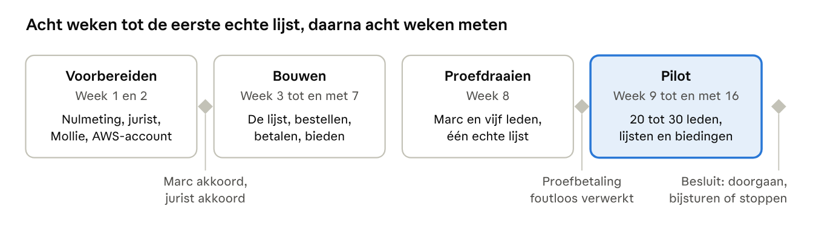

# Pilotplan: Marcs wijnclub

19 november 2026, bijgewerkt op 20 november 2026 · Aidan van Latestein

Opgeslagen uit het document op 19 november 2026: https://claude.ai/artifact/D2djDwZgkEWgahsqJxwJrT. Daarna is alleen dit bestand bijgewerkt. Op 20 november 2026 koos Aidan voor ontwerp V4 (`design-v4/`): betalen bij het bestellen, brengen of halen in plaats van afhaalpunten, en geen letters meer voor leden.

## Samenvatting

De pilot is een besloten web-app waarin 20 tot 30 leden van Marcs WhatsApp-groep op twee manieren wijn kopen: van de lijst tegen vaste prijs, en via een bieding op een bijzondere fles. Na acht weken pilot weten we of leden liever zo bestellen dan via de groepschat, en of het Marc tijd scheelt.

- **De lijst:** de wijnen die Marc nu in WhatsApp aanbiedt, met zijn tekst per wijn. Een lijst staat enkele uren open. Een lid tikt aan hoeveel flessen het wil, kiest brengen of halen en betaalt meteen met iDEAL. Marc houdt de flessen 15 minuten vast.
- **De bieding:** voor bijzondere flessen waarvan Marc er maar één of enkele heeft. Het hoogste bod op de eindtijd wint. Marc kiest per wijn welke vorm het wordt.
- **Voor Marc:** hij fotografeert de fles, plakt zijn WhatsApp-bericht en kijkt na wat de app herkende. De voorraad telt automatisch af. Het overzicht "nog beschikbaar" en de lijst van wat hij brengt en wat er gehaald wordt, maakt de app.
- **Wat het niet is:** geen marktplaats tussen leden, geen app uit de App Store en geen vervanging van de WhatsApp-groep. De groep blijft de plek waar Marc de link deelt.

De app draait serverloos op AWS en kost naar verwachting minder dan €10 per maand aan hosting. De betaling loopt via Marcs eigen Mollie-account.

## Aannames en open beslissingen

Het plan rust op acht aannames. De eerste twee zijn op 20 november 2026 bewust omgedraaid, met de keuze voor ontwerp V4; de andere zes zijn nog niet bevestigd. De eerste drie bepalen de vorm van de app.

| Aanname | Als het anders is |
| --- | --- |
| Een lid betaalt een bestelling van de lijst meteen bij het bestellen, per bon. Marc houdt de flessen 15 minuten vast. Omgedraaid op 20 november 2026: eerst werd er pas betaald als de lijst sloot | Bestellen vraagt nu een betaalstap en is daardoor trager dan een bericht in WhatsApp. Haken leden af bij het betalen, dan kan betalen na het sluiten terugkomen |
| Marc brengt de flessen naar het adres van het lid, of het lid haalt ze bij hem op. Per avond kiest Marc het moment, en bij halen de plek. Omgedraaid op 20 november 2026: eerst waren het afhaalpunten per regio | Brengen vraagt een afleveradres per lid. Kost brengen Marc te veel tijd, dan biedt hij voor een avond alleen halen aan |
| Marc heeft geregeld een bijzondere fles die een bieding waard is | Zonder zulke flessen blijft de bieding ongebruikt en kan dat deel later gebouwd worden |
| De wijnen komen uit Marcs eigen inkoop | Verkoop namens leden vraagt een beoordelingsstap en commissie. Dat is een latere fase |
| Marc is de verkoper en ontvangt de betalingen op zijn eigen Mollie-account | Zonder eigen account moet er een andere verkopende partij komen |
| De pilot is een hulpmiddel voor Marc, geen product voor andere verkopers | Meerdere verkopers vraagt vanaf het begin gescheiden gegevens per verkoper |
| Er is geen pakketverzending | Verzending vraagt verpakking, verzekering en een leeftijdscheck aan de deur |
| Eén bouwer werkt er in deeltijd aan | De planning schuift mee |

Op 20 november 2026 is ook besloten dat het fotograferen van een fles en het voorstellen van een tekst in de pilot komen, in week 4. Het stond eerder als eerste stap van onderwerp 1 op de roadmap. Marc begint met een foto, met zijn WhatsApp-bericht of met beide. De app leest het etiket, en uit een paar steekwoorden van Marc maakt ze drie tekstvoorstellen; Marc kiest er één en past hem aan. De stijl van de voorstellen levert Aidan later aan, op basis van Marcs omschrijvingen in WhatsApp.

Deze punten moeten vóór de bouw rond zijn:

- [ ] Marc is akkoord met de pilot en met zijn rol: wijnen invoeren, teksten controleren, afleveren
- [ ] Vastgelegd hoe leden nu betalen en hoe de flessen bij hen komen
- [ ] Marc heeft een Mollie-account op naam van zijn zaak
- [ ] De naam van de club is gekozen. Een eigen domein hoeft nog niet: de app draait voorlopig op het adres dat AWS geeft, zie onderwerp 13 op de roadmap
- [ ] De 20 tot 30 leden voor de pilot zijn gekozen, met voorkeur voor wie nu het vaakst bestelt
- [ ] Een jurist heeft de punten onder Juridisch en privacy bekeken
- [ ] Nulmeting gedaan bij de eerstvolgende lijst in WhatsApp: aantal berichten, tijd van Marc, tijd tot betaling, fouten in de telling

## Scope

Leden hebben één startpagina, zonder tabbalk. Marc heeft drie beheerschermen. Alles wat handel tussen leden raakt, blijft erbuiten.

| Onderdeel | In de pilot | Niet in de pilot |
| --- | --- | --- |
| De lijst | Wijnen van Marc tegen vaste prijs, met voorraad per wijn en zijn eigen inleiding. Enkele uren open. Meerdere wijnen in één bestelling. Bijbestellen kan tot de lijst sluit, als een nieuwe bon met een eigen betaling | Staffelkorting, abonnement |
| De bieding | Bijzondere flessen, één per keer, met eindtijd. Het hoogste bod wint | Flessen van leden, prijsvergelijking |
| Advies | Bij elke wijn Marcs tekst. Marc schrijft hem zelf, neemt hem over uit zijn WhatsApp-bericht, of kiest uit drie voorstellen die de app maakt uit zijn steekwoorden en het etiket. "Wat eet je erbij" en "wanneer drinken" mogen leeg blijven. Bij een bieding ook herkomst, bewaring en een spraakbericht | Algemeen wijnadvies los van het aanbod. Een tekst uit een spraakbericht, en voorstellen die leren van Marcs eerdere teksten (onderwerp 1 op de roadmap) |
| Betalen | iDEAL via Mollie. Lijst: meteen bij het bestellen, één betaling per bon. Marc houdt de flessen 15 minuten vast; daarna vervalt een onbetaalde bon en komt de voorraad terug. Namens een lid: het lid krijgt een betaallink en heeft 48 uur. Bieding: binnen 48 uur na het winnen | Credits, creditcard, betalen tussen leden, één betaling per lid voor een hele lijst |
| Je bestellingen | Wat het lid op de lopende lijst bestelde en de fles die het won, met brengen of halen, de status en betalen. Het lid komt er via de terugblik na de avond | Een eigen collectie: eerder gekocht, een oordeel per wijn, opnieuw bestellen en flessen in bewaring. Dat is onderwerp 14 op de roadmap |
| Levering | Brengen of halen, door Marc per avond ingesteld. Brengen: Marc brengt de flessen naar het adres van het lid, op een moment dat hij kiest. Halen: het lid haalt ze bij Marc op, op een moment en een plek die hij kiest. Ook voor een gewonnen fles kiest het lid brengen of halen | Bewaren bij Marc (onderwerp 9 op de roadmap), pakketverzending, afhaalpunten per regio |
| Contact | Knop "Vraag Marc", naar WhatsApp met de wijn ingevuld | Chat in de app, een bot, een boekingssysteem voor diners |
| Meldingen | Nieuwe lijst, één herinnering "nog beschikbaar" voor het sluiten, nieuwe bieding, overboden, gewonnen. Een betaallink bij een bestelling namens een lid, en één herinnering om te betalen bij een bestelling namens een lid of een gewonnen fles. "Ik ben onderweg" aan wie Marc gaat brengen. Bij elke melding legt de app vast wanneer hij verstuurd is en hoeveel leden erop tikten | Marketingberichten en geplande campagnes. Die staan op de roadmap |
| Toegang | Alleen op uitnodiging van Marc. Inloggen met een code per e-mail, daarna eventueel met een passkey ("Face ID") | Open aanmelding |
| Beheer | Drie schermen. De avond: wijnen op tafel zetten, iets tegen de tafel zeggen, de veiling starten en de avond sluiten. Nieuwe fles: de fles fotograferen, het etiket en het WhatsApp-bericht laten herkennen, nakijken, steekwoorden geven en een tekstvoorstel kiezen, en kiezen tussen lijst en veiling. Afleveren: wat Marc brengt en wat er gehaald wordt, afvinken, een betaallink sturen en laten weten dat hij onderweg is. Verder: een avond met brengen en halen instellen, een bestelling namens een lid invoeren met letters en aantallen, het overzicht "nog beschikbaar" delen in WhatsApp, en het afleveradres van een lid bijhouden | Boekhouding, facturen |

De stijl volgt marckookt.com: de lijst op één scherm, een bijzondere fles met een grote foto, korte tekst in de je-vorm.

## Hoe het werkt

Marc zet wijnen op de lijst of start een bieding en deelt de link; het lid bestelt of biedt, betaalt en ziet zijn flessen terug.

**Voor Marc**

1. Hij maakt een lijst aan met een titel, een korte inleiding en een eindtijd. Per avond kiest hij of hij brengt, of leden komen halen, of beide, met het moment en bij halen de plek.
2. Per wijn fotografeert hij de fles, plakt hij zijn WhatsApp-bericht, of doet hij beide. Van het etiket worden naam, producent, jaargang en streek gelezen; uit het bericht naam, jaargang, tekst, aantal en prijs. Hij kijkt ze na. Heeft hij nog geen tekst, dan typt of dicteert hij een paar steekwoorden, zoals "fris, citrus, bij asperges", en kiest hij uit drie voorstellen. Woorden die niet van hem of van het etiket komen, zijn gemarkeerd. De wijn krijgt de volgende letter, zoals nu in de groep. Leden zien die letter niet; Marc gebruikt hem als hij namens een lid bestelt.
3. Hij kiest per wijn: op de lijst tegen vaste prijs, of als bieding met startbod en eindtijd. Bij een bieding voegt hij de herkomst toe en spreekt hij een bericht van 30 seconden in.
4. Hij publiceert. Leden krijgen een melding en Marc deelt de link in de WhatsApp-groep.
5. De voorraad telt automatisch af. Bestelt iemand in de groep of in een privébericht, dan typt Marc de letters en aantallen in, zoals "C2 D2". Het lid krijgt een betaallink en heeft 48 uur om te betalen.
6. Voor het sluiten deelt hij met één tik het overzicht "nog beschikbaar" in de groep. Leden krijgen één herinnering.
7. Na de avond ziet hij onder Afleveren wat hij brengt en wat er gehaald wordt. Aan wie nog moet betalen stuurt hij een betaallink. Gaat hij brengen, dan laat hij met één tik weten dat hij onderweg is. Wat afgeleverd is, vinkt hij af.

**Voor een lid**

1. Het lid krijgt een uitnodiging van Marc en logt eenmalig in met een code per e-mail. Daarna kan het een passkey kiezen ("Face ID"): dan komt het de volgende keer met één tik binnen. Het blijft ingelogd op die telefoon.
2. Het zet de app op het beginscherm van de telefoon en staat meldingen toe.
3. Bij een nieuwe lijst tikt het per wijn aan hoeveel flessen het wil.
4. Het kiest brengen of halen en betaalt meteen met iDEAL. Marc houdt de flessen 15 minuten vast; mislukt het betalen, dan kan het binnen die tijd opnieuw. Daarna vervalt de bon en komen de flessen terug in de voorraad. Bijbestellen kan tot de lijst sluit, met een nieuwe bon.
5. Kiest het brengen, dan brengt Marc de flessen naar het adres van het lid, op het moment dat hij voor die avond koos. Kiest het halen, dan haalt het ze bij Marc op.
6. Op een bijzondere fles doet het een bod. Wint het, dan betaalt het binnen 48 uur en kiest het daarna brengen of halen.
7. Na de avond leidt de terugblik naar Je bestellingen: wat het op de lopende lijst bestelde en welke fles het won, met de status en hoe het de flessen krijgt.

**Regels voor een bieding**

- Een bod is bindend en moet minstens de minimale verhoging boven het hoogste bod liggen.
- Een bod in de laatste twee minuten verlengt de eindtijd met twee minuten.
- De winnaar heeft 48 uur om te betalen. Daarna beslist Marc of de fles naar de volgende bieder gaat.
- Leden zien het hoogste bod, niet wie het deed. Design-v3 stelt vaste bijnamen per veiling voor, zoals "Bieder 7", die niet herleidbaar zijn tot het lid; dat is een open beslissing voor Aidan en de jurist.

**Regels voor de lijst**

- De voorraad is leidend. Is een wijn op, dan staat hij op uitverkocht.
- Een betaalde bestelling is bindend. Annuleren kan alleen via Marc.
- Een lijst sluit op de eindtijd die Marc kiest, of eerder als hij hem zelf sluit. Het sluiten verandert niets aan een betaling.
- Het lid betaalt meteen bij het bestellen, per bon. Marc houdt de flessen 15 minuten vast. Is er dan niet betaald, dan vervalt de bon en komen de flessen terug in de voorraad. Marc levert pas uit na betaling.
- Een bestelling namens een lid heeft 48 uur. Na 24 uur volgt één herinnering. Daarna vervalt de bestelling: de flessen komen terug in Marcs voorraad en hij krijgt bericht.
- Bestellen is de aantallen kiezen, brengen of halen kiezen, en betalen. Door de betaalstap duurt dat langer dan een WhatsApp-bericht; zie de eerste aanname.

## Schermen en UX

Elk scherm heeft één hoofdknop. De specificatie van de schermen is ontwerp V4: `design-v4/DESIGN.md` en de schermen in `design-v4/schermen/`. Wat V4 niet tekent, komt uit `design-v3/`. Het klikbare prototype in `app/` laat de schermen zien; het eerste prototype, `wijnclub-prototype.html`, is achterhaald.

Zeven regels gelden voor elk scherm:

- **Gemaakt voor de telefoon:** vrijwel elk lid gebruikt de app op zijn telefoon, staand en met één hand. Elk scherm wordt daarvoor ontworpen en daarop getest. Zie "Mobiel eerst" hieronder.
- **De lijst is één scherm:** alle wijnen onder elkaar, met het aantal direct erbij. Een bijzondere fles krijgt een eigen scherm met een grote foto.
- **Naam en foto, geen letters:** een lid ziet een wijn bij zijn naam en met een foto. Marc gebruikt de letters uit WhatsApp nog als hij namens een lid bestelt, zoals "G2 H1". Besloten op 20 november 2026, met ontwerp V4.
- **Eén hoofdknop per scherm**, altijd onderaan.
- **Marc eerst:** zijn inleiding staat boven de lijst en zijn tekst bij elke wijn, boven de prijs.
- **Snel:** aantallen aantikken, brengen of halen kiezen, betalen. Sinds 20 november 2026 hoort betalen bij het bestellen; daardoor is bestellen een stap langer dan een WhatsApp-bericht.
- **Rustig:** geen knipperende aftelklok, badges of punten. Design-v3 stelt een live-stip die niet knippert, het label "net op tafel" en een rustige klok in de laatste twee minuten van een veiling voor; dat is een open beslissing voor Aidan en Marc.

**Een avond bij Marc (design-v3).** Het ontwerp maakt van elke lijst een avond, zoals nu in de WhatsApp-groep. Marc kondigt de avond aan met een persoonlijk bericht en wat er op tafel komt. Op de begintijd wordt het aanbod een live feed: Marc zet de wijnen een voor een op tafel, zegt er iets bij, en leden zien wat er gebeurt ("een lid nam 2 × Janasse", "de Verdejo is op"), zonder namen. Bestellen gaat zoals hierboven: aantallen aantikken, brengen of halen, en meteen betalen. De bijzondere fles gaat aan het eind onder de hamer, in een zaal met het hoogste bod groot in beeld en een biedlog. Na afloop volgt een terugblik. Waar dit afwijkt van de regels in dit plan, staat het in de bouwspecificatie, hoofdstuk 9, als open beslissing; het prototype heeft daarvoor een instelling.

**Ontwerp V4 (design-v4).** V4 bouwt voort op de avond van design-v3. Er is geen tabbalk meer, leden zien geen letters, het lid betaalt op de bon en kiest daar brengen of halen, inloggen kan daarna met Face ID, en Marc zet een fles klaar met de camera. Aidan koos op 20 november 2026 om V4 te volgen, ook waar het van het plan afweek; dit plan en de bouwspecificatie zijn daarop aangepast. Wat V4 aan de regels verandert en wat nog niet getekend is, staat in `design-v4/DESIGN.md`.

Het lid heeft één startpagina: de aankondiging vóór de avond, het aanbod tijdens de avond en de terugblik erna. Je bestellingen bereik je via de terugblik. De nummers in de tabel zijn de schermen in `design-v4/schermen/`.

| Scherm | Wat erop staat | Hoofdknop |
| --- | --- | --- |
| Inloggen (01 tot en met 05) | Het e-mailadres, de code uit de mail, de vraag of je 18 jaar of ouder bent (met Ja ga je akkoord met de voorwaarden), en daarna eventueel een passkey ("Face ID"). Wie Face ID koos, ziet de volgende keer "Welkom terug" en komt met één tik binnen | Stuur mij een code, daarna Ja, kom binnen |
| Aanbod: aankondiging (06) | Vóór de begintijd: datum, Marcs aankondiging en wat er vanavond op tafel komt, met de veiling als laatste regel. Een wijn is alvast te bekijken | Herinner mij op de begintijd |
| Aanbod: de avond (07) | Tijdens de avond: een live feed met Marcs berichten, de wijnen die hij op tafel zette (foto, naam, kleur en land, tekst, prijs, voorraad en een aantal dat je aantikt) en wat er gebeurt, zonder namen van leden. Daaronder wanneer de veiling begint. Na afloop een terugblik, met de weg naar Je bestellingen | Bestel, zodra er iets is aangetikt |
| Wijn van de lijst (08) | Foto en Marcs tekst. "Wat eet je erbij" en "wanneer drinken" alleen als Marc ze heeft ingevuld. Zwevend: terug naar het aanbod en Vraag Marc | Aantal aantikken, daarna Bestel |
| De bon (09) | De gekozen wijnen met aantallen en het totaal, brengen of halen met het moment, en dat Marc de flessen 15 minuten vasthoudt | Betaal met iDEAL |
| Betaald (10) | De bon met de stempel BETAALD, en hoe je de flessen krijgt: brengen of halen, met het moment en bij brengen het adres. Mislukt de betaling of vervalt de bon, dan staat dat er in dezelfde stijl | Terug naar het aanbod |
| Bijzondere fles | Grote foto, spraakbericht van Marc, drie blokken (waarom deze, wanneer drinken, wat eet je erbij), herkomst en bewaring. Uit design-v3, te openen vanaf de zaal | Bied met het volgende bedrag |
| De veiling (11, 13 en 14) | De zaal: het hoogste bod groot, de hamertijd, de biedlog met berichten van Marc; je eigen bod staat in goud. In de laatste twee minuten "eenmaal, andermaal" met een rustige klok. Na de hamer "verkocht" voor de winnaar met de betaalknop, "afgelopen" voor de anderen, en de terugblik op de avond | Bied met het volgende bedrag |
| Bieden (12) | Paneel van onderaf met drie bedragen en de melding dat een bod bindend is | Bevestig bod |
| Na een gewonnen bieding | Betalen, daarna brengen of halen kiezen. Nog niet getekend | Klaar |
| Je bestellingen | Wat je op de lopende lijst bestelde en de fles die je won, met brengen of halen en de status: betaal vóór een tijd, betaald, gebracht of opgehaald. Is er niets besteld, dan staat dat er, met een link naar het aanbod. Nog niet getekend | Naar het aanbod. Een bon die nog open is, heeft zelf een betaalknop |
| Marc | Zijn foto, een korte tekst, voorwaarden en privacy. Zonder tab; nog niet getekend in V4 | Vraag Marc |
| Beheer (15 tot en met 21) | Drie schermen. De avond (`/beheer`, 20): wijnen op tafel zetten, iets tegen de tafel zeggen met snelle zinnen, de veiling eerder starten en de avond sluiten, met tellers. Nieuwe fles (`/beheer/nieuw`, 15 tot en met 19): fotograferen of de WhatsApp-tekst plakken, nakijken wat de app herkende, lijst of veiling, en klaar. Steekwoorden geven en een tekstvoorstel kiezen hoort bij nakijken (16) en is nog niet getekend. Afleveren (`/beheer/afleveren`, 21): brengen, halen en klaar, een betaallink sturen en "laat weten: ik ben onderweg". Een bestelling namens een lid in de stijl van V4, en een avond plannen met de momenten van brengen en halen, zijn nog niet getekend | Zet de wijn op tafel, Zet klaar voor de avond, of Laat weten: ik ben onderweg |

"Vraag Marc" opent WhatsApp met een bericht dat al klaarstaat, inclusief de naam van de fles.

**Mobiel eerst**

Vrijwel elk lid opent de app op zijn telefoon, via de link in de WhatsApp-groep. De telefoon is daarom het uitgangspunt voor ontwerp, bouw en test, en geen variant van een groter scherm. Een groter scherm toont dezelfde kolom van hoogstens 430 px. Dit geldt ook voor het beheer: Marc werkt ook op zijn telefoon.

- **Met één hand:** de hoofdknop staat onderaan, binnen bereik van de duim. Wat je nodig hebt om te bestellen, te bieden of te betalen staat nooit alleen bovenaan.
- **Tikvlakken van minstens 44 × 44 px**, met ruimte ertussen. Dat geldt ook voor de flessen in de flessenrij.
- **Het belangrijkste zonder scrollen** op een kleine telefoon van 375 × 667 px: de eerste wijn op de kaart, brengen of halen en het totaal op de bon, het hoogste bod en de eindtijd bij een bijzondere fles, en de knop om een bod te bevestigen.
- **Leesbaar:** lopende tekst is minstens 16 px. Alles wat je moet kunnen lezen heeft een contrast van minstens 4,5:1, ook een keuze die nog niet gekozen is. Inzoomen blijft mogelijk.
- **Geen vergissing bij een bindende stap:** vóór Betaal en Bevestig bod staan aantal, bedrag en brengen of halen in beeld. Dubbel tikken geeft één bestelling, één betaling of één bod. Een stap die niet terug te draaien is, zoals de lijst sluiten, vraagt een bevestiging.
- **Bestand tegen onderbreking:** je keuze blijft staan als je even naar je mail, WhatsApp of je bank gaat en terugkomt. Bij terugkomst zijn voorraad en hoogste bod ververst. De terugknop van de telefoon sluit eerst een open paneel.
- **Bruikbaar op een trage verbinding:** elk scherm laat zien dat het laadt of dat het niet lukte, en de kaart staat er binnen drie seconden.
- **Getest op echte telefoons:** de browsertests draaien op telefoonformaat, en elke release wordt met de hand nagelopen op een iPhone en een Android-telefoon.

De meetbare eisen en de stand van het prototype staan in de bouwspecificatie, hoofdstuk 10.

**Stijl, overgenomen van marckookt.com**

| Onderdeel | Keuze | Opmerking |
| --- | --- | --- |
| Achtergrond en tekst | Zwart met witte tekst, grijs voor bijschriften | Zoals de site |
| Lettertype | Smal en schreefloos, koppen in hoofdletters | De site gebruikt DIN Pro Condensed, waarvoor een licentie nodig is. Het prototype gebruikt Barlow Condensed |
| Accent | Goud, alleen voor het woord "wijnclub" en kleine markeringen | Kleur geschat op basis van het logo |
| Knoppen | Rechthoekig, hoofdletters. Wit voor de hoofdknop, grijs voor de rest | Zoals de site |
| Scheidingslijnen | Gestippeld onder kopjes en tussen regels | Zoals de site |
| Toon | Je-vorm, korte zinnen, Marc in de ik-vorm | Zoals de site |

Dit moet Marc aanleveren voordat het prototype naar leden gaat:

- [ ] Logo in de witte uitvoering en de exacte goudkleur
- [ ] Besluit over het lettertype: licentie voor DIN Pro Condensed of het gratis alternatief
- [ ] Vijf tot tien eigen foto's, waaronder één portret
- [ ] Eén echte fles met zijn advies in eigen woorden en een spraakbericht van 30 seconden
- [ ] Tien tot twintig van zijn omschrijvingen uit WhatsApp, als voorbeeld voor de stijl van de tekstvoorstellen. Aidan maakt daar een beschrijving van de stijl van. De berichten zelf komen alleen in de openbare repository als Marc dat goed vindt
- [ ] Zijn oordeel over het prototype, daarna een test met drie leden op hun eigen telefoon

## Architectuur op AWS

De app is volledig serverloos: er draait geen server die onderhoud vraagt, en zonder gebruik kost hij vrijwel niets.

Leden en Marc gebruiken dezelfde web-app; Marc heeft daarnaast het beheerscherm. Mollie is de enige externe partij.

| Onderdeel | Dienst | Toelichting |
| --- | --- | --- |
| Web-app | S3 + CloudFront | Statische bestanden, bijvoorbeeld gebouwd met React. Dit deel blijft JavaScript, omdat het in de browser draait. Installeerbaar op het beginscherm |
| Inloggen | Cognito | Code per e-mail of passkey, geen wachtwoorden. Twee groepen: lid en beheer |
| Toegang tot gegevens | API Gateway (HTTP API) + Lambda in Python | Eén functie per taak: lijst, bestellen, bieden, mijn bestelling, beheer, melding van Mollie |
| Opslag | DynamoDB | Betalen naar gebruik |
| Foto's en spraakberichten | S3 achter CloudFront | Niet publiek toegankelijk buiten CloudFront om |
| Eindtijd van een bieding en vervallen bonnen | EventBridge Scheduler | Eén geplande taak per bieding, die de winnaar vaststelt en de betaallink maakt. Een taak die elke minuut draait, laat onbetaalde bestellingen vervallen en geeft de voorraad terug |
| Live bijwerken (design-v3, nog te kiezen) | API Gateway WebSocket API + Lambda, of pollen | Nieuwe wijn, bericht en voorraad binnen 2 seconden, de stand van de veiling binnen 1 seconde. Voor de pilot kan pollen elke 3 seconden volstaan. Zie de bouwspecificatie, hoofdstuk 9 |
| Meldingen | Web Push vanuit Lambda, e-mail via SES als terugval | Op een iPhone werkt een melding pas als de app op het beginscherm staat |
| Bericht en etiket herkennen, tekst voorstellen | Bedrock, in een regio in de EU | Haalt naam, jaargang, aantal, prijs en tekst uit Marcs WhatsApp-bericht, en naam, producent, jaargang en streek van de foto van het etiket. Maakt drie tekstvoorstellen uit Marcs steekwoorden. Marc controleert het resultaat en kiest. Eén model dat ook afbeeldingen leest |
| Sleutels | Secrets Manager | Mollie-sleutel en de sleutels voor meldingen |
| Logboek en alarmen | CloudWatch | Alarm bij mislukte betaalmeldingen en mislukte sluiting van een bieding |
| Opzet van de omgeving | AWS CDK in Python | Alles als code, in dezelfde taal als de Lambda-functies. Een privé-AWS-account dat Aidan deelt met zijn eigen andere projecten, met een aparte stack voor test en productie |

**Beveiliging**

- Inloggen gaat via Cognito en wordt niet zelf gebouwd. Zelf aanmelden staat uit; alleen Marc nodigt uit.
- Elke aanroep controleert wie er is ingelogd. Een lid ziet alleen zijn eigen biedingen en bestellingen. Beheer vraagt de groep beheer.
- Uploads zijn een risico. Alleen Marc mag uploaden, alleen afbeeldingen en geluid, met een maximale grootte, via een tijdelijke uploadlink.
- Foutmeldingen aan gebruikers zijn algemeen. Details staan alleen in het logboek, zonder persoonsgegevens.
- Er staan geen sleutels in de code, en afhankelijkheden staan op een exacte versie.
- De API begrenst het aantal aanroepen per gebruiker, zodat een fout of misbruik geen kosten opdrijft.

## Deployment, testen en CI/CD

Elke wijziging gaat via een pull request in GitHub, wordt automatisch getest en uitgerold naar de teststack. Productie krijgt alleen een versie die op test is geslaagd, en pas als jij er een release-tag op zet.

Faalt een stap, dan stopt de pipeline en gaat er niets door naar de volgende stap. Ingericht zijn nu de controles, de uitrol naar test en productie, de rooktest en de toegang via OIDC; de workflows staan in `.github/workflows`. mypy, cdk-nag, de integratietests en de end-to-end-tests volgen.

**Opzet**

| Onderdeel | Keuze | Waarom |
| --- | --- | --- |
| Code | Eén repository in GitHub met `app/` (web-app), `functions/` (Lambda in Python), `infra/` (CDK in Python) en `tests/` | Eén plek en één pull request per wijziging |
| Werkwijze | Korte branches en een pull request naar `main`. `main` is altijd uit te rollen | Past bij één bouwer in deeltijd |
| Pipeline | GitHub Actions | Zit bij de code, geen extra dienst om te beheren |
| Toegang tot AWS | GitHub logt via OIDC in met een tijdelijke rol. Er staan geen AWS-sleutels in GitHub | Niets om te lekken of te vervangen |
| Omgevingen | Per omgeving vier CDK-stacks, `Wijnclub-test-*` en `Wijnclub-prod-*`, elk met eigen tabellen, gebruikers en Mollie-sleutel. De stack `Wijnclub-GitHub` regelt de toegang van de pipeline; die rol je eenmalig zelf uit | Test raakt nooit productiegegevens |
| Afhankelijkheden | Python via pip met exacte versies in de requirements-bestanden, de web-app via npm met lockbestand. Elke GitHub Action vastgezet op een commit-hash | Elke build is gelijk. Een gekaapt versielabel van een Action, zoals bij tj-actions in 2025, komt er niet in |
| Uitrollen | `cdk deploy` per stack. CloudFormation draait een mislukte uitrol zelf terug | Nooit een half bijgewerkte omgeving |

**Drie momenten in de pipeline**

1. **Bij elke pull request:** ruff, pip-audit en pytest op de Python-code, npm audit en build van de web-app, `cdk synth` voor test en productie, en `cdk diff` tegen productie in de samenvatting van de controle. Een pull request uit een fork krijgt nooit toegang tot AWS. De pipeline heeft hier alleen leesrechten. Doel: klaar binnen vijf minuten.
2. **Bij elke merge naar main:** uitrol naar de teststack, daarna de rooktest. De integratietests en de end-to-end-tests tegen die stack komen erbij zodra er meer gebouwd is.
3. **Bij een release-tag, zoals `v2026.12.1`:** de pipeline wacht op jouw goedkeuring in de GitHub-omgeving `productie`, rolt dezelfde commit uit naar productie en draait de rooktest. Faalt de uitrol of de rooktest, dan rolt de pipeline de vorige release-tag opnieuw uit en faalt de run, zodat jij een melding krijgt.

De repository is openbaar. Daardoor kan productie een echte goedkeuringsstap krijgen: de uitrol draait in de GitHub-omgeving `productie`, die alleen tags met `v` toelaat en op jouw goedkeuring wacht. Alleen vanuit die omgeving mag GitHub de productierol in AWS aannemen. De logs van een openbare repository zijn ook openbaar; het accountnummer en het afzenderadres staan daarom als geheim in GitHub, en GitHub maskeert ze in de logs.

**Testen**

Alle tests draaien in pytest, ook de browsertests via Playwright voor Python. Zo heeft de bouwer één testtaal.

| Laag | Wat het controleert | Wanneer | Waartegen |
| --- | --- | --- | --- |
| Unit-tests | Regels voor bieden (minimale verhoging, verlenging in de laatste twee minuten, eindtijd), bestelling en voorraad, het verwerken van een Mollie-melding, het herkennen van een WhatsApp-bericht en een etiket en het controleren van tekstvoorstellen met een nagebootst taalmodel, en het tellen van een tik op een melding: één keer per lid | Elke pull request | Alleen de code, geen AWS |
| Integratietests | Twintig gelijktijdige biedingen: precies één winnaar per bedrag. Gelijktijdige bestellingen: de voorraad komt nooit onder nul. Een bieding sluit op de eindtijd. Dezelfde Mollie-melding twee keer: één betaling | Elke merge | Teststack, met echte DynamoDB en Mollie in testmodus |
| End-to-end-tests | Vier stromen op een telefoonscherm van 375 × 667 px en van 320 × 568 px: van de lijst bestellen en meteen betalen, een bon die niet betaald wordt en vervalt, bieden en winnen, en Marc die een wijn op de lijst zet. Bij elke stroom ook de eisen voor de telefoon die een test kan meten: tikvlakken, geen horizontaal scrollen en wat zonder scrollen in beeld moet staan | Elke merge | Teststack, via de browser |
| Handtest op telefoons | Dezelfde stromen op een echte iPhone (in Safari en vanaf het beginscherm) en een echte Android-telefoon (in Chrome), één keer met de schermlezer aan | Elke release | Teststack |
| Smoke-test | De site laadt, de lijst is op te vragen, inloggen werkt. Er worden geen bestellingen geplaatst | Elke release | Productie |
| Herkennen en voorstellen | Twintig echte aanbiedingen van Marc met de juiste naam, jaargang, aantal en prijs als antwoord, en twintig foto's van etiketten met de juiste naam, producent, jaargang en streek. Minstens 95% van de velden moet kloppen. Tien sets steekwoorden: bij elk voorstel is met de hand nagekeken dat er geen smaak, score of prijs bij verzonnen is | Bij een wijziging van prompt of model, en wekelijks | Teststack, met het echte taalmodel |
| Beveiliging | pip-audit en npm audit op bekende kwetsbaarheden, secret scanning op de repository. cdk-nag op de infrastructuur volgt | Elke pull request, en wekelijks | De code |

**Testgegevens en inloggen in de test**

- De teststack krijgt bij elke uitrol vaste voorbeeldwijnen en testleden uit een seed-script. Productiegegevens gaan nooit naar test.
- Inloggen met een code per e-mail is niet te automatiseren. In de teststack krijgen testleden daarom een wachtwoord dat de pipeline zelf aanmaakt en in Secrets Manager zet. In productie staat inloggen met een wachtwoord uit.
- Betalingen op test lopen via de testsleutel van Mollie. De browsertest kiest op de testbetaalpagina van Mollie of de betaling lukt of mislukt.
- Een lijst of bieding sluit in de test niet na uren of dagen: de test zet de eindtijd op één minuut.

**Eén account, twee stacks**

Eén AWS-account met een aparte stack voor test en productie is voor de pilot werkbaar. Beide stacks delen wel de uitrolrollen van CDK, dus de scheiding zit vooral in wie de pipeline mag starten. Vier afspraken houden het veilig:

- Alles van de wijnclub begint met `Wijnclub-` of `wijnclub-`, en niets anders in het account wordt aangeraakt. Het account is gedeeld met andere eigen projecten. De pipeline kan alles in het account, ook daar; dat risico is bewust genomen voor de pilot, zie "Een gedeeld account" in de README.
- Pull requests krijgen een rol die alleen de sjablonen van de stacks kan lezen, geen gegevens. Alleen `main` mag naar test uitrollen, en alleen de omgeving `productie` naar productie.
- Elke naam begint met de stacknaam, en geen functie of rol van test heeft rechten op tabellen of sleutels van productie.
- De productiestack heeft beëindigingsbeveiliging, en de productietabellen hebben verwijderbeveiliging en herstel tot op de seconde (point-in-time recovery).

Komen er meer leden, andere verkopers of een tweede ontwikkelaar bij, dan is een eigen AWS-account voor de wijnclub de volgende stap.

## Gegevensmodel

Negen soorten gegevens volstaan, elk in een eigen DynamoDB-tabel met betalen naar gebruik. Je bestellingen heeft geen eigen tabel: dat scherm leest de bestellingen van het lid.

| Tabel | Sleutel | Belangrijkste velden |
| --- | --- | --- |
| `lid` | lidId (uit Cognito) | naam, telefoon, afleveradres (straat met huisnummer, postcode, plaats; alleen voor wie wil dat Marc brengt), brengen of halen als voorkeur, datum 18+-bevestiging, meldingsabonnementen |
| `lijst` | lijstId | titel, inleiding, open van en tot, status, levering: brengen (van en tot) en halen (van, tot en waar), of één van de twee |
| `wijn` | wijnId | naam, producent, jaargang, soort (vaste prijs of bieding), tekst, waar de tekst vandaan komt (uit het bericht, een voorstel, een aangepast voorstel, of zelf geschreven), foto. Optioneel: druif, spijs, drinken van en tot. Bij vaste prijs: lijstId, letter, prijs, voorraad. Bij een bieding: startbod, minimale verhoging, eindtijd, herkomst, spraakbericht, hoogste bod, hoogste bieder |
| `bod` | wijnId + tijdstip | lidId, bedrag |
| `bestelling` | bestellingId | lidId, soort (lijst, namens, bieding), lijstId, regels (wijnId, aantal, prijs), totaal, status (open, betaald, verlopen, terugbetaald), betalen vóór, levering (brengen of halen), afgeleverd, ingevoerd door (lid of Marc). Het adres staat niet op de bestelling |
| `betaling` | nummer van de Mollie-betaling | de bestelling waar hij bij hoort. Een betaling hoort bij precies één bestelling |
| `weergave` | wijnId + lidId | het eerste moment waarop het lid een bieding opende. Vervalt na 180 dagen |
| `bericht` | berichtId | soort (nieuwe lijst, nog beschikbaar, betaallink bij een bestelling namens een lid, betaalherinnering, nieuwe bieding, overboden, gewonnen), kanaal (melding, e-mail, groep), de lijst of wijn waar het over gaat, verzonden op, aantal ontvangers |
| `tik` | berichtId + lidId | het eerste moment waarop het lid op de melding tikte. Verdwijnt vanzelf na 180 dagen |

Drie regels houden de gegevens kloppend:

- **Een bod** wordt alleen opgeslagen als het hoger is dan het hoogste bod plus de minimale verhoging, de eindtijd niet voorbij is en de bieding open staat. DynamoDB controleert dat in dezelfde schrijfactie, zodat twee gelijktijdige biedingen elkaar niet overschrijven.
- **Voorraad** gaat omlaag op het moment van bestellen, voor alle wijnen in de bestelling tegelijk. Is één wijn net op, dan gaat de hele bestelling niet door en ziet het lid welke wijn het is. Is een bestelling van de lijst 15 minuten na het bestellen niet betaald, of een bestelling namens een lid na 48 uur, dan komt de voorraad terug.
- **Eén betaling per bestelling.** Elke bon wordt apart betaald, ook wat het lid bijbestelde en wat Marc namens hem invoerde. Er is geen gezamenlijke betaling per lid per lijst.

`bericht` en `tik` dienen alleen om te meten welk moment werkt. Wie na een bericht bestelde of bood, leidt de app af uit de bestellingen en biedingen; dat wordt niet apart opgeslagen. `weergave` dient alleen de tellingen voor de roadmap.

## Betaling

Alle betalingen lopen via iDEAL op Marcs eigen Mollie-account, zodat het geld rechtstreeks bij hem komt en de app nooit geld vasthoudt.

- **De lijst:** het lid betaalt meteen bij het bestellen, op de betaalpagina van Mollie, één betaling per bon. Marc houdt de flessen 15 minuten vast. Mislukt de betaling, dan kan het lid binnen die tijd opnieuw betalen. Daarna vervalt de bon en komen de flessen terug in de voorraad. Marc levert pas uit na betaling. Sinds 20 november 2026; eerst kwam er één betaalverzoek per lid als de lijst sloot.
- **Bieding:** bieden kost niets. De winnaar heeft na de eindtijd 48 uur om te betalen, en kiest daarna brengen of halen. iDEAL kan geen bedrag vooraf reserveren; in een besloten groep die Marc kent is dat een aanvaardbaar risico.
- **Bestelling namens een lid:** Marc voert de bestelling in. Het lid krijgt een betaallink naar de app en heeft 48 uur om te betalen.
- **Wie niet betaalt:** bij een bestelling namens een lid en een gewonnen fles volgt na 24 uur één herinnering. Na 48 uur vervalt de bestelling en krijgt Marc bericht. Bij een bestelling namens een lid komen de flessen terug in de voorraad; bij een gewonnen fles beslist Marc of hij naar de volgende bieder gaat.
- **Terugbetalen:** Marc doet dat zelf in het Mollie-dashboard. De app neemt de status over.

Voor de bouw gelden drie punten:

- De melding van Mollie bevat alleen een betalingsnummer. De app vraagt de status daarna zelf bij Mollie op en vertrouwt nooit op de inhoud van de melding.
- Dezelfde melding kan meer dan één keer binnenkomen. De verwerking moet dan hetzelfde resultaat geven.
- De Mollie-sleutel staat in AWS Secrets Manager, niet in de code of in omgevingsvariabelen. Bouwen en testen gebeurt met de testsleutel van Mollie.

## Juridisch en privacy

Zes punten moeten door een jurist bekeken worden voordat de pilot start. De middelste kolom is mijn inschatting uit het hoofd, geen juridisch advies.

| Onderwerp | Inschatting | Wat te doen |
| --- | --- | --- |
| Leeftijd | Verkoop van alcohol op afstand vraagt een leeftijdscontrole van 18 jaar, bij bestellen en bij afleveren | Marc bevestigt bij de uitnodiging dat het lid volwassen is; het lid bevestigt het zelf bij de eerste login. Laten toetsen of dat volstaat, ook als Marc de flessen aan huis brengt |
| Bedenktijd | Bij verkoop op afstand aan consumenten geldt in principe 14 dagen bedenktijd, waarschijnlijk ook bij online bieden | Laten uitzoeken, ook wanneer de termijn ingaat |
| Bindend bod | Een bod is alleen afdwingbaar als de voorwaarden dat zeggen | Korte clubvoorwaarden opstellen die het lid bij de eerste login accepteert |
| WhatsApp | Nagezocht: het [beleid van WhatsApp voor zakelijke accounts](https://whatsappbusiness.com/policy/) (versie 23 september 2026) staat berichten die alcohol promoten alleen toe in een lijst met landen. Nederland staat daar niet op. Verkopen via een catalogus of betaling in WhatsApp mag nergens | Bestellen en betalen blijven in de app; in de groep staat alleen de link. Laat toetsen of Marcs huidige berichten in de groep onder dit beleid vallen |
| Btw en accijns | Voor Marcs eigen inkoop verandert er niets | Marcs boekhouder laten bevestigen |

**Privacy (AVG)**

- Marc is verantwoordelijk voor de gegevens van zijn leden. Wie de app bouwt en beheert is verwerker; daar hoort een verwerkersovereenkomst bij.
- De app bewaart alleen wat nodig is: naam, e-mail, telefoon, brengen of halen als voorkeur, biedingen en aankopen, en een afleveradres voor wie wil dat Marc brengt. Alleen het lid zelf en de groep beheer zien dat adres; het komt niet op de bestelling en niet in het logboek. Geen geboortedatum, geen kopie van een identiteitsbewijs. Het adres kwam erbij op 20 november 2026, met de keuze voor brengen of halen.
- Voor de tellingen van de pilot legt de app 180 dagen vast welk lid een bieding opende. Marc en de bouwer zien daarvan alleen aantallen. Dit staat in de privacyverklaring, en de grondslag hoort bij de juridische check.
- De app legt vast op welke melding een lid tikte, om te meten welk moment werkt. Dat staat in de privacyverklaring. Na 180 dagen verdwijnt dat gegeven vanzelf. Laat toetsen of hiervoor toestemming nodig is.
- Alle gegevens staan in een AWS-regio binnen de EU. Ook het taalmodel in Bedrock draait in de EU.
- De foto van een fles en Marcs steekwoorden gaan naar het taalmodel. De web-app haalt de locatie en andere gegevens uit de foto voordat hij wordt geüpload. Op de foto hoort alleen de fles; laat de jurist meekijken naar wat AWS met deze gegevens doet.
- Er komt een korte privacyverklaring in de app, en een lid kan zijn gegevens laten verwijderen. Betaalgegevens blijven bij Mollie en in Marcs boekhouding zolang de fiscale bewaarplicht dat vraagt.
- Namen, adressen en bedragen per persoon komen niet in de logbestanden.

## Planning

De eerste echte lijst staat acht weken na de start online; daarna loopt de pilot acht weken. De weken gaan uit van één bouwer in deeltijd.

Elke ruit is een voorwaarde om door te gaan. Zonder akkoord van Marc en de jurist begint de bouw niet.

| Week | Oplevering |
| --- | --- |
| 1 en 2 | Open beslissingen rond, nulmeting gedaan, Mollie-account en AWS-account aangemaakt |
| 3 | Omgeving als code met AWS CDK, pipeline met teststack, inloggen op uitnodiging, lege web-app online op het adres dat CloudFront geeft |
| 4 | Beheer: de fles fotograferen, het etiket lezen, het WhatsApp-bericht plakken en herkennen, nakijken, tekstvoorstellen uit steekwoorden (twee tot drie dagen extra), een lijst met inleiding en met brengen en halen, wijn op de lijst zetten. Het afleveradres van een lid. De lijst en de wijnpagina voor leden |
| 5 | Bestellen met brengen of halen, voorraad en 15 minuten houdtijd, meteen betalen via Mollie in testmodus, een onbetaalde bon laten vervallen, bijbestellen als nieuwe bon. Je bestellingen |
| 6 | Bieding: bieden, sluiten op de eindtijd, betalen binnen 48 uur, daarna brengen of halen kiezen. Vastleggen wie een bieding opent en welk bod de eindtijd verlengt |
| 7 | Meldingen en herinneringen, met een meting per melding. Bestelling namens een lid met een betaallink, overzicht "nog beschikbaar", afleveren met brengen en halen en "ik ben onderweg", knoppen naar WhatsApp, voorwaarden en privacyverklaring, alarmen. De drie tellingen voor de roadmap opvraagbaar |
| 8 | Eerste release naar productie. Proefdraaien met Marc en vijf leden, met één echte lijst en echte betalingen |
| 9 tot en met 16 | Pilot. Marc plaatst zijn lijsten in de app en start minstens twee biedingen. Alleen fouten worden hersteld; er komen geen nieuwe functies bij |

Vanaf week 3 gaat elke wijziging via de pipeline naar de teststack. Elke week komen de tests voor wat in die week gebouwd is erbij, zodat de pipeline in week 8 de hele app afdekt.

Een goedkopere eerste stap is mogelijk: alleen week 3 tot en met 5, zonder bieding. Dan staat na vijf weken de lijst met bestellen en betalen online. Dat dekt wat Marc nu al via WhatsApp doet, en de bieding komt er later bij.

## Kosten

De lopende kosten blijven naar verwachting onder €10 per maand; de echte investering is bouwtijd. De bedragen zijn schattingen uit het hoofd en moeten tegen de actuele prijslijsten gecontroleerd worden.

| Post | Schatting | Toelichting |
| --- | --- | --- |
| AWS-hosting | Onder €10 per maand | Bij 30 tot 120 gebruikers valt bijna alles binnen het gratis gebruik. De vaste post is de sleutel in Secrets Manager |
| Domeinnaam | Ongeveer €10 tot €15 per jaar, plus ongeveer een halve euro per maand als de DNS in Route 53 komt | Nog niet: de app draait voorlopig op het adres van CloudFront. Zie onderwerp 13 op de roadmap |
| Mollie | Geen vaste kosten, ongeveer €0,30 per iDEAL-betaling | Marc betaalt dit als verkoper. Het is één betaling per bestelling, niet per fles |
| Inloggen | Gratis op deze schaal | Met een code per e-mail. Een code per sms kost per bericht en is niet nodig |
| Bedrock: bericht en etiket herkennen, tekst voorstellen | Onder €1 per maand met een klein model, €2 tot €3 met een middelgroot model | Zie "Kosten van het taalmodel" hieronder |
| Juridische check | Eenmalig, bedrag onbekend | Offerte vragen |
| Bouw en beheer | Eigen uren | Geen licentiekosten |
| GitHub Actions | Gratis | De repository is openbaar; voor openbare repositories zijn de standaardrunners van GitHub gratis |
| Teststack | Enkele euro's per maand | Dezelfde diensten als productie, met weinig gebruik. De wekelijkse test van het taalmodel kost enkele centen |

Zet in het AWS-account een budgetalarm op €20 per maand, zodat een fout in de opzet niet ongemerkt geld kost.

**Kosten van het taalmodel**

Bedrock rekent per token: een stukje tekst van ongeveer een halve tot driekwart woord, en een foto telt als een vast aantal tokens. Er zijn geen vaste kosten. De schatting hieronder gebruikt de prijzen die Anthropic zelf rekent, op 20 november 2026: Claude Haiku 5.5 $0,10 per miljoen tokens in en $0,50 uit, Claude Sonnet 5.5 $2 in en $10 uit. Bedrock heeft eigen prijzen, mogelijk met een toeslag voor een regio in de EU. Controleer ze op de prijspagina van Bedrock bij de keuze van het model in week 4.

| Per wijn | Tokens, ruw geschat | Klein model (Haiku 5.5) | Middelgroot model (Sonnet 5.5) |
| --- | --- | --- | --- |
| Bericht herkennen | 1.000 in, 300 uit | minder dan $0,001 | ongeveer $0,005 |
| Etiket lezen: een foto van 1600 px en de vraag | 2.000 in, 300 uit | minder dan $0,001 | ongeveer $0,007 |
| Drie tekstvoorstellen, met voorbeelden van de stijl | 2.000 in, 1.500 uit, inclusief het denkwerk van het model | ongeveer $0,001 | ongeveer $0,02 |
| Samen | | ongeveer $0,002 | ongeveer $0,03 |

- **Pilot:** tien wijnen per week, waarvan Marc een deel twee of drie keer opnieuw laat voorstellen, is ruim honderd aanroepen per maand. Dat is minder dan $1 per maand met het kleine model en $2 tot $3 met het middelgrote.
- **Teststack:** de wekelijkse test met het echte model is vijftig aanroepen: een paar cent met het kleine model, ongeveer $0,50 per keer met het middelgrote. Bij het bouwen in week 4 komt daar enkele euro's aan proberen bij.
- **Overig in AWS:** de foto's in S3 (een paar honderd kB per wijn), de uploads en de extra Lambda-functies vallen bij dit gebruik in centen of binnen het gratis gebruik.
- **Welk model:** begin met het kleine model en stap alleen over als de test met twintig etiketten en tien sets steekwoorden niet goed genoeg is. Het verschil is in deze pilot een paar euro per maand; de kwaliteit van de voorstellen weegt zwaarder.
- **Onverwachte kosten:** alleen de groep `beheer` kan het model aanroepen, met een limiet per dag in de app. Het budgetalarm hierboven vangt de rest op. Omdat het account gedeeld is, krijgen alle onderdelen van de wijnclub een tag, zodat de kosten van de wijnclub apart te zien zijn.

## Succescriteria

De pilot is geslaagd als leden liever via de app bestellen dan via WhatsApp en Marc er per lijst minder tijd aan kwijt is dan nu. De streefwaarden zijn een voorstel; stel ze met Marc vast vóór de start.

| Wat we meten | Streefwaarde | Hoe |
| --- | --- | --- |
| Uitgenodigde leden die inloggen | 70% of meer | Telling in de app |
| Bestellingen van pilotleden die via de app komen | 80% of meer | Bestellingen van leden tegenover wat Marc namens leden invoert |
| Tijd van lijst openen tot besteld | Onder een halve minuut | Gemeten in de app |
| Bestellingen die binnen hun termijn betaald zijn, zonder dat Marc erachteraan moet: 15 minuten voor een bon, 48 uur namens een lid of na een bieding | 90% of meer | Betaald tegenover vervallen, per soort bestelling |
| Tijd van Marc per lijst | Lager dan de nulmeting | Marc noteert het per lijst |
| Fouten in voorraad, betaling of paklijst | Geen | Marcs telling tegenover de app |
| Biedingen: aantal bieders per fles en eindprijs tegenover Marcs verwachting | Geen streefwaarde, wel volgen | Telling in de app |
| Leden die op een tweede en derde lijst bestellen | Geen streefwaarde, wel volgen | Telling in de app |
| Oordeel van leden | Vijf gesprekken na afloop | Bellen of aan tafel |
| Beste moment: per melding het tijdstip, het aantal leden dat tikte en de bestellingen binnen 24 uur | Geen streefwaarde, wel volgen | Vastgelegd bij elke melding; één overzicht aan het eind van de pilot |

Na acht weken valt het besluit:

- **Doorgaan** als de streefwaarden voor bestellen via de app, betalen, fouten en Marcs tijd gehaald zijn. Dan volgen de overige leden.
- **Bijsturen** als leden wel inloggen maar via WhatsApp blijven bestellen: dan is bestellen in de app nog niet snel genoeg. Vervallen veel bonnen omdat leden afhaken bij het betalen, dan kan betalen na het sluiten terugkomen.
- **Stoppen** als minder dan de helft inlogt of Marc er meer tijd aan kwijt is dan via WhatsApp.

De bieding wordt apart beoordeeld: trekt een bijzondere fles meerdere bieders en een prijs waar Marc tevreden over is, dan blijft hij. Zo niet, dan gaat alleen de lijst door.

## Markt en concurrentie

Er is geen app gevonden die doet wat de wijnclub doet, maar het model zelf is niet nieuw: minstens drie Nederlandse wijnverkopers verkopen op dezelfde manier via een WhatsApp-groep, zonder app. De echte concurrent van de app is daarmee WhatsApp zelf. Voor de bieding bestaan grote veilinghuizen, die de koper ongeveer een kwart bovenop het bod rekenen.

Nagezocht op 19 november 2026, op openbare websites. Drie beperkingen:

- Geen van de aanbieders noemt het aantal leden of de omzet.
- Er is geen aanbieder in Roermond of Limburg gevonden. Besloten groepen zijn van buitenaf niet te vinden, dus dat bewijst niet dat ze er niet zijn. Marc weet dit beter dan een zoekmachine.
- De websites van Catawiki, Sylvie's, Boeren & Buren en Rechtstreex waren niet te lezen. Wat daarover staat, is als onbevestigd gemarkeerd of weggelaten.

**Verkopers met hetzelfde model**

| Aanbieder | Kanaal | Bestellen | Betalen | Ophalen of bezorgen | Wat opvalt |
| --- | --- | --- | --- | --- | --- |
| [SLOQ](https://sites.google.com/smarterwinebuyers.com/sloq/english), Hilversum | WhatsApp-groep, toegang via een bericht of via een lid dat je voorstelt | Antwoord in de groep of privébericht. De resterende voorraad wordt na elke bestelling in de groep bijgewerkt | Factuur met betaallink na het bestellen, binnen 7 dagen | Ophalen bij het magazijn, bezorgen of pakketpost | Wachtlijst: onbetaalde of geannuleerde flessen gaan op volgorde naar de wachtenden. Proeverijen |
| [MÈZON](https://mezonwine.nl/), Haarlem en Amsterdam | Eén WhatsApp-groep, elke donderdag een aanbod | Antwoord in de groep met fles en aantal | Betaalverzoek aan het eind van de dag | Ophalen op afspraak op drie plekken, of verzenden | Flessen blijven staan tot het totaal €350 is; daarna is verzending gratis. Geen webshop, geen abonnement |
| [Wine Drops](https://wijntripje.nl/wine-drops/) van Wijntripje | WhatsApp-community, open via een link | Antwoord in de groep of privébericht | Betaalgegevens na bevestiging | Verzenden €9,95 tot zes flessen, ophalen gratis | Werft met "geen webshop, geen account". Enkele berichten per maand, geen vast ritme |
| [Slimmer Wijn Kopen](https://slimmerwijnkopen.nl/hoewerkthet) | Website en nieuwsbrief, ongeveer 30 deals per jaar | Op de website | Bij het bestellen | Gratis thuisbezorgd binnen twee weken na de deal | Een deal gaat alleen door als de minimale afname gehaald is, anders volgt terugbetaling. Punten: 3% per bestelling, 10% van de eerste bestelling van een vriend |

Geen van de vier heeft een bieding, en geen van de vier heeft een app.

**Veilingen**

| Aanbieder | Kosten | Werking | Wat opvalt |
| --- | --- | --- | --- |
| [Winefield's](https://www.winefields.com/conditions-of-sale/), Amsterdam | Koper: 24% opgeld. Verkoper: 10 commissie en 1,5 verzekering volgens de [verkooppagina](https://www.winefields.com/sell/); de eenheid staat er niet bij, vermoedelijk procenten | Zaalveilingen en online veilingen met een eindtijd, bijvoorbeeld 48 uur | App met volgen van kavels, meldingen en bieden bij afwezigheid. De tweede bieder blijft aan zijn bod gebonden als de winnaar niet betaalt |
| [iDealwine](https://www.idealwine.com/en/corporate/conditions_generales), Frankrijk | Koper: 25,8% inclusief btw sinds 27 maart 2026. Wie niet betaalt: 10% van het bedrag plus €75 | Veilingen van ongeveer tien dagen, vier tot vijf per maand. Maximaal bod. Een bod in de laatste vijf minuten verlengt de kavel | Richtprijs per kavel, minimumprijs standaard op de onderkant daarvan. Beoordeling van vulniveau, etiket en kurk. Ook verkoop tegen vaste prijs |
| Catawiki | Koper 9%, verkoper 12,5% volgens een [artikel van Emerce](https://www.emerce.nl/nieuws/catawiki-verzuimt-klanten-vooraf-toestemming-vragen-commissiekosten) zonder duidelijke datum. Niet bevestigd bij Catawiki zelf | Wekelijkse online veilingen, ook van particulieren | Het grootste bereik. Kavels verschijnen ook op Marktplaats |
| [Crurated](https://crurated.com/what-membership-means) | Lidmaatschap €300 per jaar exclusief btw, kwijtgescholden bij €5.000 aan aankopen | Geen veiling: toewijzingen rechtstreeks van producenten | Gratis opslag in Beaune, diners en proeverijen met producenten |

**Software waarmee een verkoper het zelf inricht**

| Aanbieder | Wat het is | Dekt van de pilot | Dekt niet |
| --- | --- | --- | --- |
| [Table22](https://www.table22.com/), Verenigde Staten | Platform waarmee restaurants en winkels een club, abonnement of losse actie aanbieden. Meer dan 1.000 aangesloten zaken volgens eigen opgave | Leden, betalen, ophalen of bezorgen, herinneringen | Niet in Nederland gevonden. Geen bieding |
| [Commerce7](https://documentation.commerce7.com/allocations), Noord-Amerika | Verkoopsoftware voor ruim 3.000 wijnhuizen volgens eigen opgave | Toewijzingen met begin- en einddatum, een maximum per klant, wensen die na afloop worden toegekend | Gericht op wijnhuizen met verzending. Geen afhaalpunten per regio, geen bieding |
| [Take App](https://www.take.app/features/whatsapp) | Winkel met bestellen via WhatsApp. Gratis tot 50 bestellingen per maand volgens een eigen pagina; betaald rond 40 tot 50 dollar per maand, de pagina's spreken elkaar tegen | Catalogus, bestelling, betaallink | Betalen na het sluiten met één betaling per lid, paklijst per afhaalpunt, bieding, toegang op uitnodiging. Of iDEAL werkt, is niet nagezocht |
| [Reorder](https://bird.com/en/blog/reorder-using-whatsapp-to-power-a-more-profitable-and-efficient-food-ordering-experience) | Bestellen in een privégesprek in WhatsApp, met betaallink en bevestiging | Laat zien dat het handwerk van een groep, zoals bestellingen ordenen en betalingen bevestigen, een erkend probleem is | Loopt via de zakelijke WhatsApp-koppeling. Die mag voor wijn in Nederland niet, zie de roadmap |

**Wat dit betekent**

- **Het model is bewezen, de app niet.** Drie verkopers draaien dit in WhatsApp en één werft uitdrukkelijk met "geen webshop, geen account". De pilot moet dus aantonen dat een app sneller is dan een antwoord in de groep. Het succescriterium van een halve minuut en het invoeren namens een lid zijn daarvoor de juiste keuzes.
- **Niemand combineert een lijst met een bieding.** De verkopers in WhatsApp bieden niet, de veilinghuizen hebben geen lijst van één verkoper die je kent.
- **De bieding kost het lid geen opgeld.** Bij de veilinghuizen komt er ongeveer een kwart bovenop het bod. In de club is het bod de prijs. Dat staat nu nergens in de app en hoort op het scherm van de bijzondere fles.
- **Marc is het onderscheid.** Geen van de gevonden aanbieders kookt. Het advies wat je erbij eet, de fles die aan tafel opengaat en ophalen in de eigen regio kan een landelijke verkoper niet namaken.
- **Wat anderen hebben en de pilot niet:** een wachtlijst, een vast ritme, flessen laten staan tot er een doos is, een lid dat een nieuw lid voorstelt, proeverijen, en bij veilingen een maximaal bod, een richtprijs en volgen. Die staan nu als onderwerp 4 tot en met 12 op de roadmap.
- **Terugkomen is de zwakke plek van online wijnverkoop.** Volgens [gegevens van Commerce7](https://wineindustryadvisor.com/2026/10/07/more-than-8-in-10-first-time-winery-web-buyers-dont-order-again-within-a-year-new-commerce7-data-shows/) bestelt meer dan acht op de tien nieuwe webklanten van wijnhuizen in de Verenigde Staten en Canada binnen een jaar niet opnieuw; wie terugkomt, doet dat meestal binnen twee maanden. Dat zijn webwinkels, geen besloten groep, dus het is een vraag en geen maatstaf. De pilot volgt daarom welk deel van de leden op een tweede en derde lijst bestelt; dat staat bij de succescriteria, zonder streefwaarde.

**Wat er in de omgeving verandert**

- **iDEAL wordt Wero.** Sinds eind januari 2026 staat het gezamenlijke logo bij webwinkels. De technische overstap loopt sinds oktober 2026 via de betaaldienstverlener, en iDEAL blijft naar verwachting tot eind 2027 beschikbaar, volgens [ABN AMRO](https://www.abnamro.nl/nl/zakelijk/producten/betalen/winkels-en-webshops/ideal-wordt-wero.html) en [Emerce](https://www.emerce.nl/nieuws/overgang-ideal-wero-begint-januari-2026). In 2027 komen er volgens ABN AMRO betaalvormen bij voor abonnementen en online bestellingen. Wat Mollie precies doet en wanneer, is niet nagezocht. Schermteksten zeggen beter "betalen" dan "iDEAL", en vraag Mollie of Wero een bedrag kan reserveren: dat zou het risico van de niet-betalende winnaar wegnemen.
- **Leeftijdscontrole bij online verkoop.** In januari 2026 is een [wetsvoorstel tot wijziging van de Alcoholwet](https://www.njb.nl/wetgeving/wetsvoorstellen/wijziging-alcoholwet/) ingediend over de naleving van de leeftijdsgrens bij online verkoop. Of het is aangenomen, is niet gevonden. Het [Ondernemersplein](https://ondernemersplein.overheid.nl/bedrijfsvoering/juridische-zaken/doe-een-leeftijdscontrole-bij-alcohol-verkopen-op-afstand/) schrijft nu al een controle voor bij de aankoop en bij de aflevering, met een vastgelegde werkwijze. Neem dit mee in de juridische check bij het punt Leeftijd.

## Roadmap

Na een geslaagde pilot volgen twee uitbreidingen met een taalmodel: eerst de omschrijving van een fles, daarna een assistent die vragen van leden beantwoordt. Die volgorde is bewust: de omschrijving bouwt voort op wat de pilot al doet en Marc keurt elke tekst goed. De assistent praat rechtstreeks met leden en vraagt meer waarborgen. Een derde uitbreiding staat los van het taalmodel: geplande campagnes, met een meting van het beste moment om leden te benaderen.

Onderwerp 4 tot en met 12 komen uit het marktonderzoek van 19 november 2026. Het zijn ideeën: ze zijn nog niet met Marc besproken en staan in volgorde van verwachte opbrengst tegenover bouwtijd. Geen ervan hoort in de pilot.

Onderwerp 13 is geen idee maar een uitgestelde keuze: het eigen domein. Het staat onderaan omdat het geen functie is, niet omdat het lang kan wachten.

Onderwerp 14 stond eerst in de pilot en is er op 19 november 2026 uitgehaald: de eigen collectie van een lid. De pilot gaat alleen over verkopen en bieden. Dat maakt de app eenvoudiger, en onderwerp 4 en een deel van onderwerp 5 en 9 wachten erop.

Onderwerp 15 is ook geen idee: het is de lijst met verbeterpunten uit de beveiligingsscan van 20 november 2026. Een deel moet af vóór de eerste uitrol naar productie.

| Onderwerp | Wat het oplevert | Start als |
| --- | --- | --- |
| 1. Omschrijving via een taalmodel | Marc zet een fles in enkele minuten online, in zijn eigen woorden. Het etiket lezen en tekstvoorstellen uit steekwoorden zitten al in de pilot; hier volgen spraak naar tekst en het leren van zijn stijl | De pilot geslaagd is en Marc in de pilot geregeld een voorstel koos |
| 2. Assistent voor vragen van leden | Leden krijgen direct antwoord op veelgestelde vragen; Marc krijgt alleen de vragen die hem nodig hebben | Er minstens 20 flessen met goedgekeurde tekst zijn en Marc dezelfde vragen steeds terug ziet komen |
| 3. Campagnes en het beste moment | Marc plant een reeks berichten rond een lijst of bieding en ziet welk moment de meeste bestellingen oplevert | De pilot geslaagd is en de app per melding heeft vastgelegd wanneer hij verstuurd is en wat hij opleverde |
| 4. Terug op de lijst en op dronk | Leden komen terug voor een wijn die ze lekker vonden, en openen een fles op het goede moment | Onderwerp 14 gebouwd is en er drie maanden aan aankopen en oordelen ligt |
| 5. Inkoopoverzicht voor Marc | Marc ziet per wijn hoe snel hij verkocht en wat er bleef staan. Met onderwerp 14 ook wat leden ervan vonden | De pilot geslaagd is. De verkoopgegevens liggen er dan al |
| 6. De bieding uitbreiden: maximaal bod, volgen, richtprijs | Een lid hoeft de eindtijd niet te bewaken, en weet vooraf wat een fles ongeveer doet | De bieding na de pilot blijft en leden afhaken omdat ze het einde missen |
| 7. Wijn aan tafel: proeverijen en diners | De club wordt meer dan een bestellijst, met iets wat alleen een chef kan bieden | Marc het wil en er een eerste avond te vullen is |
| 8. Een lid stelt een lid voor | De club groeit voorbij de huidige groep en blijft besloten | Alle huidige leden zijn uitgenodigd en Marc wil groeien |
| 9. Bewaren en bundelen | Een lid bestelt ook als het moment van brengen of halen niet past | Leden lijsten overslaan vanwege het moment van brengen of halen |
| 10. Voorinschrijving met een drempel | Marc koopt alleen in wat al verkocht is | Marc wijnen kan krijgen met een minimale afname |
| 11. De vaste doos van Marc | Voorspelbare omzet, en leden die niet elke lijst hoeven te volgen | Een vaste groep op bijna elke lijst bestelt |
| 12. Wachtlijst bij uitverkocht | Een fles die vrijkomt gaat vanzelf naar wie hem wilde | Marc wijnen gaat verkopen die hij kan nabestellen, of bestellingen geregeld vervallen |
| 13. Eigen domein en eigen afzenderadres | Een adres dat leden herkennen, en een inlogcode die van de club komt | De naam van de club gekozen is. Uiterlijk vóór de eerste uitnodiging aan een lid |
| 14. Mijn flessen: de eigen collectie | Een lid ziet terug wat het kocht, wat het ervan vond en wat bij Marc ligt, en bestelt opnieuw | De pilot geslaagd is en leden vragen wat ze eerder kochten, of onderwerp 4 aan de beurt is |
| 15. Security: verbeterpunten uit de scan | De pipeline, het inloggen en de API zijn dicht voordat er echte leden en betalingen zijn | Nu. Groep A vóór de eerste release-tag, groep B vóór de eerste uitnodiging aan een lid |

**1. Omschrijving via een taalmodel**

In de pilot herkent de app al naam, jaargang, aantal, prijs en tekst in Marcs WhatsApp-bericht. Op 20 november 2026 is de eerste stap van dit onderwerp naar de pilot gehaald: Marc fotografeert de fles, de app leest het etiket, en uit zijn steekwoorden maakt ze drie tekstvoorstellen in een vaste stijl. Zie Hoe het werkt en de bouwspecificatie, hoofdstuk 5. Na de pilot volgen nog twee stappen:

1. **Van spraak naar tekst.** Marc spreekt 30 seconden in over de fles. De app schrijft daar de drie blokken van: waarom deze, wanneer drinken, wat eet je erbij.
2. **Zijn stijl leren.** Eerder goedgekeurde teksten gaan als voorbeeld mee, zodat een nieuw voorstel klinkt als Marc. In de pilot is de stijl nog één vaste beschrijving.

Vier regels gelden daarbij:

- Marc keurt elke tekst goed voordat een lid hem ziet.
- Herkomst en bewaring worden nooit gegenereerd. Die komen alleen uit wat Marc zelf invoert.
- Het model verzint geen scores, prijzen of smaken die Marc niet noemde.
- We meten hoeveel tijd een fles Marc kost en welk deel van het concept hij ongewijzigd laat. In de pilot legt elke wijn vast waar de tekst vandaan komt.

Technisch blijft dit binnen de bestaande opzet: een taalmodel via Bedrock voor tekst en etiket, en Amazon Transcribe voor de spraak. Of Transcribe Nederlands goed genoeg herkent, moet een proef met Marcs eigen opnames uitwijzen.

**2. Assistent voor vragen van leden**

De assistent is een chatvenster in de app dat vragen beantwoordt over het aanbod, de eigen flessen en de werking van de club. Voorbeelden: wanneer is mijn fles op dronk, wat eet ik erbij, wat is het verschil tussen deze twee flessen, hoe werkt bieden, waar is mijn bestelling.

| Onderdeel | Keuze |
| --- | --- |
| Waar hij uit put | Alleen Marcs goedgekeurde teksten, de voorwaarden van de club en de bestellingen en flessen van het lid zelf |
| Als hij het niet weet | Hij zegt dat, en biedt aan de vraag met één tik door te zetten naar Marc via WhatsApp |
| Hoe hij zich voorstelt | Als assistent van de club, nooit als Marc. Leden weten dat ze met een AI praten |
| Wat hij niet doet | Bieden, kopen of betalen namens een lid. Uitspraken over de waarde van een fles. Advies over alcohol en gezondheid |
| Wat hij mag zien | Alleen gegevens van het lid dat de vraag stelt, en alleen lezen |

De risico's en wat ertegen helpt:

- **Een fout antwoord dat als advies van Marc wordt gelezen.** De assistent antwoordt alleen uit goedgekeurde tekst en noemt de fles waar het antwoord vandaan komt. Marc bekijkt elke week een steekproef van gesprekken.
- **Leden die de assistent iets anders proberen te laten doen.** Hij heeft geen rechten om iets te wijzigen, en de invoer van een lid geldt als vraag, nooit als opdracht aan het systeem.
- **Het persoonlijke contact verdwijnt.** "Vraag Marc" blijft op elk scherm staan. De assistent komt ernaast, niet ervoor in de plaats.
- **Privacy.** Gesprekken worden kort bewaard, staan in de privacyverklaring en worden niet gebruikt om een model te trainen. De verwerking blijft in de EU.
- **Regels voor AI.** Voor zover bekend verplicht de Europese AI-verordening om duidelijk te maken dat iemand met een AI praat. Laat dit meenemen in de juridische check.

Technisch is dit één extra Lambda-functie die het taalmodel via Bedrock aanroept. Bij enkele tientallen flessen passen alle teksten in de vraag aan het model, dus een aparte zoekdatabase is niet nodig. Een limiet per lid per dag voorkomt onverwachte kosten.

De assistent is geslaagd als hij meer dan de helft van de vragen afhandelt zonder Marc, en Marc in zijn wekelijkse steekproef geen antwoorden vindt die hij zelf anders had gegeven.

**3. Campagnes en het beste moment**

Een campagne is een reeks geplande berichten rond één lijst of bieding: een vooraankondiging, de opening, een herinnering, een laatste oproep en de uitslag. Marc plant de reeks één keer. De app verstuurt de berichten of zet ze voor hem klaar, en meet per bericht wat het opleverde.

Eén beperking bepaalt de vorm: **automatisch berichten sturen via WhatsApp kan voor wijn in Nederland niet binnen de regels van WhatsApp.** Dit is nagezocht op 19 november 2026.

| Route | Kan het | Waarom |
| --- | --- | --- |
| Zakelijke WhatsApp-koppeling, een bericht per lid | Nee | Het [beleid van WhatsApp](https://whatsappbusiness.com/policy/) staat berichten die alcohol promoten alleen toe in een lijst met landen. Nederland en de rest van Europa staan daar niet op |
| Automatisch plaatsen in Marcs bestaande groep | Nee | De [groepsfunctie van de koppeling](https://developers.facebook.com/documentation/business-messaging/whatsapp/groups/get-started/) werkt met groepen die via de koppeling zijn aangemaakt en vraagt een geverifieerd zakelijk account. Voor een bestaande groep is geen route beschreven |
| Marcs eigen account laten aansturen door software | Niet doen | Dat is tegen de voorwaarden van WhatsApp. Een blokkade raakt het nummer waar zijn zaak op draait |
| Marc plaatst zelf in de groep, de app zet het bericht klaar | Ja | Dit is de bestaande werkwijze. De app plant, herinnert hem en meet. Of de werkwijze zelf binnen het beleid past, hoort bij de juridische check |
| Melding van de app en e-mail | Ja | Dit zijn kanalen van de club zelf. Ze zijn volledig te plannen en te meten |

De campagne loopt daarom over drie kanalen:

1. **Melding van de app.** Automatisch, op het geplande moment.
2. **E-mail.** Automatisch, voor leden die geen meldingen aan hebben.
3. **De WhatsApp-groep.** Half automatisch. Op het geplande moment krijgt Marc een melding met het bericht kant-en-klaar. Eén tik opent WhatsApp, hij kiest de groep en verstuurt.

Zo blijft het bereik van de groep behouden zonder dat Marcs nummer gevaar loopt.

**Een reeks rond een bieding**

De tabel beschrijft de inhoud per bericht. De tekst zelf is van Marc.

| Moment | Bericht | Kanaal |
| --- | --- | --- |
| Ochtend | Vooraankondiging: vanavond komt er een bijzondere fles, nog zonder te zeggen welke | Groep, melding |
| Een uur vooraf | Een hint: de streek of de jaargang | Melding |
| Opening | De fles, Marcs spraakbericht en het startbod | Groep, melding, e-mail |
| Halverwege | De stand: het hoogste bod | Melding, alleen aan wie de fles bekeek |
| Laatste kwartier | Laatste oproep | Melding, alleen aan wie bood of bekeek |
| Na afloop | De uitslag: verkocht voor dit bedrag | Groep |

Voor een lijst is de reeks korter: aankondiging, opening, "nog beschikbaar" en de sluiting.

**Het beste moment meten**

- Elk bericht krijgt een eigen link. De app legt vast wanneer het verstuurd is, via welk kanaal, wie erop tikte, en wie daarna binnen 24 uur bestelde of bood.
- De maat is bestellingen en biedingen per bereikt lid. Geopende berichten tellen niet, want die zeggen niets over verkoop.
- Bij meldingen en e-mail kan de app eerlijk vergelijken: de leden worden willekeurig in twee helften verdeeld, en elke helft krijgt hetzelfde bericht op een ander moment. In de groep kan dat niet; daar vergelijk je lijsten onderling.
- Het overzicht toont per dag en dagdeel het aantal berichten, het bereik en de bestellingen, met de onzekerheid erbij. Het doet pas een aanbeveling als er genoeg metingen zijn.
- Met 30 leden en één lijst per week duurt het maanden voordat een verschil tussen twee momenten meer is dan toeval. Met 120 leden gaat dat vier keer zo snel.

**Sneller antwoord, zonder te bouwen**

De groepschat bevat al een deel van het antwoord. Marc kan de chat exporteren. Uit de tijdstippen van zijn aanbiedingen en de bestellingen daarna volgt op welke dagen en uren de groep het snelst en het meest bestelt. Dat kost een middag en kan vóór de pilot.

De export bevat namen en telefoonnummers van leden. Verwerk hem lokaal, bewaar alleen de tellingen en zet hem nooit in de repository.

**Regels**

- **Toestemming.** Volgens de [ACM](https://www.acm.nl/nl/verkoop-aan-consumenten/reclame-en-verleiden/spam-voorkomen-uw-reclame) mag reclame via e-mail, WhatsApp en andere elektronische berichten alleen naar mensen die vooraf toestemming gaven. Bestaande klanten mogen berichten krijgen over producten die met eerdere aankopen te maken hebben. Een lid geeft per kanaal toestemming bij de eerste login.
- **Afmelden.** In elk bericht staat hoe je je afmeldt, en de afzender is herkenbaar. In de app zet een lid elk kanaal apart uit.
- **Rust.** Geen campagneberichten tussen 21:30 en 9:00, en een maximum per lid per week. De grenzen stelt Marc vast.
- **Echte schaarste.** "Nog 3 flessen" komt uit de voorraad. Er zijn geen verzonnen aantallen en geen kunstmatige aftelklok.
- **Marc keurt elke tekst goed.** Een taalmodel mag een concept maken; er gaat niets uit zonder zijn akkoord.
- **Alcoholreclame.** Alleen aan leden die 18 jaar of ouder zijn, en zonder aan te zetten tot meer drinken. Laat de regels voor alcoholreclame meenemen in de juridische check.

**Techniek en kosten**

- EventBridge Scheduler plant elk bericht, zoals het ook het sluiten van een bieding plant. Een Lambda-functie verstuurt de melding of de e-mail, of stuurt Marc de herinnering met het klaargezette groepsbericht.
- Er komt één tabel bij: `campagne` (de lijst of bieding, de reeks, de status). `bericht` en `tik` bestaan sinds de pilot; `bericht` krijgt er de velden gepland op en tekst bij. De toestemming per kanaal staat bij het `lid`.
- Er komen geen nieuwe externe diensten of sleutels bij. Meldingen zijn gratis en e-mail via SES kost een fractie van een cent per bericht.
- Ter vergelijking: via de zakelijke WhatsApp-koppeling zou een marketingbericht naar een Nederlands nummer ongeveer €0,13 kosten, ruim €15 per bericht aan 120 leden. Dat bedrag komt uit tariefoverzichten van leveranciers; de tarieflijst van Meta zelf is niet geraadpleegd.

**Als het beleid van WhatsApp verandert**

Controleer het beleid elk kwartaal. Komt Nederland op de lijst, dan wordt WhatsApp een vierde kanaal in dezelfde planner. Er is dan toestemming per lid nodig, elk bericht gebruikt een goedgekeurd sjabloon en elk bericht kost geld.

**Wat de pilot hiervoor al vastlegt**

Meten kan alleen over berichten waarvan het tijdstip en de link bewaard zijn. De pilot legt daarom bij elke melding vast wanneer hij verstuurd is, en geeft elke melding een eigen link. Hetzelfde gebeurt als Marc de link of het overzicht "nog beschikbaar" in de groep deelt. Na acht weken ligt er zo een eerste meting, nog zonder dat er iets gepland of vergeleken wordt.

Campagnes zijn geslaagd als een lijst met campagne meer bestellingen per lid oplevert dan een lijst zonder, weinig leden zich afmelden, en Marc na een kwartaal een voorkeursmoment heeft dat op metingen berust.

**4. Terug op de lijst en op dronk**

Twee meldingen die uit Mijn flessen volgen, onderwerp 14. Zet Marc een wijn op de lijst die een lid eerder "Lekker" gaf, dan krijgt dat lid een melding. En valt een gekochte fles binnen de periode die Marc bij "wanneer drinken" invulde, dan krijgt het lid één bericht dat hij op dronk is.

- "Drinken van en tot" per wijn bestaat al. Het oordeel per lid komt met onderwerp 14; dat moet er dus eerst zijn.
- De melding "op dronk" verschijnt alleen als Marc de periode zelf heeft ingevuld. De app schat niets.
- Dit is het antwoord op de zwakke plek uit het marktonderzoek: terugkomen. Meet welk deel van de meldingen tot een bestelling leidt.
- De regels van de campagnes gelden ook hier: toestemming per kanaal, een maximum per week, niets na 21:30.

**5. Inkoopoverzicht voor Marc**

Een scherm in beheer met per wijn: verkocht van de voorraad, tijd tot uitverkocht, en flessen die bleven staan. Daarnaast per lijst het aantal bestellers en het bedrag per bestelling.

- Dit komt uit gegevens die de pilot al vastlegt. Het is alleen lezen.
- Hoeveel leden een wijn lekker vonden of niet, komt erbij zodra onderwerp 14 de oordelen vastlegt.
- Het overzicht toont tellingen per wijn, geen ranglijst van leden.
- Het helpt bij de vraag die geen concurrent voor Marc beantwoordt: wat hij de volgende keer inkoopt, en hoeveel.

**6. De bieding uitbreiden: maximaal bod, volgen, richtprijs**

De pilot heeft de kern: een bindend bod, een minimale verhoging en verlenging in de laatste twee minuten. Veilinghuizen bieden daarbovenop vier dingen die een lid verwacht dat ze kent.

| Onderdeel | Wat het doet | Waar het vandaan komt |
| --- | --- | --- |
| Maximaal bod | Het lid geeft één keer zijn hoogste bedrag op. De app biedt namens hem telkens de minimale verhoging, tot dat bedrag | iDealwine, en bieden bij afwezigheid bij Winefield's |
| Volgen | Eén tik op "Volg deze fles" geeft een melding bij een nieuw bod en een kwartier voor de eindtijd | De app van Winefield's, iDealwine |
| Richtprijs | Marc vult een bedrag van en tot in. Het veld mag leeg blijven | Beide veilinghuizen tonen een bandbreedte per kavel |
| Staat van de fles | Vulniveau, etiket en capsule, door Marc aangevinkt, bij de herkomst en bewaring | iDealwine beoordeelt vulniveau, etiket en kurk |

- Het maximum is geheim. Leden zien alleen het hoogste bod, zoals nu.
- Een maximaal bod is bindend tot het hele bedrag. Dat moet in de voorwaarden en op het scherm staan voordat het lid bevestigt.
- Bij twee gelijke maxima wint wie het eerst opgaf. De regel hoort in `domein/` met tests, en de schrijfactie in DynamoDB moet het verborgen maximum in dezelfde stap controleren als het bod.
- De richtprijs en de staat komen alleen van Marc en worden nooit gegenereerd, net als herkomst en bewaring.
- Zet op het scherm van de bijzondere fles dat er geen opgeld is. Dat kost één zin en geen bouwtijd.

**7. Wijn aan tafel: proeverijen en diners**

Een avond bij Marc staat als regel op de lijst: een proeverij rond de wijnen van die lijst, of een diner waar een bijzondere fles opengaat. Het aantal plaatsen is de voorraad. Het lid bestelt en betaalt zoals het een fles bestelt.

- Dit is het onderdeel dat een landelijke verkoper niet kan namaken. SLOQ en The Online Sommelier houden proeverijen, Crurated diners met producenten, en in de Verenigde Staten draaien meer dan duizend restaurants en winkels een club via Table22. Een [stuk over het verloop bij wijnclubs](https://wineindustryadvisor.com/2026/04/21/the-wine-club-retention-crisis/) noemt clubs die alleen een levering zijn als de eerste die leden opzeggen.
- Het blijft buiten wat de scope uitsluit: geen boekingssysteem voor diners. Het is één datum met een vast aantal plaatsen, geen agenda.
- Technisch is het een derde soort regel naast vaste prijs en bieding, zonder brengen of halen en met een datum. Bestellen, voorraad en betalen blijven gelijk.
- Wat Marc aanbiedt, voor welke prijs en hoe vaak, bepaalt hij. Hier staat alleen de vorm.
- Schenken op een eigen avond kan andere regels kennen dan verkoop van gesloten flessen. Laat dit meenemen in de juridische check.

**8. Een lid stelt een lid voor**

Een lid deelt een persoonlijke link met iemand die het kent. Die persoon vult zelf naam en e-mail in, en Marc keurt de aanvraag goed of af. De club blijft op uitnodiging; alleen de eerste stap komt van een lid. Bij SLOQ kom je zo de groep in, en Slimmer Wijn Kopen geeft er punten voor.

- Het lid voert geen gegevens van een ander in. De nieuwe persoon doet dat zelf, zodat er toestemming is.
- Marc ziet wie wie voorstelde. Dat is ook zijn waarborg bij een bod dat niet betaald wordt.
- Begin zonder beloning. Punten passen niet bij de regel "rustig", en een beloning voor het werven van wijnkopers raakt de regels voor alcoholreclame.
- Stel een grens aan het aantal leden, zodat de schaarste van een lijst echt blijft.

**9. Bewaren en bundelen**

Een lid kiest bij het bestellen "Bewaar bij Marc" in plaats van brengen of halen, en krijgt later alles in één keer. MÈZON laat flessen staan tot het totaal €350 is. In de pilot kan bewaren niet: elke fles wordt gebracht of gehaald, ook een gewonnen fles. Bewaren voor een fles uit een bieding stond eerst in de pilot en is er op 19 november 2026 uitgehaald; het is de kleinste eerste stap van dit onderwerp. Design-v3 tekende er de keuze BEWAAR voor.

- Dit neemt de reden weg om een lijst over te slaan omdat het moment van brengen of halen niet past.
- Het vraagt ruimte en aansprakelijkheid van Marc. Er moet vastliggen van wie de fles is en wie opdraait voor breuk, diefstal of een slechte kurk. Eerst moeten er dus bewaarvoorwaarden zijn en moet Marcs verzekering nagekeken zijn, met een maximale duur en een maximaal aantal flessen per lid. Laat ook uitzoeken wanneer de bedenktijd ingaat als Marc de fles bewaart.
- Of bewaren gratis is of een vergoeding kost, is een keuze van Marc.
- Het lid moet zien wat er in bewaring ligt. Dat hoort bij Mijn flessen, onderwerp 14, met de knoppen "Breng of haal alles" voor de eerstvolgende avond en "Open aan tafel" naar WhatsApp.
- Een goedkoper alternatief zonder opslag: een lid laat een ander lid voor hem ophalen, en dat staat bij Marc onder Afleveren.

**10. Voorinschrijving met een drempel**

Marc biedt een wijn aan die hij nog niet heeft ingekocht, met een minimum aantal flessen. Wordt het minimum gehaald als de lijst sluit, dan koopt hij in. Wordt het niet gehaald, dan vervalt de regel. Slimmer Wijn Kopen werkt zo, met terugbetaling als de minimale afname niet gehaald wordt.

- Sinds 20 november 2026 betaalt een lid bij het bestellen. Betaalt het ook hier meteen, dan moet Marc terugbetalen als het minimum niet gehaald wordt. Een alternatief is een betaallink na het sluiten, zoals bij een bestelling namens een lid: dan betaalt niemand voor een wijn die niet doorgaat.
- Het lid ziet de stand: nog zoveel flessen tot de wijn doorgaat. Dat is echte schaarste, geen aftelklok.
- De levertijd is langer dan bij een gewone lijst en moet bij het bestellen vermeld staan.
- Een wijn per doos, zoals MÈZON soms doet, is dezelfde regel met een veelvoud van zes.
- De bedenktijd bij een fles die nog besteld moet worden, hoort bij de juridische check.

**11. De vaste doos van Marc**

Een lid dat dat wil, krijgt elke maand of elk kwartaal een doos die Marc samenstelt, voor een vast bedrag, gebracht of op te halen bij Marc. Het is het model waarmee Table22 restaurants een club laat draaien. De scope sluit een abonnement nu uit, en dat blijft zo tot de lijst bewezen is.

- Overslaan en pauzeren moeten met één tik kunnen. Bij Commerce7 zijn overslaan, wisselen en pauzeren standaard.
- De cijfers manen tot voorzichtigheid: volgens hetzelfde stuk over het verloop zegt bijna 40% van de leden van Amerikaanse wijnclubs binnen een jaar op. De bron van dat cijfer wordt niet genoemd.
- Het vraagt terugkerende betalingen. Hoe dat bij Mollie werkt, is niet nagezocht, en met de overgang naar Wero komen er in 2027 volgens ABN AMRO betaalvormen voor abonnementen bij. Wacht daarop.
- Een lichtere eerste stap: "Marcs keuze" als één regel op een gewone lijst, een doos van zes die hij samenstelt. Dat meet de belangstelling zonder abonnement.

**12. Wachtlijst bij uitverkocht**

Staat een wijn op uitverkocht, dan tikt een lid op "Zet me op de wachtlijst" met een aantal. Komt er een fles vrij doordat een bestelling niet betaald wordt en vervalt, dan krijgt de eerste op de wachtlijst een aanbod dat een dag geldig is. SLOQ doet dit met de hand in de groep; Commerce7 kent het als wensen die na afloop worden toegekend.

- **Waarom dit onderaan staat.** Marc verkoopt vaak restpartijen. Is zo'n wijn op, dan komt er geen voorraad bij, en levert een wachtlijst alleen iets op als een bestelling vervalt.
- Het sluit aan op wat de pilot al doet: een vervallen bestelling geeft de voorraad nu terug aan Marc. Met een wachtlijst gaat die eerst naar een lid.
- Marc ziet per wijn hoeveel flessen er meer gevraagd waren. Bij een restpartij kan hij daar niets mee; bij een wijn die hij kan nabestellen wel.
- Er komt één tabel bij, `wachtlijst` (wijn, tijdstip, lid, aantal). De volgorde is het tijdstip van aanmelden, en dat staat in de voorwaarden.
- De pilot meet de vraag hiernaar niet.

**13. Eigen domein en eigen afzenderadres**

Voorlopig draait de app op het adres dat CloudFront geeft, zoals `d123abc.cloudfront.net`, en verstuurt Cognito de inlogcode vanaf één los e-mailadres dat in Amazon SES is geverifieerd. Dat is genoeg om te bouwen en om Marc het prototype te laten zien. Besloten op 19 november 2026.

- **Waarom het niet tot na de pilot kan wachten.** De app op het beginscherm, de toestemming voor meldingen en het ingelogd blijven horen bij het adres. Verandert het adres, dan moet elk lid de app opnieuw op het beginscherm zetten, opnieuw inloggen en meldingen opnieuw toestaan. Het domein moet er dus zijn vóór het eerste lid wordt uitgenodigd.
- **Wat het oplevert.** Een adres dat Marc in de groep kan delen en dat leden herkennen, en een inlogcode met de club als afzender in plaats van een los adres.
- **Wat erbij komt.** Het domein zelf, een certificaat in AWS Certificate Manager in de regio `us-east-1` (dat vraagt CloudFront, dus een kleine extra stack in die regio), het domein als afzender in SES met DKIM, en `afzender_email` op een adres van dat domein.
- **SES blijft een eigen stap.** Ook zonder domein geldt: in de proefomgeving van SES komt de inlogcode alleen aan op adressen die je zelf hebt geverifieerd. Toegang daarbuiten vraag je aan bij AWS, en dat moet rond zijn vóór de eerste uitnodiging.
- De naam van de club is een open beslissing van Marc; het domein volgt daaruit.

**14. Mijn flessen: de eigen collectie**

Een scherm waar een lid terugziet wat het bij Marc kocht. Het stond in de pilot en in de ontwerpen tot en met `design-v3` (scherm 12), en is er op 19 november 2026 uitgehaald: de pilot gaat alleen over verkopen en bieden, en dat maakt de app eenvoudiger. Wat er in de pilot van overblijft is Je bestellingen: de lopende bestellingen met status en betalen.

- **Eerder gekocht.** Per wijn het aantal en de datum, uit de bestellingen die al vastliggen.
- **Een oordeel per wijn:** "Lekker" of "Niet voor mij". Daar komt één tabel voor bij, `oordelen` (lid, wijn, oordeel).
- **Opnieuw bestellen** met één tik, als de wijn weer op een open lijst staat.
- **Tellers:** onderweg, bij Marc en gedronken.
- **In bewaring bij Marc** hoort hier pas bij als onderwerp 9 er is.
- Zelf flessen van elders toevoegen blijft erbuiten: het is geen kelderboek.
- Onderwerp 4 leunt op het oordeel, en onderwerp 5 gebruikt het voor wat leden van een wijn vonden.
- De pilot meet de vraag hiernaar niet. Vraag er in de vijf gesprekken na afloop naar.

**15. Security: verbeterpunten uit de scan**

Op 20 november 2026 zijn de repository, de instellingen van de repository in GitHub en de lokaal gebouwde sjablonen van de stacks nagelopen. Het AWS-account zelf is nog niet gescand: de sessie van het profiel `wijnclub` was verlopen. Die punten staan onderaan als nog te controleren.

Wat goed staat: geen geheimen of persoonsgegevens in de code of de geschiedenis, een noreply-adres als auteur, secret scanning met push-beveiliging aan, elke Action op een commit-hash, OIDC met het onveranderlijke onderwerp, een bucket die alleen CloudFront kan lezen, herstel naar een tijdstip op elke tabel, zelf aanmelden uit, `npm audit` zonder meldingen en `pip-audit` schoon op Python 3.14 in de pipeline.

*Groep A: vóór de eerste release-tag*

| Nr | Punt | Wat te doen |
| --- | --- | --- |
| A1 | De GitHub-omgeving `productie` bestaat niet. De rol `wijnclub-github-prod` vertrouwt alleen op de naam van die omgeving. Zonder goedkeurder en zonder beperking tot tags krijgt elke workflow die de omgeving noemt de productierol | Maak de omgeving aan met jezelf als verplichte goedkeurder en alleen tags `v*`. Dit is stap 3 van "Eenmalig instellen" in de README |
| A2 | `main` is niet beschermd en er zijn geen regels voor tags. Een push naar `main` rolt uit met rechten op het hele account | Een ruleset voor `main`: alleen via een pull request, de controles geslaagd, geen force-push en niet verwijderen. Een tweede ruleset voor tags `v*`: alleen jij maakt ze, en niet verplaatsen of verwijderen |
| A3 | Alle Actions zijn toegestaan en een commit-hash is niet verplicht. Een workflow van een externe bijdrager vraagt alleen de eerste keer om goedkeuring | Sta alleen `actions/*` en `aws-actions/*` toe, verplicht een commit-hash, en vraag goedkeuring voor elke externe bijdrager |
| A4 | De uitrolrollen van CDK zijn beheerder van het hele gedeelde account. Dat is een bewust risico, maar het maakt A1 tot en met A3 zwaarder | Een eigen bootstrap voor de wijnclub met een eigen kenmerk (qualifier) en een uitvoeringsbeleid of een grens (permissions boundary) die alleen `Wijnclub-*` en `wijnclub-*` toelaat. Of het eigen account uit de README |
| A5 | `productie.yml` controleert niet of de tag op `main` staat. Een tag op een losse commit gaat na goedkeuring naar productie | Een stap die stopt als de commit van de tag niet in `main` zit |
| A6 | De CDK-opdrachtregel komt bij elke run via `npx --yes aws-cdk@2.1149.0` binnen, zonder lockbestand; pip installeert zonder hashes. De versie staat vast, de inhoud en de onderliggende pakketten niet | Zet `aws-cdk` als ontwikkelpakket in een `package.json` met lockbestand en gebruik `npm ci`. Installeer Python-pakketten met `--require-hashes` |

*Groep B: vóór de eerste uitnodiging aan een lid*

| Nr | Punt | Wat te doen |
| --- | --- | --- |
| B1 | Inloggen met een wachtwoord staat in beide omgevingen aan als eerste factor (`auth_stack.py`). Het plan zegt dat het in productie uit staat | Zet het in productie uit. Laat Cognito dat niet toe, maak leden dan aan zonder wachtwoord, zet een streng wachtwoordbeleid en leg in een stacktest vast wat er geldt |
| B2 | De client van de user pool heeft de OAuth-stromen `implicit` en `code` aan. Dat is de standaard van CDK; de app gebruikt ze niet | `disable_o_auth=True` op de client, met een stacktest |
| B3 | De groep `beheer` logt in zonder tweede factor. Wie de mailbox van Marc of de bouwer heeft, heeft het beheer | Een passkey of een tweede factor voor de groep `beheer`, en een korter refresh-token voor beheer dan het jaar voor leden |
| B4 | De begrenzing van de API is één grens voor iedereen samen: 20 per seconde. Het plan belooft een grens per gebruiker. Eén lid of één script kan nu de API voor iedereen dichtzetten tijdens een bieding | Een grens per lid op bieden en bestellen, in de functie zelf. Een regel in AWS WAF op CloudFront die per IP-adres begrenst |
| B5 | De API is ook rechtstreeks bereikbaar op het adres van API Gateway, buiten CloudFront om. Het token blijft verplicht, maar headers en een latere WAF gelden daar niet | Met het eigen domein (onderwerp 13) het standaardadres uitzetten, of CloudFront een geheime header laten meesturen die de API controleert |
| B6 | Er is geen Content-Security-Policy. Het standaardbeleid `SECURITY_HEADERS` van CloudFront bevat die niet, en ook geen Permissions-Policy. Op `/api/*` staat geen headerbeleid | Een eigen headerbeleid met een CSP die alleen de eigen herkomst toelaat, ook op `/api/*`. Doe dit vóór het echte inloggen in de web-app komt |
| B7 | Zonder eigen domein geldt de ingestelde minimale TLS-versie niet: op het adres van CloudFront accepteert AWS ook TLS 1.0 | Vervalt met onderwerp 13. Controleer daarna dat TLS 1.2 het minimum is |
| B8 | Er is geen toegangslogboek op de API en op CloudFront. Na een incident is niet te zien wie wat aanriep | Toegangslogboek op de stage van de API en standaardlogboek op CloudFront, met een bewaartermijn en zonder persoonsgegevens buiten het IP-adres |
| B9 | De alarmen uit week 7 gaan over betalen en sluiten, niet over misbruik | Alarmen op pieken in 401, 403 en 429, op mislukte inlogpogingen in Cognito, en een budgetalarm |

*Groep C: bij het bouwen van de volgende delen*

| Nr | Punt | Wat te doen |
| --- | --- | --- |
| C1 | Het echte inloggen in de web-app (week 4 tot en met 7). De bibliotheken van Cognito bewaren tokens standaard in `localStorage`, waar elk script op de pagina bij kan | Kies bewust waar het refresh-token staat en leg het vast in de bouwspecificatie. Samen met B6 |
| C2 | De melding van Mollie is de enige route zonder token, en Mollie ondertekent hem niet | Vertrouw nooit de inhoud: haal de status op bij Mollie, verwerk dezelfde melding één keer, en geef de route een eigen, lage grens |
| C3 | Paden onder `/api/beheer` controleren de groep in de functie zelf. Eén vergeten controle zet een beheerroute open voor elk lid | Eén gedeelde controle die elke beheerfunctie als eerste aanroept, en per route een test dat een gewoon lid `403` krijgt |
| C4 | Uploads van foto's en spraak | Wat de bouwspecificatie al zegt, plus: het bestandstype controleren op inhoud en niet op naam, en serveren met `nosniff` en als bijlage waar het kan |
| C5 | `herkennen.py` haalt `<bericht>`-tags één keer weg. Een geneste tag, zoals `</beri</bericht>cht>`, blijft als geldige tag over. Het risico is laag: alleen Marc voert in, en elk veld wordt tegen het bericht gecontroleerd | Herhaal het weghalen tot er niets meer verandert, of vervang elke `<`. Met een test |
| C6 | Bedrock en Secrets Manager komen er nog bij | Per functie alleen het ene model en het ene geheim dat hij nodig heeft, in een regio in de EU, met een stacktest op de rechten |

*Groep D: zicht houden*

| Nr | Punt | Wat te doen |
| --- | --- | --- |
| D1 | Dependabot staat uit: geen meldingen en geen updates. De Actions op een commit-hash blijven zo voor altijd op dezelfde versie | Meldingen aan, en een `dependabot.yml` voor pip, npm en GitHub Actions |
| D2 | Code scanning (CodeQL) is niet ingesteld. Voor een openbare repository is het gratis | De standaardinstelling aanzetten voor Python, TypeScript en de workflows |
| D3 | cdk-nag staat in het plan als "volgt" | Toevoegen aan de controles, met een korte lijst uitzonderingen en de reden erbij |
| D4 | Er is geen `SECURITY.md` en vertrouwelijk melden staat uit. De repository is openbaar | Vertrouwelijk melden aanzetten en in één alinea zeggen hoe iemand een lek meldt |
| D5 | Secret scanning zoekt alleen naar sleutels van bekende leveranciers | Ook de algemene patronen en de geldigheidscontrole aanzetten |
| D6 | De lokale `.venv` draait op Python 3.9.6. `pip-audit` meldt daar 15 bekende kwetsbaarheden, in pytest, urllib3, requests, filelock en msgpack. Ze draaien alleen lokaal | De lokale omgeving opnieuw aanmaken met Python 3.14 en de regels voor 3.9 uit `requirements-dev.txt` halen |

*Nog te controleren in het AWS-account*

- Het rootaccount: tweestapsverificatie aan en geen toegangssleutels.
- IAM: gebruikers met vaste sleutels, ongebruikte sleutels en rollen die elk account of elke GitHub-repository vertrouwen.
- CloudTrail, GuardDuty en het budgetalarm: of ze aan staan.
- De stacks `Wijnclub-*` zoals ze er nu staan, vergeleken met de sjablonen: afwijkingen, openbare toegang, de vertrouwensregels van de drie rollen voor GitHub en het beleid van de uitrolrollen van CDK (A4).
- Secrets Manager: of er alleen `wijnclub/<omgeving>/…` staat en wie het mag lezen.
- SES: of het afzenderadres geverifieerd is en of het account nog in de proefomgeving zit.

**Bewust niet**

| Idee | Waarom niet |
| --- | --- |
| Verkoop tussen leden | Catawiki en Winefield's doen dit met commissie, beoordeling en echtheidscontrole. Het maakt van Marc een tussenpersoon en staat buiten het doel van de club |
| Landelijke pakketverzending | Alle gevonden verkopers verzenden. Het vergroot het bereik, maar ruilt het onderscheid van de club in voor een markt met gratis bezorging als norm, en vraagt een leeftijdscontrole aan de deur |
| Punten en spaarsystemen | Slimmer Wijn Kopen heeft ze. Ze botsen met de regel "rustig" en zetten aan tot meer kopen |
| Een product voor andere chefs en restaurants | Er is in Nederland geen aanbieder zoals Table22 gevonden. Dat is een opening, maar het is een ander project dan een hulpmiddel voor Marc |

**Wat de pilot hiervoor al vastlegt**

Drie tellingen maken de keuze tussen deze onderwerpen na acht weken makkelijker. Ze staan in de planning bij week 6 en 7, en in de bouwspecificatie onder Tellingen voor de roadmap. Er komt geen scherm bij; de bouwer vraagt ze op voor de evaluatie.

- Welk deel van de leden op een tweede en derde lijst bestelt: of terugkomen een probleem is.
- Bij een bieding: hoeveel leden de fles bekeken zonder te bieden, en hoeveel biedingen de eindtijd verlengden: de vraag naar volgen en een maximaal bod.
- Per melding: wanneer hij verstuurd is, hoeveel leden erop tikten en hoeveel er binnen 24 uur bestelden of boden: het beste moment, voor de campagnes.
