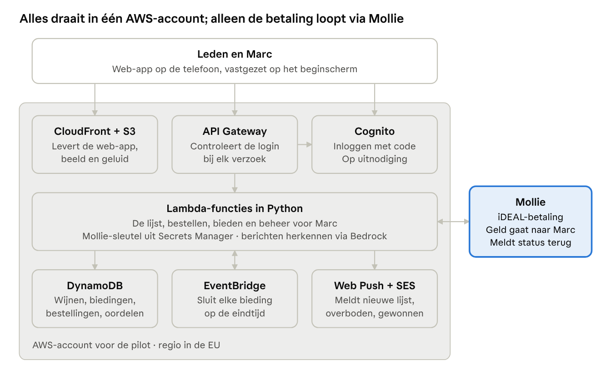
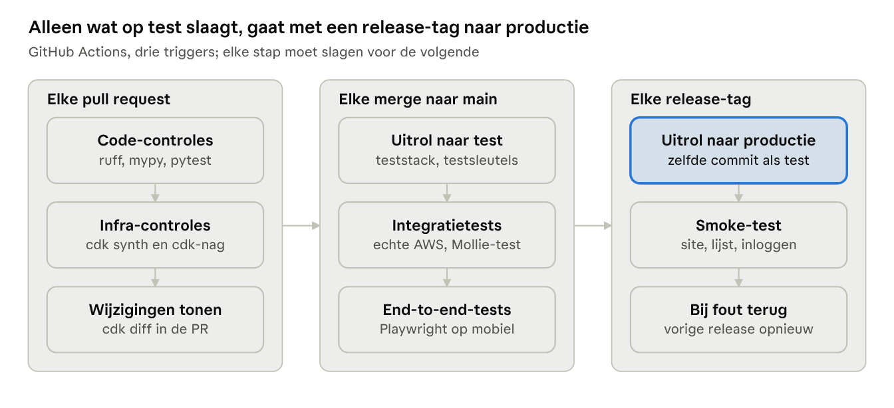

# Pilotplan: Marcs wijnclub

19 november 2026 · Aidan van Latestein

Opgeslagen uit het document op 19 november 2026: https://claude.ai/artifact/D2djDwZgkEWgahsqJxwJrT

## Samenvatting

De pilot is een besloten web-app waarin 20 tot 30 leden van Marcs WhatsApp-groep op twee manieren wijn kopen: van de lijst tegen vaste prijs, en via een bieding op een bijzondere fles. Na acht weken pilot weten we of leden liever zo bestellen dan via de groepschat, en of het Marc tijd scheelt.

- **De lijst:** de wijnen die Marc nu in WhatsApp aanbiedt, met zijn tekst per wijn. Een lid tikt aan hoeveel flessen het wil en rekent de hele bestelling in één keer af met iDEAL.
- **De bieding:** voor bijzondere flessen waarvan Marc er maar één of enkele heeft. Het hoogste bod op de eindtijd wint. Marc kiest per wijn welke vorm het wordt.
- **Voor Marc:** hij plakt zijn WhatsApp-bericht en de wijn staat online. De voorraad telt automatisch af, en lijstjes, hartjes en losse betaalverzoeken vervallen.
- **Wat het niet is:** geen marktplaats tussen leden, geen app uit de App Store en geen vervanging van de WhatsApp-groep. De groep blijft de plek waar Marc de link deelt.

De app draait serverloos op AWS en kost naar verwachting minder dan €10 per maand aan hosting. De betaling loopt via Marcs eigen Mollie-account.

## Aannames en open beslissingen

Het plan rust op acht aannames die nog niet bevestigd zijn. De eerste drie bepalen de vorm van de app.

| Aanname | Als het anders is |
| --- | --- |
| Bij de lijst betaalt een lid direct bij het bestellen | Laat Marc nu achteraf betalen, dan moet de app een openstaand bedrag per lid bijhouden |
| Bestellingen van de lijst brengt Marc langs of het lid haalt ze op | Bij een andere werkwijze verandert de keuze na het bestellen |
| Marc heeft geregeld een bijzondere fles die een bieding waard is | Zonder zulke flessen blijft de bieding ongebruikt en kan dat deel later gebouwd worden |
| De wijnen komen uit Marcs eigen inkoop | Verkoop namens leden vraagt een beoordelingsstap en commissie. Dat is een latere fase |
| Marc is de verkoper en ontvangt de betalingen op zijn eigen Mollie-account | Zonder eigen account moet er een andere verkopende partij komen |
| De pilot is een hulpmiddel voor Marc, geen product voor andere verkopers | Meerdere verkopers vraagt vanaf het begin gescheiden gegevens per verkoper |
| Er is geen pakketverzending | Verzending vraagt verpakking, verzekering en een leeftijdscheck aan de deur |
| Eén bouwer werkt er in deeltijd aan | De planning schuift mee |

Deze punten moeten vóór de bouw rond zijn:

- [ ] Marc is akkoord met de pilot en met zijn rol: wijnen invoeren, teksten controleren, afleveren
- [ ] Vastgelegd hoe leden nu betalen en hoe de flessen bij hen komen
- [ ] Marc heeft een Mollie-account op naam van zijn zaak
- [ ] Naam en domein van de club zijn gekozen
- [ ] De 20 tot 30 leden voor de pilot zijn gekozen, met voorkeur voor wie nu het vaakst bestelt
- [ ] Een jurist heeft de punten onder Juridisch en privacy bekeken
- [ ] Nulmeting gedaan bij de eerstvolgende lijst in WhatsApp: aantal berichten, tijd van Marc, tijd tot betaling, fouten in de telling

## Scope

De pilot heeft drie tabs voor leden en één beheerscherm voor Marc. Alles wat handel tussen leden raakt, blijft erbuiten.

| Onderdeel | In de pilot | Niet in de pilot |
| --- | --- | --- |
| De lijst | Wijnen van Marc tegen vaste prijs, met voorraad per wijn. Meerdere wijnen in één bestelling | Staffelkorting, abonnement |
| De bieding | Bijzondere flessen, één per keer, met eindtijd. Het hoogste bod wint | Flessen van leden, prijsvergelijking |
| Advies | Bij elke wijn: Marcs tekst, wat eet je erbij, wanneer drinken. Bij een bieding ook herkomst, bewaring en een spraakbericht | Algemeen wijnadvies los van het aanbod |
| Betalen | iDEAL via Mollie. Lijst: direct bij het bestellen. Bieding: na het winnen | Credits, creditcard, betalen tussen leden |
| Mijn flessen | Bestellingen onderweg, flessen in bewaring, eerder gekocht met oordeel en opnieuw bestellen | Zelf flessen van elders toevoegen |
| Levering | Brengen of afhalen. Bewaren bij Marc alleen voor flessen uit een bieding | Pakketverzending |
| Contact | Knop "Vraag Marc" en knop "Open aan tafel", beide naar WhatsApp met de wijn ingevuld | Chat in de app, een bot, een boekingssysteem voor diners |
| Meldingen | Nieuwe lijst, nieuwe bieding, overboden, gewonnen, betaalherinnering | Marketingberichten |
| Toegang | Alleen op uitnodiging van Marc | Open aanmelding |
| Beheer | WhatsApp-bericht plakken en laten herkennen, wijn op de lijst zetten of bieding starten, bestelling namens een lid invoeren, bestellingen zien, levering afvinken | Boekhouding, facturen |

De stijl volgt marckookt.com: de lijst op één scherm, een bijzondere fles met een grote foto, korte tekst in de je-vorm.

## Hoe het werkt

Marc zet wijnen op de lijst of start een bieding en deelt de link; het lid bestelt of biedt, betaalt en ziet zijn flessen terug.

**Voor Marc**

1. Hij plakt zijn WhatsApp-bericht in de app en voegt de foto toe. Naam, jaargang, tekst, aantal en prijs worden herkend; hij controleert ze.
2. Hij kiest per wijn: op de lijst tegen vaste prijs, of als bieding met startbod en eindtijd.
3. Bij een bieding voegt hij de herkomst toe en spreekt hij een bericht van 30 seconden in.
4. Hij publiceert. Leden krijgen een melding en Marc deelt de link in de WhatsApp-groep.
5. De voorraad telt automatisch af. Bestelt iemand nog via WhatsApp, dan voert Marc die bestelling zelf in.
6. Hij ziet wie wat bestelde en betaalde, en vinkt af: gebracht, afgehaald of in bewaring.

**Voor een lid**

1. Het lid krijgt een uitnodiging van Marc en logt eenmalig in met een code per e-mail. Daarna blijft het ingelogd op die telefoon.
2. Het zet de app op het beginscherm van de telefoon en staat meldingen toe.
3. Bij een nieuwe lijst tikt het per wijn aan hoeveel flessen het wil.
4. Het kiest brengen of afhalen en betaalt de hele bestelling in één keer met iDEAL.
5. Op een bijzondere fles doet het een bod. Wint het, dan volgt een betaallink en de keuze: brengen, afhalen of bewaren bij Marc.
6. Onder Mijn flessen staat wat onderweg is, wat bij Marc ligt en wat het eerder kocht. Daar geeft het aan wat het lekker vond en bestelt het opnieuw.

**Regels voor een bieding**

- Een bod is bindend en moet minstens de minimale verhoging boven het hoogste bod liggen.
- Een bod in de laatste twee minuten verlengt de eindtijd met twee minuten.
- De winnaar heeft 48 uur om te betalen. Daarna beslist Marc of de fles naar de volgende bieder gaat.
- Leden zien het hoogste bod, niet wie het deed.

**Regels voor de lijst**

- De voorraad is leidend. Is een wijn op, dan staat hij op uitverkocht.
- Flessen in een bestelling zijn 15 minuten gereserveerd, tot de betaling rond is.
- Een lijst sluit op de eindtijd die Marc kiest.
- Bestellen moet sneller zijn dan een WhatsApp-bericht: van lijst tot betalen in drie tikken.

## Schermen en UX

De app heeft negen schermen voor leden en één voor Marc, elk met één hoofdknop. Het klikbare prototype `wijnclub-prototype.html` laat ze allemaal zien en dient als specificatie voor de bouw.

Vijf regels gelden voor elk scherm:

- **De lijst is één scherm:** alle wijnen onder elkaar, met het aantal direct erbij. Een bijzondere fles krijgt een eigen scherm met een grote foto.
- **Eén hoofdknop per scherm**, altijd onderaan.
- **Marc eerst:** zijn tekst staat bij elke wijn, boven de prijs.
- **Snel:** van lijst tot betalen in drie tikken. Bestellen mag niet trager zijn dan een WhatsApp-bericht.
- **Rustig:** geen knipperende aftelklok, badges of punten.

Onderaan staan drie tabs: Aanbod, Mijn flessen en Marc.

| Scherm | Wat erop staat | Hoofdknop |
| --- | --- | --- |
| Eerste login | Code uit de e-mail, bevestiging 18 jaar of ouder, daarna de tip om de app op het beginscherm te zetten en meldingen aan te zetten | Kom binnen |
| Aanbod | Bovenaan de lijst van de week: per wijn foto, Marcs tekst, prijs, voorraad en een aantal dat je aantikt. Daaronder de bijzondere flessen met het hoogste bod en de eindtijd | Bestel, zodra er iets is aangetikt |
| Wijn van de lijst | Foto, Marcs tekst, wat eet je erbij, wanneer drinken | Aantal aantikken, daarna Bestel |
| Bestelling | De gekozen wijnen met aantallen, het totaal, en de keuze tussen brengen en afhalen | Betaal met iDEAL |
| Bijzondere fles | Grote foto, spraakbericht van Marc, drie blokken (waarom deze, wanneer drinken, wat eet je erbij), herkomst en bewaring | Bied met het volgende bedrag |
| Bieden | Paneel van onderaf met drie bedragen en de melding dat een bod bindend is | Bevestig bod |
| Na een gewonnen bieding | Betalen, daarna de keuze tussen bewaren bij Marc, brengen of afhalen | Klaar |
| Mijn flessen | Wat onderweg is, wat bij Marc in bewaring ligt, en wat je eerder kocht met de knoppen Lekker, Niet voor mij en Opnieuw | Opnieuw bestellen, of Open aan tafel bij een bewaarde fles |
| Marc | Zijn foto, een korte tekst, voorwaarden en privacy | Vraag Marc |
| Beheer | Eén formulier op de telefoon: WhatsApp-bericht plakken en laten herkennen, foto, vaste prijs of bieding. Daaronder de bestellingen en de knop om een bestelling namens een lid in te voeren | Zet op de lijst, of Start de bieding |

"Vraag Marc", "Open aan tafel" en "Laat hem brengen" openen WhatsApp met een bericht dat al klaarstaat, inclusief de naam van de fles.

**Stijl, overgenomen van marckookt.com**

| Onderdeel | Keuze | Opmerking |
| --- | --- | --- |
| Achtergrond en tekst | Zwart met witte tekst, grijs voor bijschriften | Zoals de site |
| Lettertype | Smal en schreefloos, koppen in hoofdletters | De site gebruikt DIN Pro Condensed, waarvoor een licentie nodig is. Het prototype gebruikt Barlow Condensed |
| Accent | Goud, alleen voor het woord "wijnclub" en kleine markeringen | Kleur geschat op basis van het logo |
| Knoppen | Rechthoekig, hoofdletters. Wit voor de hoofdknop, grijs voor de rest | Zoals de site |
| Scheidingslijnen | Gestippeld onder kopjes en tussen regels | Zoals de site |
| Toon | Je-vorm, korte zinnen, Marc in de ik-vorm | Zoals de site |

Dit moet Marc aanleveren voordat het prototype naar leden gaat:

- [ ] Logo in de witte uitvoering en de exacte goudkleur
- [ ] Besluit over het lettertype: licentie voor DIN Pro Condensed of het gratis alternatief
- [ ] Vijf tot tien eigen foto's, waaronder één portret
- [ ] Eén echte fles met zijn advies in eigen woorden en een spraakbericht van 30 seconden
- [ ] Zijn oordeel over het prototype, daarna een test met drie leden op hun eigen telefoon

## Architectuur op AWS

De app is volledig serverloos: er draait geen server die onderhoud vraagt, en zonder gebruik kost hij vrijwel niets.

Leden en Marc gebruiken dezelfde web-app; Marc heeft daarnaast het beheerscherm. Mollie is de enige externe partij.

| Onderdeel | Dienst | Toelichting |
| --- | --- | --- |
| Web-app | S3 + CloudFront | Statische bestanden, bijvoorbeeld gebouwd met React. Dit deel blijft JavaScript, omdat het in de browser draait. Installeerbaar op het beginscherm |
| Inloggen | Cognito | Code per e-mail of passkey, geen wachtwoorden. Twee groepen: lid en beheer |
| Toegang tot gegevens | API Gateway (HTTP API) + Lambda in Python | Eén functie per taak: lijst, bestellen, bieden, mijn flessen, beheer, melding van Mollie |
| Opslag | DynamoDB | Betalen naar gebruik |
| Foto's en spraakberichten | S3 achter CloudFront | Niet publiek toegankelijk buiten CloudFront om |
| Eindtijd van een bieding | EventBridge Scheduler | Eén geplande taak per bieding, die de winnaar vaststelt en de betaallink maakt |
| Meldingen | Web Push vanuit Lambda, e-mail via SES als terugval | Op een iPhone werkt een melding pas als de app op het beginscherm staat |
| Bericht herkennen | Bedrock | Haalt naam, jaargang, aantal, prijs en tekst uit Marcs WhatsApp-bericht. Marc controleert het resultaat |
| Sleutels | Secrets Manager | Mollie-sleutel en de sleutels voor meldingen |
| Logboek en alarmen | CloudWatch | Alarm bij mislukte betaalmeldingen en mislukte sluiting van een bieding |
| Opzet van de omgeving | AWS CDK in Python | Alles als code, in dezelfde taal als de Lambda-functies. Een eigen AWS-account voor de pilot, met een aparte stack voor test en productie |

**Beveiliging**

- Inloggen gaat via Cognito en wordt niet zelf gebouwd. Zelf aanmelden staat uit; alleen Marc nodigt uit.
- Elke aanroep controleert wie er is ingelogd. Een lid ziet alleen zijn eigen biedingen, bestellingen en oordelen. Beheer vraagt de groep beheer.
- Uploads zijn een risico. Alleen Marc mag uploaden, alleen afbeeldingen en geluid, met een maximale grootte, via een tijdelijke uploadlink.
- Foutmeldingen aan gebruikers zijn algemeen. Details staan alleen in het logboek, zonder persoonsgegevens.
- Er staan geen sleutels in de code, en afhankelijkheden staan op een exacte versie.
- De API begrenst het aantal aanroepen per gebruiker, zodat een fout of misbruik geen kosten opdrijft.

## Deployment, testen en CI/CD

Elke wijziging gaat via een pull request in GitHub, wordt automatisch getest en uitgerold naar de teststack. Productie krijgt alleen een versie die op test is geslaagd, en pas als jij er een release-tag op zet.

Faalt een stap, dan stopt de pipeline en gaat er niets door naar de volgende stap.

**Opzet**

| Onderdeel | Keuze | Waarom |
| --- | --- | --- |
| Code | Eén repository in GitHub met `app/` (web-app), `functions/` (Lambda in Python), `infra/` (CDK in Python) en `tests/` | Eén plek en één pull request per wijziging |
| Werkwijze | Korte branches en een pull request naar `main`. `main` is altijd uit te rollen | Past bij één bouwer in deeltijd |
| Pipeline | GitHub Actions | Zit bij de code, geen extra dienst om te beheren |
| Toegang tot AWS | GitHub logt via OIDC in met een tijdelijke rol. Er staan geen AWS-sleutels in GitHub | Niets om te lekken of te vervangen |
| Omgevingen | Twee CDK-stacks: `Wijnclub-Test` en `Wijnclub-Prod`, elk met eigen tabellen, gebruikers, subdomein en Mollie-sleutel | Test raakt nooit productiegegevens |
| Afhankelijkheden | Python via uv met lockbestand, de web-app via npm met lockbestand, alles op exacte versies. Elke GitHub Action vastgezet op een commit-hash | Elke build is gelijk. Een gekaapt versielabel van een Action, zoals bij tj-actions in 2025, komt er niet in |
| Uitrollen | `cdk deploy` per stack. CloudFormation draait een mislukte uitrol zelf terug | Nooit een half bijgewerkte omgeving |

**Drie momenten in de pipeline**

1. **Bij elke pull request:** ruff en mypy op de Python-code, unit-tests met pytest, lint en build van de web-app, `cdk synth` met cdk-nag als veiligheidscontrole op de infrastructuur, en `cdk diff` tegen productie als opmerking in de pull request. De pipeline heeft hier alleen leesrechten. Doel: klaar binnen vijf minuten.
2. **Bij elke merge naar main:** uitrol naar de teststack, daarna de integratietests en de end-to-end-tests tegen die stack.
3. **Bij een release-tag, zoals `v2026.12.1`:** uitrol van dezelfde commit naar productie, daarna een smoke-test. Faalt die, dan rolt de pipeline de vorige release-tag opnieuw uit en krijg jij een melding.

Ik kies een release-tag in plaats van een goedkeuringsknop. Een verplichte goedkeuring voor een omgeving is in een privérepository voor zover ik weet alleen beschikbaar met GitHub Enterprise; controleer dit voor je abonnement. Een release-tag werkt overal: de rol voor productie accepteert alleen tags die met `v` beginnen.

**Testen**

Alle tests draaien in pytest, ook de browsertests via Playwright voor Python. Zo heeft de bouwer één testtaal.

| Laag | Wat het controleert | Wanneer | Waartegen |
| --- | --- | --- | --- |
| Unit-tests | Regels voor bieden (minimale verhoging, verlenging in de laatste twee minuten, eindtijd), bestelling en voorraad, het verwerken van een Mollie-melding, en het herkennen van een WhatsApp-bericht met een nagebootst taalmodel | Elke pull request | Alleen de code, geen AWS |
| Integratietests | Twintig gelijktijdige biedingen: precies één winnaar per bedrag. Gelijktijdige bestellingen: de voorraad komt nooit onder nul. Een bieding sluit op de eindtijd. Dezelfde Mollie-melding twee keer: één betaling | Elke merge | Teststack, met echte DynamoDB en Mollie in testmodus |
| End-to-end-tests | Drie stromen op een telefoonscherm: van de lijst bestellen en betalen, bieden en winnen, en Marc die een wijn op de lijst zet | Elke merge | Teststack, via de browser |
| Smoke-test | De site laadt, de lijst is op te vragen, inloggen werkt. Er worden geen bestellingen geplaatst | Elke release | Productie |
| Berichten herkennen | Twintig echte aanbiedingen van Marc met de juiste naam, jaargang, aantal en prijs als antwoord. Minstens 95% van de velden moet kloppen | Bij een wijziging van prompt of model, en wekelijks | Teststack, met het echte taalmodel |
| Beveiliging | pip-audit en npm audit op bekende kwetsbaarheden, cdk-nag op de infrastructuur, secret scanning op de repository | Elke pull request, en wekelijks | De code |

**Testgegevens en inloggen in de test**

- De teststack krijgt bij elke uitrol vaste voorbeeldwijnen en testleden uit een seed-script. Productiegegevens gaan nooit naar test.
- Inloggen met een code per e-mail is niet te automatiseren. In de teststack krijgen testleden daarom een wachtwoord dat de pipeline zelf aanmaakt en in Secrets Manager zet. In productie staat inloggen met een wachtwoord uit.
- Betalingen op test lopen via de testsleutel van Mollie. De browsertest kiest op de testbetaalpagina van Mollie of de betaling lukt of mislukt.
- Een bieding sluit in de test niet na dagen: de test zet de eindtijd op één minuut.

**Eén account, twee stacks**

Eén AWS-account met een aparte stack voor test en productie is voor de pilot werkbaar. Beide stacks delen wel de uitrolrollen van CDK, dus de scheiding zit vooral in wie de pipeline mag starten. Drie afspraken houden het veilig:

- Pull requests krijgen een rol die alleen kan lezen. Alleen `main` mag naar test uitrollen, en alleen een release-tag naar productie.
- Elke naam begint met de stacknaam, en geen functie of rol van test heeft rechten op tabellen of sleutels van productie.
- De productiestack heeft beëindigingsbeveiliging, en de productietabellen hebben verwijderbeveiliging en herstel tot op de seconde (point-in-time recovery).

Komen er meer leden of andere verkopers bij, dan is een eigen AWS-account voor productie de volgende stap.

## Gegevensmodel

Zes soorten gegevens volstaan, elk in een eigen DynamoDB-tabel met betalen naar gebruik. Mijn flessen heeft geen eigen tabel: dat scherm leest de bestellingen en oordelen van het lid.

| Tabel | Sleutel | Belangrijkste velden |
| --- | --- | --- |
| `lid` | lidId (uit Cognito) | naam, telefoon, afleveradres, datum 18+-bevestiging, meldingsabonnementen |
| `lijst` | lijstId | titel, open van en tot, status |
| `wijn` | wijnId | naam, producent, jaargang, soort (vaste prijs of bieding), tekst, spijs, drinken van en tot, foto. Bij vaste prijs: lijstId, prijs, voorraad. Bij een bieding: startbod, minimale verhoging, eindtijd, herkomst, spraakbericht, hoogste bod, hoogste bieder |
| `bod` | wijnId + tijdstip | lidId, bedrag |
| `bestelling` | bestellingId | lidId, regels (wijnId, aantal, prijs), totaal, Mollie-betaling, status (open, betaald, verlopen, terugbetaald), levering (brengen, afhalen, bewaren), afgeleverd, ingevoerd door (lid of Marc) |
| `oordeel` | lidId + wijnId | lekker of niet voor mij |

Twee regels houden de gegevens kloppend:

- **Een bod** wordt alleen opgeslagen als het hoger is dan het hoogste bod plus de minimale verhoging, de eindtijd niet voorbij is en de bieding open staat. DynamoDB controleert dat in dezelfde schrijfactie, zodat twee gelijktijdige biedingen elkaar niet overschrijven.
- **Voorraad** gaat omlaag op het moment van bestellen, voor alle wijnen in de bestelling tegelijk. Is één wijn net op, dan gaat de hele bestelling niet door en ziet het lid welke wijn het is. Komt de betaling niet binnen 15 minuten, dan komt de voorraad terug.

## Betaling

Alle betalingen lopen via iDEAL op Marcs eigen Mollie-account, zodat het geld rechtstreeks bij hem komt en de app nooit geld vasthoudt.

- **De lijst:** het lid rekent de hele bestelling in één keer af op de betaalpagina van Mollie en komt terug in de app. Mollie meldt de uitkomst aan de app, die de bestelling op betaald zet.
- **Bieding:** bieden kost niets. De winnaar krijgt na de eindtijd een betaallink die 48 uur geldig is. iDEAL kan geen bedrag vooraf reserveren; in een besloten groep die Marc kent is dat een aanvaardbaar risico.
- **Bestelling namens een lid:** Marc voert de bestelling in en het lid krijgt een betaallink.
- **Bewaren bij Marc:** alleen voor flessen uit een bieding, en gratis tijdens de pilot. Een bewaarvergoeding is een latere keuze.
- **Terugbetalen:** Marc doet dat zelf in het Mollie-dashboard. De app neemt de status over.

Voor de bouw gelden drie punten:

- De melding van Mollie bevat alleen een betalingsnummer. De app vraagt de status daarna zelf bij Mollie op en vertrouwt nooit op de inhoud van de melding.
- Dezelfde melding kan meer dan één keer binnenkomen. De verwerking moet dan hetzelfde resultaat geven.
- De Mollie-sleutel staat in AWS Secrets Manager, niet in de code of in omgevingsvariabelen. Bouwen en testen gebeurt met de testsleutel van Mollie.

## Juridisch en privacy

Zes punten moeten door een jurist bekeken worden voordat de pilot start. De middelste kolom is mijn inschatting uit het hoofd, geen juridisch advies.

| Onderwerp | Inschatting | Wat te doen |
| --- | --- | --- |
| Leeftijd | Verkoop van alcohol op afstand vraagt een leeftijdscontrole van 18 jaar, bij bestellen en bij afleveren | Marc bevestigt bij de uitnodiging dat het lid volwassen is; het lid bevestigt het zelf bij de eerste login. Laten toetsen of dat volstaat |
| Bedenktijd | Bij verkoop op afstand aan consumenten geldt in principe 14 dagen bedenktijd, waarschijnlijk ook bij online bieden | Laten uitzoeken, ook wanneer de termijn ingaat als Marc de fles bewaart |
| Bindend bod | Een bod is alleen afdwingbaar als de voorwaarden dat zeggen | Korte clubvoorwaarden opstellen die het lid bij de eerste login accepteert |
| Bewaren bij Marc | Er moet vastliggen van wie de fles is en wie opdraait voor breuk, diefstal of een slechte kurk | Bewaarvoorwaarden opstellen en Marcs verzekering nakijken |
| WhatsApp | Het handelsbeleid van WhatsApp beperkt alcoholverkoop via zakelijke accounts | Bestellen en betalen blijven in de app; in de groep staat alleen de link |
| Btw en accijns | Voor Marcs eigen inkoop verandert er niets | Marcs boekhouder laten bevestigen |

**Privacy (AVG)**

- Marc is verantwoordelijk voor de gegevens van zijn leden. Wie de app bouwt en beheert is verwerker; daar hoort een verwerkersovereenkomst bij.
- De app bewaart alleen wat nodig is: naam, e-mail, telefoon, afleveradres, biedingen en aankopen. Geen geboortedatum, geen kopie van een identiteitsbewijs.
- Alle gegevens staan in een AWS-regio binnen de EU.
- Er komt een korte privacyverklaring in de app, en een lid kan zijn gegevens laten verwijderen. Betaalgegevens blijven bij Mollie en in Marcs boekhouding zolang de fiscale bewaarplicht dat vraagt.
- Namen, adressen en bedragen per persoon komen niet in de logbestanden.

## Planning

De eerste echte lijst staat acht weken na de start online; daarna loopt de pilot acht weken. De weken gaan uit van één bouwer in deeltijd.

Elke ruit is een voorwaarde om door te gaan. Zonder akkoord van Marc en de jurist begint de bouw niet.

| Week | Oplevering |
| --- | --- |
| 1 en 2 | Open beslissingen rond, nulmeting gedaan, Mollie-account en AWS-account aangemaakt |
| 3 | Omgeving als code met AWS CDK, pipeline met teststack, inloggen op uitnodiging, lege web-app online op het eigen domein |
| 4 | Beheer: WhatsApp-bericht plakken en herkennen, wijn op de lijst zetten. De lijst en de wijnpagina voor leden |
| 5 | Bestelling met meerdere wijnen, voorraad, betalen via Mollie in testmodus. Mijn flessen |
| 6 | Bieding: bieden, sluiten op de eindtijd, betaallink voor de winnaar, bewaren bij Marc |
| 7 | Meldingen, bestelling namens een lid, knoppen naar WhatsApp, voorwaarden en privacyverklaring, alarmen |
| 8 | Eerste release naar productie. Proefdraaien met Marc en vijf leden, met één echte lijst en echte betalingen |
| 9 tot en met 16 | Pilot. Marc plaatst zijn lijsten in de app en start minstens twee biedingen. Alleen fouten worden hersteld; er komen geen nieuwe functies bij |

Vanaf week 3 gaat elke wijziging via de pipeline naar de teststack. Elke week komen de tests voor wat in die week gebouwd is erbij, zodat de pipeline in week 8 de hele app afdekt.

Een goedkopere eerste stap is mogelijk: alleen week 3 tot en met 5, zonder bieding. Dan staat na vijf weken de lijst met bestellen en betalen online. Dat dekt wat Marc nu al via WhatsApp doet, en de bieding komt er later bij.

## Kosten

De lopende kosten blijven naar verwachting onder €10 per maand; de echte investering is bouwtijd. De bedragen zijn schattingen uit het hoofd en moeten tegen de actuele prijslijsten gecontroleerd worden.

| Post | Schatting | Toelichting |
| --- | --- | --- |
| AWS-hosting | Onder €10 per maand | Bij 30 tot 120 gebruikers valt bijna alles binnen het gratis gebruik. Vaste posten zijn het domein in Route 53 en de sleutel in Secrets Manager |
| Domeinnaam | Ongeveer €10 tot €15 per jaar |  |
| Mollie | Geen vaste kosten, ongeveer €0,30 per iDEAL-betaling | Marc betaalt dit als verkoper. Het is één betaling per bestelling, niet per fles |
| Inloggen | Gratis op deze schaal | Met een code per e-mail. Een code per sms kost per bericht en is niet nodig |
| Berichten herkennen via Bedrock | Enkele centen per wijn |  |
| Juridische check | Eenmalig, bedrag onbekend | Offerte vragen |
| Bouw en beheer | Eigen uren | Geen licentiekosten |
| GitHub Actions | Naar verwachting gratis | Een run duurt ongeveer tien minuten. Voor privérepositories is voor zover ik weet 2.000 minuten per maand gratis; controleer dit voor je abonnement |
| Teststack | Enkele euro's per maand | Dezelfde diensten als productie, met weinig gebruik. De wekelijkse test van het taalmodel kost enkele centen |

Zet in het AWS-account een budgetalarm op €20 per maand, zodat een fout in de opzet niet ongemerkt geld kost.

## Succescriteria

De pilot is geslaagd als leden liever via de app bestellen dan via WhatsApp en Marc er per lijst minder tijd aan kwijt is dan nu. De streefwaarden zijn een voorstel; stel ze met Marc vast vóór de start.

| Wat we meten | Streefwaarde | Hoe |
| --- | --- | --- |
| Uitgenodigde leden die inloggen | 70% of meer | Telling in de app |
| Bestellingen van pilotleden die via de app komen | 80% of meer | Bestellingen van leden tegenover wat Marc namens leden invoert |
| Tijd van lijst openen tot betaald | Onder één minuut | Gemeten in de app |
| Tijd van Marc per lijst | Lager dan de nulmeting | Marc noteert het per lijst |
| Fouten in voorraad of betaling | Geen | Marcs telling tegenover de app |
| Biedingen: aantal bieders per fles en eindprijs tegenover Marcs verwachting | Geen streefwaarde, wel volgen | Telling in de app |
| Oordeel van leden | Vijf gesprekken na afloop | Bellen of aan tafel |

Na acht weken valt het besluit:

- **Doorgaan** als de streefwaarden voor bestellen via de app, fouten en Marcs tijd gehaald zijn. Dan volgen de overige leden.
- **Bijsturen** als leden wel inloggen maar via WhatsApp blijven bestellen. Dan is bestellen in de app nog niet snel genoeg.
- **Stoppen** als minder dan de helft inlogt of Marc er meer tijd aan kwijt is dan via WhatsApp.

De bieding wordt apart beoordeeld: trekt een bijzondere fles meerdere bieders en een prijs waar Marc tevreden over is, dan blijft hij. Zo niet, dan gaat alleen de lijst door.

## Roadmap

Na een geslaagde pilot volgen twee uitbreidingen met een taalmodel: eerst de omschrijving van een fles, daarna een assistent die vragen van leden beantwoordt. Die volgorde is bewust: de omschrijving bouwt voort op wat de pilot al doet en Marc keurt elke tekst goed. De assistent praat rechtstreeks met leden en vraagt meer waarborgen.

| Onderwerp | Wat het oplevert | Start als |
| --- | --- | --- |
| 1. Omschrijving via een taalmodel | Marc zet een fles in enkele minuten online, in zijn eigen woorden | De pilot geslaagd is en het herkennen van Marcs berichten in de pilot goed werkt |
| 2. Assistent voor vragen van leden | Leden krijgen direct antwoord op veelgestelde vragen; Marc krijgt alleen de vragen die hem nodig hebben | Er minstens 20 flessen met goedgekeurde tekst zijn en Marc dezelfde vragen steeds terug ziet komen |

**1. Omschrijving via een taalmodel**

In de pilot herkent de app al naam, jaargang, aantal, prijs en tekst in Marcs WhatsApp-bericht. Daarna volgen drie stappen:

1. **Etiket herkennen.** Marc fotografeert het etiket; naam, producent, jaargang en streek worden ingevuld. Hij controleert ze.
2. **Van spraak naar tekst.** Marc spreekt 30 seconden in over de fles. De app schrijft daar de drie blokken van: waarom deze, wanneer drinken, wat eet je erbij.
3. **Zijn stijl leren.** Eerder goedgekeurde teksten gaan als voorbeeld mee, zodat een nieuw concept klinkt als Marc.

Vier regels gelden daarbij:

- Marc keurt elke tekst goed voordat een lid hem ziet.
- Herkomst en bewaring worden nooit gegenereerd. Die komen alleen uit wat Marc zelf invoert.
- Het model verzint geen scores, prijzen of smaken die Marc niet noemde.
- We meten hoeveel tijd een fles Marc kost en welk deel van het concept hij ongewijzigd laat.

Technisch blijft dit binnen de bestaande opzet: een taalmodel via Bedrock voor tekst en etiket, en Amazon Transcribe voor de spraak. Of Transcribe Nederlands goed genoeg herkent, moet een proef met Marcs eigen opnames uitwijzen.

**2. Assistent voor vragen van leden**

De assistent is een chatvenster in de app dat vragen beantwoordt over het aanbod, de eigen flessen en de werking van de club. Voorbeelden: wanneer is mijn fles op dronk, wat eet ik erbij, wat is het verschil tussen deze twee flessen, hoe werkt bieden, waar is mijn bestelling.

| Onderdeel | Keuze |
| --- | --- |
| Waar hij uit put | Alleen Marcs goedgekeurde teksten, de voorwaarden van de club en de bestellingen en flessen van het lid zelf |
| Als hij het niet weet | Hij zegt dat, en biedt aan de vraag met één tik door te zetten naar Marc via WhatsApp |
| Hoe hij zich voorstelt | Als assistent van de club, nooit als Marc. Leden weten dat ze met een AI praten |
| Wat hij niet doet | Bieden, kopen of betalen namens een lid. Uitspraken over de waarde van een fles. Advies over alcohol en gezondheid |
| Wat hij mag zien | Alleen gegevens van het lid dat de vraag stelt, en alleen lezen |

De risico's en wat ertegen helpt:

- **Een fout antwoord dat als advies van Marc wordt gelezen.** De assistent antwoordt alleen uit goedgekeurde tekst en noemt de fles waar het antwoord vandaan komt. Marc bekijkt elke week een steekproef van gesprekken.
- **Leden die de assistent iets anders proberen te laten doen.** Hij heeft geen rechten om iets te wijzigen, en de invoer van een lid geldt als vraag, nooit als opdracht aan het systeem.
- **Het persoonlijke contact verdwijnt.** "Vraag Marc" blijft op elk scherm staan. De assistent komt ernaast, niet ervoor in de plaats.
- **Privacy.** Gesprekken worden kort bewaard, staan in de privacyverklaring en worden niet gebruikt om een model te trainen. De verwerking blijft in de EU.
- **Regels voor AI.** Voor zover bekend verplicht de Europese AI-verordening om duidelijk te maken dat iemand met een AI praat. Laat dit meenemen in de juridische check.

Technisch is dit één extra Lambda-functie die het taalmodel via Bedrock aanroept. Bij enkele tientallen flessen passen alle teksten in de vraag aan het model, dus een aparte zoekdatabase is niet nodig. Een limiet per lid per dag voorkomt onverwachte kosten.

De assistent is geslaagd als hij meer dan de helft van de vragen afhandelt zonder Marc, en Marc in zijn wekelijkse steekproef geen antwoorden vindt die hij zelf anders had gegeven.
