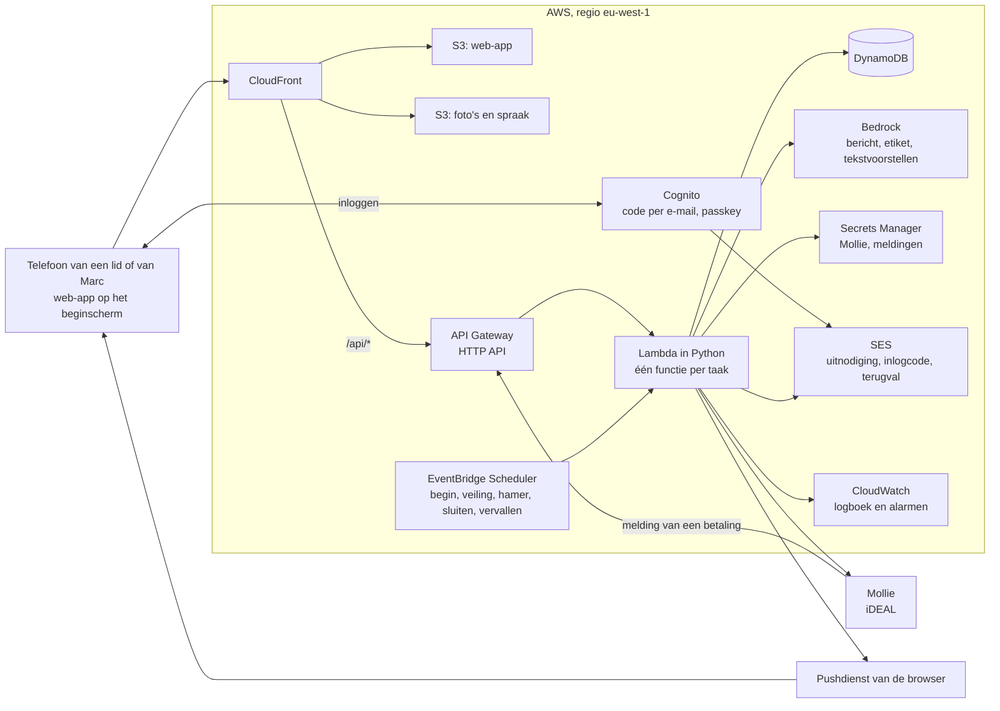
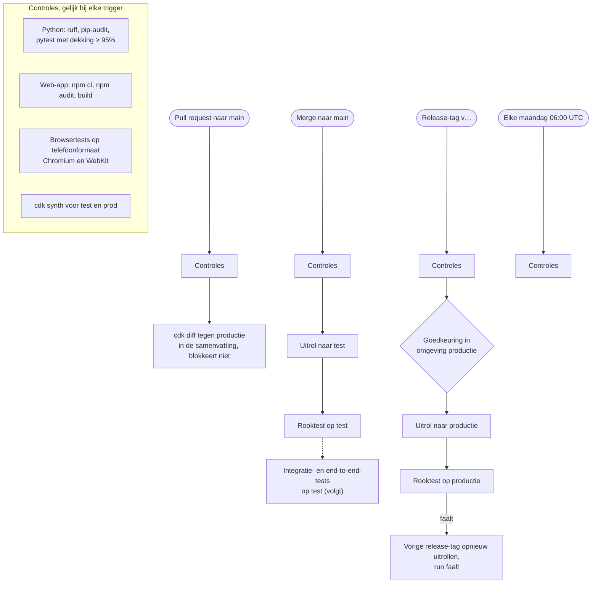
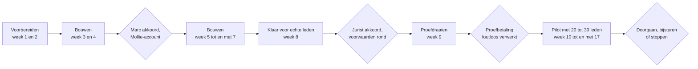

# Pilotplan: Marcs wijnclub

19 november 2026, herzien op 21 november 2026 · Aidan van Latestein

Opgeslagen uit het document op 19 november 2026: https://claude.ai/artifact/D2djDwZgkEWgahsqJxwJrT. Daarna is alleen dit bestand bijgewerkt. Op 20 november 2026 koos Aidan voor ontwerp V4 (`design-v4/`): betalen bij het bestellen, brengen of halen in plaats van afhaalpunten, en geen letters meer voor leden. Op 21 november 2026 is het plan herzien, zodat het op zichzelf klopt en genoeg is om de web-app en de back-end opnieuw te bouwen. Marktonderzoek, roadmap en de beveiligingsscan staan sindsdien in eigen bestanden.

## Herbouwen: lees dit eerst

Drie documenten zijn samen de specificatie, met twee aanvullingen die je bij een herbouw overneemt: de kleuren, typografie, ruimte en de schermen die V4 uit V3 haalt, staan in `design-v3/DESIGN.md`; de instructies aan het taalmodel staan als tekst in `functions/wijnclub/domein/herkennen.py` en `domein/tekst.py`. Verder heb je de huidige code niet nodig. Het prototype in `app/` laat zien hoe het werkt, maar bij een verschil winnen de documenten.

| Document | Zegt | Wint bij |
| --- | --- | --- |
| Dit plan | Wat er komt en waarom: scope, besluiten, regels, schermen, architectuur, planning | Functie en regels |
| [docs/bouwspecificatie.md](docs/bouwspecificatie.md) | Hoe het in elkaar zit: tabellen en velden, levensloop van een avond en een bestelling, de veiling, de API, de eisen voor de telefoon. Hoofdstuk 8 zegt wat al gebouwd is | Gegevens, aanroepen, foutcodes |
| [design-v4/DESIGN.md](design-v4/DESIGN.md) en `design-v4/schermen/` | Hoe het eruitziet. Wat V4 niet tekent, komt uit `design-v3/` | Uiterlijk, opmaak en interactie |

Spreken ze elkaar tegen, of staat iets nergens: vraag het na en pas het document aan in dezelfde wijziging. Niet gokken.

Daarnaast, niet nodig voor de bouw van de pilot:

- [docs/roadmap.md](docs/roadmap.md): wat er na de pilot kan komen, onderwerp 1 tot en met 18. Alleen onderwerp 13 (eigen domein) en 15 (beveiliging) moeten vóór de eerste uitnodiging af; ze staan in week 8.
- [docs/beveiliging.md](docs/beveiliging.md): de verbeterpunten uit de beveiligingsscan van 20 november 2026, A1 tot en met E10.
- [docs/marktonderzoek.md](docs/marktonderzoek.md): wie hetzelfde doet en wat dat betekent, van 19 november 2026.

**Bouwvolgorde.** Volg de planning: omgeving en inloggen, beheer en de wijn, de avond met bestellen en betalen, de veiling, meldingen en afleveren, en dan wat nodig is voor echte leden. Elke week komen de tests voor wat in die week gebouwd is erbij. De tabel Dekking onderaan dit plan koppelt elk onderdeel aan scherm, aanroep, tabel, week en test.

## Samenvatting

De pilot is een besloten web-app waarin 20 tot 30 leden van Marcs WhatsApp-groep op twee manieren wijn kopen: van de lijst tegen vaste prijs, en in een veiling van een bijzondere fles. Na acht weken pilot weten we of leden liever zo bestellen dan via de groepschat, en of het Marc tijd scheelt.

- **Een avond bij Marc.** Zoals nu in de groep: Marc kondigt een avond aan, zet op de begintijd de wijnen een voor een op tafel en zegt er iets bij. Leden zien dat live gebeuren. Een avond duurt enkele uren.
- **De lijst:** de wijnen van die avond, met Marcs tekst per wijn. Een lid tikt aan hoeveel flessen het wil, kiest brengen of halen en betaalt meteen met iDEAL. Marc houdt de flessen 15 minuten vast.
- **De veiling:** aan het eind van de avond gaat één bijzondere fles onder de hamer. Het hoogste bod op de eindtijd wint. Marc kiest per wijn of hij op de lijst komt of in de veiling.
- **Voor Marc:** hij fotografeert de fles, plakt zijn WhatsApp-bericht en kijkt na wat de app herkende. Uit een paar steekwoorden maakt de app drie tekstvoorstellen. De voorraad telt automatisch af. Na de avond ziet hij wat hij brengt en wat er gehaald wordt.
- **Wat het niet is:** geen marktplaats tussen leden, geen app uit de App Store en geen vervanging van de WhatsApp-groep. De groep blijft de plek waar Marc de link deelt.

De app draait serverloos op AWS en kost naar verwachting minder dan €10 per maand aan hosting. De betaling loopt via Marcs eigen Mollie-account.

## Begrippen

Eén woord per ding. In schermteksten en in dit plan staat het woord voor leden; in gegevens en code het woord in de laatste kolom.

| Woord | Betekenis | In gegevens |
| --- | --- | --- |
| Avond | Wat leden meemaken: aankondiging, de avond zelf met de lijst en de veiling, en de terugblik | `lijsten`, één rij per avond |
| Aanbod | De startpagina van een lid. Toont de aankondiging, de avond of de terugblik, afhankelijk van de status van de avond | – |
| De lijst | De wijnen van een avond tegen vaste prijs | `wijnen` met `soort` `vast` |
| Op tafel | Een wijn die Marc op tafel zette, is te koop en staat in de feed. Daarvoor staat hij klaar en is hij niet te koop | `opTafelSinds` |
| Feed | Wat er tijdens de avond gebeurt: wijnen op tafel, berichten van Marc, gebeurtenissen zonder namen | `feed` |
| Veiling | Eén bijzondere fles aan het eind van de avond, met een eindtijd. De zaal is het scherm van de veiling | `wijnen` met `soort` `bieding` |
| Bod | Een bindend bedrag in een veiling | `biedingen` |
| Bon | Wat een lid in één keer bestelt en betaalt. Bijbestellen is een nieuwe bon | `bestellingen` |
| Namens een lid | Een bon die Marc invoert voor een lid, na een bericht in de groep | `soort` `namens` |
| Vervallen | Een bon die niet op tijd betaald is. De flessen komen terug | status `verlopen` |
| Brengen, halen | Hoe een lid de flessen krijgt. Marc stelt per avond het moment in, en bij halen de plek | `levering` |
| Afleveren | Marcs scherm na de avond: wat hij brengt, wat er gehaald wordt, wat klaar is | afleverlijst |
| Melding | Een pushmelding van de app aan een lid, met e-mail als terugval | – |
| Bericht | De vastlegging van een melding of van iets wat Marc in de groep deelde, om te meten. Niet te verwarren met Marcs WhatsApp-bericht dat de app herkent | `berichten` |
| Bericht van Marc | Wat Marc tijdens de avond tegen de tafel zegt. Staat in de feed, en in de biedlog als de veiling loopt | `feed` met `soort` `bericht` |
| Bijnaam | "Bieder 7": het vaste nummer van een bieder in één veiling | `bieder` |
| Terugblik | Wat het aanbod toont na de avond, tot de volgende aankondiging | – |
| Je bestellingen | De bonnen van een lid op de lopende avond en een gewonnen fles, met status | – |

## Besluiten

Alles wat de vorm van de app bepaalt, op één plek. **Besloten** staat vast. **Voorlopige bouwkeuze** is hoe er gebouwd wordt, met een instelling waar dat kan, tot de genoemde persoon het bevestigt of verandert. **Open** moet beslist worden; tot dan geldt wat in de kolom staat.

| Punt | Status | Inhoud |
| --- | --- | --- |
| Betalen | Besloten, 20 november 2026 | Een lid betaalt meteen bij het bestellen, per bon. Marc houdt de flessen 15 minuten vast. Eerst werd er pas betaald als de lijst sloot |
| Levering | Besloten, 20 november 2026 | Brengen naar het adres van het lid of halen bij Marc, per avond met een moment. Eerst waren het afhaalpunten per regio |
| Letters | Besloten, 20 november 2026 | Leden zien een wijn bij zijn naam en met een foto. Marc gebruikt de letters uit WhatsApp nog als hij namens een lid bestelt, zoals "G2 H1" |
| Etiket en tekstvoorstellen | Besloten, 20 november 2026 | In de pilot, week 4. De stijl is op 21 november 2026 afgeleid van Marcs omschrijvingen in WhatsApp; zeven ervan staan met zijn toestemming als voorbeeld in `domein/tekst.py` |
| Eigen collectie en bewaren | Besloten, 19 november 2026 | Niet in de pilot. Roadmap onderwerp 14 en 9 |
| Live bijwerken | Besloten, 21 november 2026 | De web-app vraagt elke 3 seconden wat er nieuw is, zolang het scherm zichtbaar is. Een WebSocket is roadmap onderwerp 17. Een bod wordt altijd op de server tegen de actuele stand beoordeeld |
| Rol van Marc | Voorlopige bouwkeuze · Marc | Marc zet tijdens de avond de wijnen zelf op tafel en zegt er iets bij. Een wijn die klaarstaat is niet te koop. Wat bij het sluiten nog klaarstaat, is niet verkocht |
| Veiling en avond | Voorlopige bouwkeuze · Aidan en Marc | Een veiling hoort bij één avond, hoogstens één per avond. Hij opent op een tijd die Marc kiest, of eerder met één tik, en sluit op zijn eigen eindtijd |
| De avond sluiten | Voorlopige bouwkeuze · Marc | Op de eindtijd, of eerder als Marc op Sluit de avond tikt, met een bevestiging |
| Rust | Voorlopige bouwkeuze · Aidan en Marc | Een live-stip die niet knippert, het label "net op tafel" en een rustige klok in de laatste twee minuten van een veiling. Samen uit te zetten met één instelling. Verder geen badges, punten of knipperende aftelklok |
| Wie bood | Voorlopige bouwkeuze · jurist | In de biedlog staat per bieder een vast nummer per veiling, zoals "Bieder 7", dat niet herleidbaar is tot het lid. Uit te zetten in de configuratie van de omgeving: dan stuurt de API het nummer niet mee en toont de biedlog alleen bedragen en tijden |
| Kleur, land, korte naam en partij van een wijn | Voorlopige bouwkeuze · Aidan | Velden op de wijn, voorgesteld uit etiket en bericht en nagekeken door Marc. Ze sluiten roadmap onderwerp 16 niet uit |
| Bovengrens op een bod | Voorlopige bouwkeuze · Marc | Een bod is hoogstens drie keer het minimum, om een tikfout op te vangen |
| Een winnaar die niet betaalt | Open · Marc | Na 48 uur vervalt de bon en krijgt Marc bericht. Hoe de fles naar de volgende bieder gaat, regelt Marc in de pilot buiten de app |
| Een open bon annuleren | Open · Marc | Kan nu niet; een bon vervalt vanzelf. Zie de bouwspecificatie, hoofdstuk 9 |
| Zonder Marc op de avond | Open · Marc | Een wijn komt alleen op tafel als Marc hem neerzet. Of wijnen op de begintijd vanzelf op tafel moeten kunnen komen, is niet gekozen |

Het plan rust daarnaast op zes aannames die nog niet bevestigd zijn:

| Aanname | Als het anders is |
| --- | --- |
| Marc heeft geregeld een bijzondere fles die een veiling waard is | Zonder zulke flessen blijft de veiling ongebruikt en kan dat deel later gebouwd worden |
| De wijnen komen uit Marcs eigen inkoop | Verkoop namens leden vraagt een beoordelingsstap en commissie. Dat is een latere fase |
| Marc is de verkoper en ontvangt de betalingen op zijn eigen Mollie-account | Zonder eigen account moet er een andere verkopende partij komen |
| De pilot is een hulpmiddel voor Marc, geen product voor andere verkopers | Meerdere verkopers vraagt vanaf het begin gescheiden gegevens per verkoper |
| Er is geen pakketverzending | Verzending vraagt verpakking, verzekering en een leeftijdscheck aan de deur |
| Eén bouwer werkt er in deeltijd aan | De planning schuift mee |

## Voorwaarden

Het klikbare prototype en de regels zonder AWS zijn gebouwd voordat deze punten rond waren. Dat was een bewuste keuze van 19 november 2026: Marc eerst iets laten zien. Voor de echte betalingen en de echte leden moeten ze rond zijn.

Vóór de koppeling met Mollie (week 5):

- [ ] Marc is akkoord met de pilot en met zijn rol: wijnen invoeren, teksten controleren, tijdens de avond de wijnen op tafel zetten, afleveren
- [ ] Vastgelegd hoe leden nu betalen en hoe de flessen bij hen komen
- [ ] Marc heeft een Mollie-account op naam van zijn zaak

Vóór de eerste uitnodiging aan een lid (week 8):

- [ ] De naam van de club is gekozen en het eigen domein staat, met de club als afzender van de inlogcode (roadmap onderwerp 13). Een ander adres na de eerste uitnodiging dwingt elk lid de app opnieuw te installeren en opnieuw in te loggen
- [ ] Amazon SES mag buiten de proefomgeving mailen
- [ ] Beveiliging groep A, B en E uit [docs/beveiliging.md](docs/beveiliging.md) is af
- [ ] De stromen zijn met de hand nagelopen op een echte iPhone en een echte Android-telefoon
- [ ] De 20 tot 30 leden voor de pilot zijn gekozen, met voorkeur voor wie nu het vaakst bestelt
- [ ] Een jurist heeft de punten onder Juridisch en privacy bekeken
- [ ] Nulmeting gedaan bij de eerstvolgende lijst in WhatsApp: aantal berichten, tijd van Marc, tijd tot betaling, fouten in de telling

## Scope

Leden hebben één startpagina, het aanbod, zonder tabbalk. Marc heeft zes beheerschermen. Alles wat handel tussen leden raakt, blijft erbuiten.

| Onderdeel | In de pilot | Niet in de pilot |
| --- | --- | --- |
| De avond | Aankondiging met Marcs bericht en wat er op tafel komt. Op de begintijd een live feed: wijnen op tafel, berichten van Marc, gebeurtenissen zonder namen. Na afloop een terugblik | Een agenda met meerdere avonden tegelijk |
| De lijst | Wijnen van Marc tegen vaste prijs, met voorraad per wijn. Meerdere wijnen in één bon. Bijbestellen kan tot de avond sluit, als een nieuwe bon met een eigen betaling | Staffelkorting, abonnement. Filteren op smaak en een melding op maat (roadmap onderwerp 16) |
| De veiling | Eén bijzondere fles per avond, met eindtijd en biedlog. Het hoogste bod wint | Flessen van leden, prijsvergelijking, een maximaal bod (roadmap onderwerp 6) |
| Advies | Bij elke wijn Marcs tekst. Marc schrijft hem zelf, neemt hem over uit zijn WhatsApp-bericht, of kiest uit drie voorstellen die de app maakt uit zijn steekwoorden en het etiket. "Wat eet je erbij" en "wanneer drinken" mogen leeg blijven. Bij een veiling ook herkomst, bewaring en een spraakbericht | Algemeen wijnadvies los van het aanbod. Een tekst uit een spraakbericht, en voorstellen die leren van Marcs eerdere teksten (roadmap onderwerp 1) |
| Betalen | iDEAL via Mollie. Lijst: meteen bij het bestellen, één betaling per bon. Marc houdt de flessen 15 minuten vast; daarna vervalt een onbetaalde bon en komt de voorraad terug. Namens een lid: het lid krijgt een betaallink en heeft 48 uur. Veiling: binnen 48 uur na het winnen | Credits, creditcard, betalen tussen leden, één betaling per lid voor een hele avond |
| Je bestellingen | Wat het lid op de lopende avond bestelde en de fles die het won, met brengen of halen, de status en betalen. Het lid komt er via de terugblik na de avond, en via de link in een melding | Een eigen collectie: eerder gekocht, een oordeel per wijn, opnieuw bestellen en flessen in bewaring (roadmap onderwerp 14) |
| Levering | Brengen of halen, door Marc per avond ingesteld. Brengen: Marc brengt de flessen naar het adres van het lid, op een moment dat hij kiest. Halen: het lid haalt ze bij Marc op, op een moment en een plek die hij kiest. Ook voor een gewonnen fles kiest het lid brengen of halen | Bewaren bij Marc (roadmap onderwerp 9), pakketverzending, afhaalpunten per regio |
| Contact | Knop "Vraag Marc", naar WhatsApp met de wijn ingevuld | Chat in de app, een bot, een boekingssysteem voor diners |
| Meldingen | Nieuwe avond aangekondigd, de avond begint (voor wie "herinner mij" koos), één herinnering "nog beschikbaar" vóór het sluiten, de veiling begint, overboden, gewonnen. Een betaallink bij een bon namens een lid, en één herinnering om te betalen bij een bon namens een lid of een gewonnen fles. "Ik ben onderweg" aan wie Marc gaat brengen. Bij elke melding legt de app vast wanneer hij verstuurd is en hoeveel leden erop tikten | Marketingberichten en geplande campagnes (roadmap onderwerp 3) |
| Toegang | Alleen op uitnodiging van Marc. Inloggen met een code per e-mail, daarna eventueel met een passkey ("Face ID") | Open aanmelding |
| Beheer | Zes schermen. De avond: wijnen op tafel zetten, iets tegen de tafel zeggen, de veiling eerder starten, het overzicht "nog beschikbaar" met één tik in WhatsApp delen en de avond sluiten, met tellers. Nieuwe fles: fotograferen, het etiket en het WhatsApp-bericht laten herkennen, nakijken, steekwoorden geven en een tekstvoorstel kiezen, en kiezen tussen lijst en veiling. Afleveren: wat Marc brengt en wat er gehaald wordt, afvinken, een betaallink sturen en laten weten dat hij onderweg is. Leden: uitnodigen, het afleveradres bijhouden en een lid verwijderen. Een avond plannen, met brengen en halen. Namens een lid: een bon invoeren met letters en aantallen | Boekhouding, facturen |

De stijl volgt marckookt.com: de avond op één scherm, een bijzondere fles met een grote foto, korte tekst in de je-vorm.

## Hoe het werkt

### Het verloop van een avond

1. **Plannen.** Marc maakt een avond aan: een titel, zijn aankondiging, de datum, de begintijd en de eindtijd. Hij kiest of hij brengt, of leden komen halen, of beide, met het moment en bij halen de plek. De avond staat nog niet voor leden open.
2. **Klaarzetten.** Per wijn fotografeert Marc de fles, plakt hij zijn WhatsApp-bericht, of doet hij beide. Van het etiket worden naam, producent, jaargang, streek, kleur en land gelezen; uit het bericht naam, producent, jaargang, tekst, aantal en prijs. Hij kijkt ze na en geeft de wijn een korte naam. Heeft hij nog geen tekst, dan typt of dicteert hij een paar steekwoorden, zoals "fris, citrus, bij asperges", en kiest hij uit drie voorstellen. Woorden die niet van hem of van het etiket komen, zijn gemarkeerd. De wijn krijgt de volgende letter, zoals nu in de groep; leden zien die niet.
3. **Lijst of veiling.** Per wijn kiest Marc: op de lijst tegen vaste prijs en met een voorraad, of als de veiling van de avond met startbod, minimale verhoging, het begin van de veiling en de eindtijd. Beide tijden vallen binnen de avond. Bij de veiling voegt hij herkomst en bewaring toe en spreekt hij een bericht van 30 seconden in. De wijn staat dan klaar.
4. **Aankondigen.** Marc kondigt de avond aan. Leden krijgen een melding, en Marc deelt de link in de WhatsApp-groep. Het aanbod toont de aankondiging: datum, Marcs bericht en wat er op tafel komt, met de veiling als laatste regel. Een wijn is alvast te bekijken, niet te bestellen. Een lid kan op "herinner mij" tikken.
5. **De avond begint.** Op de begintijd gaat de avond vanzelf open, en wie "herinner mij" koos, krijgt een melding. Marc opent de avond in beheer en zet de wijnen een voor een op tafel. Een wijn op tafel komt bovenaan de feed en is te koop. Marc zegt er iets bij, zelf getypt of met een snelle zin; dat komt in de feed.
6. **Bestellen.** Een lid tikt per wijn aan hoeveel flessen het wil, kiest brengen of halen en betaalt meteen. Zie Regels voor de lijst. In de feed staat "een lid nam 2 × Janasse", zonder naam. Is een wijn op, dan staat er "de Verdejo is op". Bestelt iemand in de groep of in een privébericht, dan typt Marc de letters en aantallen in, zoals "C2 D2"; het lid krijgt een betaallink.
7. **Nog beschikbaar.** Vóór het sluiten deelt Marc met één tik het overzicht "nog beschikbaar" in de groep: de wijnen op tafel die nog niet op zijn, met prijs, voorraad en de link. Leden krijgen één herinnering.
8. **De veiling.** Op het begin van de veiling, of eerder als Marc op Start tikt, krijgen leden een melding en opent de zaal: het hoogste bod groot, de hamertijd, en de biedlog met berichten van Marc. Zie Regels voor de veiling. Na de hamer ziet de winnaar "verkocht" met de betaalknop, en de anderen "afgelopen".
9. **Sluiten.** De avond sluit op de eindtijd, of eerder als Marc op Sluit de avond tikt. Daarna is er niets meer te bestellen, en toont het aanbod de terugblik: wat er verkocht is, de uitkomst van de veiling, en de weg naar Je bestellingen. De terugblik blijft staan tot Marc een volgende avond aankondigt.
10. **Afleveren.** Na de avond ziet Marc onder Afleveren wat hij brengt, met naam en adres, en wat er gehaald wordt. Aan wie nog moet betalen stuurt hij de betaallink opnieuw. Gaat hij brengen, dan laat hij met één tik weten dat hij onderweg is. Wat afgeleverd is, vinkt hij af.

### Voor een lid

1. Het lid krijgt een uitnodiging van Marc per e-mail en logt eenmalig in met een code per e-mail. Het bevestigt dat het 18 jaar of ouder is; met Ja gaat het akkoord met de voorwaarden. Zegt het nee, dan kan het niet bestellen of bieden. Daarna kan het een passkey kiezen ("Face ID"): dan komt het de volgende keer met één tik binnen. Het blijft ingelogd op die telefoon.
2. Het zet de app op het beginscherm van de telefoon en staat meldingen toe.
3. Op de avond tikt het per wijn aan hoeveel flessen het wil, en ziet het de bon: de wijnen, het totaal en brengen of halen met het moment.
4. Het kiest brengen of halen en betaalt meteen met iDEAL. Kiest het brengen zonder afleveradres, dan vult het eerst een adres in. Marc houdt de flessen 15 minuten vast; mislukt het betalen, dan kan het binnen die tijd opnieuw. Daarna vervalt de bon en komen de flessen terug in de voorraad. Bijbestellen kan tot de avond sluit, met een nieuwe bon.
5. Kiest het brengen, dan brengt Marc de flessen naar het adres van het lid, op het moment dat hij voor die avond koos. Kiest het halen, dan haalt het ze bij Marc op.
6. In de veiling doet het een bod. Wint het, dan betaalt het binnen 48 uur en kiest het daarna brengen of halen.
7. Na de avond leidt de terugblik naar Je bestellingen: wat het op de lopende avond bestelde en welke fles het won, met de status en hoe het de flessen krijgt.

### Regels voor de lijst

- De voorraad is leidend. Is een wijn op, dan staat hij op uitverkocht.
- Een wijn is alleen te bestellen als hij op tafel staat en de avond open is.
- Een betaalde bon is bindend. Annuleren kan alleen via Marc, met een terugbetaling in Mollie.
- Een avond sluit op de eindtijd die Marc kiest, of eerder als hij hem zelf sluit. Het sluiten verandert niets aan een betaling: een bon van vlak voor het sluiten blijft binnen zijn 15 minuten te betalen.
- Het lid betaalt meteen bij het bestellen, per bon. Marc houdt de flessen 15 minuten vast. Is er dan niet betaald, dan vervalt de bon en komen de flessen terug in de voorraad. Marc krijgt daar geen bericht van. Marc levert pas uit na betaling. Startte het lid vlak voor het einde nog een betaling, dan wacht de app tot Mollie die afrondt; de flessen staan dan hoogstens ongeveer een half uur vast.
- Een bon namens een lid heeft 48 uur. Na 24 uur volgt één herinnering. Daarna vervalt de bon: de flessen komen terug in Marcs voorraad en hij krijgt bericht.
- Brengen kan alleen als Marc het voor die avond aanbiedt en het lid een afleveradres heeft. Halen kan alleen als Marc het aanbiedt.
- Bestellen is de aantallen kiezen, brengen of halen kiezen, en betalen. Door de betaalstap duurt dat langer dan een WhatsApp-bericht.

### Regels voor de veiling

- Een bod is bindend. Het eerste bod is minstens het startbod; elk volgend bod minstens de minimale verhoging boven het hoogste bod. Een bod is hoogstens drie keer dat minimum.
- De hoogste bieder kan niet opnieuw bieden tot hij overboden is.
- Een bod in de laatste twee minuten verlengt de eindtijd tot twee minuten na dat bod.
- Leden zien het hoogste bod en of hun eigen bod het hoogste is, niet wie het deed. In de biedlog staat een bijnaam per veiling; zie de besluiten.
- Bieden kost niets. Het bod is de prijs: er komt geen opgeld bij. Dat staat op het scherm van de bijzondere fles.
- De winnaar heeft 48 uur om te betalen. Na 24 uur volgt één herinnering. Daarna vervalt de bon en krijgt Marc bericht; wat er met de fles gebeurt, is een open besluit.
- Na het betalen kiest de winnaar brengen of halen. Het moment is dat van de avond. Is dat al voorbij, dan spreekt Marc het met hem af.
- De veiling opent niet vóór de begintijd van de avond en heeft een eindtijd vóór het einde van de avond. Loopt hij door verlenging langer, dan sluit de avond pas na de hamer. Zolang de veiling open is, kan Marc de avond niet eerder sluiten; sluit hij de avond voordat de veiling opende, dan gaat de veiling niet door.

## Schermen en UX

Elk scherm heeft één hoofdknop. De specificatie van de schermen is ontwerp V4: `design-v4/DESIGN.md` en de schermen in `design-v4/schermen/`. Wat V4 niet tekent, komt uit `design-v3/`. Het klikbare prototype in `app/` laat de schermen zien, met voorbeeldinhoud; het eerste prototype, `wijnclub-prototype.html`, is achterhaald.

Zes regels gelden voor elk scherm:

- **Gemaakt voor de telefoon:** vrijwel elk lid gebruikt de app op zijn telefoon, staand en met één hand. Elk scherm wordt daarvoor ontworpen en daarop getest. Zie "Mobiel eerst" hieronder.
- **De avond is één scherm:** alle wijnen onder elkaar in de feed, met het aantal direct erbij. Een bijzondere fles krijgt een eigen scherm met een grote foto.
- **Naam en foto, geen letters:** een lid ziet een wijn bij zijn naam en met een foto.
- **Eén hoofdknop per scherm**, altijd onderaan.
- **Marc eerst:** zijn aankondiging staat boven de avond en zijn tekst bij elke wijn, boven de prijs.
- **Rustig:** zie de besluiten. Wat de instelling Rust uitzet, moet uit kunnen zonder dat een scherm onbruikbaar wordt.

Het lid heeft één startpagina, het aanbod: de aankondiging vóór de avond, de avond zelf en de terugblik erna. Is er geen avond aangekondigd en geen terugblik, dan staat er "Niets open". De nummers zijn de schermen in `design-v4/schermen/`; "V3 n" is een scherm uit `design-v3/schermen/`.

| Scherm | Getekend | Wat erop staat | Hoofdknop |
| --- | --- | --- | --- |
| Inloggen | V4 01 tot en met 05 | Het e-mailadres, de code uit de mail, de vraag of je 18 jaar of ouder bent (met Ja ga je akkoord met de voorwaarden), en daarna eventueel een passkey ("Face ID"). Wie Face ID koos, ziet de volgende keer "Welkom terug" en komt met één tik binnen. Nee bij 18 jaar: nog niet getekend | Stuur mij een code, daarna Ja, kom binnen |
| Aanbod: aankondiging | V4 06 | Vóór de begintijd: datum, Marcs aankondiging en wat er op tafel komt, met de veiling als laatste regel. Een wijn is alvast te bekijken | Herinner mij op de begintijd |
| Aanbod: de avond | V4 07 | Tijdens de avond: de live feed met Marcs berichten, de wijnen die hij op tafel zette (foto, naam, kleur en land, tekst, prijs, voorraad en een aantal dat je aantikt) en wat er gebeurt, zonder namen van leden. Daaronder wanneer de veiling begint | Bestel, zodra er iets is aangetikt |
| Aanbod: terugblik | Nog niet als eigen scherm; V4 14 tekent hem onder de hamerslag | Na de avond: wat er verkocht is, de uitkomst van de veiling als er een was, en de weg naar Je bestellingen | Naar je bestellingen |
| Wijn van de lijst | V4 08 | Foto en Marcs tekst. "Wat eet je erbij" en "wanneer drinken" alleen als Marc ze heeft ingevuld. Zwevend: terug naar het aanbod en Vraag Marc | Aantal aantikken, daarna Bestel |
| De bon | V4 09 | De gekozen wijnen met aantallen en het totaal, brengen of halen met het moment, en dat Marc de flessen 15 minuten vasthoudt. Een afleveradres invullen bij brengen zonder adres: nog niet getekend | Betaal met iDEAL |
| Betaald | V4 10 | De bon met de stempel BETAALD, en hoe je de flessen krijgt: brengen of halen, met het moment en bij brengen het adres. Mislukt de betaling of vervalt de bon, dan staat dat er in dezelfde stijl. Hetzelfde adres toont een bon die nog open is, met de betaalknop; daar komt de betaallink uit | Terug naar het aanbod, of Betaal bij een open bon |
| Net op | V3 16 | Een wijn die op is, zonder letters | Terug naar het aanbod |
| Bijzondere fles | V3 06 | Grote foto, spraakbericht van Marc, drie blokken (waarom deze, wanneer drinken, wat eet je erbij), herkomst en bewaring, en dat er geen opgeld is. Te openen vanaf de aankondiging en de zaal | Bied met het volgende bedrag, of Naar de veiling vóór het begin |
| De veiling | V4 11, 13 en 14 | De zaal: het hoogste bod groot, de hamertijd, de biedlog met berichten van Marc; je eigen bod staat in goud. In de laatste twee minuten "eenmaal, andermaal" met een rustige klok. Na de hamer "verkocht" voor de winnaar met de betaalknop, en "afgelopen" voor de anderen (nog niet getekend) | Bied met het volgende bedrag |
| Bieden | V4 12 | Paneel van onderaf met drie bedragen en de melding dat een bod bindend is | Bevestig bod |
| Na een gewonnen veiling | Nog niet | Betalen, daarna brengen of halen kiezen | Klaar |
| Je bestellingen | Nog niet | Je bonnen op de lopende avond en de fles die je won, met brengen of halen en de status: betaal vóór een tijd, betaald, gebracht of opgehaald. Is er niets besteld, dan staat dat er, met een link naar het aanbod | Naar het aanbod. Een bon die nog open is, heeft zelf een betaalknop |
| Marc | Nog niet in V4; V3 13 | Zijn foto, een korte tekst, voorwaarden en privacy. Bereikbaar via een link onderaan het aanbod | Vraag Marc |
| Beheer: de avond (`/beheer`) | V4 20 | Wijnen op tafel zetten, iets tegen de tafel zeggen met snelle zinnen, de veiling eerder starten, "nog beschikbaar" delen en de avond sluiten, met tellers: flessen, bonnen en betaald bedrag. Het delen van "nog beschikbaar" is nog niet getekend | Zet de volgende wijn op tafel, daarna Sluit de avond |
| Beheer: nieuwe fles (`/beheer/nieuw`) | V4 15 tot en met 19 | Fotograferen of de WhatsApp-tekst plakken, nakijken wat de app herkende, lijst of veiling, en klaar. Steekwoorden geven en een tekstvoorstel kiezen hoort bij nakijken (16) en is nog niet getekend | Zet klaar voor de avond |
| Beheer: afleveren (`/beheer/afleveren`) | V4 21 | Brengen, halen en klaar, een betaallink sturen en "laat weten: ik ben onderweg" | Laat weten: ik ben onderweg |
| Beheer: een avond plannen | Nog niet | Titel, aankondiging, datum, begin- en eindtijd, de momenten van brengen en halen, en Aankondigen | Kondig aan |
| Beheer: leden | Nog niet | Uitnodigen met naam en e-mail, en bevestigen dat het lid 18 jaar of ouder is. Het afleveradres bijhouden, en een lid verwijderen | Nodig uit |
| Beheer: namens een lid | Nog niet in V4 | Een lid kiezen, letters en aantallen zoals "C2 D2", brengen of halen | Voer in |

Tussen de beheerschermen tekent V4 geen weg; het prototype gebruikt tekstlinks. "Vraag Marc" opent WhatsApp met een bericht dat al klaarstaat, inclusief de naam van de fles. Marcs WhatsApp-nummer staat in de configuratie van de omgeving, niet in de repository.

**Mobiel eerst**

Vrijwel elk lid opent de app op zijn telefoon, via de link in de WhatsApp-groep. De telefoon is daarom het uitgangspunt voor ontwerp, bouw en test, en geen variant van een groter scherm. Een groter scherm toont dezelfde kolom van hoogstens 430 px. Dit geldt ook voor het beheer: Marc werkt ook op zijn telefoon.

- **Met één hand:** de hoofdknop staat onderaan, binnen bereik van de duim. Wat je nodig hebt om te bestellen, te bieden of te betalen staat nooit alleen bovenaan.
- **Tikvlakken van minstens 44 × 44 px**, met ruimte ertussen. Een fles in de flessenrij, de rij kleine flessen waarmee je een aantal kiest, is smaller; daarom zijn er ook een min- en een plusknop van 44 px.
- **Het belangrijkste zonder scrollen** op een kleine telefoon van 375 × 667 px: de eerste wijn in de feed, brengen of halen en het totaal op de bon, het hoogste bod en de eindtijd bij een bijzondere fles, en de knop om een bod te bevestigen.
- **Leesbaar:** lopende tekst is minstens 16 px. Alles wat je moet kunnen lezen heeft een contrast van minstens 4,5:1, ook een keuze die nog niet gekozen is. Inzoomen blijft mogelijk.
- **Geen vergissing bij een bindende stap:** vóór Betaal en Bevestig bod staan aantal, bedrag en brengen of halen in beeld. Dubbel tikken geeft één bon, één betaling of één bod. Een stap die niet terug te draaien is, zoals de avond sluiten, vraagt een bevestiging.
- **Bestand tegen onderbreking:** je keuze blijft staan als je even naar je mail, WhatsApp of je bank gaat en terugkomt. Bij terugkomst zijn voorraad en hoogste bod ververst. De terugknop van de telefoon sluit eerst een open paneel.
- **Bruikbaar op een trage verbinding:** elk scherm laat zien dat het laadt of dat het niet lukte, en het aanbod staat er binnen drie seconden.
- **Getest op echte telefoons:** de browsertests draaien op telefoonformaat, en elke release wordt met de hand nagelopen op een iPhone en een Android-telefoon.

De meetbare eisen en de stand van het prototype staan in de bouwspecificatie, hoofdstuk 10.

**Stijl, overgenomen van marckookt.com**

| Onderdeel | Keuze | Opmerking |
| --- | --- | --- |
| Achtergrond en tekst | Zwart met witte tekst, grijs voor bijschriften | Zoals de site |
| Lettertype | Smal en schreefloos, koppen in hoofdletters | De site gebruikt DIN Pro Condensed, waarvoor een licentie nodig is. Het prototype gebruikt Barlow Condensed |
| Accent | Goud, alleen voor het woord "wijnclub" en kleine markeringen | Kleur geschat op basis van het logo |
| Knoppen | Rechthoekig, hoofdletters. Wit voor de hoofdknop, grijs voor de rest, goud voor betalen | Zoals de site en V4 |
| Scheidingslijnen | Gestippeld onder kopjes en tussen regels | Zoals de site |
| Toon | Je-vorm, korte zinnen, Marc in de ik-vorm | Zoals de site |

De knop heet in V4 "Betaal met iDEAL". iDEAL gaat op in Wero (zie het [marktonderzoek](docs/marktonderzoek.md)); zodra Mollie dat aanbiedt, wordt het "Betaal". Die tekst staat daarom op één plek in de web-app.

Dit moet Marc aanleveren voordat het prototype naar leden gaat:

- [ ] Logo in de witte uitvoering en de exacte goudkleur
- [ ] Besluit over het lettertype: licentie voor DIN Pro Condensed of het gratis alternatief
- [ ] Vijf tot tien eigen foto's, waaronder één portret, en twee of drie sfeerfoto's voor aankondigingen
- [ ] Eén echte fles met zijn advies in eigen woorden en een spraakbericht van 30 seconden
- [ ] Zijn WhatsApp-nummer, de momenten van brengen en halen, en zijn snelle zinnen voor de avond
- [x] Omschrijvingen uit WhatsApp als voorbeeld voor de stijl van de tekstvoorstellen. Aangeleverd op 21 november 2026; zeven staan met zijn toestemming in `domein/tekst.py`. Meer omschrijvingen uit de groep zijn beschikbaar en worden pas toegevoegd nadat Marc ze als openbaar voorbeeld heeft goedgekeurd
- [ ] Zijn oordeel over het prototype, daarna een test met drie leden op hun eigen telefoon

## Architectuur op AWS

De app is volledig serverloos: er draait geen server die onderhoud vraagt, en zonder gebruik kost hij vrijwel niets. Alles staat in de regio `eu-west-1` (Ierland). Mollie is de enige externe partij.

| Onderdeel | Dienst | Toelichting |
| --- | --- | --- |
| Web-app | S3 + CloudFront | Statische bestanden, gebouwd met React en Vite in TypeScript. Eén pagina met adressen achter een hekje, zoals `#/wijn/…`. Installeerbaar op het beginscherm met een manifest |
| Inloggen | Cognito | Code per e-mail of passkey, geen wachtwoorden. Alleen op uitnodiging. Eén groep `beheer` voor Marc en de bouwer; elk ander is lid |
| Toegang tot gegevens | API Gateway (HTTP API) + Lambda in Python | Onder `/api/*` op hetzelfde adres als de web-app, via CloudFront. Eén functie per taak. Lambda-runtime `python3.14` |
| Opslag | DynamoDB | Tien tabellen met betalen naar gebruik, zie Gegevensmodel |
| Foto's en spraakberichten | S3 achter CloudFront | Niet publiek toegankelijk buiten CloudFront om. Uploaden via een tijdelijke uploadlink |
| Geplande taken | EventBridge Scheduler | Eenmalige taken op de begintijd van een avond, het begin van de veiling, de hamer en de eindtijd van de avond. Een taak die elke minuut draait, laat onbetaalde bonnen vervallen, geeft de voorraad terug en stuurt de betaalherinnering |
| Live bijwerken | Pollen op de HTTP API | Elke 3 seconden zolang het scherm zichtbaar is, voor de avond en de zaal. Bij 30 leden is dat ongeveer 10 aanroepen per seconde; de begrenzing van de API moet daarop zijn ingesteld. Een WebSocket is roadmap onderwerp 17 |
| Meldingen | Web Push vanuit Lambda, met een service worker in de web-app; e-mail via SES als terugval | De service worker dient alleen voor meldingen, niet om offline te werken. Op een iPhone werkt een melding pas als de app op het beginscherm staat. E-mail is de terugval voor meldingen over een eigen bon of bod en voor "ik ben onderweg", als het lid geen werkend abonnement heeft. Marc krijgt een melding als een bon namens een lid of een gewonnen fles vervalt |
| Bericht en etiket herkennen, tekst voorstellen | Bedrock, in een regio in de EU | Haalt naam, jaargang, aantal, prijs en tekst uit Marcs WhatsApp-bericht, en naam, producent, jaargang en streek van de foto van het etiket. Maakt drie tekstvoorstellen uit Marcs steekwoorden. Marc controleert het resultaat en kiest. Eén model dat ook afbeeldingen leest |
| Sleutels | Secrets Manager | Mollie-sleutel en de sleutels voor meldingen. In `test` de testsleutel van Mollie |
| Instellingen | CDK-context bij het uitrollen | Afzenderadres en Marcs WhatsApp-nummer gaan als context mee en komen in de configuratie van de web-app, niet in de repository |
| Logboek en alarmen | CloudWatch | Alarm bij mislukte betaalmeldingen, een dubbele betaling, een mislukte geplande taak en pieken in geweigerde aanroepen |
| Opzet van de omgeving | AWS CDK in Python | Alles als code, in dezelfde taal als de Lambda-functies. Per omgeving vier stacks, zie Deployment |

**Beveiliging**

Dit is hoe het moet zijn. Wat nog niet zo staat, staat in [docs/beveiliging.md](docs/beveiliging.md).

- Inloggen gaat via Cognito en wordt niet zelf gebouwd. Zelf aanmelden staat uit; alleen Marc nodigt uit. In productie kan niemand met een wachtwoord inloggen. De groep `beheer` logt in met een passkey.
- Elke aanroep controleert wie er is ingelogd. Een lid ziet alleen zijn eigen biedingen en bestellingen; het lid komt altijd uit het token. Elke functie onder `/api/beheer` controleert als eerste de groep `beheer`.
- Uploads zijn een risico. Alleen Marc mag uploaden, alleen afbeeldingen en geluid, met een maximale grootte, via een tijdelijke uploadlink. Het type wordt aan de inhoud gecontroleerd, niet aan de naam.
- De melding van Mollie is de enige aanroep zonder token. De app vertrouwt de inhoud nooit en haalt de status zelf op.
- Foutmeldingen aan gebruikers zijn algemeen. Details staan alleen in het logboek, zonder persoonsgegevens.
- Er staan geen sleutels in de code, en afhankelijkheden staan op een exacte versie.
- De API begrenst het aantal aanroepen per lid op bieden en bestellen, zodat een fout of misbruik geen kosten opdrijft en de veiling niet dichtzet.
- De productiestacks hebben beëindigingsbeveiliging, en de productietabellen verwijderbeveiliging en herstel tot op de seconde.

## Deployment, testen en CI/CD

Elke wijziging gaat via een pull request in GitHub, wordt automatisch getest en uitgerold naar de teststack. Productie krijgt alleen een versie die op test is geslaagd, en pas als Aidan er een release-tag op zet. De workflows staan in `.github/workflows`.

Faalt een stap, dan stopt de pipeline en gaat er niets door naar de volgende stap. Ingericht zijn de controles, de uitrol naar test en productie, de rooktest, de wekelijkse controle en de toegang via OIDC. De integratietests, de end-to-end-tests, mypy en cdk-nag volgen.

**Opzet**

| Onderdeel | Keuze | Waarom |
| --- | --- | --- |
| Code | Eén repository in GitHub met `app/` (web-app), `functions/` (Lambda in Python), `infra/` (CDK in Python) en `tests/` | Eén plek en één pull request per wijziging |
| Werkwijze | Korte branches en een pull request naar `main`. `main` is altijd uit te rollen | Past bij één bouwer in deeltijd |
| Pipeline | GitHub Actions | Zit bij de code, geen extra dienst om te beheren |
| Toegang tot AWS | GitHub logt via OIDC in met een tijdelijke rol. Er staan geen AWS-sleutels in GitHub | Niets om te lekken of te vervangen |
| Omgevingen | `test` en `prod`, elk met vier CDK-stacks: `Wijnclub-<omgeving>-Data`, `-Inloggen`, `-Api` en `-Web`, met eigen tabellen, gebruikers en Mollie-sleutel. De stack `Wijnclub-GitHub` regelt de toegang van de pipeline; die rol je eenmalig zelf uit | Test raakt nooit productiegegevens |
| Afhankelijkheden | Python via pip met exacte versies in de requirements-bestanden, de web-app via npm met lockbestand, Node 24. Elke GitHub Action vastgezet op een commit-hash | Elke build is gelijk. Een gekaapt versielabel van een Action, zoals bij tj-actions in 2025, komt er niet in |
| Uitrollen | `cdk deploy` per stack. CloudFormation draait een mislukte uitrol zelf terug | Nooit een half bijgewerkte omgeving |

**Vier momenten in de pipeline**

1. **Bij elke pull request:** de controles, en `cdk diff` tegen productie in de samenvatting van de controle. Een pull request uit een fork krijgt nooit toegang tot AWS. De pipeline heeft hier alleen leesrechten. Doel: klaar binnen vijf minuten.
2. **Bij elke merge naar main:** de controles, de uitrol naar de teststack en daarna de rooktest. De integratietests en de end-to-end-tests tegen die stack komen erbij zodra de API ze kan bedienen.
3. **Bij een release-tag, zoals `v2026.12.1`:** de controles, dan wacht de pipeline op Aidans goedkeuring in de GitHub-omgeving `productie`, rolt dezelfde commit uit naar productie en draait de rooktest. Faalt de uitrol of de rooktest, dan rolt de pipeline de vorige release-tag opnieuw uit en faalt de run, zodat Aidan een melding krijgt.
4. **Elke maandag:** de controles opnieuw, zodat een nieuw bekende kwetsbaarheid in een vastgezette versie opvalt. De wekelijkse test met het echte taalmodel komt hier later bij.

De repository is openbaar. Daardoor kan productie een echte goedkeuringsstap krijgen: de uitrol draait in de GitHub-omgeving `productie`, die alleen tags met `v` toelaat en op goedkeuring wacht. Alleen vanuit die omgeving mag GitHub de productierol in AWS aannemen. De logs van een openbare repository zijn ook openbaar; het accountnummer en het afzenderadres staan daarom als geheim in GitHub, en GitHub maskeert ze in de logs.

**Testen**

Alle tests draaien in pytest, ook de browsertests via Playwright voor Python. Zo heeft de bouwer één testtaal.

| Laag | Wat het controleert | Wanneer | Waartegen |
| --- | --- | --- | --- |
| Unit-tests | Regels voor bieden (minimale verhoging, bovengrens, niet jezelf overbieden, verlenging in de laatste twee minuten, eindtijd), bestelling, voorraad en levering, het verwerken van een Mollie-melding, het herkennen van een WhatsApp-bericht en een etiket en het controleren van tekstvoorstellen met een nagebootst taalmodel, het tellen van een tik op een melding: één keer per lid. Stacktests op de sjablonen | Elke pull request | Alleen de code, geen AWS |
| Browsertests | De stromen op telefoonformaat van 375 × 667 en 320 × 568 px, in Chromium en WebKit: inloggen, bestellen en betalen, een bon die niet betaald wordt en vervalt, bieden en winnen, Je bestellingen, een nieuwe fles klaarzetten. Bij elke stroom ook de eisen voor de telefoon die een test kan meten: tikvlakken, geen horizontaal scrollen, contrast, tekstgrootte en wat zonder scrollen in beeld moet staan | Elke pull request | De gebouwde web-app, nu met voorbeeldgegevens |
| Integratietests | Twintig gelijktijdige biedingen: precies één winnaar per bedrag. Gelijktijdige bestellingen: de voorraad komt nooit onder nul. Een veiling sluit op de eindtijd. Dezelfde Mollie-melding twee keer: één betaling. Volgt | Elke merge | Teststack, met echte DynamoDB en Mollie in testmodus |
| End-to-end-tests | Dezelfde stromen als de browsertests, maar tegen de echte API: een avond die begint, van de lijst bestellen en meteen betalen, een bon die vervalt, bieden en winnen, en Marc die een wijn op tafel zet. Volgt | Elke merge | Teststack, via de browser |
| Handtest op telefoons | Dezelfde stromen op een echte iPhone (in Safari en vanaf het beginscherm) en een echte Android-telefoon (in Chrome), één keer met de schermlezer aan | Elke release | Teststack |
| Rooktest | De site laadt, het aanbod is op te vragen, inloggen werkt. Er worden geen bestellingen geplaatst | Elke merge en elke release | Test en productie |
| Herkennen en voorstellen | Twintig echte aanbiedingen van Marc met de juiste naam, jaargang, aantal en prijs als antwoord, en twintig foto's van etiketten met de juiste naam, producent, jaargang en streek. Minstens 95% van de velden moet kloppen. Tien sets steekwoorden: bij elk voorstel is met de hand nagekeken dat er geen smaak, score of prijs bij verzonnen is. Volgt | Bij een wijziging van prompt of model, en wekelijks | Teststack, met het echte taalmodel |
| Beveiliging | pip-audit en npm audit op bekende kwetsbaarheden, secret scanning op de repository. cdk-nag op de infrastructuur volgt | Elke pull request, en wekelijks | De code |

**Testgegevens en inloggen in de test**

- De teststack krijgt bij elke uitrol vaste voorbeeldwijnen, een voorbeeldavond en testleden uit een seed-script. Productiegegevens gaan nooit naar test.
- Inloggen met een code per e-mail is niet te automatiseren. In de teststack krijgen testleden daarom een wachtwoord dat de pipeline zelf aanmaakt en in Secrets Manager zet. In productie staat inloggen met een wachtwoord uit.
- Betalingen op test lopen via de testsleutel van Mollie. De browsertest kiest op de testbetaalpagina van Mollie of de betaling lukt of mislukt.
- Een avond of veiling sluit in de test niet na uren: de test zet de eindtijd op één minuut.

**Eén account, twee omgevingen**

Eén AWS-account met een aparte set stacks voor test en productie is voor de pilot werkbaar. Beide omgevingen delen wel de uitrolrollen van CDK, dus de scheiding zit vooral in wie de pipeline mag starten. Vier afspraken houden het veilig:

- Alles van de wijnclub begint met `Wijnclub-` of `wijnclub-`, en niets anders in het account wordt aangeraakt. Het account is gedeeld met andere eigen projecten. De pipeline kan alles in het account, ook daar; dat risico is bewust genomen voor de pilot, zie "Een gedeeld account" in de README.
- Pull requests krijgen een rol die alleen de sjablonen van de stacks kan lezen, geen gegevens. Alleen `main` mag naar test uitrollen, en alleen de omgeving `productie` naar productie.
- Elke naam begint met de stacknaam, en geen functie of rol van test heeft rechten op tabellen of sleutels van productie.
- De productiestacks hebben beëindigingsbeveiliging, en de productietabellen hebben verwijderbeveiliging en herstel tot op de seconde (point-in-time recovery).

Komen er meer leden, andere verkopers of een tweede ontwikkelaar bij, dan is een eigen AWS-account voor de wijnclub de volgende stap.

## Gegevensmodel

Tien tabellen in DynamoDB, met betalen naar gebruik. Je bestellingen en de terugblik hebben geen eigen tabel: ze lezen de bestellingen, de avond en de feed. De velden, sleutels en indexen staan in de bouwspecificatie, hoofdstuk 2; de namen hieronder zijn dezelfde.

| Tabel | Sleutel | Belangrijkste velden |
| --- | --- | --- |
| `leden` | `lidId` (uit Cognito) | naam, e-mail, telefoon, afleveradres (straat met huisnummer, postcode, plaats; alleen voor wie wil dat Marc brengt), brengen of halen als voorkeur, datum 18+-bevestiging, meldingsabonnementen, de avonden waarvoor het lid "herinner mij" koos |
| `lijsten` | `lijstId` | één avond: titel, aankondiging, status (`concept`, `aangekondigd`, `open`, `gesloten`), begintijd en eindtijd, levering: brengen (van en tot) en halen (van, tot en waar), of één van de twee |
| `wijnen` | `wijnId` | naam, korte naam, producent, jaargang, streek, kleur, land, soort (`vast` of `bieding`), tekst, waar de tekst vandaan komt, foto, de avond, op tafel sinds. Optioneel: druif, spijs, drinken. Bij vaste prijs: letter, prijs, voorraad, partij, op sinds. Bij een veiling: startbod, minimale verhoging, begin van de veiling, eindtijd, herkomst, bewaring, spraakbericht, hoogste bod, hoogste bieder |
| `biedingen` | `wijnId` + tijdstip en lid | lid, bedrag, bijnaam in deze veiling, of het bod de eindtijd verlengde |
| `bestellingen` | `bestellingId` | lid, soort (`lijst`, `namens`, `bieding`), avond, regels (wijn, naam, aantal, prijs), totaal, status (`open`, `betaald`, `verlopen`, `terugbetaald`), betalen vóór, levering, afgeleverd, ingevoerd door. Het adres staat niet op de bestelling |
| `betalingen` | nummer van de Mollie-betaling | de bestelling waar hij bij hoort. Een betaling hoort bij precies één bestelling |
| `feed` | `lijstId` + tijdstip | soort (wijn op tafel, bericht van Marc, gebeurtenis), de wijn of de tekst. Nooit een lid |
| `weergaven` | `wijnId` + `lidId` | het eerste moment waarop het lid een veiling opende. Verdwijnt na 180 dagen |
| `berichten` | `berichtId` | soort (aankondiging, begin, nog beschikbaar, de veiling begint, overboden, gewonnen, betaallink, betaalherinnering, onderweg), kanaal (melding, e-mail, groep), de avond of wijn waar het over gaat, verzonden op, aantal ontvangers. Nooit een lid |
| `tikken` | `berichtId` + `lidId` | het eerste moment waarop het lid op de melding tikte. Verdwijnt na 180 dagen |

Drie regels houden de gegevens kloppend:

- **Een bod** wordt alleen opgeslagen als het minstens het hoogste bod plus de minimale verhoging is, de eindtijd niet voorbij is en de veiling open staat. DynamoDB controleert dat in dezelfde schrijfactie, zodat twee gelijktijdige biedingen elkaar niet overschrijven.
- **Voorraad** gaat omlaag op het moment van bestellen, voor alle wijnen in de bon tegelijk. Is één wijn net op, dan gaat de hele bon niet door en ziet het lid welke wijn het is. Is een bon van de lijst 15 minuten na het bestellen niet betaald, of een bon namens een lid na 48 uur, dan komt de voorraad terug.
- **Eén betaling per bon.** Elke bon wordt apart betaald, ook wat het lid bijbestelde en wat Marc namens hem invoerde. Er is geen gezamenlijke betaling per lid per avond.

`berichten`, `tikken` en `weergaven` dienen alleen om te meten, zie Succescriteria. Wie na een bericht bestelde of bood, leidt de app af uit de bestellingen en biedingen; dat wordt niet apart opgeslagen.

## Betaling

Alle betalingen lopen via iDEAL op Marcs eigen Mollie-account, zodat het geld rechtstreeks bij hem komt en de app nooit geld vasthoudt.

- **De lijst:** het lid betaalt meteen bij het bestellen, op de betaalpagina van Mollie, één betaling per bon. Marc houdt de flessen 15 minuten vast. Mislukt de betaling, dan kan het lid binnen die tijd opnieuw betalen. Daarna vervalt de bon en komen de flessen terug in de voorraad. Marc levert pas uit na betaling.
- **Veiling:** bieden kost niets. De winnaar heeft na de eindtijd 48 uur om te betalen, en kiest daarna brengen of halen. iDEAL kan geen bedrag vooraf reserveren; in een besloten groep die Marc kent is dat een aanvaardbaar risico.
- **Namens een lid:** Marc voert de bon in. De app stuurt het lid een melding met een betaallink naar de bon in de app, en Marc kan dezelfde link kopiëren om in WhatsApp te sturen. Het lid heeft 48 uur om te betalen. De link gaat naar de app en niet naar Mollie, omdat een betaling bij Mollie na 15 minuten verloopt.
- **Wie niet betaalt:** bij een bon namens een lid en een gewonnen fles volgt na 24 uur één herinnering. Na 48 uur vervalt de bon en krijgt Marc bericht. Bij een bon namens een lid komen de flessen terug in de voorraad; bij een gewonnen fles zie de besluiten.
- **Terugbetalen:** Marc doet dat zelf in het Mollie-dashboard. De app neemt de status over.

Voor de bouw gelden drie punten:

- De melding van Mollie bevat alleen een betalingsnummer. De app vraagt de status daarna zelf bij Mollie op en vertrouwt nooit op de inhoud van de melding.
- Dezelfde melding kan meer dan één keer binnenkomen. De verwerking moet dan hetzelfde resultaat geven.
- De Mollie-sleutel staat in AWS Secrets Manager, niet in de code of in omgevingsvariabelen. Bouwen en testen gebeurt met de testsleutel van Mollie.

## Juridisch en privacy

Zes punten moeten door een jurist bekeken worden voordat de pilot start. De middelste kolom is een inschatting uit het hoofd, geen juridisch advies.

| Onderwerp | Inschatting | Wat te doen |
| --- | --- | --- |
| Leeftijd | Verkoop van alcohol op afstand vraagt een leeftijdscontrole van 18 jaar, bij bestellen en bij afleveren | Marc bevestigt bij de uitnodiging dat het lid volwassen is; het lid bevestigt het zelf bij de eerste login. Laten toetsen of dat volstaat, ook als Marc de flessen aan huis brengt. Neem het wetsvoorstel uit het [marktonderzoek](docs/marktonderzoek.md) mee |
| Bedenktijd | Bij verkoop op afstand aan consumenten geldt in principe 14 dagen bedenktijd, waarschijnlijk ook bij online bieden | Laten uitzoeken, ook wanneer de termijn ingaat |
| Bindend bod | Een bod is alleen afdwingbaar als de voorwaarden dat zeggen | Korte clubvoorwaarden opstellen die het lid bij de eerste login accepteert |
| Bijnamen in de biedlog | Andere leden zien hoe vaak "Bieder 7" bood en hoeveel. In een kleine groep kan dat herleidbaar zijn | Laten toetsen; anders toont de biedlog alleen bedragen en tijden |
| WhatsApp | Nagezocht: het [beleid van WhatsApp voor zakelijke accounts](https://whatsappbusiness.com/policy/) (versie 23 september 2026) staat berichten die alcohol promoten alleen toe in een lijst met landen. Nederland staat daar niet op. Verkopen via een catalogus of betaling in WhatsApp mag nergens | Bestellen en betalen blijven in de app; in de groep staat alleen de link. Laat toetsen of Marcs huidige berichten in de groep onder dit beleid vallen |
| Btw en accijns | Voor Marcs eigen inkoop verandert er niets | Marcs boekhouder laten bevestigen |

**Privacy (AVG)**

- Marc is verantwoordelijk voor de gegevens van zijn leden. Wie de app bouwt en beheert is verwerker; daar hoort een verwerkersovereenkomst bij.
- De app bewaart alleen wat nodig is: naam, e-mail, telefoon, brengen of halen als voorkeur, biedingen en aankopen, en een afleveradres voor wie wil dat Marc brengt. Alleen het lid zelf en de groep beheer zien dat adres; het komt niet op de bestelling en niet in het logboek. Geen geboortedatum, geen kopie van een identiteitsbewijs.
- Gebeurtenissen in de feed en de biedlog noemen nooit een lid.
- Voor de tellingen van de pilot legt de app 180 dagen vast welk lid een veiling opende. Marc en de bouwer zien daarvan alleen aantallen. Dit staat in de privacyverklaring, en de grondslag hoort bij de juridische check.
- De app legt vast op welke melding een lid tikte, om te meten welk moment werkt. Dat staat in de privacyverklaring. Na 180 dagen verdwijnt dat gegeven vanzelf. Laat toetsen of hiervoor toestemming nodig is.
- Alle gegevens staan in een AWS-regio binnen de EU. Ook het taalmodel in Bedrock draait in de EU.
- De foto van een fles en Marcs steekwoorden gaan naar het taalmodel. De web-app haalt de locatie en andere gegevens uit de foto voordat hij wordt geüpload. Op de foto hoort alleen de fles; laat de jurist meekijken naar wat AWS met deze gegevens doet.
- Het AWS-account is gedeeld met andere eigen projecten. Wie daar beheerrechten heeft, kan de gegevens van leden lezen; dat hoort in de privacyverklaring. Zie punt E8 en E9 in [docs/beveiliging.md](docs/beveiliging.md).
- Er komt een korte privacyverklaring in de app, en een lid kan zijn gegevens laten verwijderen: Marc doet dat in Beheer: leden. Bestellingen blijven voor de boekhouding, zonder naam of adres. Betaalgegevens blijven bij Mollie en in Marcs boekhouding zolang de fiscale bewaarplicht dat vraagt.
- Namen, adressen en bedragen per persoon komen niet in de logbestanden.

## Planning

De eerste echte avond staat negen weken na de start online; daarna loopt de pilot acht weken. De weken gaan uit van één bouwer in deeltijd. Op 21 november 2026 is week 8 erbij gekomen voor wat vóór de eerste uitnodiging af moet; de omvang van week 4 tot en met 7 is daarbij niet opnieuw geschat, terwijl de avond en het pollen erbij kwamen.

Elke ruit is een voorwaarde om door te gaan; de punten staan onder Voorwaarden.

| Week | Oplevering |
| --- | --- |
| 1 en 2 | Voorwaarden voor week 5 rond, nulmeting gedaan, Mollie-account en AWS-account aangemaakt |
| 3 | Omgeving als code met AWS CDK, pipeline met teststack, inloggen op uitnodiging met een code per e-mail en een passkey, lege web-app online op het adres dat CloudFront geeft |
| 4 | Beheer: een avond plannen met brengen en halen, leden uitnodigen met hun afleveradres. Nieuwe fles: de fles fotograferen, het etiket lezen, het WhatsApp-bericht plakken en herkennen, nakijken met kleur en land, tekstvoorstellen uit steekwoorden (twee tot drie dagen extra), lijst of veiling, klaarzetten. Voor leden de aankondiging en de wijnpagina |
| 5 | De avond: aankondigen, vanzelf beginnen, wijnen op tafel zetten, berichten van Marc, de feed, en pollen elke 3 seconden. Bestellen met brengen of halen, voorraad en 15 minuten houdtijd, meteen betalen via Mollie in testmodus, een onbetaalde bon laten vervallen, bijbestellen als nieuwe bon. De avond sluiten en de terugblik. Je bestellingen |
| 6 | Veiling: de bijzondere fles, de zaal met biedlog en bijnamen, bieden, verlengen, de hamer, betalen binnen 48 uur, daarna brengen of halen kiezen. Vastleggen wie een veiling opent en welk bod de eindtijd verlengt |
| 7 | Meldingen met service worker en e-mail als terugval, "herinner mij", "nog beschikbaar" en de betaalherinnering, met een meting per melding. Bon namens een lid met een betaallink, afleveren met brengen en halen en "ik ben onderweg", Vraag Marc, de pagina van Marc met voorwaarden en privacyverklaring, een lid verwijderen, alarmen. De tellingen voor de roadmap opvraagbaar |
| 8 | Klaar voor echte leden: eigen domein, certificaat en afzender in SES, SES buiten de proefomgeving, beveiliging groep A, B en E, handtest op een echte iPhone en Android-telefoon. Eerste release naar productie |
| 9 | Proefdraaien met Marc en vijf leden, met één echte avond en echte betalingen |
| 10 tot en met 17 | Pilot. Marc houdt zijn avonden in de app en houdt minstens twee veilingen. Alleen fouten worden hersteld; er komen geen nieuwe functies bij |

Vanaf week 3 gaat elke wijziging via de pipeline naar de teststack. Elke week komen de tests voor wat in die week gebouwd is erbij, zodat de pipeline in week 8 de hele app afdekt. Wat al gebouwd is, staat in de bouwspecificatie, hoofdstuk 8.

Een goedkopere eerste stap is mogelijk: week 3 tot en met 5 en week 8, zonder veiling. Dan staat na zes weken de avond met bestellen en betalen online. Dat dekt wat Marc nu al via WhatsApp doet, en de veiling komt er later bij.

## Kosten

De lopende kosten blijven naar verwachting onder €10 per maand; de echte investering is bouwtijd. De bedragen zijn schattingen uit het hoofd en moeten tegen de actuele prijslijsten gecontroleerd worden.

| Post | Schatting | Toelichting |
| --- | --- | --- |
| AWS-hosting | Onder €10 per maand | Bij 30 tot 120 gebruikers valt bijna alles binnen het gratis gebruik. Pollen tijdens een avond van drie uur met 30 leden is ruim 100.000 aanroepen: enkele tientallen centen. De vaste post is de sleutel in Secrets Manager |
| Domeinnaam | Ongeveer €10 tot €15 per jaar, plus ongeveer een halve euro per maand als de DNS in Route 53 komt | Vóór de eerste uitnodiging, week 8 |
| Beveiliging uit de scan | Nog niet geschat | WAF op CloudFront, een CloudTrail-spoor, GuardDuty en een eigen sleutel in KMS (punt B4, E3 en E8 in [docs/beveiliging.md](docs/beveiliging.md)) zitten niet in de €10. Schat ze in week 8 |
| Mollie | Geen vaste kosten, ongeveer €0,30 per iDEAL-betaling | Marc betaalt dit als verkoper. Het is één betaling per bon, niet per fles |
| Inloggen | Gratis op deze schaal | Met een code per e-mail of een passkey. Een code per sms kost per bericht en is niet nodig |
| Bedrock: bericht en etiket herkennen, tekst voorstellen | Onder €1 per maand met een klein model, €2 tot €3 met een middelgroot model | Zie "Kosten van het taalmodel" hieronder |
| Juridische check | Eenmalig, bedrag onbekend | Offerte vragen |
| Bouw en beheer | Eigen uren | Geen licentiekosten |
| GitHub Actions | Gratis | De repository is openbaar; voor openbare repositories zijn de standaardrunners van GitHub gratis |
| Teststack | Enkele euro's per maand | Dezelfde diensten als productie, met weinig gebruik. De wekelijkse test van het taalmodel kost enkele centen |

Zet in het AWS-account een budgetalarm op €20 per maand, zodat een fout in de opzet niet ongemerkt geld kost.

**Kosten van het taalmodel**

Bedrock rekent per token: een stukje tekst van ongeveer een halve tot driekwart woord, en een foto telt als een vast aantal tokens. Er zijn geen vaste kosten. De schatting hieronder gebruikt de prijzen die Anthropic zelf rekent, op 20 november 2026: Claude Haiku 5.5 $0,10 per miljoen tokens in en $0,50 uit, Claude Sonnet 5.5 $2 in en $10 uit. Bedrock heeft eigen prijzen, mogelijk met een toeslag voor een regio in de EU. Controleer ze op de prijspagina van Bedrock bij de keuze van het model in week 4.

| Per wijn | Tokens, ruw geschat | Klein model (Haiku 5.5) | Middelgroot model (Sonnet 5.5) |
| --- | --- | --- | --- |
| Bericht herkennen | 1.000 in, 300 uit | minder dan $0,001 | ongeveer $0,005 |
| Etiket lezen: een foto van 1600 px en de vraag | 2.000 in, 300 uit | minder dan $0,001 | ongeveer $0,007 |
| Drie tekstvoorstellen, met voorbeelden van de stijl | 2.000 in, 1.500 uit, inclusief het denkwerk van het model | ongeveer $0,001 | ongeveer $0,02 |
| Samen | | ongeveer $0,002 | ongeveer $0,03 |

- **Pilot:** tien wijnen per week, waarvan Marc een deel twee of drie keer opnieuw laat voorstellen, is ruim honderd aanroepen per maand. Dat is minder dan $1 per maand met het kleine model en $2 tot $3 met het middelgrote.
- **Teststack:** de wekelijkse test met het echte model is vijftig aanroepen: een paar cent met het kleine model, ongeveer $0,50 per keer met het middelgrote. Bij het bouwen in week 4 komt daar enkele euro's aan proberen bij.
- **Overig in AWS:** de foto's in S3 (een paar honderd kB per wijn), de uploads en de extra Lambda-functies vallen bij dit gebruik in centen of binnen het gratis gebruik.
- **Welk model:** begin met het kleine model en stap alleen over als de test met twintig etiketten en tien sets steekwoorden niet goed genoeg is. Het verschil is in deze pilot een paar euro per maand; de kwaliteit van de voorstellen weegt zwaarder.
- **Onverwachte kosten:** alleen de groep `beheer` kan het model aanroepen, met een limiet van 100 aanroepen per dag in de app. Het budgetalarm hierboven vangt de rest op. Omdat het account gedeeld is, krijgen alle onderdelen van de wijnclub de tag `project=wijnclub`, zodat de kosten van de wijnclub apart te zien zijn.

## Succescriteria

De pilot is geslaagd als leden liever via de app bestellen dan via WhatsApp en Marc er per avond minder tijd aan kwijt is dan nu. De streefwaarden zijn een voorstel; stel ze met Marc vast vóór de start.

| Wat we meten | Streefwaarde | Hoe |
| --- | --- | --- |
| Uitgenodigde leden die inloggen | 70% of meer | Telling in de app |
| Bestellingen van pilotleden die via de app komen | 80% of meer | Bonnen van leden tegenover wat Marc namens leden invoert |
| Tijd van de avond openen tot de tik op Betaal | Onder een halve minuut | De web-app stuurt de duur mee bij het bestellen |
| Tijd van de tik op Betaal tot betaald | Geen streefwaarde, wel volgen | Gemeten in de app. Zegt of 15 minuten houdtijd past |
| Bonnen die binnen hun termijn betaald zijn, zonder dat Marc erachteraan moet: 15 minuten voor een bon van de lijst, 48 uur namens een lid of na een veiling | 90% of meer | Betaald tegenover vervallen, per soort bon |
| Tijd van Marc per avond | Lager dan de nulmeting | Marc noteert het per avond |
| Fouten in voorraad, betaling of afleveren | Geen | Marcs telling tegenover de app |
| Veilingen: aantal bieders per fles en eindprijs tegenover Marcs verwachting | Geen streefwaarde, wel volgen | Telling in de app |
| Leden die op een tweede en derde avond bestellen | Geen streefwaarde, wel volgen | Telling in de app |
| Oordeel van leden | Vijf gesprekken na afloop | Bellen of aan tafel |
| Beste moment: per melding het tijdstip, het aantal leden dat tikte en de bestellingen binnen 24 uur | Geen streefwaarde, wel volgen | Vastgelegd bij elke melding; één overzicht aan het eind van de pilot |

Na acht weken pilot valt het besluit:

- **Doorgaan** als de streefwaarden voor bestellen via de app, betalen, fouten en Marcs tijd gehaald zijn. Dan volgen de overige leden.
- **Bijsturen** als leden wel inloggen maar via WhatsApp blijven bestellen: dan is bestellen in de app nog niet snel genoeg. Vervallen veel bonnen omdat leden afhaken bij het betalen, dan kan betalen na het sluiten terugkomen.
- **Stoppen** als minder dan de helft inlogt of Marc er meer tijd aan kwijt is dan via WhatsApp.

De veiling wordt apart beoordeeld: trekt een bijzondere fles meerdere bieders en een prijs waar Marc tevreden over is, dan blijft hij. Zo niet, dan gaat alleen de lijst door.

**Wat de pilot vastlegt voor de roadmap**

Drie tellingen maken de keuze tussen de onderwerpen op de [roadmap](docs/roadmap.md) na acht weken makkelijker. Er komt geen scherm bij; de bouwer vraagt ze op voor de evaluatie. De uitwerking staat in de bouwspecificatie onder Tellingen voor de roadmap.

- Welk deel van de leden op een tweede en derde avond bestelt: of terugkomen een probleem is.
- Bij een veiling: hoeveel leden de fles bekeken zonder te bieden, en hoeveel biedingen de eindtijd verlengden: de vraag naar volgen en een maximaal bod.
- Per melding: wanneer hij verstuurd is, hoeveel leden erop tikten en hoeveel er binnen 24 uur bestelden of boden: het beste moment, voor de campagnes.

Daarnaast legt elke wijn vast waar zijn tekst vandaan komt: uit het bericht, een voorstel, een aangepast voorstel of zelf geschreven.

## Dekking

Elk onderdeel van de scope, met waar het staat. Schermen zijn die uit de tabel onder Schermen en UX; aanroepen en tabellen staan in de bouwspecificatie, hoofdstuk 5 en 2.

| Onderdeel | Scherm | Aanroepen | Tabellen | Week | Test |
| --- | --- | --- | --- | --- | --- |
| Uitnodigen en inloggen | Inloggen, Beheer: leden | `POST /api/beheer/leden`, `GET /api/beheer/leden`, Cognito | `leden` | 3 en 4 | Browsertest, stacktest, rooktest |
| Een lid verwijderen | Beheer: leden | `DELETE /api/beheer/leden/{lidId}` | `leden`, `weergaven`, `tikken` | 7 | Unit |
| Profiel en afleveradres | De bon, Beheer: leden | `GET` en `PUT /api/mijn/profiel`, `PUT /api/beheer/leden/{lidId}/adres` | `leden` | 4 | Unit, browsertest |
| Een avond plannen en aankondigen | Beheer: een avond plannen | `POST /api/beheer/lijsten`, `PUT /api/beheer/lijsten/{lijstId}`, `GET /api/beheer/lijsten` | `lijsten`, `berichten` | 4 en 5 | Unit, end-to-end |
| Nieuwe fles | Beheer: nieuwe fles | `POST /api/beheer/uploads`, `/herken`, `/etiket`, `/teksten`, `POST /api/beheer/wijnen`, `PUT /api/beheer/wijnen/{wijnId}` | `wijnen` | 4 | Unit met nagebootst model, test met het echte model |
| De avond live | Aanbod, Beheer: de avond | `GET /api/aanbod`, `GET /api/beheer/lijsten/{lijstId}`, `POST /api/beheer/wijnen/{wijnId}/op-tafel`, `POST /api/beheer/lijsten/{lijstId}/feed` | `lijsten`, `wijnen`, `feed` | 5 | Unit, browsertest, end-to-end |
| Bestellen en betalen | Wijn van de lijst, De bon, Betaald | `POST /api/bestellingen`, `GET /api/bestellingen/{id}`, `POST /api/mijn/betalingen`, `POST /api/webhooks/mollie` | `bestellingen`, `betalingen`, `wijnen` | 5 | Unit, browsertest, integratie, end-to-end |
| Vervallen en herinneren | De bon, Je bestellingen | geplande taak | `bestellingen`, `berichten` | 5 en 7 | Unit, integratie |
| De avond sluiten en terugblik | Aanbod, Beheer: de avond | `PUT /api/beheer/lijsten/{lijstId}`, geplande taak | `lijsten`, `feed` | 5 | Unit, end-to-end |
| Je bestellingen | Je bestellingen | `GET /api/mijn/bestellingen` | `bestellingen` | 5 | Browsertest |
| Veiling | Bijzondere fles, De veiling, Bieden, Na een gewonnen veiling | `GET /api/wijnen/{wijnId}`, `POST /api/wijnen/{wijnId}/biedingen`, `POST /api/beheer/wijnen/{wijnId}/veiling-starten`, `PUT /api/bestellingen/{id}/levering`, geplande taken | `wijnen`, `biedingen`, `bestellingen`, `weergaven` | 6 | Unit, browsertest, integratie, end-to-end |
| Meldingen | – | `POST` en `DELETE /api/mijn/meldingen`, `POST /api/mijn/herinneringen`, `POST /api/mijn/tikken` | `leden`, `berichten`, `tikken` | 7 | Unit, handtest |
| Nog beschikbaar | Beheer: de avond | `POST /api/beheer/lijsten/{lijstId}/herinnering`, `POST /api/beheer/berichten` | `berichten` | 7 | Unit |
| Namens een lid | Beheer: namens een lid | `POST /api/beheer/bestellingen`, `POST /api/beheer/bestellingen/{id}/betaallink` | `bestellingen`, `berichten` | 7 | Unit, browsertest |
| Afleveren | Beheer: afleveren | `GET /api/beheer/lijsten/{lijstId}/afleverlijst`, `PUT /api/beheer/bestellingen/{id}/afgeleverd`, `POST /api/beheer/lijsten/{lijstId}/onderweg` | `bestellingen`, `leden`, `berichten` | 7 | Unit, browsertest |
| Vraag Marc, voorwaarden en privacy | Wijn van de lijst, Marc | – | – | 7 | Browsertest |
| Tellingen | – | `GET /api/beheer/tellingen` | `bestellingen`, `weergaven`, `berichten`, `tikken`, `biedingen` | 6 en 7 | Unit |
